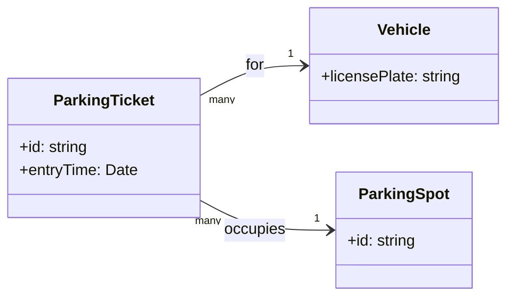
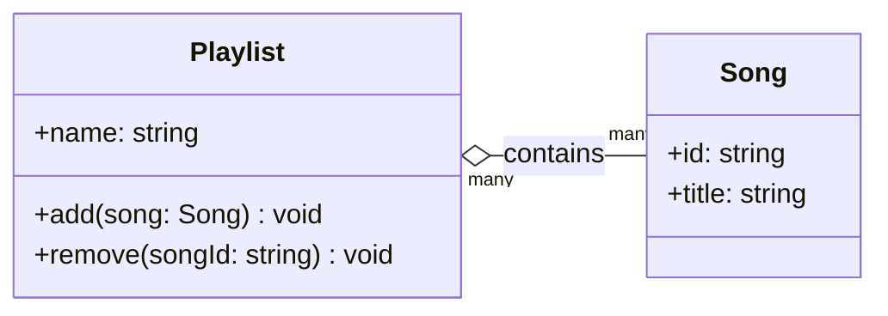
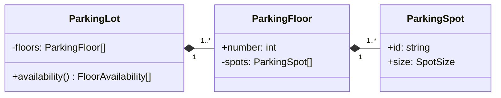
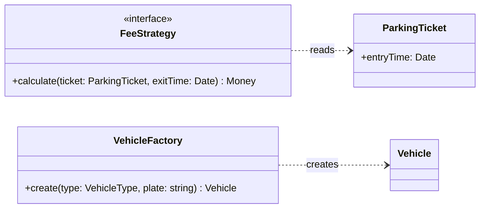
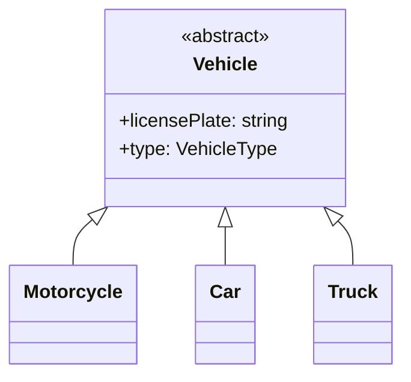
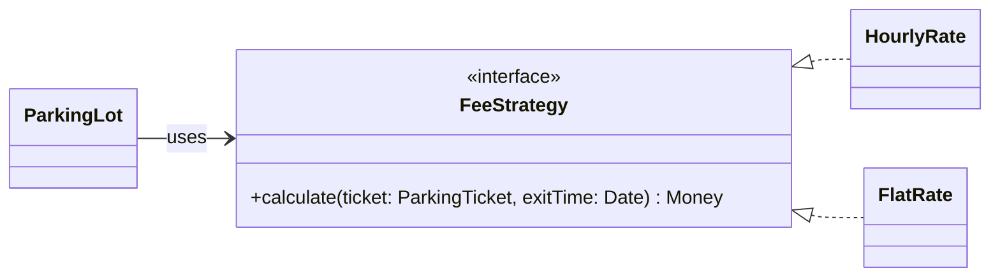
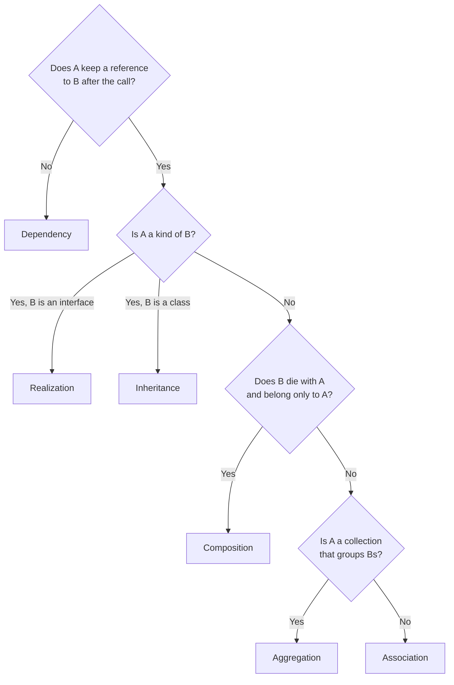

# Class relationships

A class diagram is mostly arrows, and each arrow makes a claim about ownership and lifetime. Interviewers read them that way: a composition diamond says "this part is created and destroyed with its owner", so drawing one where the code passes the part in from outside is a mismatch they will ask about. This page covers the six relationships, how each looks in Mermaid and in TypeScript, and how to choose. Diagram syntax beyond this page is in the [UML cheatsheet](uml-cheatsheet.md).

## Summary

| Relationship | Mermaid | Reads as | Lifetime | Typical TypeScript |
|---|---|---|---|---|
| Association | `A --> B` | A knows B | Independent | A field holding a reference or an id |
| Aggregation | `A o-- B` | A groups Bs it does not own | B outlives A | A collection of objects passed in |
| Composition | `A *-- B` | A is made of Bs | B dies with A | Parts created inside A, never handed out for mutation |
| Dependency | `A ..> B` | A uses B briefly | No stored link | A parameter, a return type or a local |
| Inheritance | `B <\|-- A` | A is a B | Not applicable | `class A extends B` |
| Realization | `B <\|.. A` | A fulfils contract B | Not applicable | `class A implements B` |

The arrow points from the class that knows to the class that is known. For inheritance and realization the triangle sits on the parent.

## Association

A holds a lasting reference to B, and each has its own lifetime. A parking ticket references the vehicle and the spot; closing the ticket does not destroy either.



```ts
class Vehicle { constructor(readonly licensePlate: string) {} }
class ParkingSpot { constructor(readonly id: string) {} }

/** Knows its vehicle and spot; does not create or own them. */
class ParkingTicket {
  constructor(
    readonly id: string,
    readonly vehicle: Vehicle,
    readonly spot: ParkingSpot,
    readonly entryTime: Date,
  ) {}
}
```

Across aggregate boundaries, hold the id rather than the object (`readonly customerId: string`). That keeps one aggregate from mutating another and maps directly to a foreign key. Make the association one-directional unless both sides need to navigate; two-way references must be kept in sync, which is a bug source.

## Aggregation

A has a collection of Bs, but Bs exist independently and can belong to several As. Deleting a playlist in [music streaming](../problems/music-streaming.md) does not delete its songs; a song can sit in many playlists.



```ts
class Song { constructor(readonly id: string, readonly title: string) {} }

class Playlist {
  private readonly songs: Song[] = [];

  constructor(readonly name: string) {}

  add(song: Song): void { this.songs.push(song); } // created elsewhere, passed in
  remove(songId: string): void {
    const index = this.songs.findIndex((s) => s.id === songId);
    if (index >= 0) this.songs.splice(index, 1);
  }
}
```

In code, aggregation and association look the same (a reference); the difference is intent: a collection that groups things. Many teams draw both as `-->`. Use `o--` when "removing the whole leaves the parts" is a point you want the diagram to make, as the [parking lot](../problems/parking-lot.md) does with `ParkingLot o-- ParkingTicket`: the lot issues tickets, but a ticket is a record in its own right.

## Composition

A is made of Bs: A creates them, nothing else holds them as owner, and they are destroyed with A. `ParkingLot` composes floors, and each floor composes its spots.



```ts
type SpotSize = 'SMALL' | 'MEDIUM' | 'LARGE';

class ParkingSpot { constructor(readonly id: string, readonly size: SpotSize) {} }

class ParkingFloor {
  private readonly spots: ParkingSpot[];

  /** The floor builds its own spots from a layout; no one else creates them. */
  constructor(readonly number: number, layout: readonly SpotSize[]) {
    this.spots = layout.map((size, i) => new ParkingSpot(`F${number}-${i + 1}`, size));
  }

  /** A copy, so callers cannot add or remove parts behind the owner's back. */
  listSpots(): readonly ParkingSpot[] { return [...this.spots]; }
}
```

Signals of composition in code: the owner constructs the parts (or receives a layout, not instances), the collection is private, and accessors return copies or read-only views. Other examples: `Order *-- OrderLine`, `Board *-- Cell` in [tic-tac-toe](../problems/tic-tac-toe.md), `Directory *-- Entry` in the [in-memory file system](../problems/in-memory-file-system.md). In a database, parts of a composition are deleted with the owner (`ON DELETE CASCADE`) or stored inside its row.

## Dependency

A uses B for the duration of a call and keeps no reference. A fee strategy reads a ticket passed as a parameter; a factory returns an instance it does not keep.



Draw dependencies sparingly. Every class depends on many types; show only the ones that explain the design, such as what a strategy reads or what a factory produces.

## Inheritance

A is a specialised B and inherits its state and behaviour. Use it for a real "is a" with shared state and a stable base, and keep hierarchies one level deep where possible.



If subclasses differ only in data (a spot size), use a field or an enum instead. If a subclass would disable inherited behaviour, it breaks [Liskov substitution](solid-principles.md#l-liskov-substitution). Chess pieces are the standard case where inheritance fits: each `Piece` subclass overrides how it moves ([chess](../problems/chess-game.md)).

## Realization

A class implements an interface: a contract with no shared state. This is how strategies, adapters and observers are wired.



The client holds an association to the interface, never to a concrete class. That one arrow is what makes the policy swappable.

## How to choose



| Mistake | Why it is wrong | Fix |
|---|---|---|
| Composition for something passed in from outside | The part has its own lifetime; the diamond claims otherwise | Association or aggregation, or have the owner create the part |
| Inheritance for a role (`Admin extends User`) | A user can gain and lose roles; a class cannot change | Composition: `User` holds a set of roles |
| Two-way associations everywhere | Both sides must be updated together | Navigate from the aggregate root; hold ids on the other side |
| An arrow to a concrete strategy | The core is coupled to one variant | Associate with the interface; realize it in each variant |
| Every type a method touches drawn as a dependency | The diagram turns into noise | Keep only dependencies that explain a design decision |

## Related

- [UML cheatsheet](uml-cheatsheet.md), [OOP fundamentals](oop-fundamentals.md), [SOLID principles](solid-principles.md)
