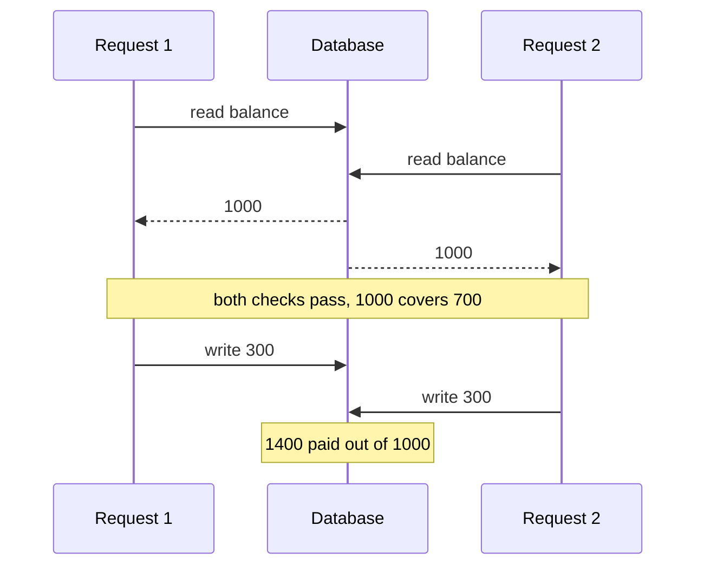
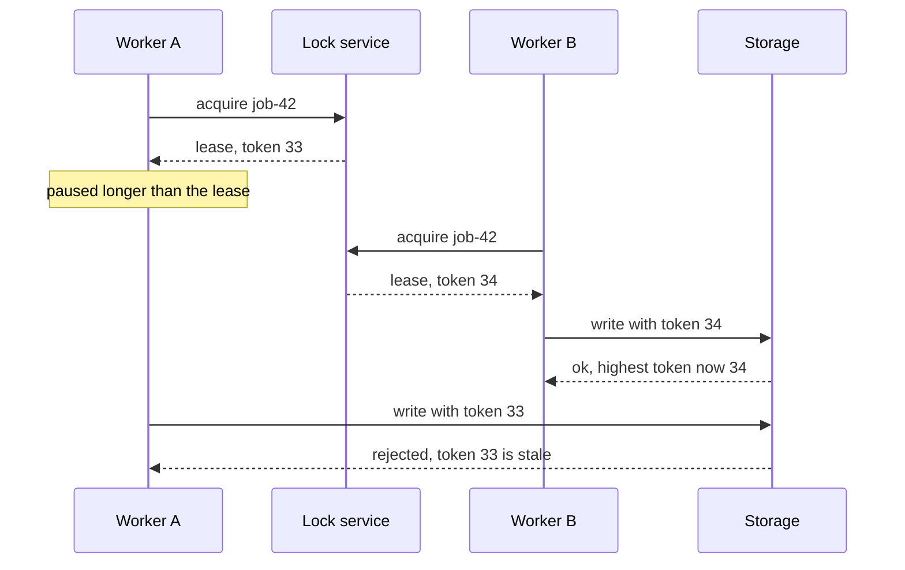

# Concurrency in LLD (for a Node.js role)

Most LLD material assumes Java threads. In a Node.js role the interviewer still asks "is this thread-safe?", and "Node is single-threaded, so yes" loses points. The useful answer names the race, says where it can happen in Node, and picks the guard that holds both in memory and in a database. The worked solutions are in [concurrency primitives](../problems/concurrency-primitives.md) and the [LRU cache](../problems/lru-cache.md).

## The Node.js model

- **One JavaScript thread per process.** The event loop takes one callback at a time and runs it to completion. Nothing else in the same process touches your objects while synchronous code runs.
- **`await` is a yield point.** At each `await` the current function pauses and other callbacks run. Code between two `await`s is atomic within the process; code that spans an `await` is not.
- **I/O runs elsewhere.** Sockets use the OS; file system, DNS and some crypto calls use libuv's thread pool. Their results come back as callbacks on the main thread.
- **Worker threads** have their own isolate and event loop. They share nothing unless you pass a `SharedArrayBuffer`, and then `Atomics` gives you compare-and-exchange and wait/notify. Use them for CPU-bound work, not for I/O.
- **Production runs many processes.** `cluster`, several containers or several servers each have their own memory. An in-memory guard protects one process only.



## Where races still happen

| Where | Example | Why a single thread does not help |
|---|---|---|
| Between `await`s | Read a balance, `await` a fraud check, then debit | Another request runs during the `await` and debits first |
| Across processes and instances | Two pods both see seat A1 free | Each process has its own memory |
| Across retries | A client times out and resends "pay" | The first attempt succeeded; the second is a new, valid-looking request |
| At-least-once delivery | A queue redelivers a message after a consumer crash | The handler runs twice for one event |
| Shared memory in workers | Two workers increment a counter in a `SharedArrayBuffer` | Real parallelism; needs `Atomics` |

The first row in code. The repository returns copies, as a database does:

```ts
import { DomainError } from '../src/shared/errors';

interface Account { id: string; balance: number; version: number }
interface AccountRepository {
  get(id: string): Promise<Account>;
  save(account: Account): Promise<void>;
}
class InsufficientFundsError extends DomainError {}

/** Broken: two concurrent withdrawals of 700 from 1000 both pass the check. */
async function withdraw(repo: AccountRepository, id: string, amount: number): Promise<void> {
  const account = await repo.get(id);
  if (account.balance < amount) throw new InsufficientFundsError(id);
  account.balance -= amount;
  await repo.save(account); // last write wins
}
```

In a single process with in-memory entities, the fix is to keep the check and the write in one synchronous method on the entity, as `ParkingSpot.park()` does in the [parking lot](../problems/parking-lot.md). Across processes the guard moves to the database.

## The guards that matter

| Guard | Protects | In memory | In a database or service |
|---|---|---|---|
| Compare-and-set on the entity | One field changes only from an expected value | `spot.park()` throws if occupied, with no `await` inside | `UPDATE spots SET vehicle_id = ? WHERE id = ? AND vehicle_id IS NULL`, check the row count |
| Optimistic versioning | A whole aggregate against lost updates | Compare a `version` field before replacing | `UPDATE ... SET version = version + 1 WHERE id = ? AND version = ?` |
| Idempotency key | Retries and redeliveries | `Map<key, Promise<result>>` | Table with a unique key and the stored response |
| Unique constraint | "At most one" rules | A `Set` or `Map` keyed by the rule | `UNIQUE (show_id, seat_id)`; partial index for one active ticket per plate |
| Row lock | Read-modify-write on hot rows | Not needed in one process | `SELECT ... FOR UPDATE` inside a transaction |
| Lease with fencing token | Exclusive work across processes | Not needed in one process | Lock with a TTL that returns an increasing token; storage rejects old tokens |

**Optimistic versioning** with a retry loop. Conflicts are expected and cheap, so retry a small number of times:

```ts
import { DomainError } from '../src/shared/errors';

interface Account { id: string; balance: number; version: number }
class InsufficientFundsError extends DomainError {}
class ConcurrentUpdateError extends DomainError {}

interface VersionedAccounts {
  get(id: string): Promise<Account>;
  /** Throws ConcurrentUpdateError if the stored version is no longer expectedVersion. */
  replace(account: Account, expectedVersion: number): Promise<void>;
}

export async function withdraw(repo: VersionedAccounts, id: string, amount: number, attempts = 3): Promise<void> {
  for (let attempt = 1; ; attempt += 1) {
    const account = await repo.get(id);
    if (account.balance < amount) throw new InsufficientFundsError(id);
    const next = { ...account, balance: account.balance - amount, version: account.version + 1 };
    try {
      await repo.replace(next, account.version);
      return;
    } catch (error) {
      if (!(error instanceof ConcurrentUpdateError) || attempt === attempts) throw error;
    }
  }
}
```

**Idempotency keys.** The client sends a key per logical operation; a repeat returns the first result, even while the first attempt is still in flight. Store a hash of the request with the key and reject a reused key with a different payload.

```ts
export class IdempotentPayments {
  private readonly results = new Map<string, Promise<string>>();

  constructor(private readonly charge: (orderId: string, amount: number) => Promise<string>) {}

  pay(idempotencyKey: string, orderId: string, amount: number): Promise<string> {
    const previous = this.results.get(idempotencyKey);
    if (previous) return previous;
    const result = this.charge(orderId, amount);
    this.results.set(idempotencyKey, result);
    return result;
  }
}
```

**Row locks.** Lock rows in a fixed order (lower account id first) so two opposite transfers cannot deadlock. For job queues, `SELECT ... FOR UPDATE SKIP LOCKED` lets several workers take different rows.

**Leases with fencing tokens.** A lease expires, so a holder that pauses (GC, a slow disk) can wake up after another worker took over and still write. The token makes the storage, not the lock, the final judge:



## Java vocabulary in Node

| Java | What it does | Node equivalent |
|---|---|---|
| `synchronized` method | One thread at a time in a critical section | Nothing, if the section has no `await`. If it awaits: a per-key promise chain (below). Across processes: a row lock or version check |
| `ReentrantLock`, `tryLock(timeout)` | Explicit lock with timeout | An async mutex; timeout with `Promise.race` or `AbortSignal.timeout`. Not reentrant: do not re-acquire inside the task |
| `ConcurrentHashMap.computeIfAbsent` | Atomic get-or-create | A plain `Map`; for async values store the `Promise` so concurrent callers share one load |
| `AtomicInteger`, `volatile` | Visibility and atomic updates across threads | Not needed on one thread; `Atomics.add` on a `SharedArrayBuffer` between workers |
| `BlockingQueue` | `take()` waits for an item, `put()` waits for space | An async queue whose `take()` and `put()` return promises (below); a broker across processes |
| `ExecutorService` | Thread pool running tasks | For I/O: a concurrency limiter over promises. For CPU work: a pool of `worker_threads` |
| `CompletableFuture` | Composable async result | `Promise`: `then`, `Promise.all` for `allOf`, `Promise.any` or `Promise.race` for `anyOf` |
| `CountDownLatch` | Wait for N events | `Promise.all` over N promises |
| `Semaphore` | At most N concurrent holders | A counter plus a queue of waiting resolvers |
| `ThreadLocal` | Per-request context | `AsyncLocalStorage` |

A per-key promise chain serialises async work on one key and leaves other keys concurrent. Use it when a critical section must span an `await` inside one process; it does nothing across instances.

```ts
export class KeyedLock {
  private readonly tails = new Map<string, Promise<void>>();

  async run<T>(key: string, task: () => Promise<T>): Promise<T> {
    const previous = this.tails.get(key) ?? Promise.resolve();
    let release!: () => void;
    const current = new Promise<void>((resolve) => { release = resolve; });
    const tail = previous.then(() => current);
    this.tails.set(key, tail);
    await previous;
    try {
      return await task();
    } finally {
      release();
      if (this.tails.get(key) === tail) this.tails.delete(key);
    }
  }
}
```

## Talking through the classic questions

**Thread-safe cache.** In one process a `Map` plus a doubly linked list is already safe, because `get` and `put` are synchronous. The real concurrency problem is the cache miss: a hundred requests miss together and all hit the database. Cache the in-flight promise (single flight) and drop it on failure. For Java parity, mention one lock per operation or lock striping, and that a read in an LRU is also a write (it moves the node). Details in the [LRU cache](../problems/lru-cache.md).

```ts
export class SingleFlightCache<V> {
  private readonly entries = new Map<string, Promise<V>>();

  constructor(private readonly load: (key: string) => Promise<V>) {}

  get(key: string): Promise<V> {
    const existing = this.entries.get(key);
    if (existing) return existing;
    const pending = this.load(key).catch((error: unknown) => {
      this.entries.delete(key); // do not cache failures
      throw error;
    });
    this.entries.set(key, pending);
    return pending;
  }
}
```

**Blocking queue.** Replace "block the thread" with "return a promise that resolves later". Waiting takers and putters are queues of resolvers. Say what Java needs and Node does not: a lock and two conditions, and a `while` loop for spurious wakeups. Keep the `while` anyway, because another caller can take the freed slot before the woken putter runs.

```ts
export class BoundedQueue<T> {
  private readonly items: T[] = [];
  private readonly takers: Array<(item: T) => void> = [];
  private readonly putters: Array<() => void> = [];

  constructor(private readonly capacity: number) {}

  async put(item: T): Promise<void> {
    while (this.items.length >= this.capacity) {
      await new Promise<void>((resolve) => this.putters.push(resolve));
    }
    const taker = this.takers.shift();
    if (taker) taker(item); // hand over directly; the item never occupies a slot
    else this.items.push(item);
  }

  take(): Promise<T> {
    if (this.items.length > 0) {
      const item = this.items.shift() as T;
      this.putters.shift()?.(); // a slot opened: wake one waiting producer
      return Promise.resolve(item);
    }
    return new Promise<T>((resolve) => this.takers.push(resolve));
  }
}
```

**Rate limiter.** A token bucket per key, refilled lazily from an injected `Clock` on each call, is atomic in one process because the refill-check-decrement has no `await`. Across instances the same three steps must run atomically in the shared store: one script in Redis, or `UPDATE buckets SET tokens = tokens - 1 WHERE key = ? AND tokens > 0`. State the trade-off: a local limiter per instance is fast but allows N times the limit. See the [rate limiter](../problems/rate-limiter.md).

**Producer-consumer.** Producers `await queue.put()` (backpressure: they slow down when the queue is full), N consumers each run `while (running) handle(await queue.take())`, and N is the concurrency limit. Cover three things: clean shutdown (stop producers, drain, then stop consumers), failure (retry with a limit, then a dead-letter list), and duplicates (consumers are idempotent because delivery is at least once). Across processes the queue becomes a broker; the [pub-sub system](../problems/pub-sub-system.md) covers offsets and acknowledgements.

## What to say in the interview

1. Name the invariant: "no seat is sold twice", "the balance never goes negative".
2. Name where it can race: "between the availability check and the write, if there is an `await`; and across instances".
3. Give the in-process guard: "the check and the write are one synchronous method on the entity".
4. Give the persistent guard: a conditional update, a version column, a unique constraint or a row lock.
5. Cover retries: "the command takes an idempotency key".

## Related

- [Concurrency primitives](../problems/concurrency-primitives.md), [LRU cache](../problems/lru-cache.md), [rate limiter](../problems/rate-limiter.md)
- [How to answer an LLD interview](how-to-answer-lld-interview.md), [question bank](question-bank.md#concurrency)
