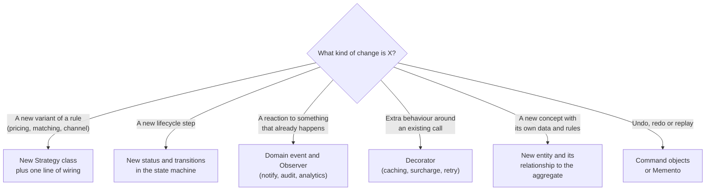

# How to answer an LLD interview

A low-level design round asks you to turn a vague prompt ("design a parking lot") into classes, relationships and working core code in 45 to 60 minutes. This page is the plan: what to do in each block of time, what is being graded, and how to handle follow-ups. The running example is the [parking lot](../problems/parking-lot.md), whose solution is in [`src/parking-lot/`](../src/parking-lot/).

## What interviewers grade

| Dimension | What they look for | How you show it |
|---|---|---|
| Abstraction | The right entities, each with one job; behaviour next to the data it changes | `ParkingSpot.park()` guards occupancy; `ParkingLot` only orchestrates |
| Extensibility | A new variant is a new class, not an edit to a `switch` | Pricing and spot choice sit behind `FeeStrategy` and `SpotAssignmentStrategy` |
| Correctness | Invariants enforced in one place, validated state transitions, explicit errors, edge cases | `SpotOccupiedError`, `TicketAlreadyClosedError`; money in integer minor units |
| Communication | You drive, state assumptions, check in at milestones, explain trade-offs | "I'll assume hourly pricing with a one-hour minimum. Tell me if you want something else." |

At senior level a fifth dimension is graded without being named: judgement. What you chose not to build, and why, counts as much as what you built. Over-engineering loses points just as a missing requirement does.

## The plan, minute by minute

| # | Phase | 45 min | 60 min | On the board when you finish |
|---|---|---|---|---|
| 1 | Clarify | 0-3 | 0-5 | Answers to 4-6 questions; assumptions written down |
| 2 | Requirements | 3-6 | 5-9 | Numbered functional list; 2-3 non-functional |
| 3 | Entities | 6-9 | 9-13 | Nouns with a one-line responsibility each; the aggregate root named |
| 4 | Relationships | 9-11 | 13-16 | Who owns whom, multiplicities |
| 5 | Class diagram | 11-17 | 16-24 | Classes, interfaces, enums, key methods |
| 6 | Key flows | 17-21 | 24-30 | One or two sequences, including a failure path |
| 7 | Patterns | 21-23 | 30-33 | Each pattern tied to a requirement |
| 8 | Code the core | 23-38 | 33-50 | Aggregate root commands, state transitions, one strategy, error classes |
| 9 | Extensions | 38-45 | 50-60 | Concurrency, persistence, 2-3 "what if" answers |

The times are a budget, not a script. If the interviewer says "skip the diagram, just code", compress phases 2 to 7 into a two-minute spoken outline and keep the entity list as a comment at the top of the file.

### 1. Clarify

Ask the questions from [the list below](#questions-to-always-ask) that matter for this prompt, then state your assumptions and write them down. Assumptions are a contract: they let you cut scope without looking as if you missed something.

### 2. Requirements

Write functional requirements as numbered actions from the actors' point of view ("a driver parks", "the lot charges on exit"). Add the two or three non-functional requirements that change the design: no double booking, deterministic tests, fast spot lookup. Leave availability percentages and latency targets to system design rounds.

### 3. Entities

Underline the nouns in the requirements, then drop the ones that are only attributes (a vehicle's plate number is a field, not a class). For each survivor write one line: what it knows and what it does. Name the aggregate root: the object every command enters through and the only place that orchestrates several entities.

### 4. Relationships

Decide ownership before drawing. Does the floor own its spots (composition) or only refer to them? Who holds a reference to whom, and in which direction? See [class relationships](class-relationships.md).

### 5. Class diagram

Draw classes with their key methods, not every getter. Mark interfaces and enums. Put each policy that varies behind an interface now; it is cheaper than retrofitting one during the coding phase. Syntax: [UML cheatsheet](uml-cheatsheet.md).

### 6. Key flows

Walk the main command through the objects as a sequence: who calls whom, where validation happens, where state changes. Always include one failure branch (no spot, seat already held, payment declined). This is where the interviewer finds out whether the diagram works.

### 7. Patterns

Name the patterns you already used and the requirement each one serves. "Strategy for pricing, because pricing changes for business reasons" is a good sentence. "I used Strategy, Observer and Factory" is not. Mention one alternative you rejected. The [design-patterns repository](https://github.com/hardyalsinghdeora/design-patterns) covers each pattern in depth.

### 8. Code the core

Code the part that holds the invariant: the aggregate root's two or three commands, the state transitions of the main entity, one strategy implementation and the domain errors. Stub persistence with a `Map`. Skip getters, UI, input parsing and logging. Write signatures first, then bodies, and narrate as you go.

### 9. Extensions

Close with concurrency (which operation races and what guards it), a persistence sketch (tables plus the one index or constraint that matters) and two or three follow-ups, each answered with the class that would change. Interviewers often bring their own follow-ups here, so leave room.

## Questions to always ask

Pick the ones that apply; four to six is enough. Each answer changes the design in a specific way.

| Question | What the answer changes |
|---|---|
| Who are the actors, and what are their top two or three actions? | The public methods of the aggregate root |
| What is out of scope for this round (admin screens, reporting, real payments)? | How much you draw and code |
| One instance or many: one lot or a chain, one process or several? | Singleton or plain class; where the concurrency guards live |
| What can happen at the same time to the same thing? | Which invariant needs a compare-and-set, a version check or a lock |
| Which rules change by business decision (pricing, matching, assignment)? | Where the Strategy interfaces go |
| What states does the main entity go through, and who moves it between them? | The status enum and the transition table |
| Is money involved: currencies, refunds, rounding? | Integer minor units, ledger entries, a refund flow |
| Is time involved: expiry, schedules, time zones? | An injected `Clock`, hold timeouts, background expiry |
| What happens on failure: payment declined, device fault, user walks away? | Failure states and compensating actions |
| Is in-memory storage fine, or should I show persistence? | Repository interfaces versus plain maps |

## How much to code and how much to draw

| Format | Draw | Code |
|---|---|---|
| 45-60 minute LLD round | Class diagram, one or two sequence diagrams | Aggregate root commands, state machine, one strategy, error classes: roughly 80-150 lines |
| Machine coding round (90-120 minutes) | A five-minute sketch of entities and relationships | Everything runnable: in-memory repositories, every functional requirement, a driver or tests |
| Object design inside a system design round | Class diagram and interfaces | Signatures only |

Rules of thumb:

- Code the invariant, not the boilerplate. `ParkingSpot.park()` throwing when the spot is taken is worth more than ten getters.
- Name methods after domain actions (`park`, `hold`, `capture`, `refund`), not `process` or `handle`.
- Use real types. `any` on a whiteboard reads as "I have not decided".
- Inject dependencies (`Clock`, `IdGenerator`, strategies) so the code you write is the code you would test. The repository's versions are in [`src/shared/`](../src/shared/).

## Common failure modes

| Failure | What it looks like | Fix |
|---|---|---|
| Over-engineering | Interfaces with one implementation and no stated reason to vary; five patterns in a parking lot; a plugin system nobody asked for | Tie every abstraction to a requirement or a likely follow-up. Say "I'd extract an interface when a second variant appears." |
| Singleton everywhere | `ParkingLot.getInstance()`, `Database.getInstance()`, `Config.getInstance()` | Create one instance at the composition root and pass it in: the same "only one", without a hidden global, and tests build their own |
| God class | A `ParkingLotManager` with thirty methods while `Spot` and `Ticket` are bags of fields | Move each rule to the object that owns the data (`spot.park()`, `ticket.close()`); keep only orchestration in the root |
| No error handling | `return null`, `return false`, `console.log("error")`, `throw "invalid"` | Named domain errors extending [`DomainError`](../src/shared/errors.ts); a command either succeeds or throws |
| No state machine | `isPaid`, `isShipped` and `isCancelled` booleans that can all be true at once | One status enum, an allowed-transitions table and a guard that throws on an invalid move |
| Switching on type | `if (vehicle.type === 'CAR')` repeated in pricing, assignment and display | A lookup table (`Record<VehicleType, ...>`), polymorphism or a strategy |
| Floats and wall clocks | `price * 1.18`; `new Date()` inside fee logic | Integer minor units ([`Money`](../src/shared/money.ts)); an injected [`Clock`](../src/shared/clock.ts) |
| Hand-waving concurrency | "Node is single-threaded, so it is safe." | Name the race and its guard: compare-and-set, version column, unique constraint ([concurrency in LLD](concurrency-in-lld.md)) |
| Coding before agreeing on scope | Ten minutes in: "actually, we only need one floor" | Clarify and write assumptions first; check in after the diagram |

## Checklist before you say "done"

Run through it aloud in the last five minutes; each item takes seconds.

- [ ] Every numbered requirement maps to a method on some class.
- [ ] The main entity has a status enum, and invalid transitions throw.
- [ ] Every command either succeeds or throws a named domain error; nothing returns `null` to signal failure.
- [ ] The core invariant (no double booking, no negative balance, one active ticket per vehicle) is enforced in exactly one place.
- [ ] Policies that vary sit behind interfaces, and the core never switches on a type.
- [ ] Money is integer minor units; time and ids are injected.
- [ ] Getters do not hand out mutable internal collections.
- [ ] You can name the race in this design and its guard, both in memory and in a database.
- [ ] You traced one happy path and one failure path through the code, not only the diagram.
- [ ] You named two extensions and the class each one would touch.

## Handling "what if we add X"

Follow-ups test whether the design bends or breaks. Answer in this order:

1. Restate X, and ask one question if it is ambiguous ("reservations for a future time slot, or holding a spot for ten minutes?").
2. Classify the change with the flowchart below.
3. Say which classes change and, just as important, which do not.
4. If the core has to change, say so and refactor aloud (extract an interface, split a class). Pretending the design already handles everything is worse than a small refactor.
5. Mention the data and concurrency impact: a new column, a new unique constraint, a new race.

| Follow-up | Where it lands | What a good answer says |
|---|---|---|
| "Add electric vehicles that need charging spots." | Enum value, spot attribute, assignment strategy | `VehicleType.EV`, a `hasCharger` attribute on spots, a strategy that prefers charger spots; `ParkingLot` unchanged |
| "Add a new payment method." | A new implementation of the payment interface | An [Adapter](https://github.com/hardyalsinghdeora/design-patterns/tree/main/src/structural/adapter) around the provider SDK; checkout unchanged |
| "Run this on three servers." | Guards move to the database | `UPDATE spots SET vehicle_id = ? WHERE id = ? AND vehicle_id IS NULL` with a row-count check; a unique index on active tickets per plate |
| "Notify the user when X happens." | A domain event and a subscriber | Publish after the state change commits; retries and idempotency live in the notifier, not in the aggregate |
| "Weekend and holiday pricing." | A decorator or composite strategy | Base strategy plus a surcharge [decorator](https://github.com/hardyalsinghdeora/design-patterns/tree/main/src/structural/decorator); choosing between them is itself a strategy |
| "Keep the history of every change." | An append-only log | A status-history list on the entity or an event log; past entries are never edited |

## Phrases that signal seniority

Each shows a habit interviewers look for. Use them when they are true.

| Phrase | What it shows |
|---|---|
| "Let me state my assumptions so you can redirect me early." | You manage scope and the interviewer's time |
| "The invariant that matters is no double booking. It lives in `ParkingSpot.park()`, and nothing else writes occupancy." | You design around invariants, not nouns |
| "Pricing varies by business rule, so it goes behind an interface. Floors have one implementation, so they stay concrete." | Abstraction where change is expected, and only there |
| "I'll create one `ParkingLot` at the composition root instead of a Singleton, so tests can build their own." | You know the pattern and its cost |
| "Time and ids are injected, so fee calculation is deterministic in tests." | Testability is part of the design |
| "In one process the check and the write are atomic because there is no `await` between them. With several instances it becomes `UPDATE ... WHERE version = ?`." | You understand both the runtime and the database |
| "Clients retry this call, so it takes an idempotency key." | You design for failure, not only the happy path |
| "I'm deliberately not modelling payments; it doesn't change the core. Happy to add it." | Judgement about scope |
| "The trade-off is A against B. I'm picking A because of requirement 3." | Decisions tied to requirements |
| "Let me trace the failure path through the code." | You verify your own work |

Phrases that cost points: "I'll make everything an interface for flexibility", "Let's add a Manager class", "We can use Kafka and microservices" (wrong level for this round), and "Node is single-threaded, so there are no race conditions".

## Related

- [OOP fundamentals](oop-fundamentals.md), [SOLID principles](solid-principles.md), [class relationships](class-relationships.md)
- [UML cheatsheet](uml-cheatsheet.md), [concurrency in LLD](concurrency-in-lld.md)
- [Question bank](question-bank.md): 70+ prompts with the trap in each
