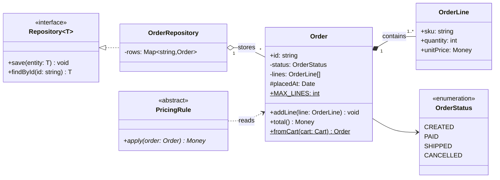
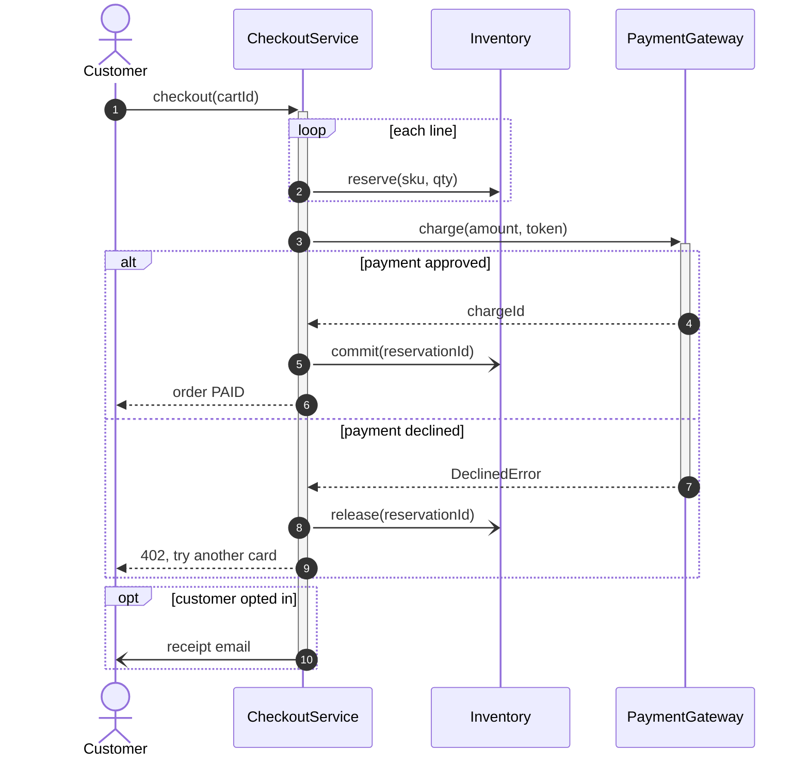
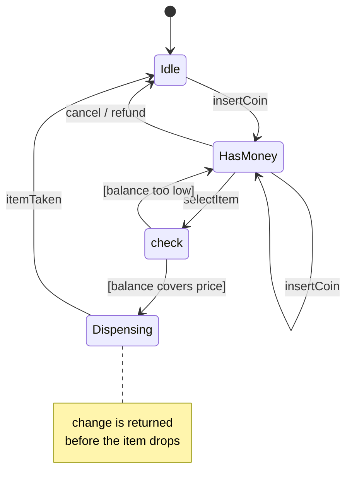
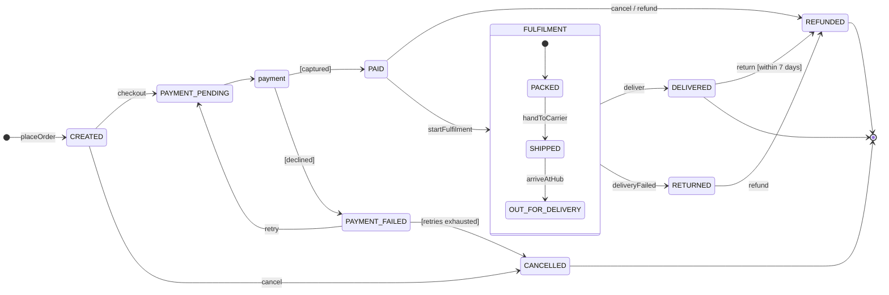
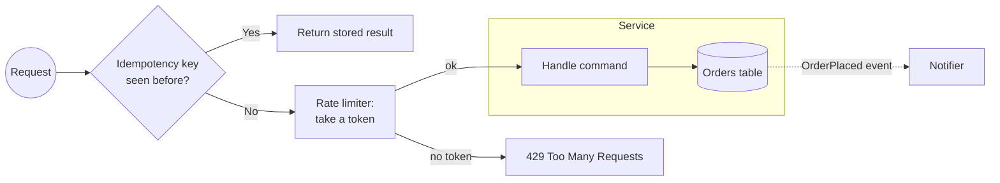

# UML cheatsheet (Mermaid)

The four diagram types an LLD answer uses, in the Mermaid syntax GitHub renders. Every block on this page renders as written; copy one and edit it. What each relationship means is in [class relationships](class-relationships.md).

## Class diagrams

| Syntax | Meaning |
|---|---|
| `+` `-` `#` `~` before a member | public, private, protected, package or internal |
| `$` after a member | static |
| `*` after a method | abstract |
| `method(arg: Type) ReturnType` | return type after the parentheses |
| `Repository~T~`, `Map~string,Order~` | generics, written with `~` and no spaces |
| `<<interface>>`, `<<abstract>>`, `<<enumeration>>` | annotations inside the class body |
| `direction LR` | lay out left to right |



Relationship arrows and cardinality:

| Arrow | Relationship | Cardinality example |
|---|---|---|
| `A --> B` | association | `A "1" --> "*" B` |
| `A o-- B` | aggregation | `Team "1" o-- "1..*" Player` |
| `A *-- B` | composition | `Order "1" *-- "1..*" OrderLine` |
| `A ..> B` | dependency | rarely has cardinality |
| `B <\|-- A` | inheritance | none |
| `B <\|.. A` | realization | none |

Add `: label` after any relationship to name it. Cardinality strings are free text: `1`, `0..1`, `1..*`, `*`, `many`.

## Sequence diagrams

| Syntax | Meaning |
|---|---|
| `actor U` / `participant S as Service` | a person / a system with an alias |
| `A->>B: call` | synchronous call |
| `B-->>A: result` | reply |
| `A-)B: event` | asynchronous message |
| `A->>+B` and `B-->>-A` | activate and deactivate B |
| `alt` / `else` / `end` | branches |
| `opt` / `end` | optional step |
| `loop` / `end` | repetition |
| `par` / `and` / `end` | parallel branches |
| `Note over A,B: text` | annotation |
| `autonumber` | number each message |



Every `+` activation needs a matching `-` or `deactivate`, or the diagram fails to render.

## State diagrams

| Syntax | Meaning |
|---|---|
| `stateDiagram-v2` | use v2; v1 renders differently |
| `[*] --> A` / `A --> [*]` | start / end |
| `A --> B: event` | transition with a trigger |
| `A --> B: event [guard]` | guard written in the label |
| `state "Long name" as L` | a display name with spaces |
| `state L { ... }` | composite state |
| `state c <<choice>>` | a branch on a condition |
| `note right of A` ... `end note` | annotation |



## Worked example: order lifecycle

A state diagram is the clearest way to agree a lifecycle with the interviewer before coding it. This one has a choice on the payment result and a composite fulfilment state.



The diagram maps one-to-one onto a transition table, which is what you then code:

```ts
export enum OrderStatus {
  CREATED = 'CREATED',
  PAYMENT_PENDING = 'PAYMENT_PENDING',
  PAYMENT_FAILED = 'PAYMENT_FAILED',
  PAID = 'PAID',
  PACKED = 'PACKED',
  SHIPPED = 'SHIPPED',
  OUT_FOR_DELIVERY = 'OUT_FOR_DELIVERY',
  DELIVERED = 'DELIVERED',
  RETURNED = 'RETURNED',
  CANCELLED = 'CANCELLED',
  REFUNDED = 'REFUNDED',
}

const FULFILMENT_EXITS = [OrderStatus.DELIVERED, OrderStatus.RETURNED];

export const ALLOWED: Record<OrderStatus, readonly OrderStatus[]> = {
  [OrderStatus.CREATED]: [OrderStatus.PAYMENT_PENDING, OrderStatus.CANCELLED],
  [OrderStatus.PAYMENT_PENDING]: [OrderStatus.PAID, OrderStatus.PAYMENT_FAILED],
  [OrderStatus.PAYMENT_FAILED]: [OrderStatus.PAYMENT_PENDING, OrderStatus.CANCELLED],
  [OrderStatus.PAID]: [OrderStatus.PACKED, OrderStatus.REFUNDED],
  [OrderStatus.PACKED]: [OrderStatus.SHIPPED, ...FULFILMENT_EXITS],
  [OrderStatus.SHIPPED]: [OrderStatus.OUT_FOR_DELIVERY, ...FULFILMENT_EXITS],
  [OrderStatus.OUT_FOR_DELIVERY]: FULFILMENT_EXITS,
  [OrderStatus.DELIVERED]: [OrderStatus.REFUNDED],
  [OrderStatus.RETURNED]: [OrderStatus.REFUNDED],
  [OrderStatus.CANCELLED]: [],
  [OrderStatus.REFUNDED]: [],
};
```

A transition out of the composite `FULFILMENT` state applies to each of its inner states, which is why `PACKED`, `SHIPPED` and `OUT_FOR_DELIVERY` all list the two exits.

## Flowcharts

| Syntax | Shape or edge |
|---|---|
| `A[text]` | process |
| `A(text)` | rounded |
| `A{text}` | decision |
| `A[(text)]` | database |
| `A((text))` | circle, for start and end |
| `A --> B`, `A -->\|label\| B` | edge, labelled edge |
| `A -.-> B`, `A ==> B` | dotted, thick |
| `subgraph Title` ... `end` | group |



## Rendering on GitHub

- Quote any label with punctuation, parentheses, commas or colons: `A["charge(amount)"]`, `-->|"no, retry"|`.
- Use `<br/>` for line breaks inside quoted labels; Markdown line breaks do not work.
- Write generics with `~` and no spaces: `Map~string,Order~`, not `Map<string, Order>`.
- Do not name a flowchart node `end` in lowercase; it closes a subgraph. `End` or `done` works.
- In state diagrams, keep state ids to letters, digits and underscores, and use `state "Display name" as ID` for anything else.
- Avoid `;` and `#` in sequence message text; both have special meaning there.
- Match every activation `+` with a `-`, and every `alt`, `opt`, `loop` and `par` with an `end`.
- GitHub's Mermaid version trails the latest release. Skip newer syntax (the `@{ shape: ... }` node syntax, `architecture-beta`) and check unfamiliar syntax in the Mermaid live editor first.
- Keep one idea per diagram and stay under about 25 nodes; split a large class diagram by aggregate.
- Use `%%` for comments that should not render.

## Related

- [Class relationships](class-relationships.md), [how to answer an LLD interview](how-to-answer-lld-interview.md)
