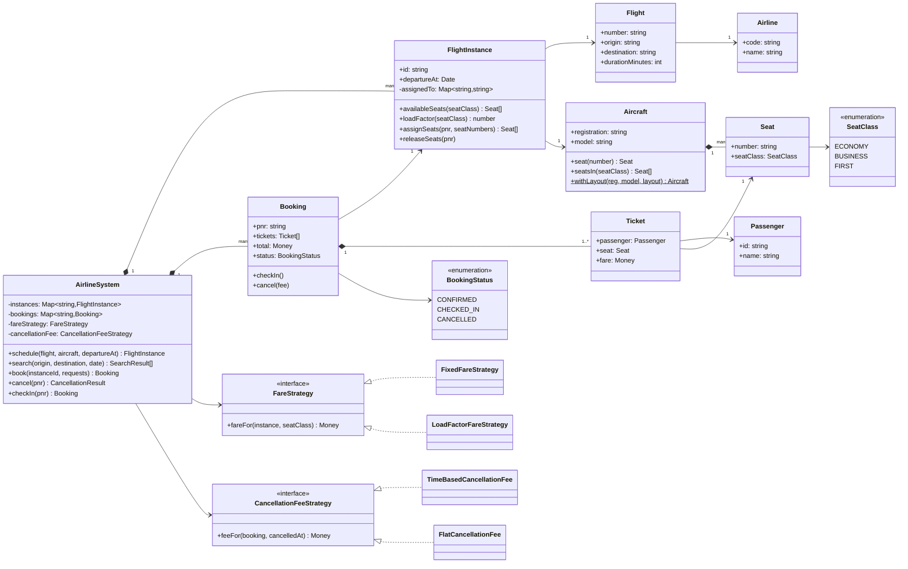
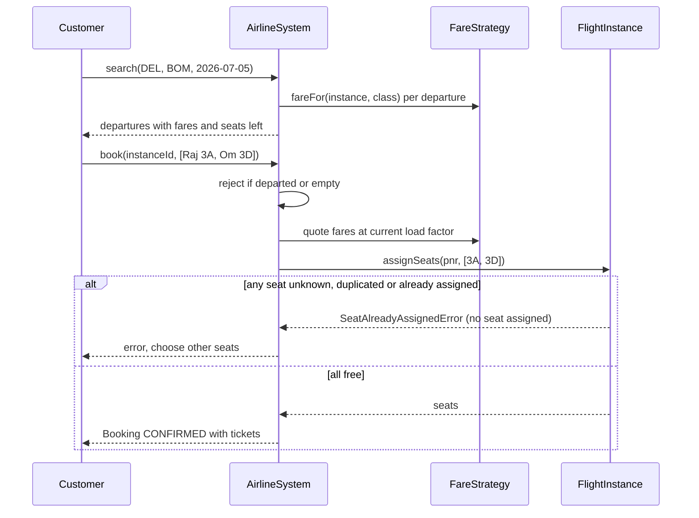
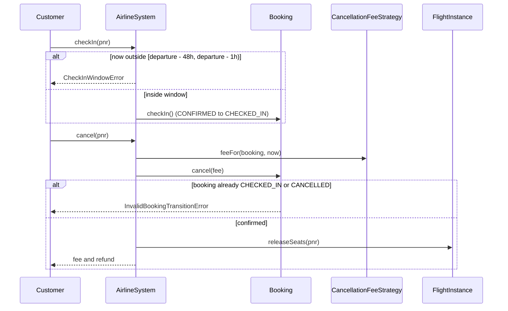

# Design an Airline Management System

| | |
|---|---|
| **Difficulty** | Hard |
| **Solution** | [`src/airline-management-system/`](../src/airline-management-system/) |
| **Run** | `npm run demo -- airline-management-system` · `npx vitest run src/airline-management-system` |
| **Patterns** | Strategy (fares, cancellation fees), State machine, Static factory, Template vs instance |

## 1. Problem statement

Design the reservation core of an airline. Customers search flights by origin, destination and date, book one or more passengers with specific seats, pay a fare that rises as the cabin fills, cancel for a fee that depends on how late they cancel, and check in online inside a time window before departure.

## 2. Clarifying questions to ask first

- Is a "flight" the route (AI-101 every day) or a single departure? (Both: separate them.)
- Which cabin classes exist, and is seat selection mandatory at booking?
- Can one booking (PNR) hold several passengers, and must they all get seats or none?
- How are fares computed: fixed per class, fare buckets, or dynamic by demand?
- What does cancellation cost, and when is it no longer possible?
- When does check-in open and close? Does check-in lock the booking?
- Out of scope? Multi-leg itineraries, crew scheduling, baggage, overbooking, loyalty.

Assumptions used in the solution: a `Flight` is the route and a `FlightInstance` is a dated departure on an aircraft; ECONOMY, BUSINESS and FIRST cabins; every passenger chooses a seat and a booking assigns all seats or none; fares are base per class plus a surge proportional to that cabin's load factor, quoted once per booking; cancellation fee is 10% at 72h or more, 50% at 24h or more, otherwise the full fare; check-in opens 48h and closes 1h before departure, and a checked-in booking can no longer be cancelled; single-leg only.

## 3. Requirements

### Functional
1. Model airlines, aircraft with a seat map by class, flights (routes) and flight instances (departures).
2. Search departures by origin, destination and date, earliest first, with the current fare and seats left per class.
3. Book several passengers on one instance, each with a chosen seat; all seats are assigned or none.
4. A seat is never assigned twice on one flight instance.
5. Fares come from a swappable `FareStrategy`; the default adds a load-factor-based surge to a base fare per class.
6. A booking moves `CONFIRMED -> CHECKED_IN` or `CONFIRMED -> CANCELLED`; other moves are rejected.
7. Cancellation applies a swappable fee strategy, refunds the rest and frees the seats.
8. Check-in is allowed only inside the window measured with the Clock.
9. Bookings and cancellations are refused once the flight has departed.

### Non-functional
- Seat assignment must be safe under concurrent bookings (no double assignment).
- Search should be fast for a large schedule (index by route and date in production).
- Money is integer minor units; the surge is computed with integer arithmetic.
- Deterministic tests via `FakeClock` and `SequentialIdGenerator`.

## 4. Core entities

| Entity | Responsibility |
|---|---|
| `Airline` | The carrier that owns flights and aircraft. |
| `Aircraft`, `Seat` (`SeatClass`) | Static cabin layout; `withLayout` factory builds rows. |
| `Flight` | Route template: number, origin, destination, duration. |
| `FlightInstance` | A dated departure on an aircraft; owns seat assignments and load factor. |
| `Passenger`, `Ticket` | A traveller and their seat and fare. |
| `Booking` (`BookingStatus`) | PNR with tickets; total; validated state machine; fee kept on cancel. |
| `FareStrategy` → `FixedFareStrategy`, `LoadFactorFareStrategy` | Price of a seat in a class right now. |
| `CancellationFeeStrategy` → `TimeBasedCancellationFee`, `FlatCancellationFee` | What the airline keeps on cancellation. |
| `AirlineSystem` | Facade: schedule, search, book, cancel, check in. |

## 5. Class diagram

## 6. Key flows

## 7. Design patterns used

- **Template vs instance** (`Flight` vs `FlightInstance`). The route is defined once; each departure owns its own seat inventory and load factor. Mixing the two is the most common modelling mistake in this problem.
- **Strategy** for fares and cancellation fees. Revenue management changes pricing constantly (fare buckets, load-factor surges, promotions) and the booking flow must not change with it. Alternative: fare classes as data (bucket tables with seat quotas), which is what real airlines do and still fits behind `FareStrategy`.
- **State machine** on `Booking` with an allowed-transitions table; check-in ends the cancellable phase.
- **Static factory** `Aircraft.withLayout` builds a seat map from a compact description, keeping test and demo setup short.
- **Facade** `AirlineSystem` keeps callers away from the seat map and the strategies. Alternative: split into `SearchService`, `BookingService` and `CheckInService` once each grows its own storage and scaling needs.

## 8. Trade-offs, extensions and follow-up questions

**"Two customers pick seat 3A on the same flight at once."** In-process, `FlightInstance.assignSeats` validates every seat and then writes all of them with no `await` between, so it is atomic. In a database: one row per (instance, seat) and `UPDATE instance_seats SET pnr = ? WHERE instance_id = ? AND seat_no IN (...) AND pnr IS NULL`, require the row count to equal the number of seats, otherwise roll back. Equivalently, insert into `seat_assignments` with a unique constraint on `(instance_id, seat_no)`.

**"Payment fails or the user retries."** Hold seats with a short TTL before payment (as in the movie booking problem), and make `book` idempotent with a client-provided idempotency key stored with the PNR.

**"Load factor changes while a group books."** We quote fares once per booking at the pre-booking load factor, so a family pays one price. Under concurrency, store the quoted fare with a quote id and expiry, and re-quote if the cabin moved by more than a threshold.

**"Search across 50,000 departures a day."** Index instances by `(origin, destination, departure_date)`; cache fares and seats left per class with a short TTL; precompute connections for multi-leg search.

**"Overbooking, waitlists, multi-leg itineraries, seat changes."** Overbooking allows `capacity + k` per class and assigns seats at check-in; multi-leg makes a booking hold several segments that must all succeed (a saga); a seat change is release-and-assign in one transaction.

**Persistence sketch.** `airlines(code, name)`, `aircraft(registration, model)`, `aircraft_seats(registration, seat_no, class)`, `flights(number, airline_code, origin, destination, duration)`, `flight_instances(id, flight_number, registration, departure_at)` indexed on `(origin, destination, departure_date)`, `instance_seats(instance_id, seat_no, pnr NULL) PRIMARY KEY(instance_id, seat_no)`, `bookings(pnr, instance_id, status, total, fee, version, idempotency_key UNIQUE)`, `tickets(pnr, passenger_id, seat_no, fare)`. State changes use `UPDATE bookings SET status = ?, version = version + 1 WHERE pnr = ? AND status = 'CONFIRMED' AND version = ?`.

## 9. What a strong interview answer sounds like

1. Clarify route vs departure, classes, group bookings, fare rules, cancellation and the check-in window; state assumptions.
2. Name the invariant (one seat, one passenger, per departure) and put it on `FlightInstance`, not on `Aircraft`.
3. Draw `Flight` and `FlightInstance` separately, `Booking` with tickets and a state machine, and the fare and cancellation-fee strategies as interfaces.
4. Walk search and an all-or-nothing group booking with the seat-conflict branch, then check-in and cancellation with the window and transition failures.
5. Close with SQL concurrency (conditional `UPDATE ... WHERE pnr IS NULL` or a unique constraint, version columns, idempotency keys), search indexing, and extensions such as overbooking and multi-leg sagas.
