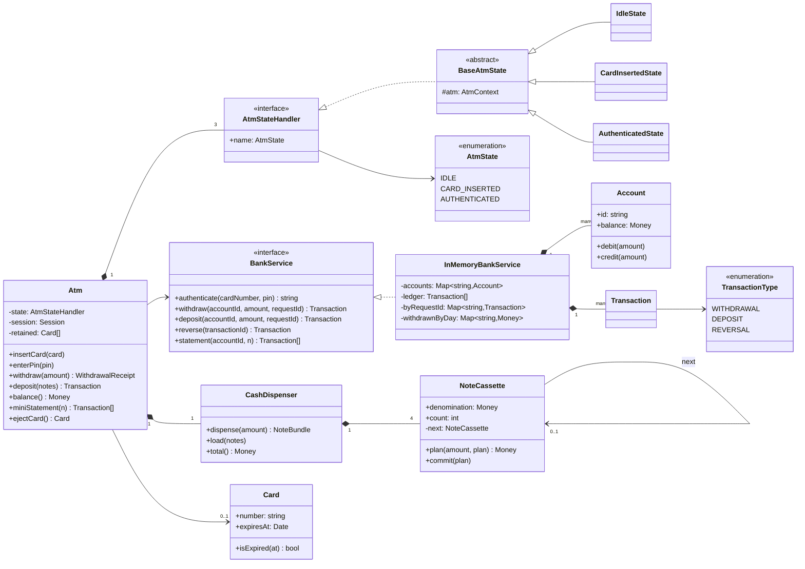
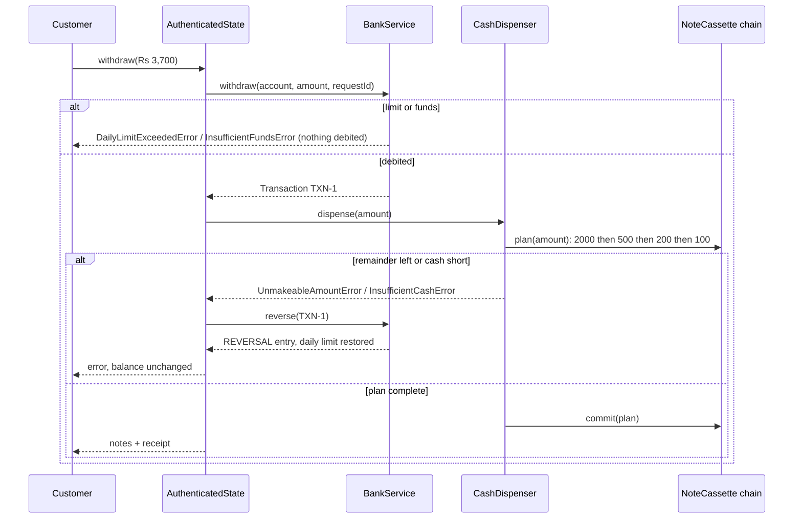
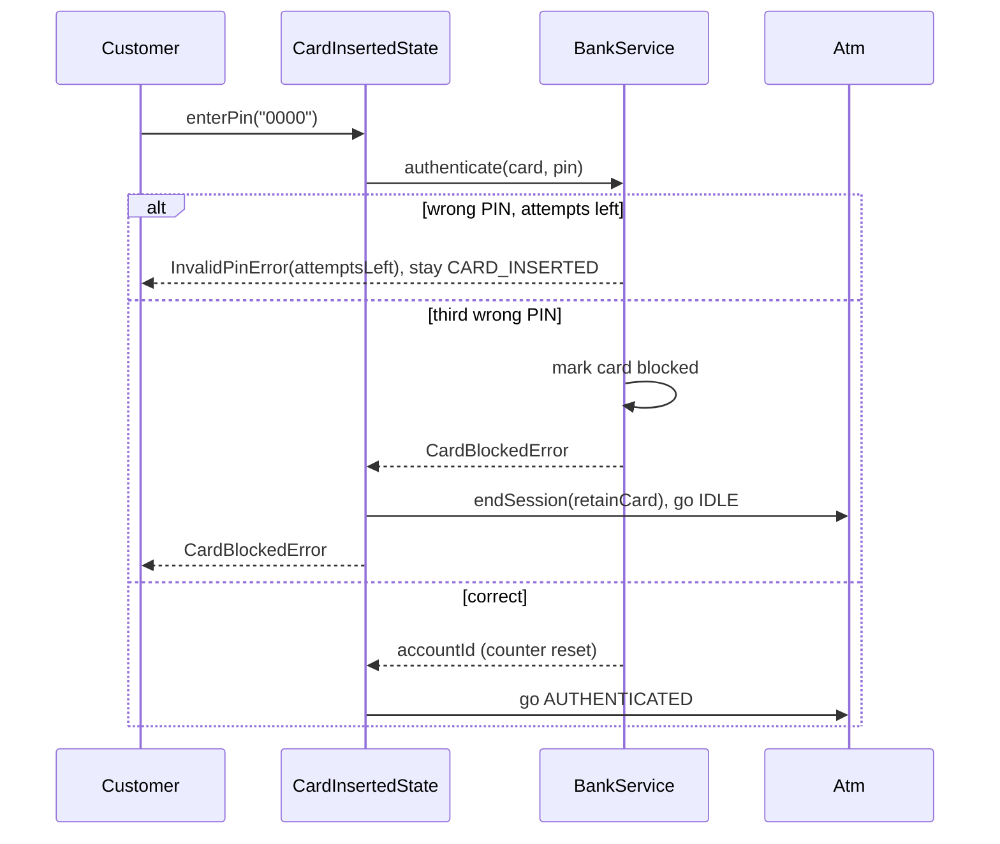

# Design an ATM

| | |
|---|---|
| **Difficulty** | Medium |
| **Solution** | [`src/atm/`](../src/atm/) |
| **Run** | `npm run demo -- atm` · `npx vitest run src/atm` |
| **Patterns** | State, Chain of Responsibility, Strategy (bank service interface), Compensating transaction |

## 1. Problem statement

Design the software for an ATM. A customer inserts a card, authenticates with a PIN, and can withdraw cash, deposit notes, check the balance or print a mini-statement. The ATM talks to the bank for every money movement and must never debit an account for cash that it did not hand out.

## 2. Clarifying questions to ask first

- Which note denominations are loaded, and does the ATM recycle deposited notes?
- How many wrong PIN attempts are allowed, and what happens after that (block, retain the card)?
- Are there withdrawal limits: per transaction, per day, per account?
- Who owns the PIN check and the balance: the ATM or the bank?
- What if cash cannot be dispensed after the account was debited (jam, wrong mix of notes)?
- How many transactions should a mini-statement show?

Assumptions used in the solution: four cassettes (Rs 2000, 500, 200, 100), three PIN attempts then the card is blocked at the bank and retained by the ATM, a per-account daily withdrawal limit enforced by the bank, the bank owns PIN hashes and balances, deposits go to a separate bin, and a failed dispense is compensated by a reversal entry.

## 3. Requirements

### Functional
1. States: IDLE (no card), CARD_INSERTED (PIN pending), AUTHENTICATED. Any operation not valid in the current state throws `InvalidAtmOperationError`.
2. An expired card is rejected at insertion.
3. A wrong PIN reports the attempts left; the third wrong PIN blocks the card and the ATM retains it. A correct PIN resets the counter.
4. Withdrawal debits the account through the bank, then dispenses notes largest first; if dispensing fails the debit is reversed.
5. The dispenser throws `InsufficientCashError` when it holds less than the amount and `UnmakeableAmountError` when its notes cannot add up to it.
6. The bank enforces sufficient funds and a daily limit that resets each calendar day.
7. Deposit credits the account; balance enquiry and a mini-statement of the last N transactions are available.

### Non-functional
- No money is created or lost: every debit is either matched by dispensed cash or by a reversal.
- Bank calls are idempotent on a request id, so retries after a timeout do not double-debit.
- The PIN never leaves the bank in clear text and is never stored by the ATM.
- Deterministic tests: clock and ids injected.

## 4. Core entities

| Entity | Responsibility |
|---|---|
| `Atm` | Context of the State pattern; holds the session (card, account) and hardware. |
| `AtmStateHandler` → `IdleState`, `CardInsertedState`, `AuthenticatedState` | What each operation means in each state; `BaseAtmState` rejects by default. |
| `Card` | Number, holder, expiry. |
| `BankService` → `InMemoryBankService` | Authentication with lockout, balances, limits, ledger, reversals, idempotency. |
| `Account`, `Transaction` | Balance that cannot go negative; immutable ledger entries. |
| `CashDispenser`, `NoteCassette` | Chain of Responsibility over the cassettes; plan then commit. |

## 5. Class diagram

## 6. Key flows

## 7. Design patterns used

- **State** for the ATM session. Operations mean different things (or nothing) depending on whether a card is in and verified; `BaseAtmState` rejects everything by default, and an explicit transition table catches illegal jumps. Alternative: an `if (!authenticated) throw` guard at the top of every method, which works until the fourth state (e.g. MAINTENANCE) arrives.
- **Chain of Responsibility** for the cassettes. Each `NoteCassette` takes what it can and passes the remainder on; adding a Rs 50 cassette is one more link. Planning is separate from committing, so a failed chain never removes notes. Alternative: a bounded DP over note counts (see the vending machine's `MinimumCoinsChangeStrategy`), which succeeds in rare cases the greedy chain misses, such as Rs 600 from one 500 and three 200s.
- **Interface for the bank** (`BankService`). The ATM never sees a balance or a PIN hash; tests and the demo use the in-memory bank, production would use a network client.
- **Compensating transaction** for withdrawal: debit, dispense, and on failure write a `REVERSAL` entry that references the original. The ledger stays append-only and auditable.

## 8. Trade-offs, extensions and follow-up questions

**Why debit before dispensing?** Cash that has left the machine cannot be recalled, but a debit can be reversed. So the irreversible step goes last. A real ATM also pre-checks the cassettes before calling the bank to avoid a pointless debit and reversal; the reversal is still needed for jams and timeouts.

**Concurrency: two ATMs, one account.** Both withdraw at the same time. The bank's debit must be a conditional update: `UPDATE accounts SET balance = balance - :amt, version = version + 1 WHERE id = ? AND balance >= :amt AND version = ?`, zero rows means retry or "insufficient funds". The daily limit is the same pattern on `daily_withdrawals(account_id, day, total)` with `total + :amt <= :limit` in the `WHERE`.

**Timeouts and retries.** If the ATM times out waiting for the bank, it retries with the same request id; `withdraw()` returns the original transaction instead of debiting again. In SQL that is a unique constraint on `transactions(request_id)` and `INSERT ... ON CONFLICT DO NOTHING` followed by a read.

**PIN security.** The ATM sends the PIN to the bank (in production as an encrypted PIN block from the PIN pad); the bank compares salted hashes. The lockout counter lives with the bank so it applies across all ATMs.

**"Add a MAINTENANCE state / cash-low alerts."** A new state class that rejects everything except `load()`, and an Observer on the dispenser total.

**Persistence sketch.** `accounts(id, owner, balance, version)`, `cards(number, account_id, pin_hash, salt, failed_attempts, blocked, expires_at)`, `transactions(id, account_id, type, amount, balance_after, request_id UNIQUE, reverses NULL REFERENCES transactions(id), created_at)` with a unique index on `reverses` so a withdrawal can be reversed only once, `daily_withdrawals(account_id, day, total)`, and per ATM `cassettes(atm_id, denomination, count)`.

## 9. What a strong interview answer sounds like

1. Clarify denominations, PIN rules, limits, and who owns balances and PINs; state the assumptions.
2. Draw the three ATM states and their transitions, and name the invariant: no debit without cash or a reversal.
3. Show the bank as an interface, the cassette Chain of Responsibility with plan-then-commit, and the state classes.
4. Walk the withdrawal sequence including limit, funds, unmakeable amount and the reversal; then the PIN lockout sequence.
5. Close with concurrent withdrawals (conditional updates), idempotent retries via request ids, and PIN security.
