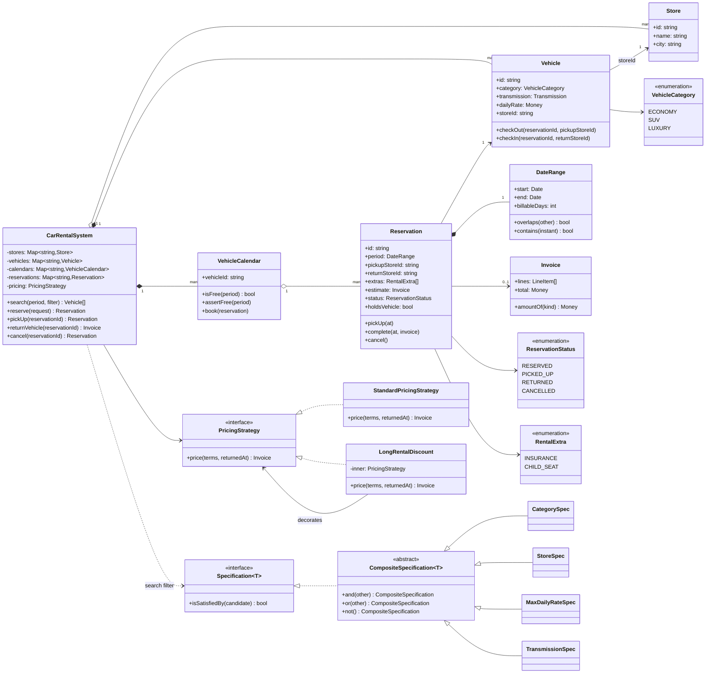
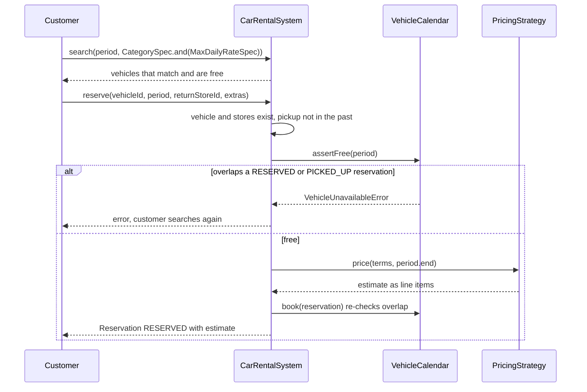
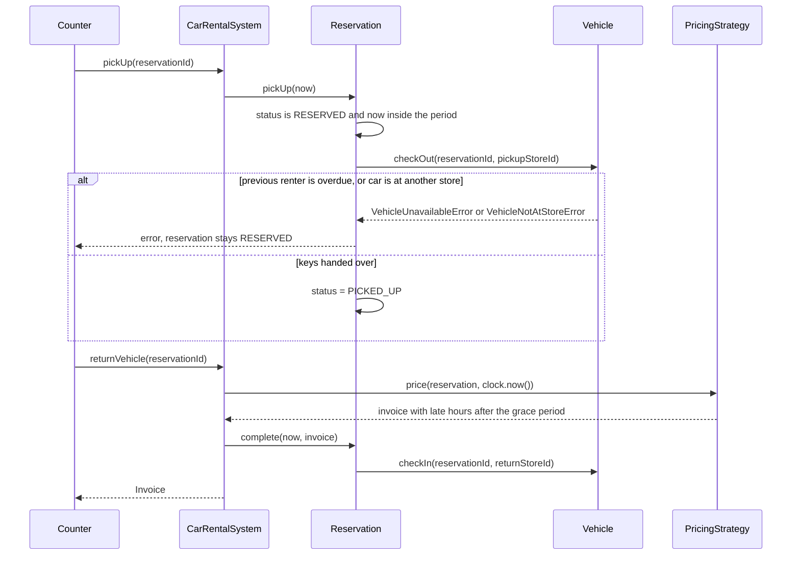

# Design a Car Rental System

| | |
|---|---|
| **Difficulty** | Medium |
| **Solution** | [`src/car-rental-system/`](../src/car-rental-system/) |
| **Run** | `npm run demo -- car-rental-system` · `npx vitest run src/car-rental-system` |
| **Patterns** | Specification, Strategy, Decorator, State (transition table) |

## 1. Problem statement

Design the booking system of a car rental company with several stores. Customers search for a car by category, store, price and transmission for a pickup/return period, reserve it with optional extras, pick it up, and return it (possibly late, possibly at another store) and get an itemised bill.

## 2. Clarifying questions to ask first

- Does the customer reserve a specific car or a category ("Creta or similar")? This decides whether availability is per vehicle or a count per category.
- How are days counted: calendar days or 24-hour blocks? Is there a grace period for late returns?
- Can a car be returned to a different store (one-way)? Is there a drop fee?
- Which extras exist and how are they priced (per day or per rental)?
- Can a customer pick up early, cancel, or extend? Are cancellations charged?
- Do we take payment, or only produce the bill?

Assumptions used in the solution: the customer reserves a specific vehicle; periods are half-open `[pickup, return)` intervals and every started 24-hour block is a billable day; extras are priced per day; late returns pay per started hour after a 30-minute grace; early returns are not refunded; one-way rentals pay a flat drop fee and the car then belongs to the return store; pickup is only allowed inside the booked period; cancellation is free while RESERVED; no payment gateway.

## 3. Requirements

### Functional
1. Stores hold vehicles of category ECONOMY, SUV or LUXURY, each with a transmission and a daily rate.
2. Search returns vehicles that match any combination of filters (category, store, price cap, transmission) and are free for the whole requested period.
3. A reservation goes RESERVED → PICKED_UP → RETURNED, or RESERVED → CANCELLED; any other move is rejected.
4. A vehicle never has two overlapping RESERVED or PICKED_UP reservations. Back-to-back bookings are allowed.
5. The bill is itemised: rental days, each extra, one-way drop fee and late fee, with the late fee measured from the clock at return.
6. A one-way rental moves the vehicle to its return store, and later searches see it there.
7. Pricing and search filters can be extended without changing the booking flow.

### Non-functional
- Correctness over throughput: the no-overlap invariant must hold even when two customers book at once.
- Search is linear in vehicles x reservations, which is fine in memory; a range index is the upgrade (section 8).
- Deterministic and testable: time and ids are injected; amounts are integer minor units.

## 4. Core entities

| Entity | Responsibility |
|---|---|
| `Store` | A branch; vehicles reference it by id. |
| `Vehicle` | Category, transmission, daily rate, current store; compare-and-set `checkOut()` / `checkIn()` of the keys. |
| `DateRange` | Half-open `[start, end)` value object: `overlaps()`, `contains()`, `billableDays`. |
| `Reservation` | One customer's claim on one vehicle for one period; owns the state machine and the key hand-over. |
| `VehicleCalendar` | All reservations of one vehicle; the single gate that rejects overlapping bookings. |
| `Invoice` / `LineItem` | Itemised bill; discounts are negative lines so the total is a plain sum. |
| `Specification<Vehicle>` → `CategorySpec`, `StoreSpec`, `MaxDailyRateSpec`, `TransmissionSpec` | Composable search filters with `and` / `or` / `not`. |
| `PricingStrategy` → `StandardPricingStrategy`, `LongRentalDiscount` | Pricing policy; the discount decorates any other strategy. |
| `CarRentalSystem` | Aggregate root: `search()`, `reserve()`, `pickUp()`, `returnVehicle()`, `cancel()`. |

## 5. Class diagram

## 6. Key flows

## 7. Design patterns used

- **Specification** for search. Each filter is a tiny object and `and` / `or` / `not` compose them, so "automatic SUVs at the airport under Rs 4,000" needs no new method. Alternative: a query object with optional fields (`{ category?, maxRate? }`), which is simpler but changes signature with every new filter and cannot express `or`. With a database, each spec renders a `WHERE` fragment instead of filtering in memory.
- **Strategy** for pricing. Rates, grace periods and drop fees change per market; the booking flow only calls `price(terms, returnedAt)`. A quote is the same call with the due time, so the estimate and the final bill can never disagree for an on-time return. Alternative: a rate table in configuration, which covers numbers but not new rules.
- **Decorator** for discounts. `LongRentalDiscount` wraps any `PricingStrategy` and appends a negative line, so promotions stack without subclass explosions. Alternative: a list of adjustment rules applied in order.
- **State machine as a transition table** in `Reservation`. Four states and five edges fit in one `Record`; invalid moves throw `InvalidReservationTransitionError`. Alternative: the GoF State pattern with a class per state, which only pays off when behaviour per state grows.
- **Compare-and-set guards**: `VehicleCalendar.book()` re-checks overlap and `Vehicle.checkOut()` refuses a second hand-over. Search results can be stale; these two checks are what keep the invariant.

## 8. Trade-offs, extensions and follow-up questions

**"Two customers book the same car for overlapping dates at the same moment."** In-process, `VehicleCalendar.book()` re-checks after the search, so the second caller gets `VehicleUnavailableError`. With PostgreSQL the same invariant is an exclusion constraint: `EXCLUDE USING gist (vehicle_id WITH =, period WITH &&) WHERE (status IN ('RESERVED','PICKED_UP'))` with `period tstzrange` stored as `'[)'`, which makes the database reject the second insert. Without range types: lock the vehicle row (`SELECT ... FOR UPDATE`) and insert after re-checking, or bump an optimistic `vehicles.version` (`UPDATE vehicles SET version = version + 1 WHERE id = ? AND version = ?`) in the same transaction as the insert. Put an idempotency key on `reserve` so a client retry after a timeout does not create a second booking.

**"The previous customer is late and the next one is at the counter."** `Vehicle.checkOut()` refuses because the keys are still out, and the late customer pays per started hour. In practice the desk gives the waiting customer another car of the same category, which is the next question.

**"Reserve a category, not a car."** Most real systems book "Creta or similar": availability becomes `count(overlapping reservations for category at store) < fleet size`, and the concrete car is assigned at pickup. That also removes the one-way problem where a car booked at store A is returned to store B by an earlier rental (`VehicleNotAtStoreError` in this design).

**"Search is slow with 50,000 cars."** Index reservations by vehicle with an interval tree, or let the database do it with a GiST index on `period`; filter by store and category first because they are the most selective.

**"Extensions: cleaning buffer, no-shows, extensions while on rent."** A buffer pads each period by N hours before the overlap check. A sweeper marks RESERVED bookings past `start + 2h` as `NO_SHOW` (a new state) and frees the car. Extending a rental re-checks `[end, newEnd)` on the calendar in the same transaction that updates the period.

**Persistence sketch.** `stores(id, name, city)`, `vehicles(id, store_id, category, transmission, daily_rate, rented_under NULL, version)`, `reservations(id, vehicle_id, customer_id, period tstzrange, pickup_store_id, return_store_id, status, version)` with the exclusion constraint above, `reservation_extras(reservation_id, extra)`, `invoice_lines(reservation_id, kind, description, amount)`. Index `vehicles(store_id, category)` for search.

## 9. What a strong interview answer sounds like

1. Ask whether customers book a car or a category, how days and late hours are counted, and whether one-way is allowed; state the assumptions.
2. Name the invariant that matters (no overlapping active reservations per vehicle) and model the period as a half-open interval so back-to-back bookings work.
3. Draw the entities with `PricingStrategy` and `Specification` as interfaces and the reservation state table; explain why the quote and the bill use the same pricing call.
4. Walk reserve and return, including the overlap failure, the overdue car at pickup and the late fee from the injected clock.
5. Close with concurrency (exclusion constraint, row lock or version column, idempotency key), booking by category, and the persistence sketch.
