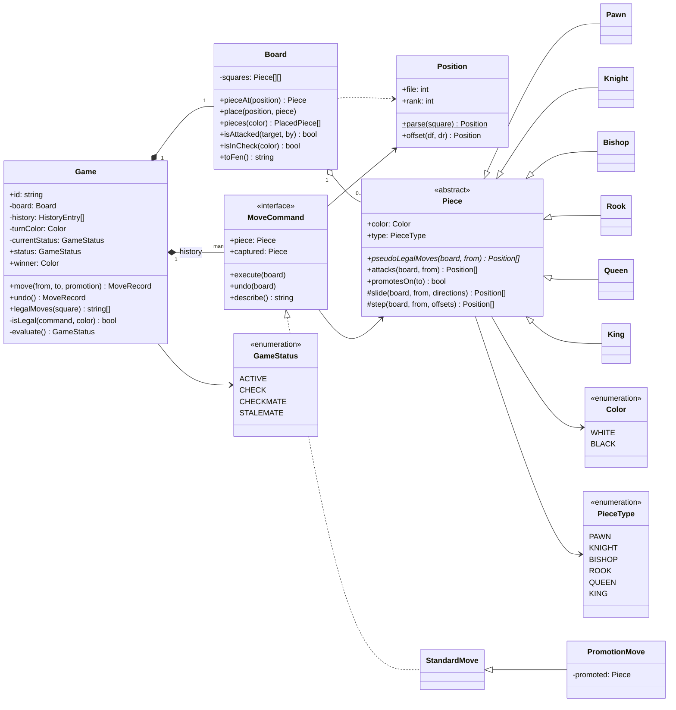
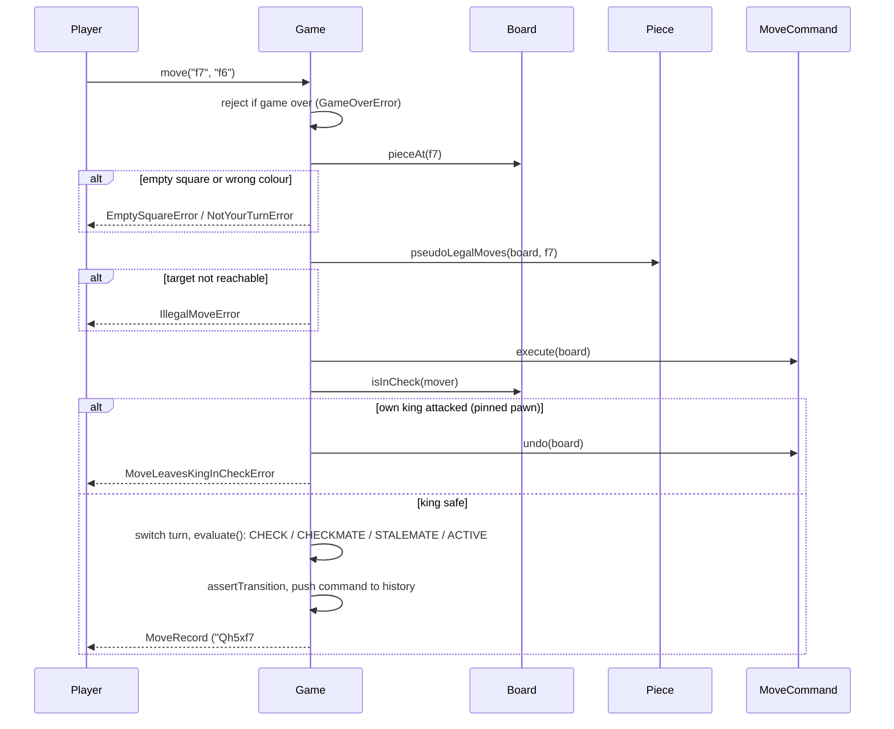
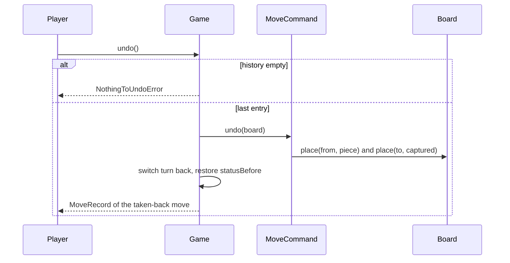

# Design a Chess Game

| | |
|---|---|
| **Difficulty** | Hard |
| **Solution** | [`src/chess-game/`](../src/chess-game/) |
| **Run** | `npm run demo -- chess-game` · `npx vitest run src/chess-game` |
| **Patterns** | Template Method (piece hierarchy), Command (moves with undo), Factory, State (game status) |

## 1. Problem statement

Design a two-player chess game. Players move pieces by naming squares such as "e2" to "e4"; the system enforces turn order and the movement rules of every piece, rejects any move that would leave the mover's own king in check, and announces check, checkmate and stalemate. Moves can be taken back one at a time.

## 2. Clarifying questions to ask first

- Do we need the full rule set (castling, en passant, fifty-move rule, threefold repetition), or the core movement and check rules?
- How is a move entered: coordinates ("e2", "e4"), standard algebraic notation ("Nf3"), or drag and drop that calls the same API?
- Which promotion piece is used when the player does not choose?
- Do we need undo? Only for analysis, or also in rated games?
- Is there a clock (time control), resignation, draw offers?
- One game in memory, or many games served concurrently from a backend?

Assumptions used in the solution: standard 8x8 chess between two local players, coordinate input, promotion defaults to a queen, unlimited undo, no time control. Castling and en passant are out of scope (section 8 shows how to add them). Positions can be loaded from the first two FEN fields so tests start from composed positions instead of long move lists.

## 3. Requirements

### Functional
1. The board starts in the standard setup; white moves first and the sides alternate.
2. Each piece generates its own pseudo-legal moves: pawn (one step, two from its start rank, diagonal capture), knight (L jump), bishop, rook, queen (sliding, blocked by pieces), king (one step).
3. A move is rejected if the square is empty, the piece belongs to the other side, the target is not reachable, or the move leaves the mover's king in check.
4. After every move the game reports ACTIVE, CHECK, CHECKMATE or STALEMATE for the side to move; no move is accepted once the game is over.
5. A pawn reaching the last rank promotes (queen by default, or rook, bishop, knight on request; never king or pawn).
6. Every move is recorded in a history that supports undo, restoring captured and promoted pieces exactly.
7. The game can list the legal destinations of any piece (for UI hints).

### Non-functional
- Correctness first: legality is checked against the real resulting position, never approximated.
- Move generation stays simple (O(pieces x squares) per check test); the board is only 64 squares.
- Deterministic and testable: the clock and the game id generator are injected; positions can be loaded from FEN.

## 4. Core entities

| Entity | Responsibility |
|---|---|
| `Position` | Immutable coordinate; the only translator between "e4" and (file, rank). |
| `Board` | 8x8 grid: occupancy, `isAttacked`, `isInCheck`, FEN in and out. No turn logic. |
| `Piece` (abstract) → `Pawn`, `Knight`, `Bishop`, `Rook`, `Queen`, `King` | Geometry only: pseudo-legal moves and attacked squares. |
| `createPiece` / `pieceFromLetter` | Factory used by board setup, FEN parsing and promotion. |
| `MoveCommand` → `StandardMove`, `PromotionMove` | Applies and reverts one move, remembers the captured piece. |
| `GameStatus` | ACTIVE, CHECK, CHECKMATE, STALEMATE with validated forward transitions. |
| `Game` | Aggregate root: turn order, legality (self-check filter), status, history and undo. |

## 5. Class diagram

## 6. Key flows

## 7. Design patterns used

- **Inheritance with Template Method** for pieces. `Piece` owns the shared ray walking (`slide`) and single jumps (`step`); each subclass only declares its directions. The pawn overrides `attacks` because it is the one piece whose captures differ from its moves. Alternative: a data table of movement vectors and a single generic `Piece` class; less code, but the pawn special cases leak into the generic loop.
- **Command** for moves. Each `MoveCommand` knows how to `execute` and `undo` itself and remembers what it captured. That gives undo for free, and it makes the legality test exact: try the move, ask the board whether the mover is in check, take it back. Alternative: clone the board for each candidate move (simpler to reason about, but allocates 64 squares per candidate and still needs a history for undo).
- **Factory** (`createPiece`, `pieceFromLetter`) is the one place that maps a `PieceType` to a class; board setup, FEN loading and promotion all use it.
- **State** (light) for `GameStatus`: a transition table says which statuses a move may lead to. Terminal states have no forward transitions, so a move after mate throws; only undo (a rewind) leaves them. A full State-object hierarchy would be overkill for four states with no per-state behaviour.
- **Separation of concerns**: pieces know geometry, the board knows occupancy and attacks, the game knows the rules of play. Check detection reuses piece `attacks`, so there is no second move generator to keep in sync.

## 8. Trade-offs, extensions and follow-up questions

**"Add castling."** Add a `CastlingMove` command that moves king and rook in `execute` and both back in `undo`. Track `hasMoved` per piece (or castling rights on the game, as FEN does), flipped by the command and restored on undo. Legality adds three checks: king not currently in check, the squares between are empty, and the square the king passes over is not attacked (`board.isAttacked`). The king's pseudo-legal generator offers the two-square step only when rights exist.

**"Add en passant."** Game remembers the en passant target square set by the last pawn double step (stored in the history entry so undo restores it). The pawn generator offers that diagonal, and an `EnPassantMove` command removes the captured pawn from the square beside the target, not from the target itself, and puts it back on undo.

**"Draw rules: threefold repetition, fifty moves, insufficient material."** Keep a `Map<string, number>` of position keys (FEN without the clocks, or a Zobrist hash) incremented on move and decremented on undo, and a half-move counter reset on captures and pawn moves. New terminal statuses `DRAW_REPETITION` etc. join the transition table.

**"Move generation is too slow for an engine."** The `O(pieces x moves)` self-check filter is fine for a game server. An engine would switch to bitboards (one 64-bit mask per piece type and colour), precomputed attack tables and pin detection instead of make-unmake for every candidate.

**"Two clients submit a move for the same game at the same time."** In-process `Game.move` is synchronous, so it is the serialisation point. Across servers the game row carries a ply counter as a version column: `UPDATE games SET fen = ?, ply = ply + 1, status = ? WHERE id = ? AND ply = ?`, and a move is accepted only if exactly one row changed. A unique key on `moves(game_id, ply)` makes a duplicate insert fail, and the client sends an idempotency key per move so a retried request after a timeout returns the original result instead of playing twice.

**"Add a chess clock."** A `GameClock` holding remaining time per colour, charged on each move with the injected `Clock` (the elapsed time since the previous move's `playedAt`), and a `TIMEOUT` terminal status checked on `move()` or an explicit `tick()`. No timers in the domain.

**Persistence sketch.** `games(id, white_player_id, black_player_id, fen, turn, status, ply, created_at)`, `moves(game_id, ply, from_sq, to_sq, promotion NULL, notation, played_at, PRIMARY KEY (game_id, ply))`. The current FEN makes loading O(1); the moves table is the audit log and lets the game be replayed (or undone) exactly. Undo in a rated game would be a request/accept protocol that deletes the last `moves` row under the same version check.

## 9. What a strong interview answer sounds like

1. Clarify scope: which special rules are in, input format, undo, clocks. Say up front that castling and en passant are deferred and how they would plug in.
2. Split responsibilities: `Position`, `Board` (occupancy and attacks), `Piece` hierarchy (geometry only), `Game` (turns, legality, status).
3. Explain pseudo-legal versus legal moves: pieces generate candidates; the game filters any move that leaves its own king attacked, which handles pins and moving into check with one rule.
4. Model moves as Commands with execute and undo; reuse them both for the self-check test and for history, and show checkmate versus stalemate as "no legal moves, in check or not".
5. Close with extensions (castling, en passant, draw rules), performance (bitboards), and multi-server concurrency (ply as a version column, unique `(game_id, ply)`, idempotency keys).
