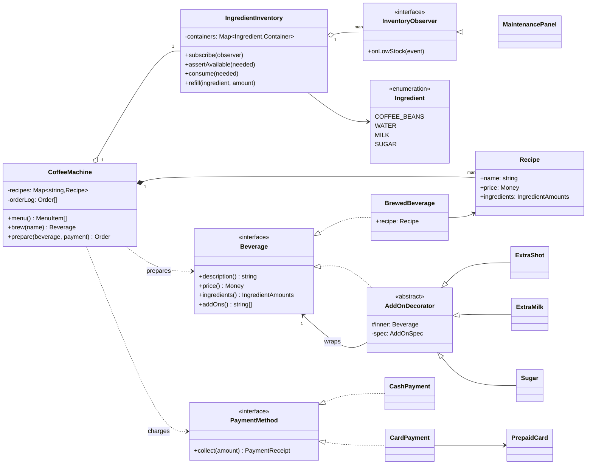
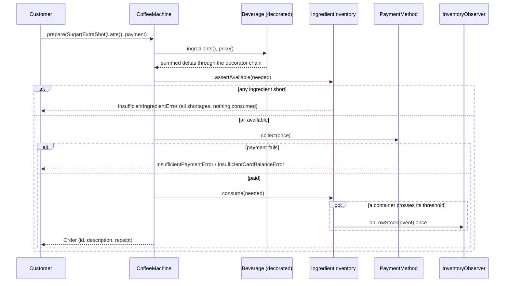

# Design a Coffee Vending Machine

| | |
|---|---|
| **Difficulty** | Medium |
| **Solution** | [`src/coffee-vending-machine/`](../src/coffee-vending-machine/) |
| **Run** | `npm run demo -- coffee-vending-machine` · `npx vitest run src/coffee-vending-machine` |
| **Patterns** | Decorator, Observer, Strategy |

## 1. Problem statement

Design a coffee machine that serves a small menu (espresso, cappuccino, latte) with optional add-ons such as an extra shot, extra milk or sugar. Each drink consumes ingredients from finite containers; the machine charges the customer, warns maintenance when a container runs low, and must never take money for a drink it cannot make.

## 2. Clarifying questions to ask first

- What is on the menu, and are recipes fixed or configurable by the operator?
- Which add-ons exist? Can they stack (two extra shots), and is there a limit?
- What happens when an ingredient is short half way through a drink?
- How do customers pay: cash with change, card, both?
- Who needs to know about low stock, and how often should they be told?
- Do containers have a maximum capacity for refills?

Assumptions used in the solution: three recipes stored as data, three add-ons that stack with per-cup limits, cash or prepaid card, ingredient amounts as integer grams or millilitres, low-stock alerts fire once per threshold crossing, refills cannot exceed container capacity.

## 3. Requirements

### Functional
1. A recipe has a name, a price and an ingredient list (beans, water, milk, sugar).
2. Add-ons change both the price and the ingredients, stack in any order and respect a per-cup limit.
3. Preparing a drink checks every ingredient first; if any is short it throws `InsufficientIngredientError` listing all shortages, and nothing is consumed or charged.
4. Payment happens through a pluggable method (cash with change, prepaid card).
5. When a container drops below its threshold, observers receive one `LowStockEvent`; a refill above the threshold re-arms the alert.
6. The menu shows which drinks can currently be made.
7. Every served drink is recorded as an order.

### Non-functional
- All-or-nothing preparation: stock and money are either both changed or neither.
- Money and quantities are integers; no floating point.
- Adding a recipe is data; adding an add-on is one small class.
- Deterministic tests with injected clock and ids.

## 4. Core entities

| Entity | Responsibility |
|---|---|
| `Recipe` | Base drink as data: name, price, ingredient amounts. |
| `Beverage` → `BrewedBeverage` | Component interface and concrete component of the Decorator. |
| `AddOnDecorator` → `ExtraShot`, `ExtraMilk`, `Sugar` | Adds a price delta and ingredient delta; enforces its own limit. |
| `IngredientInventory` | Containers with quantity, capacity and threshold; atomic `consume()`, `refill()`, observers. |
| `InventoryObserver` → `MaintenancePanel` | Receives `LowStockEvent`s. |
| `PaymentMethod` → `CashPayment`, `CardPayment` (+ `PrepaidCard`) | Strategy for collecting the price. |
| `CoffeeMachine` | Aggregate root: menu, `brew()`, `prepare()` and the order log. |

## 5. Class diagram

## 6. Key flows

## 7. Design patterns used

- **Decorator** for add-ons. Each add-on wraps a `Beverage` and adds its own delta to `price()` and `ingredients()`, so "latte with two shots, extra milk and sugar" is just nested constructors, and the per-cup limit is checked by the decorator that knows it. Alternative: an order line with a list of add-on ids priced from a table. That is what a real product with an operator UI would do (add-ons become data), and it is worth saying in the interview; the Decorator is the classic answer because the behaviour (price and ingredients) composes.
- **Observer** for low stock. The inventory does not know who cares: a maintenance panel, telemetry, a refill scheduler. The "once per crossing" rule lives in the subject, with an `alerted` flag per container, so observers do not each have to de-duplicate. Alternative: polling `level()` on a schedule.
- **Strategy** for payment. Cash returns change; a card debits exactly. The machine only calls `collect()`.
- **Recipes as data**, not subclasses. `Espresso extends Beverage` would add a class per menu item for no behaviour difference.

## 8. Trade-offs, extensions and follow-up questions

**Ordering for atomicity.** Check ingredients, collect payment, consume. The check and the consume are separate calls, which is safe in a single-threaded process with nothing in between. In a real machine with a hardware controller, the equivalent is a reservation: reserve ingredients, charge, commit, and release the reservation on failure.

**"Two orders race for the last 200ml of milk"** (a networked machine taking app orders). Model it as a conditional update per container: `UPDATE containers SET quantity = quantity - :needed WHERE machine_id = ? AND ingredient = 'MILK' AND quantity >= :needed`, all containers for one drink inside one transaction, and roll back if any update touched zero rows. Payment uses the order id as an idempotency key so a retried charge is not taken twice.

**"Low-stock alert storms."** Already handled by firing once per crossing. A second, lower "critical" threshold is another flag per container.

**"Operator changes the price of a latte."** Recipes are data; versioned rows (`recipes(id, version, price, ...)`) so past orders keep the price they were sold at.

**"Size options (small, medium, large)."** A `SizeDecorator` that scales ingredients and price, or a size field on the recipe. Scaling milk by 1.5 needs explicit rounding of integers, which is why amounts are integers in the first place.

**Persistence sketch.** `recipes(name, price, ingredients_json)`, `containers(machine_id, ingredient, quantity, capacity, threshold, alerted)`, `orders(id, machine_id, description, price, payment_method, change, created_at)`. Unique `(machine_id, ingredient)` on containers; low-stock events go to an outbox table so the alert is published exactly once with the consuming transaction.

## 9. What a strong interview answer sounds like

1. Clarify menu, add-ons and their limits, payment methods and what "low stock" should trigger; state the assumptions.
2. Separate data (recipes) from behaviour (add-ons that change price and ingredients) and name the atomicity invariant.
3. Draw the Decorator chain and show how price and ingredients sum through it; mention the data-driven alternative.
4. Walk `prepare()`: check, pay, consume, notify, including the shortage and payment failure branches.
5. Finish with the once-per-crossing Observer, conditional updates for concurrent orders, and an outbox for alerts.
