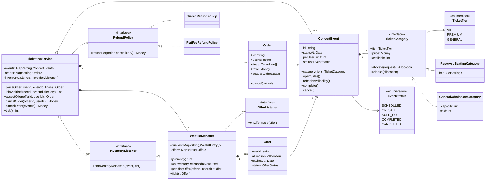
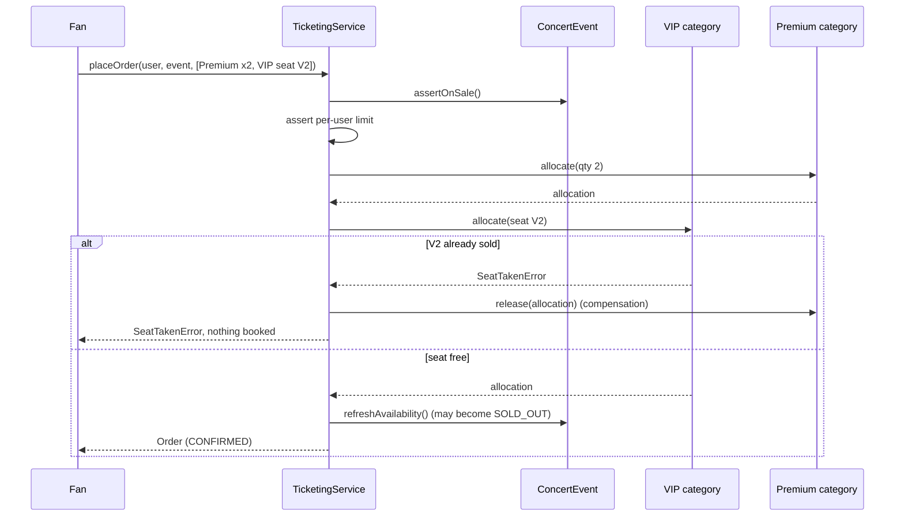
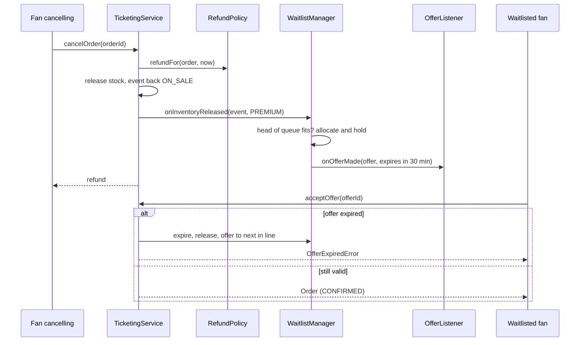

# Design a Concert Ticket Booking System

| | |
|---|---|
| **Difficulty** | Medium |
| **Solution** | [`src/concert-ticket-booking/`](../src/concert-ticket-booking/) |
| **Run** | `npm run demo -- concert-ticket-booking` · `npx vitest run src/concert-ticket-booking` |
| **Patterns** | Strategy (refund), Observer (waitlist offers), State machine, Compensation for atomic orders |

## 1. Problem statement

Design the ticketing core for large concerts. An event sells tiered categories: VIP as numbered reserved seats, Premium and General as standing quantities. Fans buy several tickets in one order, are limited per event, and join a waitlist when a category sells out; when someone cancels, the freed tickets are offered automatically to the next person in line.

This differs from movie booking: there is no seat map for most tickets, demand spikes far beyond supply, fairness (limits, FIFO waitlist) matters more than seat choice, and the event itself has a lifecycle that can end in cancellation and mass refunds.

## 2. Clarifying questions to ask first

- Which categories are seated and which are by quantity?
- Can one order mix categories, and must it succeed or fail as a whole?
- What is the purchase limit: per order, per user per event, per payment card?
- Is the waitlist strict FIFO, or may a smaller request jump ahead when only one ticket is freed?
- How long does a waitlisted fan have to accept an offer?
- What is the refund policy for fan cancellations, and for organiser cancellations?
- Is there a resale market? (Out of scope here; it changes refunds into transfers.)

Assumptions used in the solution: VIP is reserved seating (choose seats or get the best free ones), Premium and General are quantities; one order may mix tiers and is all-or-nothing; the limit is per user per event across confirmed orders (default 4); the waitlist is strict FIFO per category and an offer holds stock for 30 minutes; payment is assumed captured with the order, so cancellation produces a refund; organiser cancellation refunds 100%.

## 3. Requirements

### Functional
1. An event moves `SCHEDULED -> ON_SALE <-> SOLD_OUT -> COMPLETED`, and may be `CANCELLED` from any non-final state; illegal moves throw.
2. Orders are accepted only while the event is `ON_SALE`.
3. An order holds one line per tier; all lines are allocated or none are.
4. A user may not hold more than the event's per-user limit in confirmed orders.
5. The event becomes `SOLD_OUT` when every category is empty and returns to `ON_SALE` when stock is freed.
6. A user may join a category's waitlist only when it cannot satisfy their quantity.
7. When a cancellation frees stock, the waitlist (an observer of freed inventory) holds it as an offer for the head of the queue.
8. An offer expires after its TTL (checked lazily on accept and by an explicit `tick()`), and the stock passes to the next in line.
9. Fan cancellation refunds via a swappable `RefundPolicy`; organiser cancellation refunds every order in full.

### Non-functional
- Never oversell a category; never sell one VIP seat twice.
- Fairness: limits and FIFO are enforced in the domain, not the UI.
- Money in integer minor units; refunds floor and the remainder is stated.
- Deterministic tests via `FakeClock` and `SequentialIdGenerator`.

## 4. Core entities

| Entity | Responsibility |
|---|---|
| `TicketCategory` → `ReservedSeatingCategory`, `GeneralAdmissionCategory` | Inventory per tier: allocate and release, never oversell. |
| `ConcertEvent` (`EventStatus`) | Lifecycle state machine, categories, per-user limit. |
| `Order` (`OrderStatus`, `OrderLine`) | Tickets bought together; total, ticket count, cancellation. |
| `WaitlistManager` (`WaitlistEntry`, `Offer`) | FIFO queues per tier; turns freed stock into time-limited offers. |
| `InventoryListener`, `OfferListener` | Observer interfaces for freed stock and offers made. |
| `RefundPolicy` → `TieredRefundPolicy`, `FlatFeeRefundPolicy` | Amount returned on a fan cancellation. |
| `TicketingService` | Facade: orders, waitlist, offers, cancellations. |

## 5. Class diagram

## 6. Key flows

## 7. Design patterns used

- **Observer** for freed inventory and offers. Cancellation code only announces "stock released"; the waitlist decides what to do, and a notifier decides how to tell the fan. Alternative: call the waitlist directly from `cancelOrder`, which is simpler but couples refunds to waitlist rules and blocks adding analytics or a resale market later.
- **Strategy** for refunds, and polymorphic `TicketCategory` for seated vs quantity inventory, so the order flow never asks "is this VIP?". Alternative: one category class with an optional seat list and `if` branches.
- **State machine** on the event (with derived `SOLD_OUT`), on orders and on offers.
- **Compensation** for atomic orders: allocate line by line and release on failure. Inside one process this is equivalent to "validate all then write all", and it maps directly to a database transaction or a saga across services. Alternative: two-phase validate-then-commit, which needs care to avoid check-then-act races.

## 8. Trade-offs, extensions and follow-up questions

**"A million fans at on-sale time."** Put a virtual queue in front (admit N users per second) so the inventory service sees bounded load. Keep General stock as a counter: `UPDATE categories SET sold = sold + ? WHERE id = ? AND sold + ? <= capacity` and check the row count, which is a single atomic conditional write. Shard hot counters into buckets and rebalance when one runs dry.

**"Two fans grab the last VIP seat."** One row per seat with `UPDATE seats SET order_id = ? WHERE id = ? AND order_id IS NULL`, or a unique constraint on `(event_id, seat_id)` in an `order_seats` table. A multi-line order runs in one transaction; across services it becomes a saga with the same compensation we model.

**"Enforce the per-user limit under concurrency."** A per-(user, event) counter row updated with `WHERE held + ? <= limit` in the same transaction as the allocation. Idempotency keys on `placeOrder` stop retries from counting twice.

**"Bots and scalpers."** Limits per payment instrument and device, CAPTCHA at the queue, and named tickets. All plug in as extra checks before allocation.

**"Should a request for 1 jump ahead of a request for 4 when only 1 ticket frees?"** We chose strict FIFO (fair, predictable). The alternative, "first that fits", raises utilisation; it is a one-line change in `onInventoryReleased`, and a good discussion point.

**Persistence sketch.** `events(id, name, starts_at, status, per_user_limit, version)`, `categories(event_id, tier, price, capacity, sold)`, `seats(event_id, seat_id, tier, order_id NULL) UNIQUE(event_id, seat_id)`, `orders(id, user_id, event_id, status, total, refunded, idempotency_key UNIQUE)`, `order_lines(order_id, tier, quantity, unit_price)`, `waitlist(event_id, tier, user_id, quantity, joined_at)` ordered by `joined_at`, `offers(id, user_id, event_id, tier, quantity, expires_at, status)`. Offer expiry is a periodic job running the same logic as `tick()`.

## 9. What a strong interview answer sounds like

1. Clarify seated vs quantity tiers, order atomicity, the limit's scope, waitlist fairness and offer TTL; state assumptions.
2. Name the invariants: never oversell, all-or-nothing orders, per-user limit, strict FIFO for freed stock.
3. Draw the event state machine, the two category types behind one interface, orders, and the waitlist as an observer of released inventory.
4. Walk an order that fails on its second line (compensation) and a cancellation that turns into a waitlist offer, including the expired-offer branch.
5. Close with on-sale scale: virtual queue, conditional counter updates, seat rows with unique constraints, idempotency keys, and the offer-expiry job.
