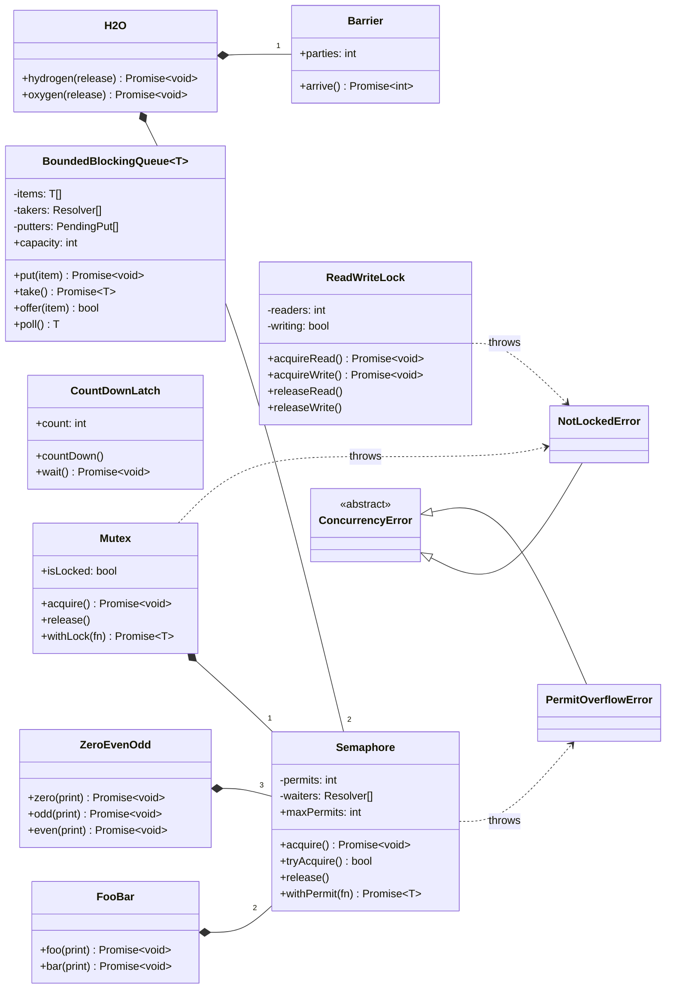
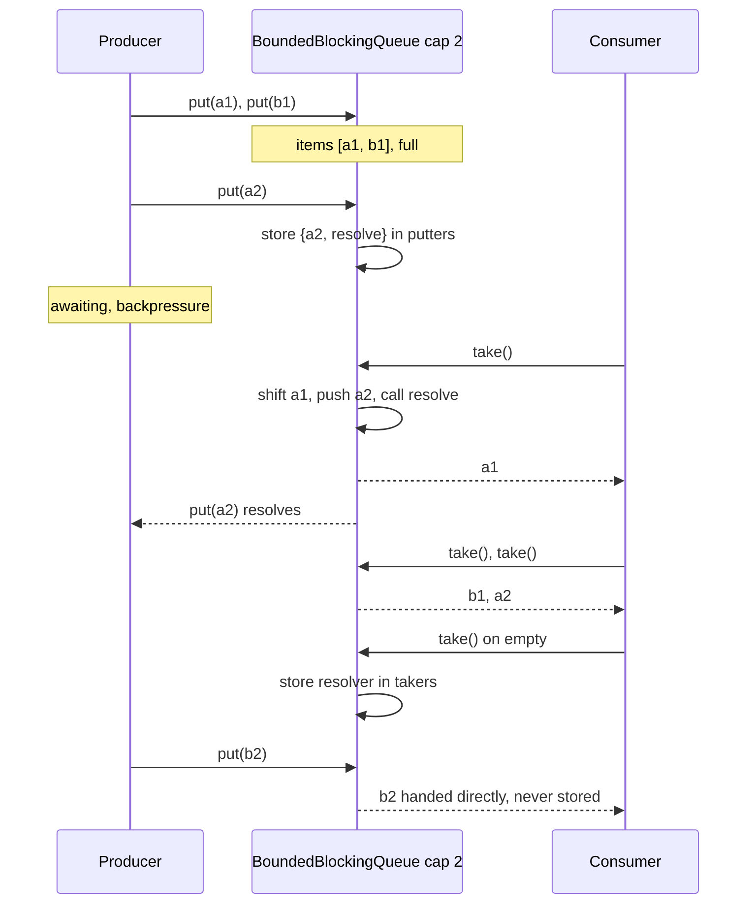
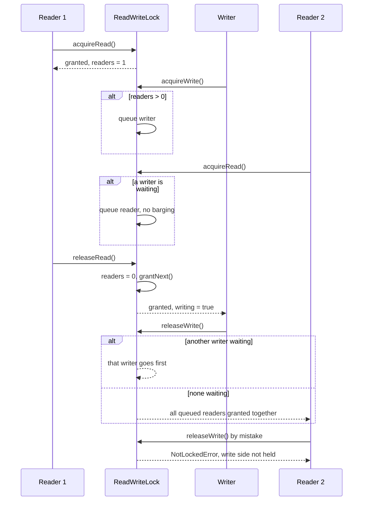

# Design Concurrency Primitives (the Node.js answer)

| | |
|---|---|
| **Difficulty** | Hard |
| **Solution** | [`src/concurrency-primitives/`](../src/concurrency-primitives/) |
| **Run** | `npm run demo -- concurrency-primitives` · `npx vitest run src/concurrency-primitives` |
| **Patterns** | Monitor (condition queues), Producer-consumer, Hand-off (baton passing), Template method (`withLock`) |

## 1. Problem statement

The classic Java concurrency LLD round asks you to build a blocking queue, a read-write lock or a semaphore, and to solve FooBar, ZeroEvenOdd or H2O. In a Node.js interview the same questions come up with a twist: there is one thread, so what exactly are you protecting? Design promise-based primitives (Mutex, Semaphore, BoundedBlockingQueue, ReadWriteLock, CountDownLatch, Barrier) and solve the three coordination problems with them.

## 2. Clarifying questions to ask first

- Is this single-process Node (async tasks on one event loop), worker threads with shared memory, or several processes? The answer decides between promises, `Atomics.wait`, and a database or Redis lock.
- Must locks be fair (FIFO) or is barging acceptable for throughput?
- For the read-write lock: reader preference, writer preference, or phase-fair? Is reader starvation acceptable?
- Do we need timeouts and cancellation (`tryAcquire(timeout)`, `AbortSignal`)?
- Re-entrant locks? (There is no thread identity in JavaScript, so re-entrancy needs an explicit owner token.)
- For the queue: is `put` allowed to fail fast (`offer`) as well as wait?

Assumptions used in the solution: one event loop, async tasks only; every primitive is FIFO-fair by hand-off; the read-write lock prefers writers; no timeouts (an extension); locks are not re-entrant; misuse such as releasing an unheld lock throws a domain error instead of silently corrupting state.

## 3. Requirements

### Functional
1. `Mutex`: `acquire`, `tryAcquire`, `release`, `withLock(fn)`; one holder at a time across awaits; waiters served FIFO; releasing an unlocked mutex throws `NotLockedError`.
2. `Semaphore(n)`: `acquire`, `tryAcquire`, `release`, `withPermit(fn)`; at most n holders; FIFO; over-release throws `PermitOverflowError`.
3. `BoundedBlockingQueue<T>(capacity)`: `put` waits when full, `take` waits when empty; `offer` and `poll` never wait; FIFO order; size never exceeds capacity.
4. `ReadWriteLock`: many readers or one writer; once a writer waits, new readers queue behind it.
5. `CountDownLatch(n)`: `wait` resolves after n `countDown`s and stays open. `Barrier(parties)`: releases each group of `parties` arrivals together, then resets.
6. FooBar prints `foobar` n times; ZeroEvenOdd prints `0 1 0 2 ... 0 n`; H2O releases atoms so every consecutive three are two H and one O.

### Non-functional
- No timers, no busy-waiting, no lost wake-ups: every waiter is a stored resolver that is called exactly once.
- Deterministic tests: interleavings come from a seeded PRNG and explicit yields (`await Promise.resolve()`, `setImmediate`).

## 4. Core entities

| Entity | Responsibility | Java | Go |
|---|---|---|---|
| `Semaphore` | Permit count plus a FIFO queue of resolvers; hand-off on release. | `Semaphore(n, true)` | buffered `chan struct{}` of size n |
| `Mutex` | One-permit semaphore with `isLocked` and misuse detection. | `ReentrantLock(true)` (minus re-entrancy) | `sync.Mutex` |
| `BoundedBlockingQueue<T>` | Buffer plus queues of waiting producers and consumers. | `ArrayBlockingQueue(cap, true)` | `make(chan T, cap)` |
| `ReadWriteLock` | Reader count, writer flag, two waiter queues, writer preference. | `ReentrantReadWriteLock` | `sync.RWMutex` |
| `CountDownLatch` | One-shot gate. | `CountDownLatch` | `sync.WaitGroup` |
| `Barrier` | Reusable rendezvous with generations and a trip action. | `CyclicBarrier` | WaitGroup per round, or channels |
| `FooBar`, `ZeroEvenOdd`, `H2O` | The coordination problems, built from the above. | same, with `Semaphore` | same, with channels |

## 5. Class diagram

## 6. Key flows

Producer/consumer hand-off with a full buffer: the take that frees a slot moves the waiting producer's item in and wakes the producer in the same synchronous step, so no other task can grab the slot in between.

Writer preference: a writer waits for the active reader, and a reader that arrives after the writer queues behind it.

## 7. Design patterns used

- **Monitor with explicit condition queues.** Each primitive is state plus arrays of stored promise resolvers; that is exactly a Java monitor with `Condition` objects, except "signal" is calling a resolver. Alternative: an `EventEmitter` per condition, which re-checks state on every wake-up (the `while (!cond) wait()` loop) and is easier to get wrong.
- **Hand-off (baton passing).** `release()` gives the permit straight to the next waiter instead of incrementing and letting everybody race. This is what makes the primitives FIFO-fair and removes lost wake-ups. Alternative: barging, which has higher throughput and lets a hot caller starve the queue.
- **Execute-around (`withLock`, `withPermit`, `withReadLock`).** Acquire and release are paired in `try/finally`, so an exception can never leak a lock. Interviewers like hearing that this is the only API you would expose in production.
- **Composition for the puzzles.** FooBar and ZeroEvenOdd pass a baton between one-permit semaphores; H2O combines admission semaphores (at most 2 H and 1 O) with a barrier (the three wait for each other). Alternative for H2O: a counter-based monitor that releases a molecule when counts reach 2 and 1; same idea, more code.

## 8. Trade-offs, extensions and follow-up questions

**"Node is single-threaded, so why do you need a mutex?"** JavaScript runs one task at a time, and a synchronous block is atomic. But every `await` is a point where other tasks run. `const v = await db.get(k); await db.set(k, v + 1)` loses updates when two requests interleave; the test `prevents the lost update that happens between awaits` reproduces it with ten tasks ending at 1 instead of 10. A mutex is needed exactly when a critical section contains an `await`. If it does not, you need nothing: that is the strongest point you can make in the interview.

**Where races still happen.**
- *Between awaits in one process:* check-then-act across an `await` (cache stampede, read-modify-write, "is the username free?").
- *Worker threads:* `SharedArrayBuffer` plus `Atomics.compareExchange`, `Atomics.wait` and `Atomics.notify` are the real CAS and futex; the primitives here would be rebuilt on them.
- *Across processes and machines:* cluster mode, several pods, cron overlap. An in-memory mutex does nothing here. Use the database: a conditional `UPDATE accounts SET balance = balance - ? WHERE id = ? AND balance >= ?` (check one row changed), a `version` column for optimistic locking (`WHERE id = ? AND version = ?`), `SELECT ... FOR UPDATE` or `pg_advisory_xact_lock` for pessimistic locking, unique constraints for "only one", and idempotency keys for retried requests. A Redis lock (`SET key token NX PX ttl`) needs fencing tokens because a paused holder can outlive its lease.

**Fairness vs throughput.** FIFO hand-off means each release wakes exactly one waiter and nobody barges, but a released permit cannot go to a task that is already running and ready. Java's default (non-fair) locks choose throughput; we choose predictability, which also makes tests deterministic.

**Writer preference vs reader starvation.** Writer preference prevents writers from starving behind a stream of readers, but a stream of writers can starve readers. Phase-fair locks alternate between a batch of readers and one writer; Go's `RWMutex` has the same writer-blocks-new-readers rule as this implementation.

**Follow-ups an interviewer may ask:**
- *Timeouts?* `acquire({ signal })`: on abort, remove the resolver from the queue and reject. The removal is the hard part; it is why waiters are stored in arrays you can splice.
- *Re-entrancy?* Pass an owner token (or use `AsyncLocalStorage` to identify the logical task) and count nested acquires.
- *Closeable queue?* `close()` rejects waiting takers once the buffer drains and rejects new puts; Go's `close(ch)` is the model.
- *Rate limiting instead of concurrency limiting?* A token bucket with the injected Clock: different problem, same "store the waiter" technique.
- *Distributed semaphore?* A table of leases `(resource, holder, expires_at)` with `INSERT ... WHERE (SELECT count(*) ...) < n` in a serialisable transaction, or Redis sorted sets keyed by expiry.

**Persistence sketch.** These primitives are in-memory by nature. When the protected state lives in a database, persist the guard there instead: `accounts(id, balance, version)` updated with `WHERE version = ?`; `jobs(id, status, locked_by, locked_until)` claimed with `UPDATE ... WHERE status = 'QUEUED' ... FOR UPDATE SKIP LOCKED` (the database's blocking queue); `requests(idempotency_key UNIQUE, response)` so a retried put is applied once.

## 9. What a strong interview answer sounds like

1. Start with the execution model: one event loop, synchronous code is atomic, races appear only across `await`s, worker threads and processes. Ask which of the three you are designing for.
2. Show the race first (read, await, write) and say the fix is to hold a lock across the await, or better, to make the update a single atomic operation where the data lives.
3. Build the semaphore as "count plus FIFO queue of resolvers with hand-off", then derive the mutex from it, then the blocking queue (two waiter queues) and the read-write lock (writer preference and its trade-off).
4. Solve FooBar and ZeroEvenOdd as baton passing between semaphores and H2O as admission semaphores plus a barrier; state the invariant you test (exact sequence, or every three releases are HHO).
5. Map each primitive to Java and Go, then finish with the multi-process story: conditional `UPDATE ... WHERE`, version columns, unique constraints, `SKIP LOCKED` and idempotency keys.
