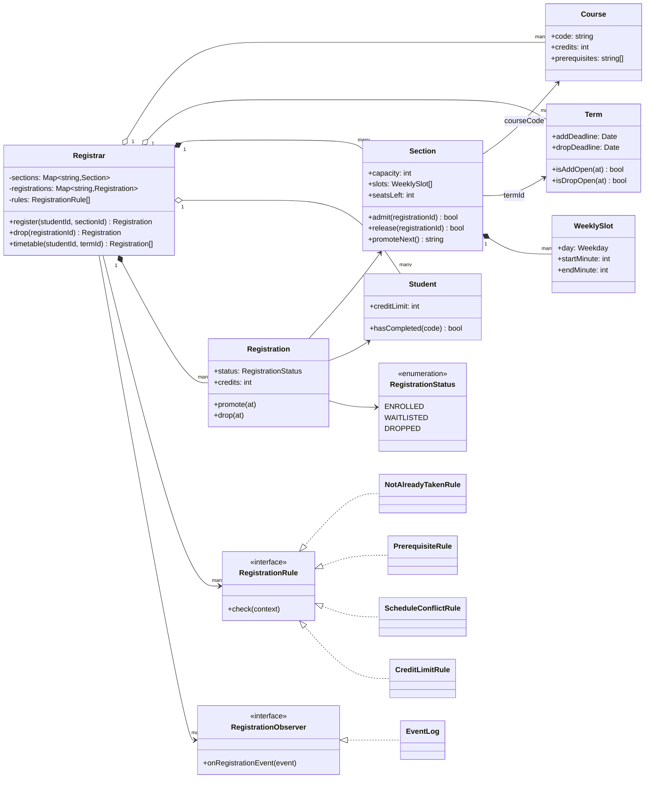
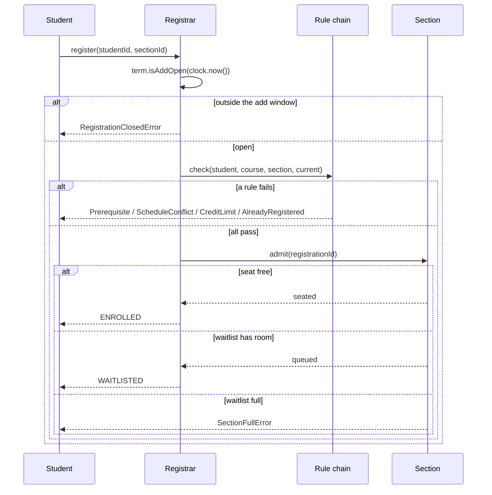
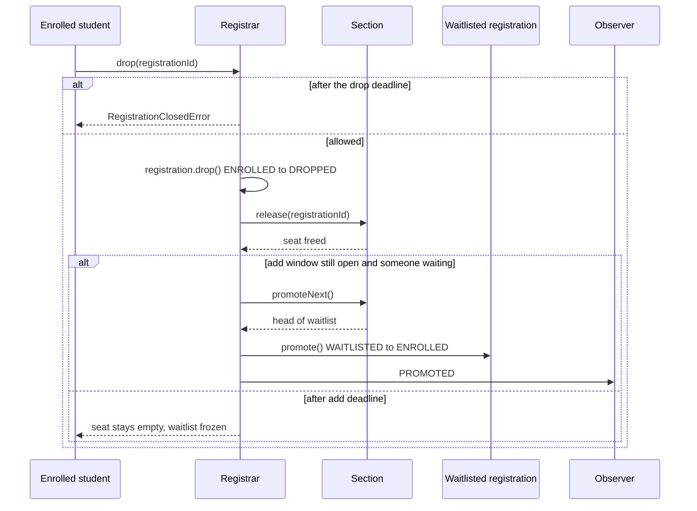

# Design a Course Registration System

| | |
|---|---|
| **Difficulty** | Medium |
| **Solution** | [`src/course-registration-system/`](../src/course-registration-system/) |
| **Run** | `npm run demo -- course-registration-system` · `npx vitest run src/course-registration-system` |
| **Patterns** | Strategy (rule chain), Observer, State (transition table), Aggregate root |

## 1. Problem statement

Design the registration system a university uses each term. Students register for sections of courses; the system checks prerequisites, seat capacity, timetable clashes and the per-term credit limit, keeps a waitlist when a section is full, promotes from the waitlist when someone drops, and enforces the add and drop deadlines.

## 2. Clarifying questions to ask first

- Course vs section: is a "class" the catalog entry, or one instructor's offering at a time and place? (Both: `Course` and `Section`.)
- Are prerequisites a flat list (all required) or expressions such as "CS201 or CS202"? Is concurrent enrolment allowed?
- How is a timetable clash defined? Does a class ending at 11:00 clash with one starting at 11:00?
- Is there a credit limit per term? Do waitlisted courses count towards it?
- What happens when a section is full: reject, or waitlist? Is the waitlist bounded? Is promotion automatic or an offer the student must accept?
- Which deadlines exist: add, drop, withdraw? Does promotion continue after the add deadline?

Assumptions used in the solution: prerequisites are a list that must all be completed; weekly slots are half-open, so back-to-back classes are fine; the credit limit and the clash check count ENROLLED and WAITLISTED registrations, so a promotion can never break either rule; a full section waitlists up to a bounded length, then refuses; promotion is automatic and FIFO; adding is allowed from `opensAt` until the add deadline (exclusive), dropping until the drop deadline, and the waitlist is frozen after the add deadline.

## 3. Requirements

### Functional
1. A `Course` has a code, credits and prerequisite course codes. A `Section` belongs to one course and one term, with an instructor, a capacity, weekly meeting slots and a bounded waitlist.
2. A `Student` has completed courses and a per-term credit limit.
3. Registration runs a rule chain and fails with a specific error: course already completed or already registered this term; missing prerequisites (listing all of them); clash with another active registration; credit limit exceeded.
4. If the section has a seat the registration is ENROLLED, else WAITLISTED; if the waitlist is full too, `SectionFullError`.
5. Dropping an ENROLLED registration frees the seat and promotes the first WAITLISTED registration while the add window is open; dropping a WAITLISTED one just leaves the line.
6. Registration states ENROLLED, WAITLISTED, DROPPED with validated transitions; DROPPED is terminal.
7. Add and drop deadlines are checked with the injected clock.
8. Observers are told about ENROLLED, WAITLISTED, PROMOTED and DROPPED events.

### Non-functional
- Never more ENROLLED registrations than seats, and promotion strictly in waitlist order.
- New eligibility rules (major only, year 3+) are one class, not an edit to the registrar.
- Deterministic: clock and ids injected; no timers.

## 4. Core entities

| Entity | Responsibility |
|---|---|
| `Course` | Catalog entry: code, title, credits, prerequisites. |
| `Term` | The add window and the drop deadline. |
| `Section` | One offering: capacity, weekly slots, seated set and FIFO waitlist; `admit`, `release`, `promoteNext`. |
| `WeeklySlot` | Day plus half-open minute range; `slotsOverlap()` is the clash test. |
| `Student` | Completed courses and credit limit. |
| `Registration` | A student's claim on a section; ENROLLED, WAITLISTED, DROPPED. |
| `RegistrationRule` → `NotAlreadyTaken`, `Prerequisite`, `ScheduleConflict`, `CreditLimit` | One eligibility check each, run in order. |
| `RegistrationObserver` → `EventLog` | Receives registration events. |
| `Registrar` | Aggregate root: register, drop and promote, timetable. |

## 5. Class diagram

## 6. Key flows

## 7. Design patterns used

- **Strategy as a rule chain.** Each `RegistrationRule` checks one thing and throws its own error. The registrar loops over the list, so the order is the order of messages a student sees, and adding "majors only" is a new class in the list. Alternative: Chain of Responsibility with `next` links; same effect, more wiring. A Specification that returns booleans would lose the reason.
- **Observer** for registration events: emailing the promoted student, syncing the timetable app and telling an advisor are subscribers, not registrar code. Alternative: an outbox table read by a worker, which survives crashes.
- **State as a transition table** for `Registration`. A DROPPED registration cannot be promoted or dropped again; re-registering creates a new record, which keeps history honest. Alternative: an `isDropped` flag plus `if`s, which is how double-drops slip through.
- **Aggregate boundaries.** `Section` owns seat counting and the waitlist order; `Registrar` owns everything that needs the student's other registrations. That split is what lets the seat invariant be one compare-and-set in a database.

## 8. Trade-offs, extensions and follow-up questions

**Counting waitlisted courses towards limits.** Counting them means a promotion is always valid, so it can be automatic. The cost is that a student cannot waitlist "backup" sections that clash. The alternative is to re-run the rules at promotion and skip students who no longer fit, which needs a SKIPPED outcome and a notification.

**"Registration opens at 09:00 and 5,000 students click at once."** The invariant is seats. In-process, `Section.admit()` is synchronous, so there is no gap between "is there a seat" and "take it". In a database, do it as one conditional update: `UPDATE sections SET enrolled = enrolled + 1 WHERE id = ? AND enrolled < capacity` and check one row changed; if not, insert into the waitlist with a sequence number. A `UNIQUE (student_id, course_code, term_id) WHERE status <> 'DROPPED'` index blocks duplicate registrations from double clicks, and an idempotency key on the request returns the first result to a retry.

**"Two drops promote the same waitlisted student."** Promotion is `UPDATE registrations SET status='ENROLLED', version=version+1 WHERE id = (SELECT id FROM registrations WHERE section_id=? AND status='WAITLISTED' ORDER BY seq LIMIT 1 FOR UPDATE SKIP LOCKED) RETURNING id`, in the same transaction as the drop.

**Clash detection cost.** A student has at most a handful of sections, so pairwise comparison is fine. For room scheduling across a campus, sort slots per day and sweep, or use an interval tree.

**Follow-ups an interviewer may ask:**
- *Prerequisites like "CS201 or CS202, and MA101"?* Model prerequisites as an expression tree (`AllOf`, `AnyOf`, `CourseCompleted`); `PrerequisiteRule` evaluates it.
- *Co-requisites, such as a lab with its lecture?* A rule that checks the co-requisite is in `current` or in the same request; register both atomically.
- *Priority registration for seniors?* Per-student `opensAt` (a registration window), checked by a new rule.
- *Offer instead of auto-promote?* Add an OFFERED state with an expiry, like a library hold; expire offers on a scheduler tick against the clock.
- *Withdrawals after the drop deadline?* A WITHDRAWN state that keeps the seat counted for the transcript but frees it for nobody.

**Persistence sketch.**

| Table | Key columns |
|---|---|
| `courses` | `code` PK, `title`, `credits` |
| `course_prerequisites` | `course_code`, `requires_code` |
| `terms` | `id` PK, `opens_at`, `add_deadline`, `drop_deadline` |
| `sections` | `id` PK, `course_code`, `term_id`, `instructor_id`, `capacity`, `enrolled`, `waitlist_capacity`, `version` |
| `section_slots` | `section_id`, `weekday`, `start_minute`, `end_minute` |
| `registrations` | `id` PK, `student_id`, `section_id`, `course_code`, `term_id`, `status`, `waitlist_seq`, `created_at`, `updated_at`; partial unique index above |

## 9. What a strong interview answer sounds like

1. Separate `Course` from `Section` at once, then ask about prerequisites, clashes, credit limits, waitlists and deadlines; state the half-open slot and "waitlisted counts" assumptions.
2. List the entities and the invariant: never more enrolled than capacity, promotion strictly FIFO.
3. Draw the class diagram with the rule chain as a Strategy list and the observer for events; show the three registration states.
4. Walk register (each failure branch, then seat or waitlist) and drop (promotion only while the add window is open).
5. Close with the registration-day rush: conditional `UPDATE ... WHERE enrolled < capacity`, the partial unique index, idempotency keys and `SKIP LOCKED` promotion; then one extension such as prerequisite expressions.
