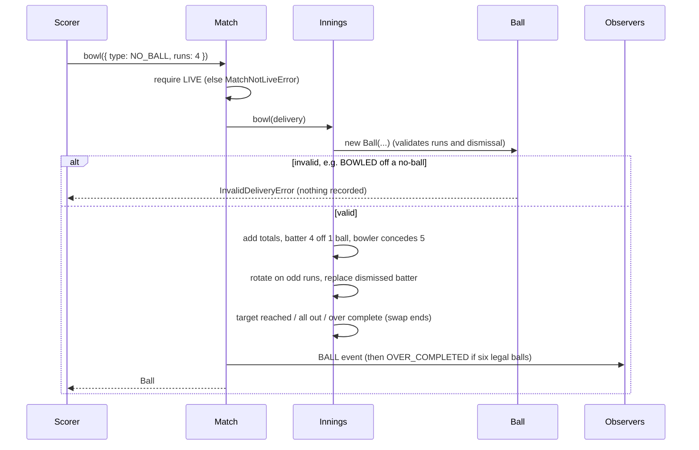
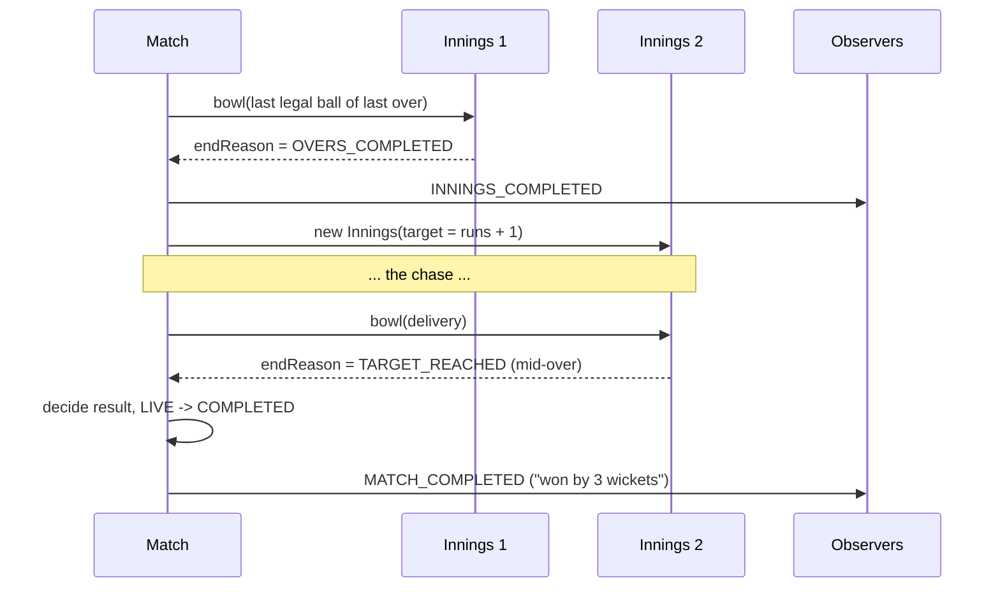

# Design Cricinfo (live cricket scoring)

| | |
|---|---|
| **Difficulty** | Medium |
| **Solution** | [`src/cricinfo/`](../src/cricinfo/) |
| **Run** | `npm run demo -- cricinfo` · `npx vitest run src/cricinfo` |
| **Patterns** | State, Observer, Value Object, Read Model (scorecard) |

## 1. Problem statement

Design the scoring engine behind a live cricket site. A scorer records every delivery of a limited-overs match; the system applies the Laws (extras, legal deliveries, strike rotation, dismissals, end of innings), keeps batting and bowling figures, publishes ball-by-ball commentary, and decides the result.

The difficulty is not the class count. It is getting the accounting rules exactly right and putting each rule in one place.

## 2. Clarifying questions to ask first

- Which formats: T20/ODI only (an overs limit), or Tests too (multiple innings, declarations, follow-on)?
- Which delivery types and extras must we support? Do penalty runs and overthrows matter?
- Which dismissals are possible off a wide or a no-ball (free hit rules)?
- What ends an innings? What decides the match: runs, wickets in hand, ties, Duckworth-Lewis?
- Who consumes updates: text commentary, a live scoreboard, push notifications? Push or poll?
- Can the scorer correct a ball after it was entered (undo)?

Assumptions used in the solution: limited overs, two innings, no rain rules; ball types NORMAL, WIDE, NO_BALL, BYE and LEG_BYE; a wide or no-ball costs one penalty run and is re-bowled; only run out (plus stumped and hit wicket off a wide) is possible off an illegal delivery; innings end on all out, overs exhausted or target reached; the result is "by N runs", "by N wickets" or a tie; commentary is pushed through observers; corrections are an extension.

## 3. Requirements

### Functional
1. A match has two teams and an overs limit, and moves SCHEDULED -> LIVE -> COMPLETED; any other transition throws.
2. An innings is a sequence of overs; an over has one bowler and completes after 6 legal deliveries. A bowler cannot bowl consecutive overs, and a new over cannot start before the current one is complete.
3. Delivery rules:
   - NORMAL: runs go to the batter and the bowler.
   - WIDE: 1 extra plus any runs taken, all as wides; not legal; not a ball faced; charged to the bowler.
   - NO_BALL: 1 extra; runs off the bat go to the batter; not legal; counts as a ball faced; the bowler is charged 1 plus the runs.
   - BYE / LEG_BYE: runs are extras; legal; a ball faced; not charged to the bowler.
4. Strike rotates when an odd number of runs is run (wide and bye runs included, the penalty run excluded), and again at the end of every over.
5. Wickets: the dismissal must be possible off that delivery type; bowled, caught, lbw, stumped and hit wicket count for the bowler, run out does not; a run out may dismiss the non-striker; the next batter takes the dismissed batter's end.
6. An innings ends when all out (one batter left), overs are exhausted, or (second innings) the target is reached, even mid-over. The target is first-innings runs plus one.
7. Scorecard: score, overs ("x.y"), extras by kind, run rate, required run rate while chasing, batting (runs, balls, 4s, 6s, strike rate, dismissal) and bowling (overs, maidens, runs, wickets, economy).
8. Commentary and other listeners receive ball, over, innings and match events and can unsubscribe.

### Non-functional
- Each Law is encoded once (on `Ball`), so the innings, scorecard and commentary cannot disagree.
- Invalid input is rejected before any state changes.
- Updates are pushed, not polled; adding a consumer does not change the match.
- Deterministic tests: clock and ids injected.

## 4. Core entities

| Entity | Responsibility |
|---|---|
| `Team`, `Player` | Squad in batting order. |
| `Ball` (with `BallType`, `Wicket`, `DismissalType`) | One delivery and its derived accounting: legal, batter runs, extras, runs conceded, ball faced, strike rotation. |
| `Over` | Up to 6 legal balls by one bowler; complete and maiden checks. |
| `Innings` | Crease (striker, non-striker, next batter), figures, extras and the end-of-innings rules. |
| `Match` | Status machine, the two innings, target hand-over, result, event publishing. |
| `MatchObserver` → `TextCommentary` | Consumers of match events. |
| `buildScorecard` | Read model computed from an innings on demand. |

## 5. Class diagram

```mermaid
classDiagram
    direction LR
    class Match {
        +id: string
        +oversLimit: int
        +status: MatchStatus
        +result: MatchResult
        +start(battingFirstId) Innings
        +startOver(bowlerId) Over
        +bowl(delivery) Ball
        +subscribe(observer) unsubscribe
        +scorecards() Scorecard[]
    }
    class Innings {
        +number: int
        +target: int
        +runs: int
        +wickets: int
        +striker: string
        +nonStriker: string
        +endReason: InningsEndReason
        +startOver(bowlerId) Over
        +bowl(delivery) Ball
        +battingFigures() BattingFigures[]
        +bowlingFigures() BowlingFigures[]
    }
    class Over {
        +index: int
        +bowlerId: string
        +legalBalls: int
        +isComplete: bool
        +isMaiden: bool
        +add(ball)
    }
    class Ball {
        +type: BallType
        +runs: int
        +wicket: Wicket
        +isLegal: bool
        +batterRuns: int
        +extras: int
        +runsConceded: int
        +countsAsBallFaced: bool
        +rotatesStrike: bool
    }
    class Team {
        +id: string
        +name: string
        +players: Player[]
    }
    class MatchObserver {
        <<interface>>
        +onEvent(event)
    }
    class TextCommentary {
        +lines: string[]
    }
    class BallType {
        <<enumeration>>
        NORMAL
        WIDE
        NO_BALL
        BYE
        LEG_BYE
    }
    class DismissalType {
        <<enumeration>>
        BOWLED
        CAUGHT
        LBW
        RUN_OUT
        STUMPED
        HIT_WICKET
    }
    class MatchStatus {
        <<enumeration>>
        SCHEDULED
        LIVE
        COMPLETED
    }
    class InningsEndReason {
        <<enumeration>>
        ALL_OUT
        OVERS_COMPLETED
        TARGET_REACHED
    }

    Match "1" *-- "1..2" Innings
    Match --> "2" Team
    Match o-- "many" MatchObserver
    Innings "1" *-- "many" Over
    Over "1" *-- "1..many" Ball
    Innings --> Team : batting and bowling
    Ball --> BallType
    Ball --> "0..1" DismissalType
    Match --> MatchStatus
    Innings --> InningsEndReason
    MatchObserver <|.. TextCommentary
```

## 6. Key flows

## 7. Design patterns used

- **Value Object with derived rules** (`Ball`). Legal or not, who gets the runs, what the bowler concedes, whether it rotates strike: each is a getter on `Ball`, so the rule exists once and the innings only sums. The alternative, a `switch` on ball type inside `Innings`, works until the scorecard and commentary need the same rules and drift.
- **State** for `Match` (SCHEDULED -> LIVE -> COMPLETED, table-driven) and, implicitly, `Innings` (in progress until an end reason is set). Bowling into a completed innings or match throws instead of being ignored.
- **Observer** for commentary. `TextCommentary` is one subscriber; a live scoreboard, a push notifier ("WICKET!") or a websocket broadcaster are others, and the match never knows about them. Alternative: an event log that consumers read at their own pace (Kafka), which is what you want once consumers are other services.
- **Read model** (`buildScorecard`). Figures are kept incrementally in the innings, but the scorecard with rates and formatting is computed on demand and never written back.

## 8. Trade-offs, extensions and follow-up questions

**"Two scorers enter the same ball, or the app retries."** Every delivery is an event with a client-generated id and a sequence number per innings. Persist with `INSERT INTO deliveries (id, innings_id, seq, ...)` and `UNIQUE (innings_id, seq)`: the second scorer's insert fails and they see the ball already recorded; a retry with the same `id` is an idempotent no-op. Update the summary row with `UPDATE innings SET runs = ?, wickets = ?, version = version + 1 WHERE id = ? AND version = ?` in the same transaction.

**"The scorer made a mistake three balls ago."** Because figures are derived from balls, an undo is "remove the last delivery event and replay the innings". Event sourcing makes this natural: the ball list is the source of truth and the figures are a projection. Publish a `CORRECTION` event so commentary can amend the line.

**"Millions of fans watching."** Do not let readers hit the match aggregate. Publish events to a topic; a fan-out service pushes deltas over websockets or SSE, and a cache holds the latest scorecard per match. Reads are then O(1) and independent of the scoring path.

**"Support Test cricket."** Innings count, follow-on and declarations become a `MatchFormat` strategy (`maxInnings`, `oversLimit | null`, result rules); `Innings` stays the same.

**"Free hits, penalty runs, overthrows, retired hurt."** Free hit is a flag on the next legal delivery restricting dismissals to run out; penalty runs are a new extra kind; overthrows are just more runs; retired hurt is a non-wicket dismissal that does not count towards all out.

**"Rain rules."** DLS revises the target and overs; model as a `TargetRevision` event applied to the second innings.

**Persistence sketch.** `teams`, `players(team_id, batting_order)`, `matches(id, team_a, team_b, overs_limit, status, result, version)`, `innings(id, match_id, number, batting_team, target, runs, wickets, end_reason, version)`, `overs(innings_id, idx, bowler_id)`, `deliveries(id, innings_id, seq, over_idx, ball_number, bowler_id, striker_id, type, runs, dismissal_type, player_out_id, fielder_id, recorded_at)` with `UNIQUE (innings_id, seq)`. Batting and bowling figures are projections that can be rebuilt from `deliveries`.

## 9. What a strong interview answer sounds like

1. Pin down the format and the Laws in scope (extras, legal deliveries, which dismissals off a no-ball, end of innings, result wording); say what is out of scope (Tests, DLS).
2. Identify the core rule carrier: `Ball` derives legality, batter runs, extras, runs conceded, ball faced and strike rotation, so everything else just adds up.
3. Draw `Match` -> `Innings` -> `Over` -> `Ball`, with the match status machine, end-of-innings reasons and the observer interface.
4. Walk one no-ball delivery end to end, including the invalid-dismissal branch, and the hand-over from first innings to chase to result.
5. Close with idempotent ball entry (unique sequence per innings), undo via event replay, fan-out to millions of readers, and how formats and free hits extend the model.
