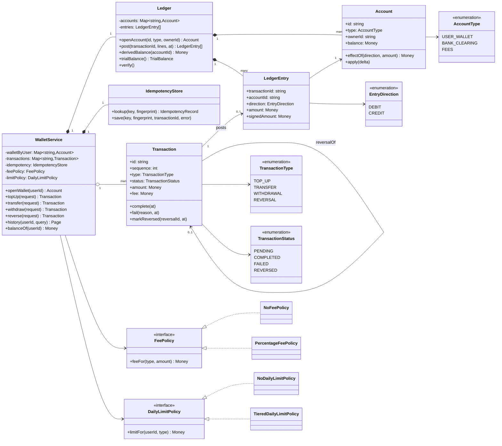
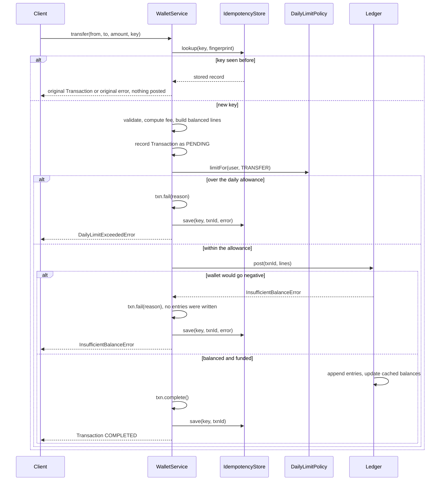
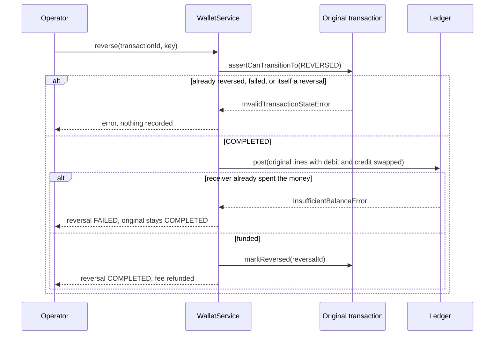

# Design a Digital Wallet

| | |
|---|---|
| **Difficulty** | Medium |
| **Solution** | [`src/digital-wallet/`](../src/digital-wallet/) |
| **Run** | `npm run demo -- digital-wallet` · `npx vitest run src/digital-wallet` |
| **Patterns** | Double-entry ledger, Strategy, State (transition table), Idempotent Receiver, Compensating Transaction |

## 1. Problem statement

Design the backend of a wallet app: users top up from their bank, pay each other, and withdraw back to their bank. Every paisa must be accounted for. Money is never created or destroyed, a retried request never moves money twice, and a mistake is undone with compensating entries instead of edits.

## 2. Clarifying questions to ask first

- One currency or several? (Several means one set of accounts per currency and FX postings between them.)
- Do we hold the money (a pooled bank account we reconcile against) or only track it?
- Are there fees? On which operations, who pays, and how is a fractional paisa rounded?
- Which limits apply: per transaction, per day, per month, by KYC tier? When does "a day" reset?
- Can a transaction be reversed? Fully or partially, by whom, and is the fee refunded?
- Do bank top-ups settle synchronously, or do they stay pending until a webhook?
- How do clients retry? Do they send an idempotency key?
- What does history look like: which order, how far back, what page size?

Assumptions used in the solution: INR only, amounts in paise; top-ups and withdrawals settle synchronously against one pooled `BANK_CLEARING` account; transfers cost 1% (sender pays, rounded half-up); daily limits per user and type reset at 00:00 UTC and count completed transactions only; only full reversals, by an operator, fee included; every request carries a client-generated idempotency key; history is newest first with keyset pagination.

## 3. Requirements

### Functional
1. Users open one wallet each; the system accounts `BANK_CLEARING` and `FEES` exist from the start.
2. Top-up, transfer and withdrawal are `Transaction`s that post balanced debit and credit entries to a double-entry ledger, all lines or none.
3. A wallet never goes negative: the request fails with `InsufficientBalanceError` and the transaction is recorded as `FAILED` with no entries.
4. Fees and daily limits are policies evaluated with the injected clock; fees are credited to `FEES`.
5. A replayed idempotency key returns the original outcome (transaction or error) without posting; the same key with a different request is rejected.
6. Transactions move `PENDING → COMPLETED | FAILED` and `COMPLETED → REVERSED`; anything else throws. A reversal posts the original lines mirrored, so nothing is ever deleted.
7. Balances are cached on accounts, derivable from entries at any time, and a reconciliation asserts both agree and that all entries sum to zero.
8. Each user sees a paginated history, newest first.

### Non-functional
- Correctness over throughput: integer minor units, no float, one explicitly rounded division (the fee).
- Auditability: the ledger is append-only; every balance is explained by its entries.
- Balance reads are O(1) from the cache; a history page is O(page size) with the right index.
- Deterministic and testable: clock and id generation are injected.

## 4. Core entities

| Entity | Responsibility |
|---|---|
| `Account` (+ `AccountType`) | Cached balance, its normal side (debit for the bank asset, credit for wallets and fees), and the no-overdraft guard for wallets. |
| `LedgerEntry` (+ `EntryDirection`) | Immutable debit or credit line belonging to one transaction. |
| `Ledger` | Validates a whole posting (balanced, positive, funded) before writing any line; derives balances; `verify()` reconciles. |
| `Transaction` (+ `TransactionType`, `TransactionStatus`) | The business view of one movement and its state machine. |
| `IdempotencyStore` | Key → request fingerprint, transaction id and, for failures, the error that was returned. |
| `FeePolicy` → `NoFeePolicy`, `PercentageFeePolicy` | What a movement costs. |
| `DailyLimitPolicy` → `NoDailyLimitPolicy`, `TieredDailyLimitPolicy` | How much a user may move per day. |
| `WalletService` | Aggregate root and the only ledger writer: `topUp`, `transfer`, `withdraw`, `reverse`, `history`. |

## 5. Class diagram



The postings, with balance = sum on the normal side minus the other side:

| Transaction | Debit | Credit |
|---|---|---|
| Top-up 1,000 | `BANK_CLEARING` 1,000 | wallet 1,000 |
| Transfer 2,500, 1% fee | sender 2,525 | receiver 2,500, `FEES` 25 |
| Withdrawal 500 | wallet 500 | `BANK_CLEARING` 500 |
| Reversal | every original credit | every original debit |

Because `BANK_CLEARING` is an asset and wallets and fees are what the platform owes, the books balance only if **bank = sum of wallets + fees**. The demo and the tests check exactly that.

## 6. Key flows





## 7. Design patterns used

- **Double-entry ledger.** Balances are a projection of immutable entries, and every posting sums to zero, so money can only move, never appear. The alternative, a mutable `balance` column per user, is simpler but cannot explain a wrong balance or prove nothing leaked.
- **Strategy** for `FeePolicy` and `DailyLimitPolicy`. Pricing and limits change with business and regulation (KYC tiers, promotions) while the posting logic must not. Alternative: a rules table read at runtime, which is the same seam with data instead of classes.
- **State (as a transition table)** for `TransactionStatus`. Four states and five legal moves fit in one table that throws on anything else. Alternative: a class per state (the GoF State pattern), worth it only when behaviour differs per state.
- **Idempotent Receiver.** The store keeps the *response* per key, not just "seen", so a client that lost the first answer gets the same one, error included. Alternative: deduplicate on a natural key such as an order id, which works only where one exists.
- **Compensating Transaction** for reversals. The original lines stay; mirrored lines cancel them. Alternative: deleting or editing entries, which destroys the audit trail and breaks reconciliation with the bank.
- **Single writer (aggregate root).** Only `WalletService.execute()` creates transactions and posts, so idempotency, limits and the ledger invariant have one gate.

## 8. Trade-offs, extensions and follow-up questions

**"Two payments from the same wallet race."** In-process the validate-then-apply is synchronous. In a database, all of one request is one database transaction:

```sql
BEGIN;
INSERT INTO idempotency_keys (key, fingerprint) VALUES (:key, :fp);      -- unique violation = replay
UPDATE accounts SET balance = balance - :debit
 WHERE id = :wallet AND balance >= :debit;                               -- 0 rows = insufficient
UPDATE accounts SET balance = balance + :amount WHERE id = :receiver;
UPDATE accounts SET balance = balance + :fee WHERE id = 'FEES';
INSERT INTO ledger_entries (...) VALUES (...), (...), (...);
UPDATE transactions SET status = 'COMPLETED' WHERE id = :txn AND status = 'PENDING';
COMMIT;
```

The conditional `UPDATE ... WHERE balance >= :debit` is the overdraft guard; checking that one row changed replaces a read-then-write race. With several accounts touched, lock them in id order (`SELECT ... FOR UPDATE ORDER BY id`) to avoid deadlocks, or run at `SERIALIZABLE` and retry on serialization failures. `FEES` and `BANK_CLEARING` are hot rows touched by every transaction: shard them into N sub-accounts and sum on read, or post their side from a queue.

**"How do you know the balances are right?"** `Ledger.verify()` is the nightly reconciliation: entries sum to zero and every cached balance equals its derived balance. A second reconciliation compares `BANK_CLEARING` with the real bank statement.

**"A bank top-up takes minutes to confirm."** Keep the transaction `PENDING` and post nothing (or post into a suspense account) until the webhook; then `complete()` posts the entries. Add an `EXPIRED` state for confirmations that never arrive.

**"Daily limits under concurrency?"** Keep a `daily_usage(user_id, day, type, used)` row and increment it with `UPDATE ... SET used = used + :amt WHERE used + :amt <= :limit` inside the same database transaction.

**"Partial refunds?"** Reverse a proportional set of lines, track `refundedAmount <= amount`, and add a `PARTIALLY_REVERSED` state.

**"Multiple currencies?"** One wallet and one clearing account per currency; FX is two balanced postings through an FX account per currency, so each currency's ledger still sums to zero.

**Persistence sketch.** `accounts(id, type, owner_id, currency, balance, version)`, `transactions(id, seq BIGSERIAL, type, status, from_account, to_account, amount, fee, reversal_of, failure_reason, created_at)`, `ledger_entries(id, transaction_id, account_id, direction, amount CHECK (amount > 0), posted_at)`, `idempotency_keys(key PRIMARY KEY, fingerprint, transaction_id, error_code, created_at)`. Index `ledger_entries(account_id, posted_at)` for derivation and statements and `transactions(account_id, seq DESC)` for keyset pagination. A deferred constraint (or the posting procedure) asserts each transaction's entries sum to zero; nobody gets `UPDATE` or `DELETE` on `ledger_entries`.

## 9. What a strong interview answer sounds like

1. Clarify currency, who holds the money, fees and rounding, limits, reversals and retries in two minutes; state the assumptions.
2. Lead with the invariant: a double-entry ledger where every posting sums to zero, wallets never go negative, and balances are a cache of entries.
3. Draw `Account`, `LedgerEntry`, `Ledger`, the `Transaction` state machine, the `IdempotencyStore`, and fees and limits as interfaces.
4. Walk a transfer end to end, including the replay, the insufficient-balance path (`FAILED`, zero entries) and a reversal as compensating entries.
5. Map it to a database: one database transaction per request, conditional `UPDATE ... WHERE balance >= amount`, the idempotency key's unique constraint in the same transaction, lock ordering, hot-account sharding, and a reconciliation job.
