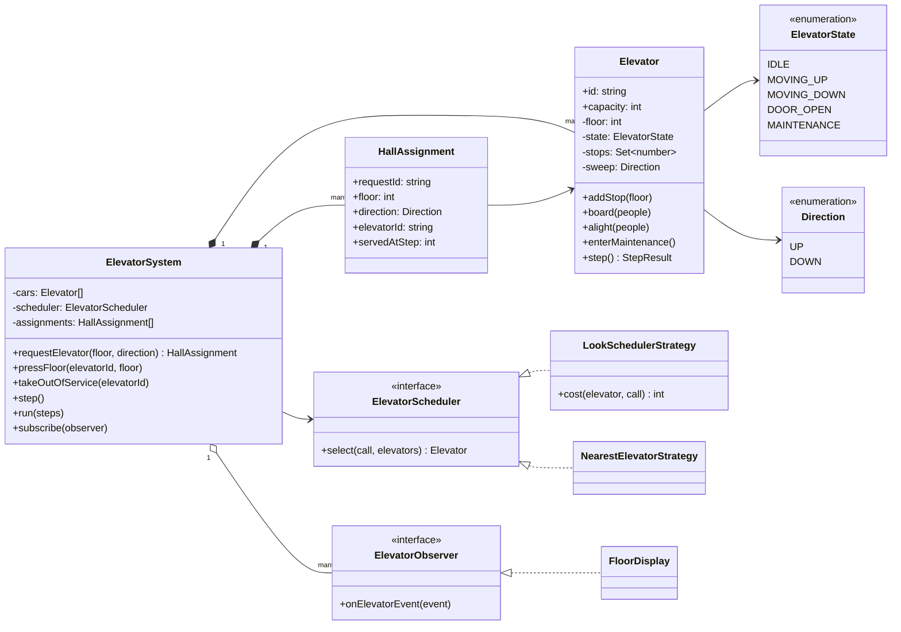
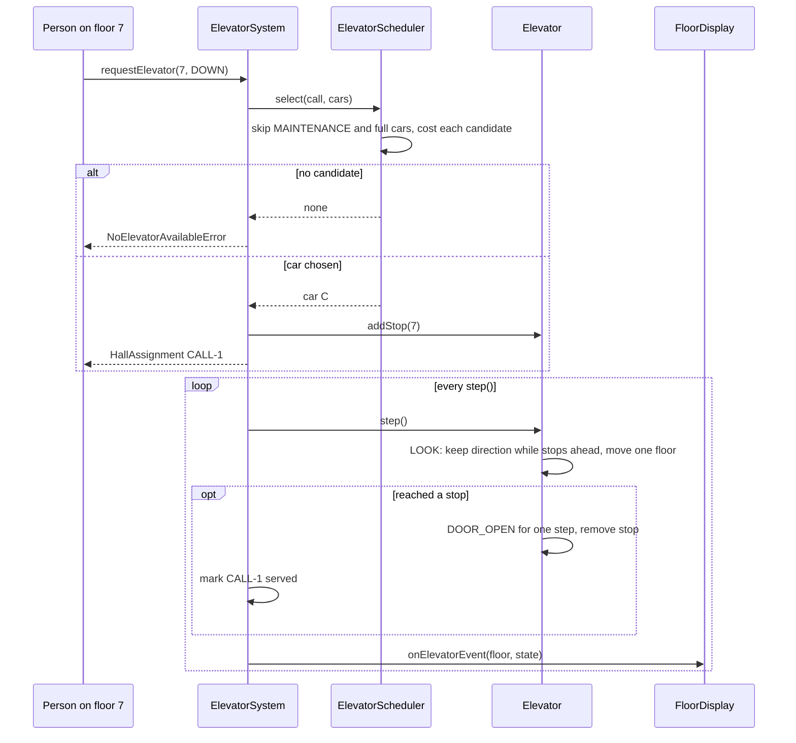

# Design an Elevator System

| | |
|---|---|
| **Difficulty** | Hard |
| **Solution** | [`src/elevator-system/`](../src/elevator-system/) |
| **Run** | `npm run demo -- elevator-system` · `npx vitest run src/elevator-system` |
| **Patterns** | Strategy, State (validated enum transitions), Observer |

## 1. Problem statement

Design the control software for a bank of elevators in one building. People on a landing press UP or DOWN (a hall call); people inside a car press a destination floor (a car call). The system decides which car answers each hall call, moves the cars, opens and closes doors, respects capacity, and keeps floor displays up to date.

## 2. Clarifying questions to ask first

- How many cars and floors? Do all cars serve all floors?
- What should the assignment optimise: wait time, travel time, energy?
- How does a car decide its order of stops? (SCAN/LOOK is the expected answer.)
- What does capacity mean: people or weight? What happens when a car is full?
- Can a car be taken out of service, and what happens to its calls?
- How is time modelled? (Say "discrete steps" so the design is testable.)

Assumptions used in the solution: N cars over floors `minFloor..maxFloor`, capacity in people, a pluggable scheduler (nearest car, or direction-aware LOOK cost), each car moves by LOOK, time advances in steps (one floor per step, a door cycle takes one step), a car enters maintenance only when idle with no stops, and full or maintenance cars are never assigned.

## 3. Requirements

### Functional
1. A hall call `(floor, direction)` is assigned to exactly one car by the scheduler; with no candidate it throws `NoElevatorAvailableError`.
2. A car call adds a stop to that car. Floors outside the building, or an UP button on the top floor, throw `InvalidFloorError`.
3. Each car moves one floor per `step()`. When it reaches a stop its door opens for one step, then it closes and the car continues.
4. A car keeps its direction while any stop lies ahead and only reverses when none does (LOOK).
5. States IDLE, MOVING_UP, MOVING_DOWN, DOOR_OPEN, MAINTENANCE with a validated transition table: a moving car cannot reverse or enter maintenance without stopping.
6. Boarding is allowed only with the door open and never beyond capacity (`CapacityExceededError`).
7. Cars in MAINTENANCE and full cars are never assigned hall calls.
8. Floor displays are notified of every floor or state change.

### Non-functional
- Deterministic simulation: no timers; tests drive `step()`.
- Swappable assignment policy without touching cars.
- Each car protects its own invariants; the system orchestrates.

## 4. Core entities

| Entity | Responsibility |
|---|---|
| `ElevatorSystem` | Assigns hall calls through the scheduler, forwards car calls, steps all cars, notifies observers, tracks which calls were served. |
| `Elevator` | One car: floor, state, stop set, load. LOOK movement, door cycle, capacity and transition checks. |
| `ElevatorState`, `Direction` + transition table | The legal state changes. |
| `ElevatorScheduler` → `NearestElevatorStrategy`, `LookSchedulerStrategy` | Strategy for choosing a car for a hall call. |
| `HallCall`, `HallAssignment` | A landing request and who answered it, when. |
| `ElevatorObserver` → `FloorDisplay` | Receive car movements and state changes. |

## 5. Class diagram

## 6. Key flows

## 7. Design patterns used

- **Strategy** for assignment. "Nearest car" is the first answer everyone gives; it fails when the nearest car is heading away with a long list of stops. `LookSchedulerStrategy` costs each car as "distance if it is already sweeping towards you in your direction, otherwise distance to the end of its sweep and back". Other policies (zoning, rush-hour lobby bias, energy saving) plug in the same way. Alternative: a central optimiser that reassigns calls every step (destination dispatch), which is a bigger design.
- **State as a validated enum** in the car. Transitions are a table (`canTransition`), and movement logic lives in `step()`. With five states and simple behaviour per state, state classes would mostly be boilerplate; say that this is a judgement call and that the vending machine and ATM in this repo use state classes because their per-state behaviour is richer.
- **Observer** for floor displays and anything else interested (telemetry, access control). The system emits an event only when a car's floor or state actually changed.
- **Discrete time.** One `step()` = one floor or one door cycle. No timers, so a test can assert "the door was open for exactly one step".

## 8. Trade-offs, extensions and follow-up questions

**Why LOOK and not SCAN or FCFS?** First-come-first-served zig-zags and starves far floors. SCAN goes to the end of the shaft every time; LOOK reverses at the last requested floor, which is what real elevators do. The car's own movement is always LOOK; only the assignment policy is swappable.

**Hall-call direction at the car.** The car stops at any floor in its stop set while passing. A refinement stores direction-tagged stops so a car going up does not stop for someone who pressed DOWN, picking them up on the way back instead.

**Concurrency.** Hall calls arrive from many landings at once while cars move. Keep one controller as the single writer per bank of elevators; requests are commands on its queue. If assignments are persisted, a call is claimed with `UPDATE hall_calls SET elevator_id = ?, version = version + 1 WHERE id = ? AND elevator_id IS NULL`, and a unique constraint on `(floor, direction) WHERE served_at IS NULL` stops a double-pressed button from creating two calls. The button press carries an idempotency key from the landing panel.

**"A car breaks down with assigned calls."** Move it to MAINTENANCE (after it is safely stopped), take its unserved hall calls and run them through the scheduler again. Car calls of passengers inside need a human: the car goes to the nearest floor and opens.

**"Capacity by weight / VIP or freight mode / express zones."** Weight replaces the people count in `board()`. Modes and zones are scheduler policies plus a per-car allowed-floor set.

**Persistence sketch.** `elevators(id, bank_id, capacity, floor, state, version)`, `hall_calls(id, floor, direction, elevator_id NULL, requested_at, served_at NULL, version)`, `car_calls(elevator_id, floor, created_at)`, and an append-only `elevator_events(elevator_id, floor, state, step, at)` for monitoring and replay.

## 9. What a strong interview answer sounds like

1. Clarify cars, floors, optimisation goal, capacity and maintenance; say you will model time as discrete steps.
2. Separate the two decisions: which car answers a hall call (scheduler Strategy) and in what order a car serves its stops (LOOK).
3. Draw the car states and the transition table; state the invariants (no reversal while moving, no boarding with the door closed, never over capacity).
4. Walk a hall call through assignment, movement, door cycle and service, including the "no car available" and capacity failures.
5. Close with the nearest-vs-LOOK counterexample, reassigning calls when a car breaks down, and single-writer concurrency with idempotent button presses.
