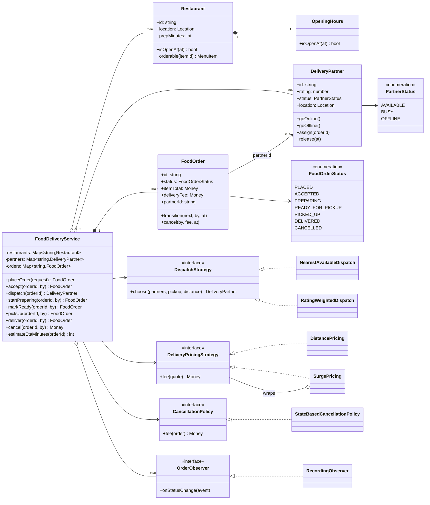
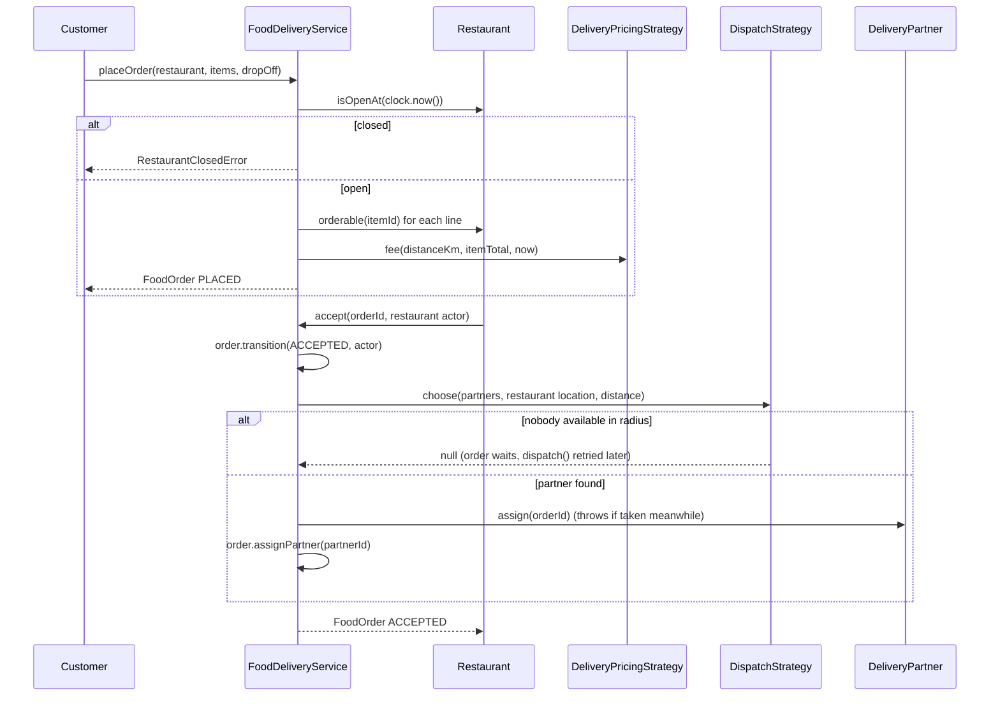
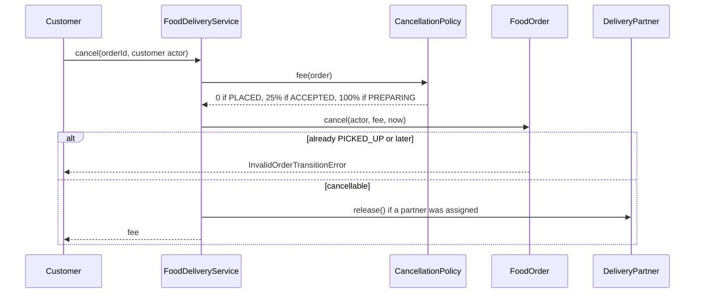

# Design a Food Delivery System

| | |
|---|---|
| **Difficulty** | Hard |
| **Solution** | [`src/food-delivery/`](../src/food-delivery/) |
| **Run** | `npm run demo -- food-delivery` · `npx vitest run src/food-delivery` |
| **Patterns** | Strategy (dispatch, pricing, cancellation), Decorator (surge), Observer, State machine with actor permissions |

## 1. Problem statement

Design the order and dispatch core of a food delivery app such as Swiggy, Zomato or DoorDash. Customers order from restaurants that are open, the restaurant accepts and cooks, the system assigns a nearby delivery partner, and the partner picks up and delivers. Three parties drive one order, so the design must say who may move the order to which state, what a cancellation costs at each point, and how partners stay consistently busy or free.

## 2. Clarifying questions to ask first

- Who can trigger each status change: customer, restaurant, delivery partner, or the system?
- When is a partner assigned: on placement, on acceptance, or when food is nearly ready?
- How do we pick a partner: nearest, best rated, fewest active orders? Within what radius?
- How is the delivery fee computed? Is there surge pricing, and what drives it?
- What does a cancellation cost the customer at each stage? Who pays if the restaurant declines?
- Do we need an ETA? From what inputs?
- Can a partner carry several orders at once (batching)?
- Are opening hours per day of week, and do they cross midnight?

Assumptions used in the solution: one restaurant per order; one order per partner at a time; dispatch happens when the restaurant accepts (and can be retried if nobody is free); nearest-available within a radius by default, rating-weighted as a variant; distance comes from an injected function; fee = base + per started km, optionally multiplied by a surge percentage; cancellation is free before acceptance, 25% of the food once accepted, 100% once cooking, impossible after pickup; restaurant-initiated cancellation is always free for the customer; daily opening windows in UTC, possibly overnight; payment is out of scope.

## 3. Requirements

### Functional
1. Restaurants have a location, a menu with availability, a preparation time and opening hours; orders are rejected while closed.
2. An order has lines snapshotted from the menu, an item total, a delivery fee and a drop-off location.
3. Lifecycle: PLACED, ACCEPTED, PREPARING, READY_FOR_PICKUP, PICKED_UP, DELIVERED, or CANCELLED. Illegal moves throw.
4. Each transition names who may perform it, and the actor must be this order's customer, restaurant or assigned partner.
5. On acceptance the system dispatches an available partner using a pluggable strategy; if none is available the order waits and dispatch can be retried.
6. Partners are AVAILABLE, BUSY or OFFLINE; a busy partner cannot take another order or go offline, and becomes available at the drop-off after delivery.
7. The delivery fee comes from a pluggable pricing strategy, with surge as a wrapper.
8. The cancellation fee depends on the state at cancellation; an assigned partner is freed.
9. The system estimates the ETA, and observers are notified of every status change.

### Non-functional
- A partner is never assigned to two orders, even with concurrent acceptances.
- Clock-driven rules (opening hours, surge windows) are deterministic in tests through an injected `Clock`.
- Money in integer minor units; surge rounds up, cancellation rounds down, both explicitly.
- Dispatch, pricing and cancellation rules change without editing the service.

## 4. Core entities

| Entity | Responsibility |
|---|---|
| `Restaurant`, `MenuItem`, `OpeningHours` | Menu and availability, location, prep time, `isOpenAt(clock.now())`. |
| `DeliveryPartner`, `PartnerStatus` | Location, rating, availability with compare-and-set `assign()`. |
| `FoodOrder`, `FoodOrderStatus`, `ActorRole` | Lines and fees; the transition table annotated with who may take each edge. |
| `DispatchStrategy` → `NearestAvailableDispatch`, `RatingWeightedDispatch` | Choose a partner for a pickup location. |
| `DeliveryPricingStrategy` → `DistancePricing`, `SurgePricing` | Delivery fee; surge decorates any base pricing. |
| `CancellationPolicy` → `StateBasedCancellationPolicy` | Fee by state. |
| `DistanceFn` | Injected distance (straight line, Manhattan, or a routing service). |
| `OrderObserver` → `RecordingObserver` | Status-change subscribers (customer, restaurant and rider apps). |
| `FoodDeliveryService` | Application service: validates, prices, dispatches, keeps partners in step with orders, ETA. |

## 5. Class diagram

## 6. Key flows

Placing and accepting an order, including the closed-restaurant and no-partner branches:

Cancellation, priced by state:

## 7. Design patterns used

- **Strategy** for dispatch, delivery pricing and cancellation. All three change for business reasons (new cities, promotions, regulation), so the service only talks to interfaces. Alternative for dispatch: a global optimiser that assigns many orders to many partners at once (Hungarian algorithm, batch every few seconds) instead of greedy per order; better utilisation, harder to explain.
- **Decorator** for surge. `SurgePricing` wraps any `DeliveryPricingStrategy`, so surge composes with distance pricing, flat pricing or a future subscription discount. Alternative: a `surgeMultiplier` parameter on every pricing strategy, which duplicates the rounding rule.
- **State machine with permissions.** The transition table maps each edge to the roles allowed to take it, and `FoodOrder.isParty()` checks the actor is this order's customer, restaurant or partner. Keeping both checks in the entity means no endpoint can forget them. Alternative: a class per state; it scatters the permission matrix across seven files.
- **Observer** for the three apps that follow an order.
- **Injected distance function** so dispatch, pricing and ETA agree on one distance and tests do not need a map service.

## 8. Trade-offs, extensions and follow-up questions

**"Two restaurants accept at once and both pick the same partner."** `DeliveryPartner.assign()` is the compare-and-set: the second call throws and dispatch picks again. In SQL: `UPDATE partners SET status = 'BUSY', order_id = :order WHERE id = :p AND status = 'AVAILABLE'` and check one row changed. A unique partial index `UNIQUE(order_id) WHERE order_id IS NOT NULL` on partners plus `orders.partner_id` set in the same transaction prevents one order getting two partners. Order status changes use `UPDATE orders SET status = :next, version = version + 1 WHERE id = :id AND version = :v`.

**"Retries from flaky rider apps."** Pick-up and deliver calls carry an idempotency key; a repeated `deliver` on a DELIVERED order with the same key returns success instead of an invalid-transition error.

**"No partner available."** The order stays ACCEPTED with no partner; a scheduler calls `dispatch()` every few seconds with a growing radius (a different `DispatchStrategy` instance per attempt). After a timeout, the system cancels with a free fee and notifies everyone.

**"Assign later to save rider idle time."** Dispatch when `prep time remaining ≈ rider travel time` instead of at acceptance: the ETA calculation already has both numbers.

**"Batching two orders per rider."** Partner capacity becomes a number instead of a boolean; `assign` checks `active < capacity`, and dispatch scores the detour.

**"Finding nearby partners among 100,000."** Index partner locations with a geohash or H3 cell in Redis (`GEOSEARCH`) and pass only nearby candidates to the strategy.

**Persistence sketch.** `restaurants(id, location, prep_minutes)`, `opening_windows(restaurant_id, open, close)`, `menu_items(id, restaurant_id, price, available)`, `partners(id, status, location, rating, order_id NULL, version)`, `orders(id, customer_id, restaurant_id, partner_id NULL, status, item_total, delivery_fee, cancellation_fee, drop_off, version)`, `order_lines(order_id, item_id, unit_price, qty)`, `order_events(order_id, status, actor_role, at)`; the events table doubles as the outbox for the Observer.

## 9. What a strong interview answer sounds like

1. Clarify who drives each transition, when dispatch happens and the cancellation rules; state assumptions.
2. Name the invariants: one partner per order and one order per partner, only legal transitions by the right party, orders only while open.
3. Draw the service with restaurant, partner and order, and the dispatch, pricing (with surge decorator), cancellation and observer interfaces.
4. Walk place, accept and dispatch (closed and no-partner branches), then cancellation priced by state and the partner being freed.
5. Finish with compare-and-set on the partner row, versioned order updates, dispatch retries and geo-indexing, and mention the clock and distance function are injected so tests are deterministic.
