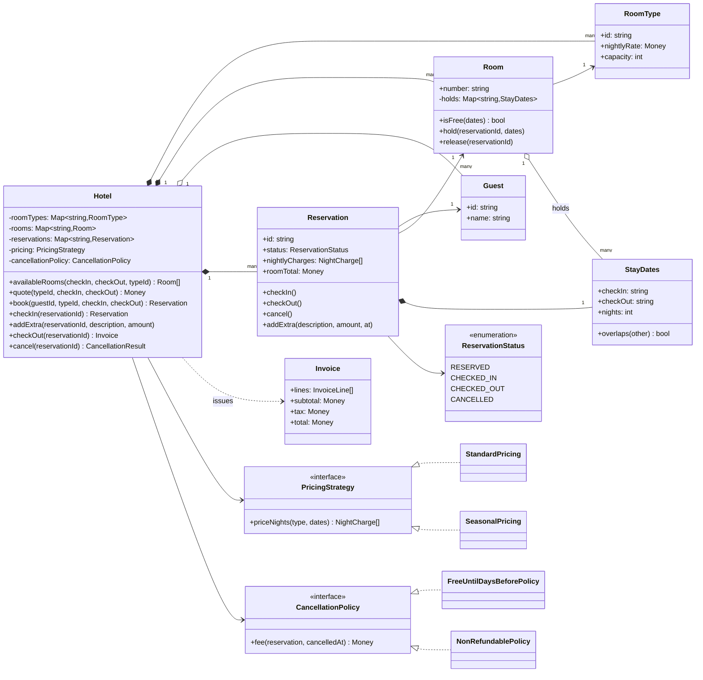
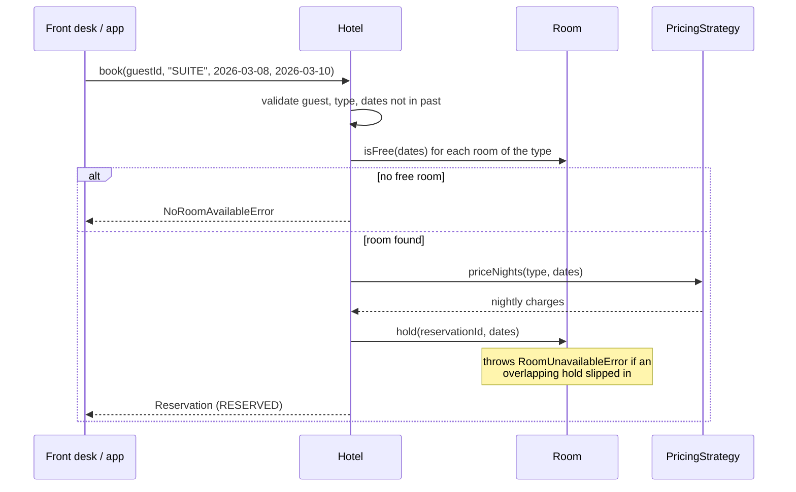
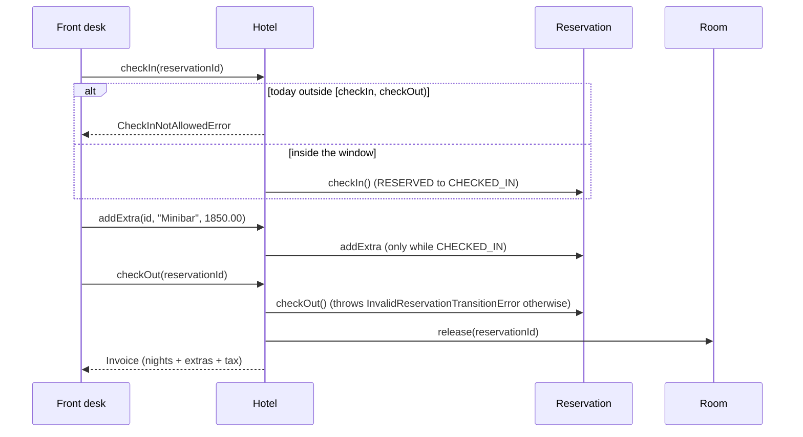

# Design a Hotel Management System

| | |
|---|---|
| **Difficulty** | Medium |
| **Solution** | [`src/hotel-management-system/`](../src/hotel-management-system/) |
| **Run** | `npm run demo -- hotel-management-system` · `npx vitest run src/hotel-management-system` |
| **Patterns** | Strategy (pricing, cancellation), State machine, Aggregate root, Value object |

## 1. Problem statement

Design the booking core of a hotel. Guests search for a room type over a date range, book it, check in, run up extras such as minibar or transfers, and check out with an invoice. Prices vary by weekend and season, cancellations may cost a fee, and a room must never be sold twice for the same night.

## 2. Clarifying questions to ask first

- Do guests book a specific room or a room type? (Almost always a type; the hotel assigns the room.)
- Is a stay a set of nights, and is the check-out day available to the next guest the same day?
- How does pricing vary: rack rate, weekends, seasons, length-of-stay discounts?
- What does cancellation cost, and is it based on how far ahead of check-in the guest cancels?
- Are payments taken at booking (deposit) or only at check-out?
- One property or a chain? Which time zone defines "today"?
- Is overbooking allowed on purpose, as airlines do?

Assumptions used in the solution: guests book a room type and get the first free room of it; stays are half-open date ranges `[checkIn, checkOut)` in the hotel's calendar (UTC in code); nightly prices are frozen at booking; payment happens at check-out, so cancellation produces a fee rather than a refund; early departure still bills every booked night; no deliberate overbooking.

## 3. Requirements

### Functional
1. Manage room types (rate, capacity) and physical rooms of each type.
2. Search free rooms for a date range, optionally filtered by type, and quote the price.
3. Book a room type for a guest; the system assigns a free room and freezes the nightly prices.
4. A reservation moves `RESERVED -> CHECKED_IN -> CHECKED_OUT`, or `RESERVED -> CANCELLED`; any other move is rejected.
5. Check-in is allowed only from the check-in day until before the check-out day.
6. Extras can be posted only while the guest is checked in.
7. Check-out issues an invoice: one line per night, one per extra, tax on the subtotal.
8. Cancellation applies a swappable policy (free until N days before, else the first night; or non-refundable) and frees the room.
9. A room is never held by two reservations whose date ranges overlap.

### Non-functional
- Correctness first: the double-booking invariant must hold under concurrent requests.
- Money is integer minor units; rounding happens once per night and once for tax.
- Deterministic tests: clock and id generator are injected.
- Pricing and cancellation rules change without touching the booking flow.

## 4. Core entities

| Entity | Responsibility |
|---|---|
| `StayDates` | Value object for a half-open date range; nights, overlap test. |
| `RoomType` | Sellable category with nightly rack rate and capacity. |
| `Room` | Physical room; owns its calendar of holds and refuses an overlapping one. |
| `Guest` | Identity and contact of the person booking. |
| `Reservation` | Guest + room + dates + frozen nightly charges; validated status transitions; extras. |
| `PricingStrategy` → `StandardPricing`, `SeasonalPricing` | Prices each night of a stay. |
| `CancellationPolicy` → `FreeUntilDaysBeforePolicy`, `NonRefundablePolicy` | Fee owed on cancellation. |
| `Invoice` | Immutable bill with lines, subtotal, tax and total. |
| `Hotel` | Aggregate root: search, quote, book, check in/out, cancel. |

## 5. Class diagram

## 6. Key flows

## 7. Design patterns used

- **Strategy** for pricing and cancellation. Revenue management changes both often (festival seasons, non-refundable promo rates), and the booking flow should not notice. Alternative: a rules engine or a pricing table in the database; better once non-engineers edit the rules, heavier for an interview.
- **State machine** on `Reservation` via an allowed-transitions table. Every illegal move (check out before check in, cancel after arrival) throws one error type. Alternative: the GoF State pattern with a class per state, worth it only when behaviour per state grows beyond a guard.
- **Aggregate root**: `Hotel` is the only entry point that turns "a SUITE for these dates" into a concrete room hold, so search and booking cannot disagree.
- **Value object**: `StayDates` makes the half-open rule a single method (`overlaps`) instead of a comparison repeated in five places.
- **Snapshot of prices** on the reservation (a form of Memento): the nightly charges are copied at booking, so changing the pricing strategy tomorrow never re-prices an existing booking.

## 8. Trade-offs, extensions and follow-up questions

**"Two clerks book the last suite at the same time."** In-process, `Room.hold()` re-checks overlap and throws, which is the compare-and-set. In a database the cleanest guard is one row per room-night: `room_nights(room_id, night, reservation_id)` with a unique constraint on `(room_id, night)`; inserting all nights in one transaction either succeeds completely or fails on the constraint. PostgreSQL can also enforce it directly with an exclusion constraint on `daterange(check_in, check_out, '[)')`. Inventory counters per type and night (`UPDATE inventory SET sold = sold + 1 WHERE type_id = ? AND night = ? AND sold < capacity`) work when guests book a type and rooms are assigned at arrival. Client retries carry an idempotency key so a double-clicked "Book" makes one reservation.

**"State changes race, e.g. cancel and check-in together."** Add a version column: `UPDATE reservations SET status = 'CANCELLED', version = version + 1 WHERE id = ? AND status = 'RESERVED' AND version = ?`; zero rows changed means someone else won.

**"Search is slow with 500 rooms and a year of bookings."** Keep a per-type, per-night availability count (or a bitmap per room) instead of scanning holds; the search becomes a range-min query over nights.

**"Guests want to choose the room, or change dates."** A `bookRoom(roomNumber)` variant reuses `Room.hold`. A date change is release-then-hold inside one transaction, re-priced by the current strategy only if the policy says so.

**"Deposits and refunds."** Add a `Payment` ledger on the reservation; the cancellation policy result becomes `refund = paid - fee`, allocated per payment.

**"Overbooking like airlines."** Allow `capacity + k` per type and night in the inventory table and add a walk-out process; the per-room invariant then applies only at room assignment.

**Persistence sketch.** `room_types(id, name, rate, capacity)`, `rooms(number, type_id, floor)`, `guests(id, name, email)`, `reservations(id, guest_id, room_id, check_in, check_out, status, version, created_at)`, `reservation_nights(reservation_id, night, amount)`, `room_nights(room_id, night, reservation_id) UNIQUE(room_id, night)`, `extras(reservation_id, description, amount, at)`, `invoices(id, reservation_id, subtotal, tax, total, issued_at)`.

## 9. What a strong interview answer sounds like

1. Clarify booking by type vs room, the half-open check-out rule, pricing and cancellation rules, and when payment happens; state the assumptions.
2. Name the invariant (no two overlapping holds on a room) and the value object that makes it one comparison: `[checkIn, checkOut)`.
3. Draw `Hotel` as the aggregate, `Room` owning its calendar, `Reservation` with a validated state machine, and the two strategies as interfaces.
4. Walk booking (including the no-room branch and the compare-and-set on the room) and the stay from check-in to invoice, including the illegal-transition branch.
5. Close with concurrency in SQL (unique room-night rows or an exclusion constraint, version columns, idempotency keys), inventory counters for scale, and two extensions such as deposits and date changes.
