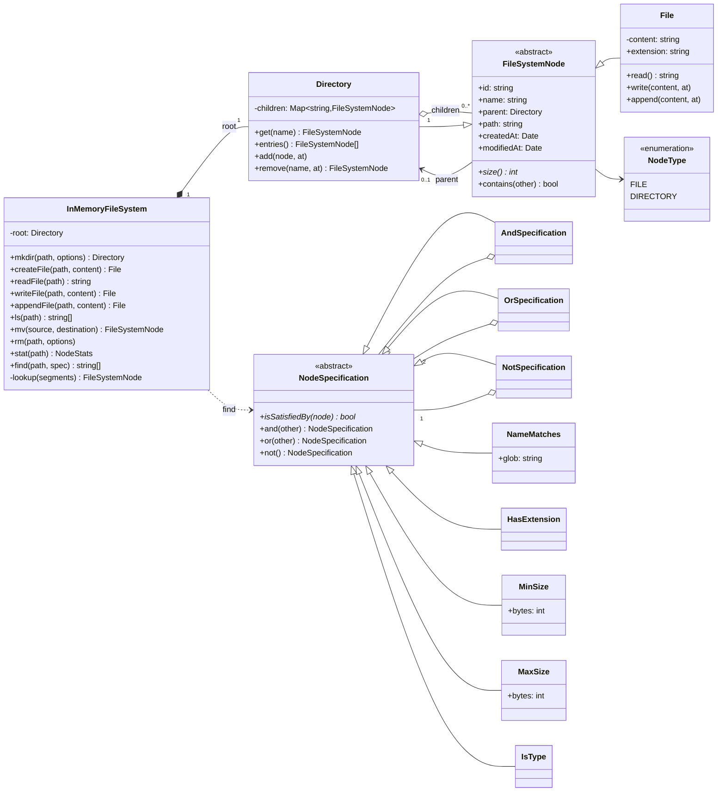
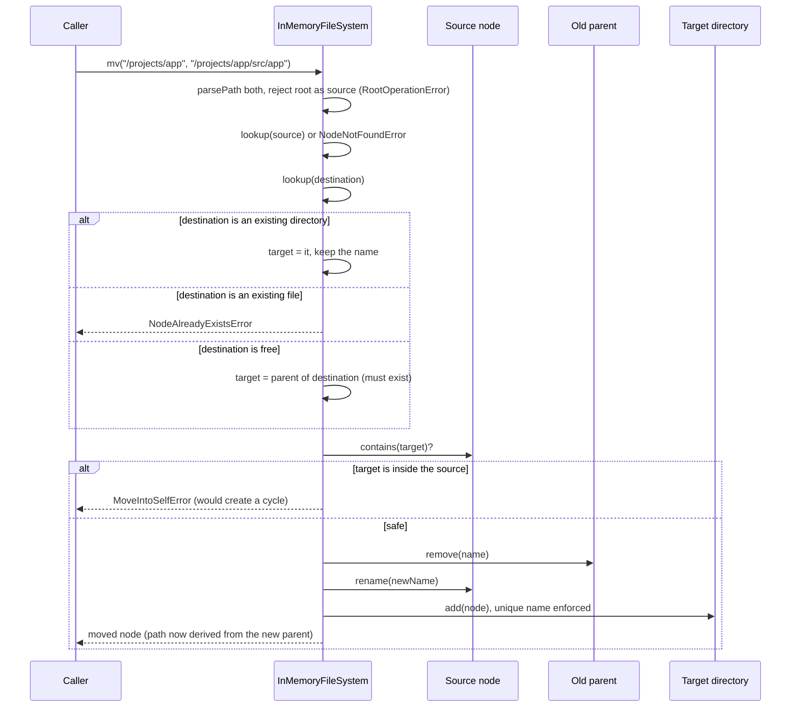
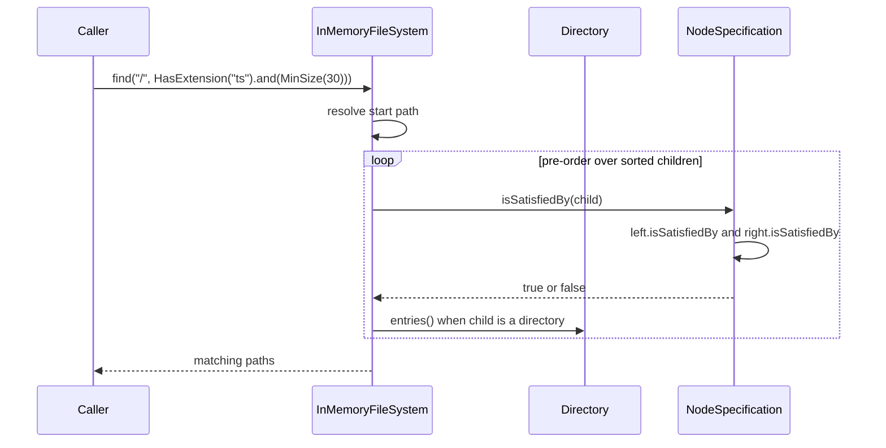

# Design an In-Memory File System

| | |
|---|---|
| **Difficulty** | Medium |
| **Solution** | [`src/in-memory-file-system/`](../src/in-memory-file-system/) |
| **Run** | `npm run demo -- in-memory-file-system` · `npx vitest run src/in-memory-file-system` |
| **Patterns** | Composite, Specification, Facade (aggregate root) |

## 1. Problem statement

Design an in-memory file system with a single root. It supports directories and files addressed by absolute paths, the usual shell operations (`mkdir`, `ls`, `mv`, `rm`, read, write, append, `stat`) and a `find` command whose filters (name, extension, size, type) can be combined freely.

## 2. Clarifying questions to ask first

- Absolute paths only, or a current working directory with relative paths? Do we resolve `.` and `..`?
- Should `mkdir` create missing parents (`mkdir -p`)? Should `rm` on a non-empty directory need a recursive flag?
- Does `mv` onto an existing file overwrite it? Does moving onto an existing directory mean "move into it"?
- File content: text or bytes? How is size measured, and is a directory's size the sum of its contents?
- Which `find` criteria, and do they need to combine with AND, OR and NOT?
- Do we need permissions, owners, symlinks, hard links, or file handles with concurrent readers?

Assumptions used in the solution: absolute paths only, with `.`, `..` and repeated slashes resolved; text content with size counted in UTF-8 bytes; a directory's size is computed recursively; `mkdir` and `rm` take a `recursive` option; `mv` into an existing directory moves inside it and never overwrites a file; `writeFile` and `appendFile` create missing files as Node's `fs` does, while `createFile` fails if the path exists. No permissions or links (section 8 discusses them).

## 3. Requirements

### Functional
1. Paths are absolute; `.`, `..` and `//` are normalised; relative paths are rejected.
2. `mkdir(path)` requires an existing parent; `mkdir(path, { recursive: true })` creates every missing level and accepts an existing directory.
3. `createFile`, `readFile`, `writeFile` (overwrite) and `appendFile` operate on files; using them on a directory fails.
4. `ls` lists a directory's children in sorted order (directories marked with `/`), or the name of a file.
5. `mv` renames or moves a file or directory; it refuses to overwrite, to move the root, or to move a directory into itself or its subtree.
6. `rm` removes a file or an empty directory; a non-empty directory needs `recursive`; the root can never be removed.
7. `stat` reports type, size (recursive for directories), child count, created and modified times.
8. `find(path, spec)` returns matching paths below `path`, where a spec is a name glob, an extension, a minimum or maximum size, a type, or any `and` / `or` / `not` combination of them.
9. Missing paths, existing nodes, wrong node types and invalid moves fail with domain errors and change nothing.

### Non-functional
- Path lookup is O(depth) thanks to a name-indexed map per directory.
- Paths are derived from parent pointers, never stored, so moves are O(1) in the size of the subtree.
- Listings and search results are deterministic (code-point sorted names, pre-order traversal).
- Deterministic and testable: clock and inode ids are injected.

## 4. Core entities

| Entity | Responsibility |
|---|---|
| `FileSystemNode` (abstract) | Shared base: id, name, parent, derived path, created and modified times, `size()`, `contains()`. |
| `File` | Leaf: text content, read, write, append, byte size, extension. |
| `Directory` | Composite: children indexed by name (unique per directory), recursive size. |
| `NodeType` | FILE, DIRECTORY. |
| `parsePath` and helpers | Absolute path parsing and normalisation, name validation, extension extraction. |
| `NodeSpecification` → `AndSpecification`, `OrSpecification`, `NotSpecification` | Composable filter with `and`, `or`, `not`. |
| `NameMatches`, `HasExtension`, `MinSize`, `MaxSize`, `IsType` | Concrete search criteria. |
| `InMemoryFileSystem` | Aggregate root: resolves paths and applies every structural change. |

## 5. Class diagram

## 6. Key flows

## 7. Design patterns used

- **Composite** for the tree. `File` and `Directory` share `FileSystemNode`, so `stat`, `find` and `size()` treat them uniformly, and a directory's size is simply the sum of its children's sizes. Alternative: a flat map from full path to node; lookups are O(1), but moves and renames must rewrite every key in the subtree and listing a directory needs a prefix scan.
- **Specification** for `find`. Each criterion is a small object with `isSatisfiedBy`, and `and` / `or` / `not` build new specifications, so "TypeScript files over 30 bytes that are not tests" needs no new code. Alternative: an options bag (`{ ext, minSize, maxSize, type }`), which is simpler but cannot express OR or NOT and grows a field per criterion.
- **Facade / aggregate root**: `InMemoryFileSystem` is the only entry point that takes path strings and the only place that changes structure, so invariants (unique names per directory, no cycles, root never removed) are checked in one place. Nodes protect local invariants themselves: `Directory.add` refuses duplicate names, and `rename` is refused while attached so the parent's index cannot go stale.
- **Value helpers** in `path.ts` keep parsing and validation pure and separately testable.

## 8. Trade-offs, extensions and follow-up questions

**"Directory sizes are slow on a huge tree."** `size()` walks the subtree, O(subtree). Cache the size on each directory and propagate deltas up the parent chain on every write, add, remove and move (O(depth) per change, O(1) per `stat`). The same trick gives file counts.

**"Add a current working directory and relative paths."** A `Session` object holding a cwd node; `parsePath(path, cwd)` resolves relative paths against `cwd.path`. The tree does not change.

**"Add permissions, owners and symlinks."** Permissions are fields on the node checked by the facade before each operation (a `PermissionPolicy` strategy). A symlink is a third leaf type storing a target path; lookup follows it with a hop limit to stop loops. Hard links break the single-parent tree, so a node would need a link count and paths would no longer be unique.

**"Many clients use it at once."** In one Node process each call is synchronous, so operations are atomic. Across processes, or once file I/O becomes async, the hazards are lost updates on a file and races on structure. With a database: `nodes(id, parent_id, name, type, content_ref, size, version, created_at, modified_at)` with `UNIQUE (parent_id, name)` makes two concurrent `createFile` calls on the same path fail cleanly. Writes use optimistic locking: `UPDATE nodes SET content_ref = ?, size = ?, version = version + 1 WHERE id = ? AND version = ?`, and zero rows changed means retry or report a conflict. `mv` runs in one transaction: lock both parents in a fixed order (by id, to avoid deadlocks), re-check the cycle condition against the ancestors of the target (a recursive CTE, or a closure table `node_ancestors(ancestor_id, descendant_id)`), then `UPDATE nodes SET parent_id = ?, name = ? WHERE id = ? AND parent_id = ?`. Create and append requests carry an idempotency key so a retried append does not duplicate data.

**"Large files."** Store content in chunks or in a blob store keyed by hash (`content_ref`), so identical files are stored once and appends write only the new chunk.

**Persistence sketch.** The `nodes` table above plus `blobs(hash, bytes)`. Path lookup is one indexed query per segment on `(parent_id, name)`, or one query with a materialised `path` column (fast lookups and prefix search for `find`, at the cost of rewriting the subtree's paths on `mv`).

## 9. What a strong interview answer sounds like

1. Clarify paths (absolute or relative, `.` and `..`), the semantics of `mkdir -p`, `rm -r` and `mv` onto existing targets, and how size is measured.
2. Propose the Composite: `FileSystemNode` with `File` and `Directory`, children indexed by name, parent pointers so paths are derived.
3. Put every path-based operation on one facade that resolves paths and owns structural invariants; walk through `mv` and the "into itself" cycle check.
4. Model `find` with Specifications that compose with and / or / not, and show one composed query.
5. Close with scaling (cached sizes, chunked content), extensions (cwd, permissions, symlinks) and the database mapping (`UNIQUE (parent_id, name)`, version column, transactional `mv` with a cycle check, idempotency keys).
