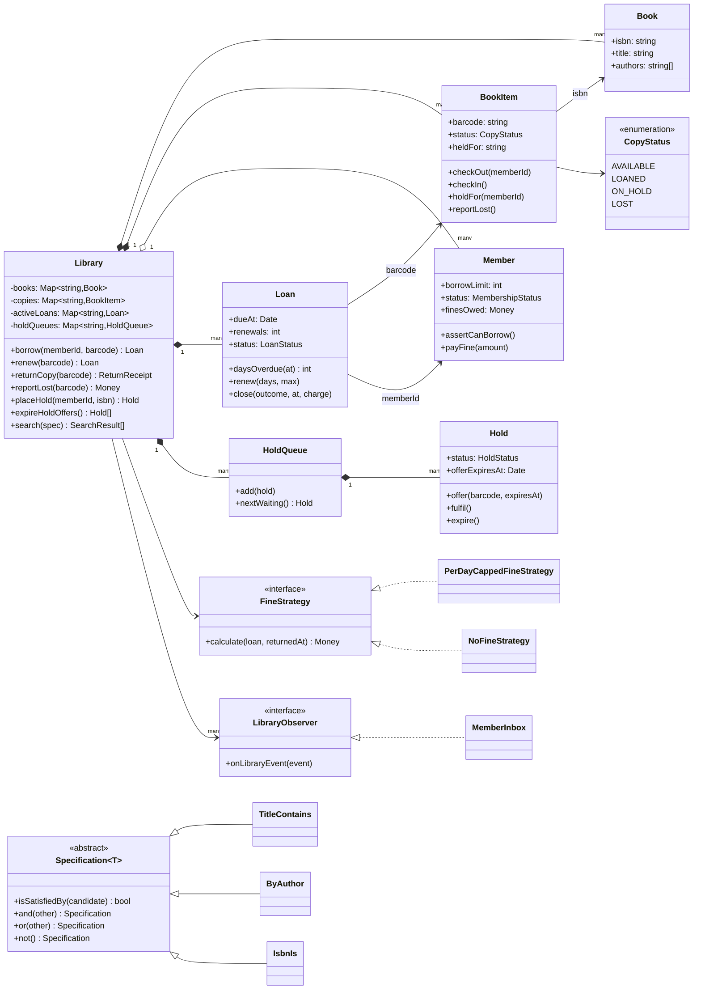
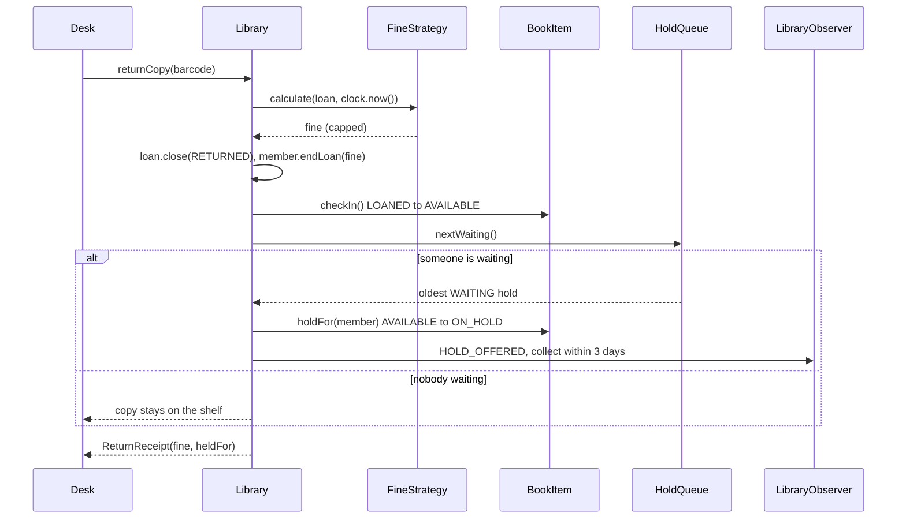
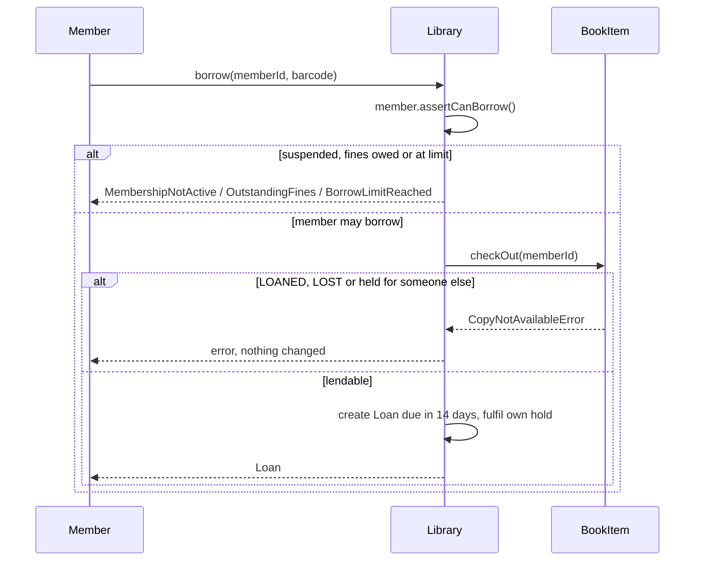

# Design a Library Management System

| | |
|---|---|
| **Difficulty** | Medium |
| **Solution** | [`src/library-management-system/`](../src/library-management-system/) |
| **Run** | `npm run demo -- library-management-system` · `npx vitest run src/library-management-system` |
| **Patterns** | Strategy, Observer, Specification, State (transition table) |

## 1. Problem statement

Design the software for a public library branch. Members search the catalog, borrow physical copies, renew and return them, pay fines for late returns, and place holds on titles that are all out. When a copy comes back it should go to the first person waiting, not back on the shelf.

## 2. Clarifying questions to ask first

- Is a "book" the title or the physical copy? (It must be both: a catalog record and many copies.)
- How many items can a member hold at once? Does it vary by membership type?
- How long is a loan, how many renewals are allowed, and can you renew while someone is waiting?
- How are fines computed: per day, per hour, capped? Is there a grace period?
- How do holds work: per title or per copy? How long does a member have to collect an offered copy?
- What happens to a lost copy? Who pays, and can it be found again?
- Which search fields matter: title, author, ISBN, subject? Exact or partial match?

Assumptions used in the solution: one branch; holds are per title (ISBN) and served first come, first served; a returned copy is offered to the oldest waiting hold for 3 days; loans last 14 days and renew at most twice, never while someone is waiting; fines are a flat amount per started day late, capped; any unpaid fine blocks borrowing; a lost copy costs a fixed replacement fee; notifications are events, delivery is someone else's job.

## 3. Requirements

### Functional
1. The catalog holds `Book` records (ISBN, title, authors); each has zero or more `BookItem` copies with a unique barcode.
2. A member may borrow an AVAILABLE copy, or an ON_HOLD copy held for them, if they are ACTIVE, owe nothing and are under their borrow limit.
3. A loan is due 14 days after it starts. It can be renewed at most 2 times; each renewal extends from the current due date. Renewal is refused while anyone waits for the title.
4. On return the fine is computed with the clock at that moment by a pluggable `FineStrategy` (per started day late, capped).
5. A member can place one active hold per title. When a copy returns (or is added or found) it is held for the oldest waiting member, who is notified and has 3 days to collect it.
6. Lapsed offers are expired on demand and the copy is passed to the next member in line, or the shelf.
7. A copy on loan can be reported lost: the loan closes, the member is charged a replacement fee, the copy is LOST until marked found.
8. Search by title, author or ISBN, composable with and / or / not, returning available and total copies.

### Non-functional
- Invariants first: a copy is never on two loans, and a held copy goes only to its holder.
- Deterministic and testable: clock and ids are injected; offer expiry is evaluated against the clock, never with timers.
- New fine policies and search filters are added without touching `Library`.

## 4. Core entities

| Entity | Responsibility |
|---|---|
| `Book` | Catalog record: normalised ISBN, title, authors. Never lent. |
| `BookItem` | One physical copy: barcode and status machine AVAILABLE / LOANED / ON_HOLD / LOST, plus who it is held for. |
| `Member` | Membership state, borrow limit, fines owed, open loans. Answers "may I borrow?". |
| `Loan` | One copy to one member: due date, renewals, closed exactly once with a charge. |
| `Hold` / `HoldQueue` | A member's place in line for a title; the queue is FIFO and allows one active hold per member. |
| `FineStrategy` → `PerDayCappedFineStrategy`, `NoFineStrategy` | Prices lateness. |
| `Specification<Book>` → `TitleContains`, `ByAuthor`, `IsbnIs` | Composable search filters. |
| `LibraryObserver` → `MemberInbox` | Receives HOLD_OFFERED, HOLD_EXPIRED and CHARGE_ADDED events. |
| `Library` | Aggregate root: borrow, renew, return, report lost, place and expire holds, search. |

## 5. Class diagram

## 6. Key flows

## 7. Design patterns used

- **Strategy** for fines. Libraries change fine policy by member type and item type; `PerDayCappedFineStrategy` and `NoFineStrategy` plug in without an `if (member.isStaff)` in the core. Alternative: a rules table loaded from configuration, which is the same idea with data instead of classes.
- **State, as a transition table** (`COPY_TRANSITIONS`, `HOLD_TRANSITIONS`, `MEMBERSHIP_TRANSITIONS`). Each entity checks its move before applying it, so "check in a copy that is on the shelf" throws `InvalidTransitionError`. Alternative: one class per state (GoF State); worth it only when behaviour, not just legality, differs per state.
- **Observer** for member notifications. `Library` publishes HOLD_OFFERED, HOLD_EXPIRED and CHARGE_ADDED; email or SMS gateways subscribe. Alternative: an outbox table polled by a notifier, which survives crashes.
- **Specification** for search. Filters compose with `and`, `or`, `not`, so a new filter (subject, year) is one class. Alternative: a query-builder that compiles to SQL or a search index; specifications are the in-memory equivalent.
- **Aggregate root.** Only `Library` touches several entities in one step (lend, return, pass a copy down the hold line). Entities guard their own rules.

## 8. Trade-offs, extensions and follow-up questions

**Book vs BookItem.** The most common mistake is one `Book` class with a status. Titles and copies have different identities (ISBN vs barcode) and different lifecycles; holds attach to the title, loans to the copy.

**"Two desks lend the same copy at once."** In-process, `BookItem.checkOut()` is the compare-and-set: the second caller sees LOANED and throws. In a database: `UPDATE copies SET status='LOANED', version=version+1 WHERE barcode=? AND (status='AVAILABLE' OR (status='ON_HOLD' AND held_for=?)) AND version=?` and require one changed row. A partial unique index `loans(barcode) WHERE status='ACTIVE'` is the backstop that makes a double loan impossible even with a bug in the application.

**"Two returns of the same copy are scanned twice."** `Loan.close()` runs exactly once; the second scan finds no active loan. Over HTTP, give the return request an idempotency key so a retry returns the first receipt instead of an error.

**"Members join the hold queue concurrently."** The order is the insertion order; in a database use `holds(isbn, placed_at, id)` with a unique partial index on `(member_id, isbn) WHERE status IN ('WAITING','OFFERED')` to enforce one active hold per member per title.

**Expiry without timers.** `expireHoldOffers()` compares `offerExpiresAt` with the clock; a scheduler calls it every few minutes. Thousands of timers would not survive a restart; a query `WHERE status='OFFERED' AND offer_expires_at <= now()` does.

**Follow-ups an interviewer may ask:**
- *Different limits for students and staff?* A `MembershipPlan` value object with `borrowLimit`, `loanDays` and a `FineStrategy`; `Member` holds a plan.
- *Fines per hour for DVDs?* A `FineStrategy` keyed by item type, or a composite strategy that delegates by type.
- *Multiple branches and transfers?* Copies get a `branchId` and a new IN_TRANSIT status; holds name a pickup branch.
- *Reservations for a future date?* That is booking over intervals, a different model from a FIFO hold queue; keep them separate.
- *Search over a million titles?* Keep specifications for the API, compile them into a full-text index query (Postgres `tsvector`, OpenSearch).

**Persistence sketch.**

| Table | Key columns |
|---|---|
| `books` | `isbn` PK, `title`, `authors` (or a `book_authors` join) |
| `copies` | `barcode` PK, `isbn` FK, `status`, `held_for` NULL, `version` |
| `members` | `id` PK, `status`, `borrow_limit`, `fines_owed` |
| `loans` | `id` PK, `barcode`, `member_id`, `borrowed_at`, `due_at`, `renewals`, `status`, `closed_at`, `charge`; unique `(barcode) WHERE status='ACTIVE'` |
| `holds` | `id` PK, `isbn`, `member_id`, `placed_at`, `status`, `offered_barcode`, `offer_expires_at` |

Lend and return are single transactions that change `copies`, `loans` and `members` together, with the event written to an outbox table in the same transaction.

## 9. What a strong interview answer sounds like

1. Ask about limits, renewals, holds and fines; state the assumptions, especially "holds are per title, served FIFO, offer expires in 3 days".
2. Separate `Book` (title) from `BookItem` (copy) immediately and say why; then `Member`, `Loan`, `Hold`.
3. Draw the copy state machine (AVAILABLE, LOANED, ON_HOLD, LOST) and name the invariant: one active loan per copy, and a held copy goes only to its holder.
4. Walk the return flow: fine with the clock, then the hold queue, then the notification; and the borrow failure branches.
5. Close with concurrency (compare-and-set on the copy, unique index on active loans, idempotent returns), expiry without timers, and two extensions such as membership plans and multiple branches.
