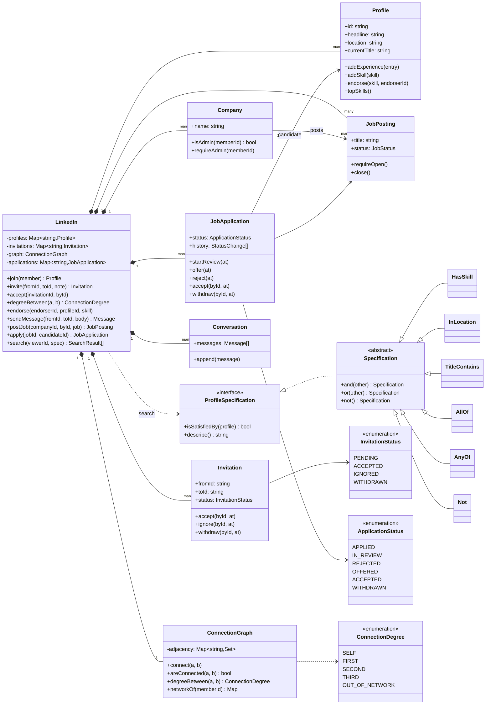
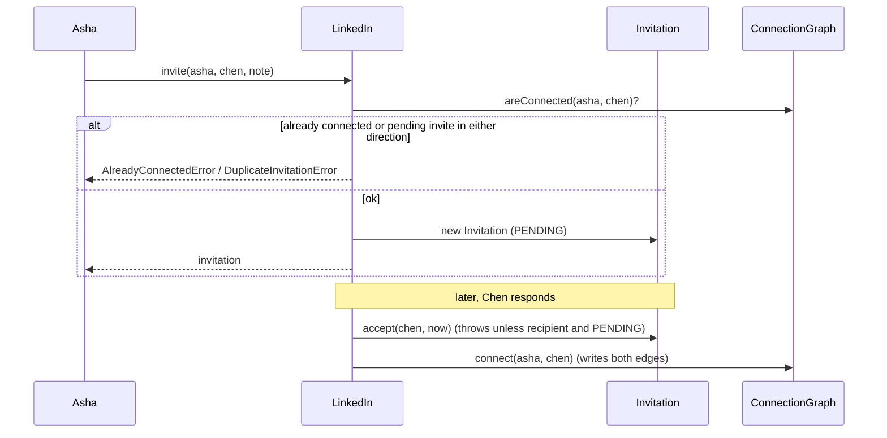
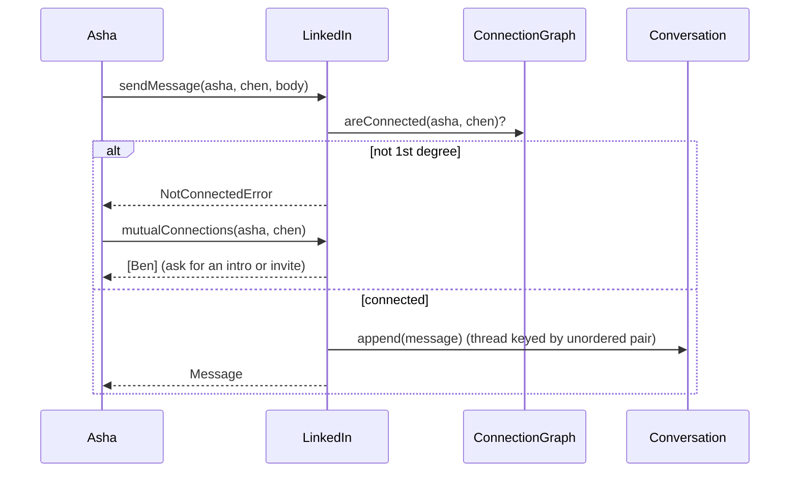

# Design LinkedIn (professional network)

| | |
|---|---|
| **Difficulty** | Hard |
| **Solution** | [`src/linkedin/`](../src/linkedin/) |
| **Run** | `npm run demo -- linkedin` · `npx vitest run src/linkedin` |
| **Patterns** | State (invitation, application), Specification, Repository-style aggregate service, bounded BFS |

## 1. Problem statement

Design the core of a professional network: members keep a profile with experience, education and skills, connect through invitations, and see how far away anyone is (1st, 2nd, 3rd degree). Companies post jobs, members apply, and recruiters move applications through a hiring pipeline. Members endorse each other's skills, search for people with composable filters, and may only message their 1st-degree connections.

This is not a social feed. The interesting parts are the professional graph, the degree query, the two state machines and the authorisation rules that depend on the graph.

## 2. Clarifying questions to ask first

- Is a connection mutual (undirected), or is there also a one-way "follow"?
- Which invitation outcomes exist? Can the sender withdraw? Can a member re-invite after being ignored?
- How far do degrees go? (LinkedIn shows 1st, 2nd, 3rd and then "out of network".)
- Who may message whom? Is there a paid InMail path for non-connections?
- Can anyone endorse any skill, or only connections, and only skills the member lists?
- What does the hiring pipeline look like, and who may move an application? Can a candidate decline an offer?
- Which search filters matter, and how are results ranked?

Assumptions used in the solution: connections are undirected and only created by an accepted invitation; invitations are PENDING then exactly one of ACCEPTED, IGNORED or WITHDRAWN, and a new invitation is allowed once the previous one is resolved; degrees stop at 3; messaging and endorsing require a 1st-degree connection (no InMail); one endorsement per endorser per listed skill; company admins move applications, the candidate accepts or withdraws (declining an offer is a withdrawal); one application per candidate per job; search ranks by degree then name.

## 3. Requirements

### Functional
1. Members join with a name, headline and location, and add experience (current role has no end date), education and skills.
2. A member invites another member with an optional note (max 300 characters). The recipient accepts or ignores; the sender may withdraw. Each invitation resolves exactly once.
3. No self-invitations, no invitation to an existing connection, and at most one pending invitation per pair in either direction.
4. An accepted invitation creates a symmetric connection.
5. The system reports the degree between two members: SELF, FIRST, SECOND, THIRD or OUT_OF_NETWORK, and the mutual connections of two members.
6. A 1st-degree connection may endorse a skill the member lists, once per skill.
7. Messages are allowed only between 1st-degree connections; A-to-B and B-to-A share one thread.
8. A company admin posts and closes jobs. Members apply to open jobs, once per job.
9. Applications move APPLIED -> IN_REVIEW -> OFFERED -> ACCEPTED, with REJECTED (by the company) and WITHDRAWN (by the candidate) as exits; invalid moves throw.
10. Profile search takes a composable filter (skill, location, title keyword, combined with and/or/not) and ranks results by degree from the viewer, then name.

### Non-functional
- Graph invariants hold by construction: edges are always written in pairs.
- The degree query costs at most the size of a member's 3rd-degree network, never the whole graph.
- New search filters are new classes, not new parameters on `search()`.
- Deterministic tests: clock and ids are injected.

## 4. Core entities

| Entity | Responsibility |
|---|---|
| `Profile` | Identity, experience (sorted newest first), education, skills with an endorser set per skill. |
| `Invitation` | PENDING -> ACCEPTED / IGNORED / WITHDRAWN; checks who may make each move. |
| `ConnectionGraph` | Undirected adjacency sets; `degreeBetween()` and `networkOf()` via BFS capped at depth 3. |
| `Conversation`, `Message` | Ordered thread keyed by the unordered member pair. |
| `Company` | Company page and its admin set. |
| `JobPosting` | OPEN or CLOSED; refuses applications when closed. |
| `JobApplication` | Hiring pipeline state machine with timestamped history; candidate-only moves. |
| `ProfileSpecification` → `HasSkill`, `InLocation`, `TitleContains`, `AllOf`, `AnyOf`, `Not` | Composable search predicates. |
| `LinkedIn` | Application service: owns the stores, writes the graph, enforces cross-entity rules. |

## 5. Class diagram

## 6. Key flows

## 7. Design patterns used

- **State (table-driven)** for `Invitation` and `JobApplication`. Each keeps a `Record<Status, Status[]>` of legal moves and throws on anything else, so "accept an ignored invitation" or "offer before review" cannot happen. A class per state is the alternative; it pays off when states carry behaviour, which these do not.
- **Specification** for search. `HasSkill`, `InLocation` and `TitleContains` are tiny predicates; `and`, `or`, `not` compose them. Adding "years of experience >= 5" is one class. Alternative: a query-builder that compiles to SQL or an Elasticsearch query, which is what you need once filtering must happen in the index rather than in memory.
- **Aggregate service** (`LinkedIn`). Entities protect their own invariants (one endorsement per endorser lives in `Profile`, resolve-once lives in `Invitation`); rules that span entities (messaging needs a graph edge, recruiter moves need a company admin) live in the service, the only writer of the graph.
- **Bounded BFS** rather than a general shortest-path algorithm: edges are unweighted and we only care up to depth 3, so BFS with an early exit is optimal. Bidirectional BFS is the upgrade for large graphs (see below).

## 8. Trade-offs, extensions and follow-up questions

**"Two members invite each other at the same moment."** In process, the pending check and the insert happen in one synchronous call, so the second invite throws `DuplicateInvitationError`. In a database, store the pair in canonical order (`member_lo`, `member_hi`) and add a partial unique index `UNIQUE (member_lo, member_hi) WHERE status = 'PENDING'`; the loser of the race gets a constraint violation and the API answers "already pending".

**"Accept and withdraw race."** The invitation resolves once: `UPDATE invitations SET status = 'ACCEPTED', resolved_at = now() WHERE id = ? AND status = 'PENDING'` and check that one row changed. Only the winner inserts the two connection rows, in the same transaction, so the graph can never be half-written. A client retrying an accept sends an idempotency key, and a replay returns the stored result instead of failing.

**"Hiring pipeline updates from two recruiters."** Give `applications` a `version` column: `UPDATE ... SET status = 'OFFERED', version = version + 1 WHERE id = ? AND version = ? AND status = 'IN_REVIEW'`. Zero rows means someone else moved it; reload and show the new state. `UNIQUE (job_id, candidate_id)` is the one-application-per-job rule.

**"Degree queries are slow at 900M members."** The in-memory BFS visits the whole 3rd-degree network, which can be millions of nodes for a well-connected member. Use bidirectional BFS (two depth-1.5 searches meeting in the middle), precompute and cache each member's 2nd-degree set, or shard the graph by member id and run the search in a graph service. Search results ask for degrees of 20 people at once, so `networkOf()` computes them in one pass instead of 20 BFS runs.

**"Remove a connection / block a member."** `ConnectionGraph.disconnect()` deletes both edges; a block list is checked by `invite`, `sendMessage` and `endorse` before the graph check.

**"InMail for premium members."** Make the messaging rule a policy (`MessagingPolicy.canMessage(from, to)`) with `ConnectionsOnly` and `PremiumInMail` (credits per month) implementations.

**"Recommend jobs or people you may know."** People you may know is the 2nd-degree set ranked by mutual-connection count; job recommendations match `JobPosting.skills` against the member's top endorsed skills.

**Persistence sketch.** `profiles(id, name, headline, location)`, `experience(profile_id, title, company, start, end NULL)`, `skills(profile_id, skill_key, name)`, `endorsements(profile_id, skill_key, endorser_id, PRIMARY KEY (profile_id, skill_key, endorser_id))`, `invitations(id, from_id, to_id, member_lo, member_hi, status, sent_at, resolved_at)`, `connections(member_id, other_id, since, PRIMARY KEY (member_id, other_id))` with both directions stored, `companies`, `company_admins`, `jobs(id, company_id, title, location, status)`, `applications(id, job_id, candidate_id, status, version, UNIQUE (job_id, candidate_id))`, `application_events(application_id, status, at)`, `messages(id, thread_key, from_id, to_id, body, sent_at)` indexed by `(thread_key, sent_at)`.

## 9. What a strong interview answer sounds like

1. Separate this from a social feed: the core is an undirected professional graph, a degree query, two state machines and graph-dependent permissions. Confirm the assumptions above.
2. Name the invariants: connections are symmetric and only come from accepted invitations; one pending invitation per pair; one endorsement per endorser per skill; one application per job; messaging and endorsing need 1st degree.
3. Draw `Profile`, `Invitation`, `ConnectionGraph`, `Company`, `JobPosting`, `JobApplication` and the `LinkedIn` service, with the state tables and the Specification hierarchy for search.
4. Walk the invite/accept flow and the messaging flow including the failure branch, and explain the depth-3 BFS and why it is bounded.
5. Close with concurrency (canonical pair unique index, conditional UPDATE for resolve-once, version column on applications), scaling the degree query (bidirectional BFS, cached 2nd-degree sets) and two extensions (InMail policy, people you may know).
