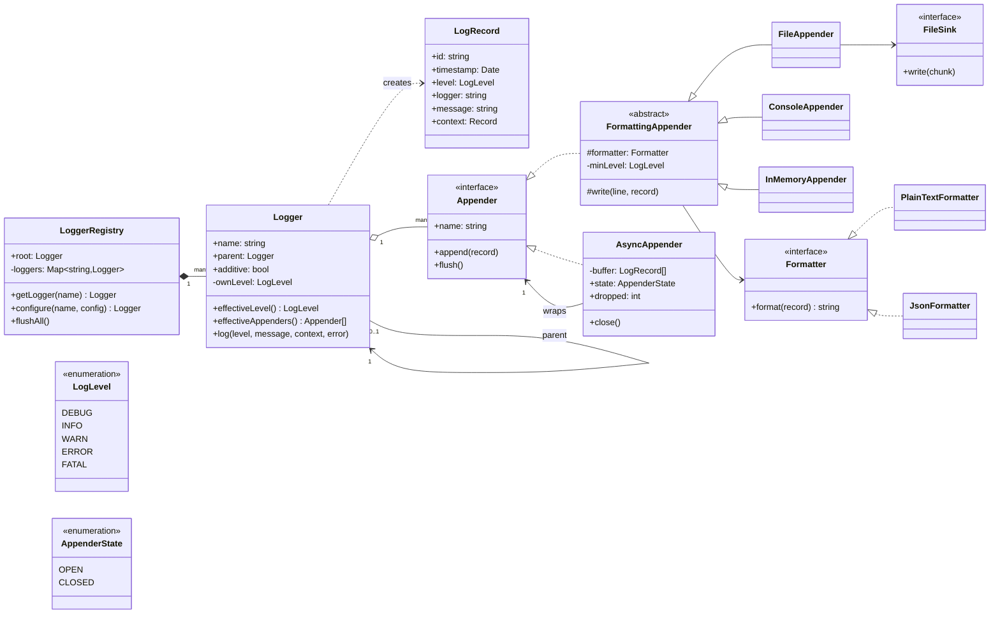
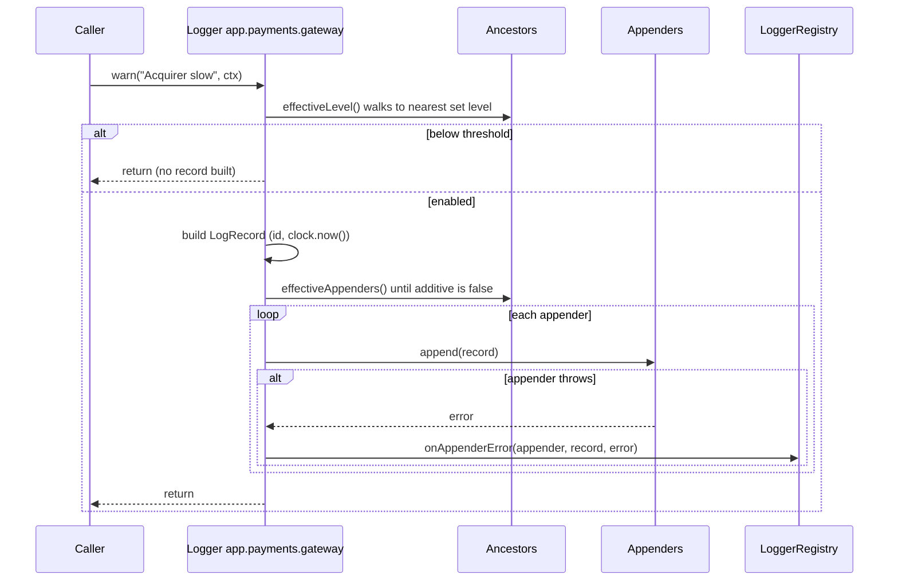
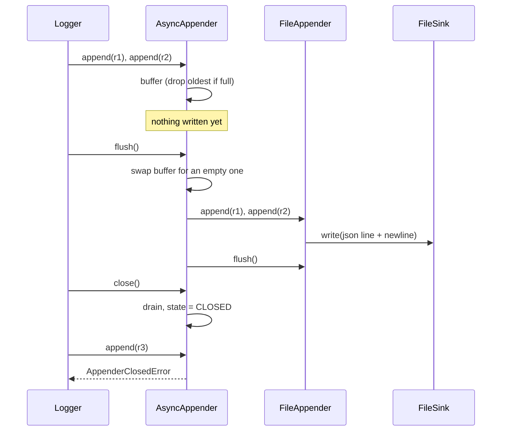

# Design a Logging Framework

| | |
|---|---|
| **Difficulty** | Medium |
| **Solution** | [`src/logging-framework/`](../src/logging-framework/) |
| **Run** | `npm run demo -- logging-framework` · `npx vitest run src/logging-framework` |
| **Patterns** | Strategy (formatters), Chain of Responsibility (logger hierarchy), Decorator (async appender), registry instead of Singleton |

## 1. Problem statement

Design a logging library in the spirit of log4j or Python's `logging`. Application code asks for a named logger and writes messages at a level; configuration decides which messages are kept, how they are formatted and where they go (console, file, a buffer that is flushed later). Loggers form a dot-separated hierarchy so `app.payments` inherits from `app`.

## 2. Clarifying questions to ask first

- Which levels, and in what order? Is there a per-destination threshold as well as a per-logger one?
- Are loggers hierarchical? What exactly is inherited: the level, the destinations, or both? Can a child opt out?
- Which destinations: console, file, network? Which output formats: plain text, JSON?
- Must logging be asynchronous? If the buffer fills up, do we block, drop, or drop only low levels?
- Can configuration change at runtime (hot reload), and must the change apply to loggers that already exist?
- What happens when a destination fails: does the application see the error?
- Structured context (key-value fields) or only message strings?

Assumptions used in the solution: five levels DEBUG < INFO < WARN < ERROR < FATAL; level and appenders are inherited from the nearest ancestor unless set; a logger can be made non-additive to stop the climb; plain text and JSON formatters; an async appender buffers in memory and drains on an explicit `flush()` (a worker or timer would call it in production), dropping the oldest record on overflow; appender failures are isolated and reported, never thrown into application code.

## 3. Requirements

### Functional
1. `registry.getLogger("app.payments")` returns the same logger every time and creates missing ancestors.
2. A record is kept only if its level is at least the logger's effective level (its own, or the nearest ancestor's).
3. A kept record goes to the logger's appenders and, while loggers are additive, to every ancestor's appenders.
4. Appenders format records with a pluggable `Formatter` (plain text, JSON) and may have their own minimum level.
5. Built-in appenders: console (injected write function), in-memory, file (injected sink), async (buffering decorator over any appender).
6. The async appender preserves arrival order, bounds its buffer, counts drops, and has an OPEN to CLOSED lifecycle; `close()` drains first.
7. A failing appender never stops other appenders or the caller; the failure is reported.
8. Bad configuration (unknown level, invalid name, duplicate appender name, clearing the root level) is rejected with domain errors.

### Non-functional
- A filtered call is cheap: the level check happens before ids, clock reads or formatting.
- Deterministic: time and record ids are injected; no timers; no disk access in tests.
- Extensible: new destinations and formats plug in without touching `Logger`.

## 4. Core entities

| Entity | Responsibility |
|---|---|
| `LogLevel` | Ordered severities; `isLevelEnabled`, `parseLogLevel`. |
| `LogRecord` | Immutable event: id, timestamp, level, logger name, message, context, error. |
| `Logger` | A node in the tree: optional level, own appenders, `additive` flag, `log()` and level shortcuts. |
| `LoggerRegistry` | Owns the tree, validates names, applies config, flushes all appenders. |
| `Formatter` → `PlainTextFormatter`, `JsonFormatter` | Turns a record into a line. |
| `Appender` → `ConsoleAppender`, `InMemoryAppender`, `FileAppender` | Writes formatted lines to a destination. |
| `AsyncAppender` | Decorator that buffers records and hands them on in order on `flush()`. |
| `FileSink` → `AppendFileSink`, `StringSink` | The byte destination behind a file appender. |

## 5. Class diagram

## 6. Key flows

## 7. Design patterns used

- **Strategy** for `Formatter`: the same record can be plain text on the console and JSON in the file. Alternative: a format string with placeholders (`%d %p [%c] %m`) parsed once into a list of field writers, which is what log4j's `PatternLayout` does.
- **Chain of Responsibility** for the hierarchy: a record climbs from `app.payments.gateway` through `app.payments` and `app` to `root`, collecting appenders until a non-additive logger stops it. Levels resolve the same way. Alternative: copy the parent's settings into each child on creation; it is faster per call but a change on `app` would no longer reach existing children.
- **Decorator** for `AsyncAppender`: it implements `Appender` and wraps any other appender, so buffering is added without changing the console or file code. Alternative: an `async: true` flag on every appender, which duplicates the buffer logic.
- **Registry instead of a Singleton `LogManager`.** Most reference answers make `LogManager.getInstance()` a global. Here the composition root builds one `LoggerRegistry` and passes it (or its loggers) down. It is just as single in production, but tests get a fresh registry each, so a level set in one test cannot leak into the next; two registries can coexist (an embedded library with its own config); and Clock and IdGenerator can be injected. If you need `getLogger()` at module scope, export the one instance from the composition root rather than hiding it in a static field.

## 8. Trade-offs, extensions and follow-up questions

**Dynamic vs cached effective level.** Walking to the nearest set level on every call costs O(depth), typically 3-5 hops. It buys correctness for hot reload: changing `app` applies to every existing descendant at once. If profiling shows it matters, cache the effective level per logger and invalidate the subtree when any level changes.

**Drop policy for the async buffer.** Dropping the oldest keeps the most recent context, which is what you want while debugging an incident. Alternatives: block the caller (no loss, but logging can stall a request), drop the newest, or drop only below WARN so errors are never lost. Whatever the policy, expose the drop count as a metric.

**Concurrency.** In Node a single `append` cannot interleave with another, so arrival order is call order. In a multi-threaded runtime the async buffer becomes a bounded multi-producer, single-consumer queue (a ring buffer, as in the LMAX Disruptor behind log4j2's async loggers) and one consumer thread owns the file handle, so lines never interleave mid-write. Across processes, each process writes its own stream and a shipper forwards them; ordering is per process only, which is why every record carries a timestamp and an id. When records land in a database, the id is an idempotency key: `INSERT ... ON CONFLICT (id) DO NOTHING` makes the shipper's retries safe. Hot-reloaded configuration stored in a table uses a version column: `UPDATE logger_config SET level = ?, version = version + 1 WHERE name = ? AND version = ?`, so two admins editing at once cannot silently overwrite each other.

**Failure isolation.** `Logger.log` catches each appender's error and hands it to `onAppenderError` (a counter by default). Logging must never take the request down, and a dead network appender must not starve the console.

**Persistence sketch.** `logger_config(name PK, level NULL, additive, version)`, `appender_config(id PK, logger_name FK, kind, formatter, min_level, settings JSON)`, and if records are stored: `log_events(id PK, ts, level, logger, message, context JSONB, error JSONB)` partitioned by day with an index on `(logger, ts)` and retention by dropping old partitions.

**Follow-ups to expect.**
- "Add a rolling file appender." A `FileSink` that rotates by size or date; the appender does not change.
- "Lazy messages." Accept `() => string` so an expensive message is built only after the level check.
- "MDC / request ids." A context provider injected into the registry that every record merges in, so each line carries `requestId` without the caller passing it.
- "Sampling." A filter between level check and appenders that keeps 1 in N DEBUG records, using an injected rng.

## 9. What a strong interview answer sounds like

1. Clarify levels, hierarchy semantics, destinations, async and failure behaviour; state the assumptions.
2. Separate the three decisions: whether to log (Logger and level), how to render (Formatter), where to write (Appender).
3. Draw the tree with inheritance by walking to the root, and the additive flag that stops it.
4. Add the async appender as a decorator with a bounded buffer, a stated drop policy and a closed state; walk the flush flow and the failure branch.
5. Explain why a registry instance beats a Singleton for tests, then cover concurrency (MPSC queue), idempotent ingestion and hot reload with a version column.
