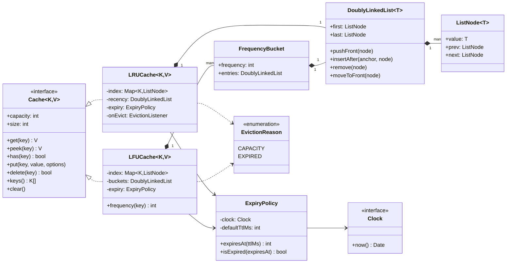
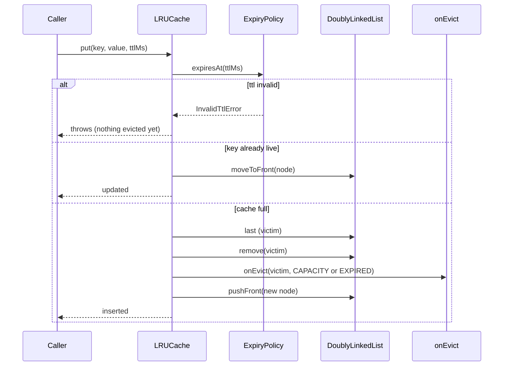
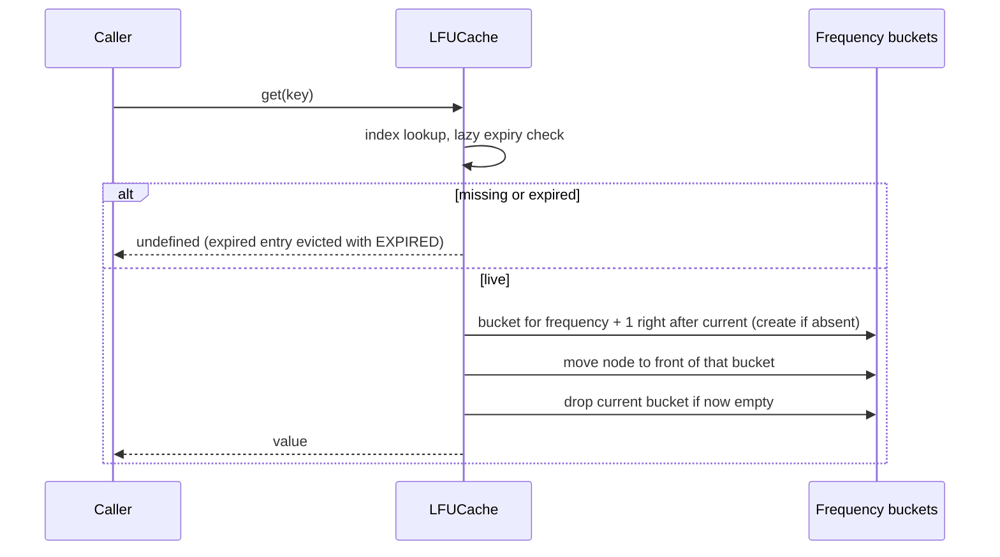

# Design an LRU Cache (and LFU)

| | |
|---|---|
| **Difficulty** | Medium |
| **Solution** | [`src/lru-cache/`](../src/lru-cache/) |
| **Run** | `npm run demo -- lru-cache` · `npx vitest run src/lru-cache` |
| **Patterns** | Strategy (eviction policy behind a `Cache` interface), Observer (`onEvict`), composition of data structures |

## 1. Problem statement

Design an in-memory key-value cache with a fixed capacity. When it is full, inserting a new key evicts the least recently used one. Every operation must run in O(1). Follow-ups: per-entry expiry, an eviction callback, and a least-frequently-used variant behind the same interface.

## 2. Clarifying questions to ask first

- Is capacity counted in entries or in bytes? Can it be 0?
- Does an update of an existing key count as a use (does it move the key to most recent)?
- Do reads that only check existence (`has`, `peek`) count as a use?
- Do entries expire? A cache-wide TTL, a per-entry TTL, or both? Must expired entries be removed eagerly or is lazy removal fine?
- Does the caller need to know when something is evicted (to write back, or to emit a metric)?
- Single-threaded, or shared between threads and processes?
- Is LFU in scope? If so, how are frequency ties broken?

Assumptions used in the solution: capacity in entries, 0 allowed (the cache stores nothing); updates count as a use and reset the TTL; `peek` and `has` do not change order; TTL is lazy (checked when an entry is touched, no timers); `onEvict` fires for capacity and expiry evictions, never for an explicit `delete` or `clear`; LFU breaks ties by recency (least recently used among the least frequent leaves first).

## 3. Requirements

### Functional
1. `get(key)` returns the value and marks the key as most recently used; a miss returns `undefined`.
2. `put(key, value)` inserts or replaces; when the cache is full, the least recently used entry is evicted first.
3. `delete(key)`, `has(key)`, `peek(key)`, `clear()` and `size` behave as on a Map.
4. `keys()` lists live keys in eviction-safety order: the next victim last.
5. Entries may carry a TTL (cache-wide default, per-entry override). An expired entry is never returned.
6. An `onEvict(key, value, reason)` listener is told about every capacity or expiry eviction.
7. An `LFUCache` implements the same `Cache` interface with O(1) operations.
8. Invalid capacity or TTL values are rejected with domain errors, and a rejected `put` changes nothing.

### Non-functional
- O(1) `get`, `put`, `delete` for both policies. No scans on the hot path.
- Deterministic: time comes from an injected `Clock`; there are no timers.
- Generic over key and value types; no `any`.

## 4. Core entities

| Entity | Responsibility |
|---|---|
| `Cache<K,V>` (interface) | The contract both policies share. Callers depend on it, not on a policy. |
| `LRUCache<K,V>` | `Map<K, node>` for lookup plus a recency list for order. |
| `LFUCache<K,V>` | `Map<K, node>` plus an ordered list of frequency buckets, each a recency list. |
| `DoublyLinkedList<T>` / `ListNode<T>` | O(1) push, unlink, move-to-front and both ends. |
| `ExpiryPolicy` | One definition of "expired" for both caches, evaluated against the Clock. |
| `EvictionReason` | `CAPACITY` or `EXPIRED`, passed to the listener. |
| `InvalidCapacityError`, `InvalidTtlError` | Domain errors for bad configuration. |

## 5. Class diagram

## 6. Key flows

## 7. Design patterns used

- **Composition of two data structures.** A Map gives O(1) lookup but no cheap reordering; a linked list gives O(1) reordering but O(n) lookup. Storing list nodes in the Map gives both. This is the core insight interviewers listen for. Alternative: JavaScript's `Map` keeps insertion order, so `delete` then `set` plus `map.keys().next()` is a valid LRU in a few lines. Mention it, then show the explicit list, because it is what the question tests and it carries over to LFU.
- **Strategy** via the `Cache` interface: LRU and LFU are eviction policies; callers (a repository, an HTTP layer) hold a `Cache<K,V>` and the policy is picked at the composition root. Alternative: one `Cache` class taking an `EvictionPolicy` object with `onAccess`, `onInsert`, `victim()` hooks. It is more flexible but the hooks leak the node structure, and LFU needs a different index anyway.
- **Observer** for `onEvict`: write-back caches, metrics and "reload from DB" hooks subscribe without the cache knowing about them. The cache unlinks before notifying, so a listener that reads the cache sees a consistent state.
- **Lazy expiry** instead of timers: TTL is checked on touch against the injected Clock. Alternative: a min-heap by `expiresAt` swept on each `put`, which bounds memory held by dead entries at an O(log n) cost.

## 8. Trade-offs, extensions and follow-up questions

**LFU in O(1).** The textbook answer tracks `minFrequency` and a `Map<frequency, list>`. That works for `get`/`put`, but after a `delete` or an expiry the minimum can be wrong and finding the next one is O(n). Linking the buckets in ascending order keeps every operation O(1): promotion inserts bucket `f+1` right after bucket `f`, an empty bucket is unlinked, and the victim is always the tail of the first bucket.

**Lazy expiry costs memory.** Expired entries still count toward `size` until touched, and they are evicted first when capacity is needed (reported as `EXPIRED`). If memory matters, add a periodic `purgeExpired()` driven by the caller's scheduler, or a heap by expiry.

**"Make it thread-safe" / concurrency.** Node runs one operation at a time, so no lock is needed in process. In a multi-threaded runtime a single lock around each operation is correct and simple; striping (N independent caches by key hash) cuts contention; `get` takes a write lock because it reorders the list, which is why read-heavy systems use approximate LRU (sampled eviction in Redis, CLOCK in OS page caches). Across processes the cache is not the source of truth: guard writes to the backing store with a version column (`UPDATE products SET price = ?, version = version + 1 WHERE id = ? AND version = ?`) and invalidate or version cache keys, so a stale entry can be detected rather than trusted.

**Thundering herd on a miss.** Many callers miss the same key at once and all hit the database. Keep a map of in-flight loads (`key -> Promise<V>`) so only the first caller loads; that is request coalescing, or "single flight".

**Size by bytes, not entries.** Keep a running `bytes` total, take a `sizeOf(value)` function, and evict in a loop until the new entry fits.

**Distributed cache.** Shard by consistent hashing; each node runs its own LRU. Persistence sketch for a write-through setup: `products(id PK, price, version)` is the source of truth; cache keys are `product:{id}:v{version}` so a write naturally retires the old entry, and an idempotency key on writes prevents a retried update from bumping the version twice.

**Follow-ups to expect.**
- Why not a `minFrequency` integer for LFU? (Delete and expiry, above.)
- How would you implement LRU-K or an admission filter (TinyLFU) so a one-off scan cannot flush hot entries? (The demo shows LRU losing the hot page to a scan and LFU keeping it.)
- What does `onEvict` see if the listener throws? (Here the cache is already consistent; decide whether to swallow and log.)
- How do you test TTL without sleeping? (FakeClock, as the tests do.)

## 9. What a strong interview answer sounds like

1. Clarify capacity semantics, what counts as a use, TTL, and the callback; state the assumptions.
2. Explain why neither a Map nor a list alone is enough, then combine them: Map of key to list node, head is most recent, tail is the victim.
3. Write `get` and `put` with the move-to-front and evict-tail steps, plus the capacity 0 and 1 edge cases.
4. Add lazy TTL with an injected Clock and an `onEvict` listener that runs after the cache is consistent.
5. Extend to LFU with linked frequency buckets behind the same `Cache` interface, then discuss locking, approximate LRU, single flight and sharding.
