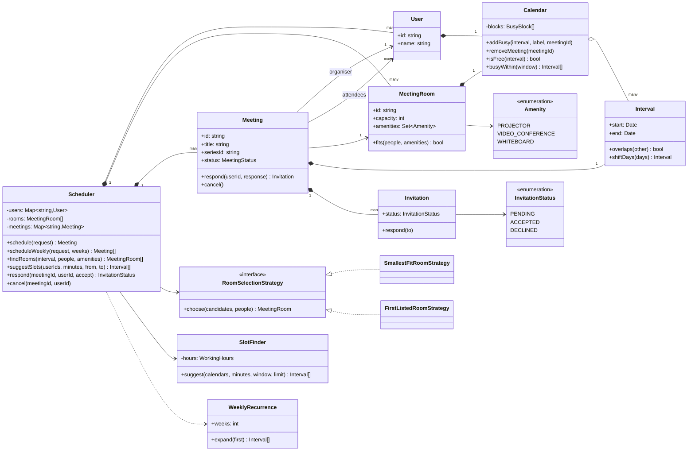
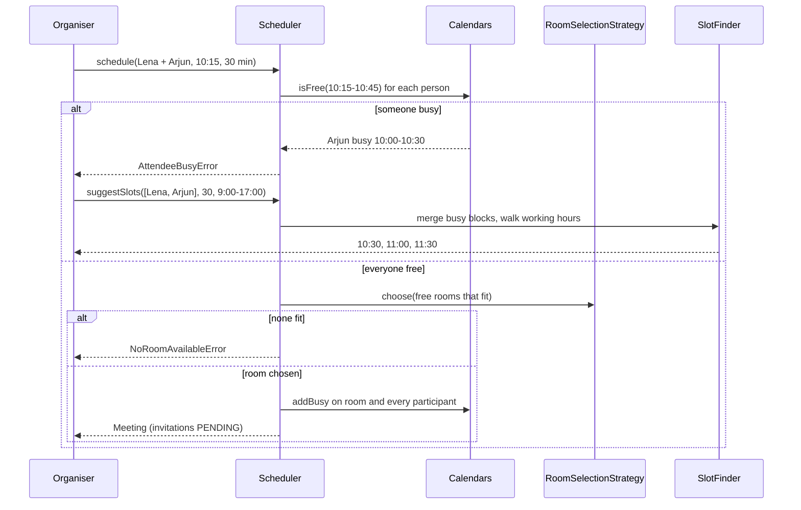
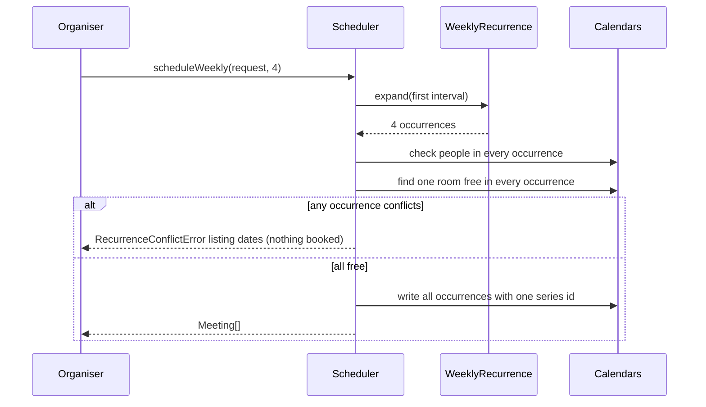

# Design a Meeting Scheduler

| | |
|---|---|
| **Difficulty** | Medium |
| **Solution** | [`src/meeting-scheduler/`](../src/meeting-scheduler/) |
| **Run** | `npm run demo -- meeting-scheduler` · `npx vitest run src/meeting-scheduler` |
| **Patterns** | Strategy (room selection), Value object (Interval), State machine, Check-then-write |

## 1. Problem statement

Design a meeting scheduler for an office. People have calendars of busy time, rooms have a capacity and amenities, and an organiser books a meeting for an interval with attendees and a room. The system must detect conflicts for rooms and people, pick a suitable room, suggest free slots that work for everyone, support weekly recurring meetings, and track who accepted.

## 2. Clarifying questions to ask first

- Is a meeting ending at 10:00 in conflict with one starting at 10:00? (No: half-open intervals.)
- Does a busy attendee block the booking, or is it only a warning?
- Do pending invitations block the attendee's time? Does declining free it?
- How do we choose a room when several fit: smallest, nearest, cheapest?
- What are working hours and days, and which time zone?
- For recurrence: which patterns, and what if one occurrence conflicts?
- Who may cancel, and should cancellation notify attendees?

Assumptions used in the solution: intervals are half-open `[start, end)`; busy attendees (including pending invitations) block a booking, and declining frees the person's time; the default room strategy is smallest fit; working hours are 09:00 to 17:00, Monday to Friday, in one shared time zone (UTC in code); weekly recurrence for N weeks is all-or-nothing and uses the same room every week; only the organiser can cancel; notifications are out of scope.

## 3. Requirements

### Functional
1. Users have calendars of busy intervals; rooms have capacity, amenities and their own calendar.
2. Schedule a meeting with organiser, attendees, start, duration and optional amenities or a specific room.
3. Reject the meeting if any participant or the requested room is busy; touching intervals do not conflict.
4. Without a specific room, choose among free rooms with enough seats and the required amenities using a swappable strategy.
5. Find free rooms for an interval by capacity and amenities.
6. Suggest free slots of a given duration for a set of people within working hours, by merging their busy intervals.
7. Schedule a weekly meeting for N weeks: all occurrences are checked first and booked only if every one is free.
8. Invitations move `PENDING -> ACCEPTED | DECLINED`, and between ACCEPTED and DECLINED; repeating a response is rejected.
9. Cancelling (organiser only, once) frees the room and every participant's calendar.

### Non-functional
- Conflict checks are exact; no double-booked room ever.
- Slot suggestion is O(n log n) in the number of busy blocks.
- Deterministic tests via `FakeClock` and `SequentialIdGenerator`.

## 4. Core entities

| Entity | Responsibility |
|---|---|
| `Interval` | Half-open value object; overlap test, shifting by days. `mergeIntervals` merges busy blocks. |
| `Calendar` (`BusyBlock`) | Busy time of a user or a room; conflicts, free check, busy within a window. |
| `User` | A person with a calendar. |
| `MeetingRoom` (`Amenity`) | Capacity, amenities, calendar; `fits(people, amenities)`. |
| `Meeting` (`MeetingStatus`) | Organiser, attendees, room, interval, series id; invitations; cancellation. |
| `Invitation` (`InvitationStatus`) | One attendee's response with validated transitions. |
| `WeeklyRecurrence` | Expands a first interval into N weekly occurrences. |
| `RoomSelectionStrategy` → `SmallestFitRoomStrategy`, `FirstListedRoomStrategy` | Picks a room among suitable free ones. |
| `SlotFinder` (`WorkingHours`) | Suggests common free slots. |
| `Scheduler` | Aggregate root: schedule, recurring, respond, cancel, find rooms, suggest slots. |

## 5. Class diagram

## 6. Key flows

## 7. Design patterns used

- **Value object** `Interval` with the half-open rule in one place. Every conflict check, merge and suggestion uses it, so "touching does not conflict" cannot drift between features.
- **Strategy** for room selection. Facilities teams change the rule (smallest fit, nearest to the organiser, avoid premium rooms) without touching scheduling. Alternative: a scoring function that weighs several criteria, still behind the same interface.
- **Check-then-write** inside the aggregate: all checks for every occurrence run before any calendar is written, which makes recurring bookings atomic in-process. Alternative: write and compensate on failure, as in the concert problem; checking first is simpler when checks are cheap and in memory.
- **State machine** for invitations and meetings, with transition tables and dedicated errors.
- **Service object** `SlotFinder` keeps the merge-and-sweep algorithm separate from booking, so it can be tested alone and swapped for a smarter ranker.

## 8. Trade-offs, extensions and follow-up questions

**"Two organisers book the same room at the same time."** In-process the check and the write happen with no `await` between them. In a database, PostgreSQL enforces it directly: `EXCLUDE USING gist (room_id WITH =, tstzrange(start_at, end_at, '[)') WITH &&)`. Without exclusion constraints, split time into 15-minute slots and insert `room_slots(room_id, slot_start)` under a unique constraint, or lock the room row (`SELECT ... FOR UPDATE`) while checking. A client idempotency key stops a double-clicked "Save" from creating two meetings.

**"Responses race with a cancellation."** Meetings carry a version: `UPDATE meetings SET status = 'CANCELLED', version = version + 1 WHERE id = ? AND status = 'SCHEDULED' AND version = ?`; responses check `status = 'SCHEDULED'` in their own conditional update.

**"Suggest slots for 50 people over a month."** Merging is O(n log n); fetch busy blocks with one indexed range query per person (`WHERE user_id IN (...) AND start_at < ? AND end_at > ?`). Rank candidates by how many optional attendees are free rather than requiring everyone.

**"Time zones and daylight saving."** Store instants in UTC, keep each user's zone and working hours, and compute the working-hours mask per person per day; recurrence expands in the organiser's zone so "Mondays 9:00" survives a DST change.

**"Edit one occurrence of a series."** Store the series rule plus exceptions (`series_exceptions(series_id, original_start, new_start | cancelled)`), the way iCalendar `RRULE` and `EXDATE` work, instead of N independent rows.

**Persistence sketch.** `users(id, name, time_zone)`, `rooms(id, name, capacity)`, `room_amenities(room_id, amenity)`, `meetings(id, title, organiser_id, room_id, start_at, end_at, series_id, status, version)` with the exclusion constraint on room and range, `invitations(meeting_id, user_id, status) PRIMARY KEY(meeting_id, user_id)`, `busy_blocks(user_id, start_at, end_at, meeting_id NULL)` indexed on `(user_id, start_at)`.

## 9. What a strong interview answer sounds like

1. Clarify the half-open rule, whether busy attendees block, working hours, room selection and recurrence semantics; state assumptions.
2. Introduce `Interval` and `Calendar` first: one overlap rule shared by people and rooms, and merging for free-slot search.
3. Draw `Scheduler` as the aggregate with users, rooms, meetings, invitations, the room-selection strategy and the slot finder.
4. Walk a booking that fails on a busy attendee and recovers via suggested slots, then a weekly series that conflicts in week three and books nothing.
5. Close with the database guard (exclusion constraint or slot rows with a unique key, version columns, idempotency keys), time zones, and editing a single occurrence.
