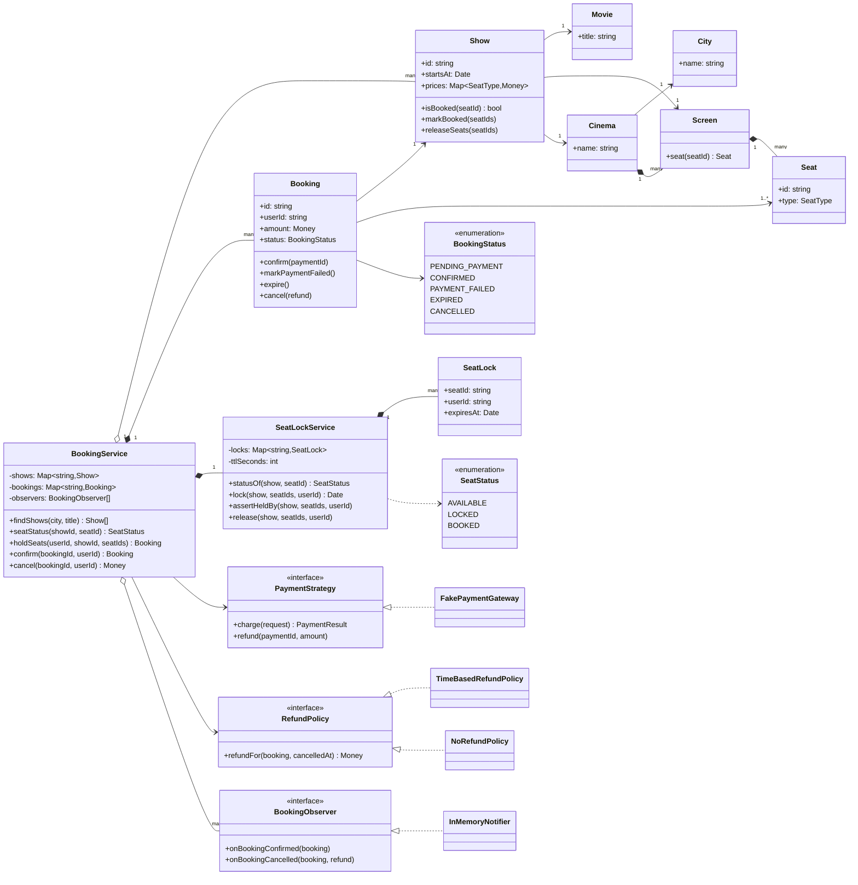
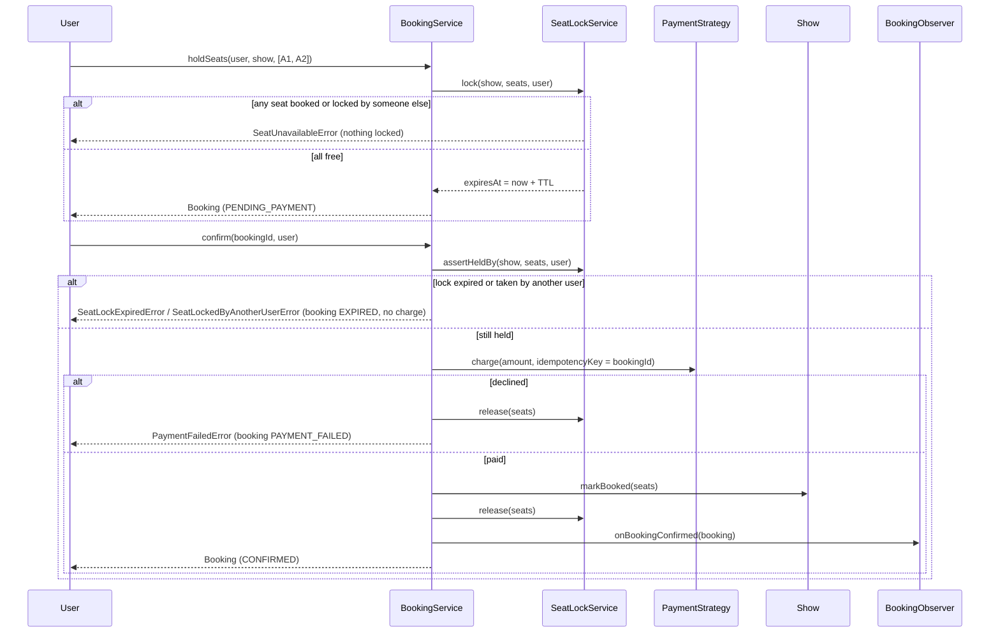
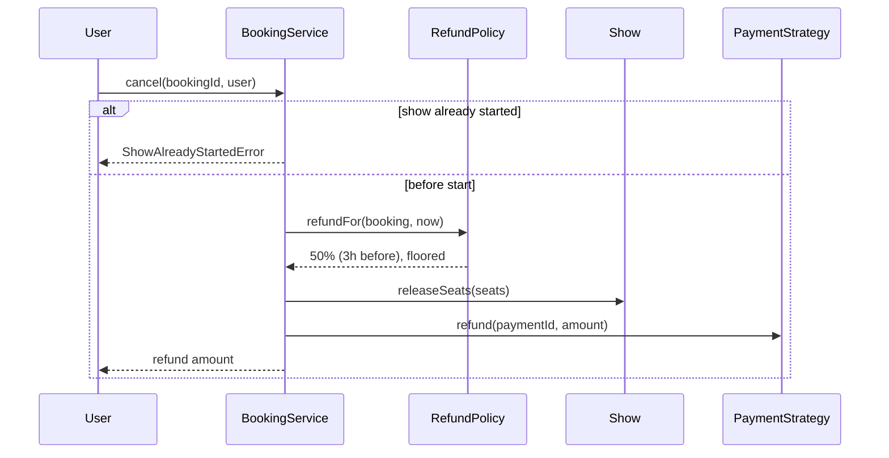

# Design a Movie Ticket Booking System

| | |
|---|---|
| **Difficulty** | Medium |
| **Solution** | [`src/movie-ticket-booking/`](../src/movie-ticket-booking/) |
| **Run** | `npm run demo -- movie-ticket-booking` · `npx vitest run src/movie-ticket-booking` |
| **Patterns** | Strategy (payment, refund), Observer, State machine, TTL lock (lease) |

## 1. Problem statement

Design the core of a BookMyShow-style app. Users pick a city, a movie and a show, choose seats on the screen's seat map, and pay. While a user is paying, the chosen seats must be held for them for a few minutes so nobody else can take them, and released automatically if the user walks away or the payment fails.

## 2. Clarifying questions to ask first

- How long is a seat hold, and does it start at seat selection or at checkout?
- Can a user hold seats in several shows at once? Is there a seat limit per booking?
- What happens if a group selection is partly taken: book the free ones or none?
- Which payment methods, and what happens when the gateway declines or times out?
- Is pricing per seat type, per show, or dynamic? Any convenience fee?
- What is the cancellation and refund policy?
- Who needs to know about a confirmed booking (email, SMS, loyalty, analytics)?

Assumptions used in the solution: a hold lasts 5 minutes (configurable) from the lock call; a group of seats is locked all-or-nothing; price is per seat type per show; payment is behind a `PaymentStrategy` and a fake gateway can be told to decline; refunds are 100% more than 24 hours before the show, 50% more than 2 hours before, otherwise nothing, and nothing after the show starts.

## 3. Requirements

### Functional
1. Model cities, cinemas, screens with seat maps (REGULAR, PREMIUM, RECLINER) and shows of movies with per-type prices.
2. Search upcoming shows by city and movie.
3. A seat in a show is `AVAILABLE`, `LOCKED` (held for a user until a TTL) or `BOOKED`.
4. Locking several seats is all-or-nothing; a seat locked by another user or booked cannot be locked.
5. Confirming a booking re-validates that every seat is still locked by the same user, charges the payment strategy, then marks seats `BOOKED`.
6. Confirm fails if a lock expired or now belongs to another user, and no money is taken.
7. A declined payment marks the booking `PAYMENT_FAILED` and releases its locks at once.
8. Observers are notified on confirmation (and cancellation).
9. Cancellation releases the seats and refunds according to a swappable policy.

### Non-functional
- No seat is ever sold twice; correctness over throughput.
- Holds expire without background jobs (lazy evaluation against the Clock).
- Payment calls are idempotent per booking so retries never double-charge.
- Deterministic tests: Clock, ids and the gateway's rng are injected.

## 4. Core entities

| Entity | Responsibility |
|---|---|
| `City`, `Cinema`, `Screen`, `Seat` (`SeatType`) | Static catalogue and seat map. |
| `Movie`, `Show` | A screening with start time, prices, and durable `BOOKED` seats. |
| `SeatLockService` (`SeatLock`, `SeatStatus`) | Temporary per-user holds with TTL; all-or-nothing group lock; lazy expiry. |
| `Booking` (`BookingStatus`) | A purchase moving through `PENDING_PAYMENT -> CONFIRMED -> CANCELLED` (or `PAYMENT_FAILED`, `EXPIRED`). |
| `PaymentStrategy` → `FakePaymentGateway` | Charge and refund; can decline via injected rng; idempotent by key. |
| `RefundPolicy` → `TimeBasedRefundPolicy`, `NoRefundPolicy` | Amount returned on cancellation. |
| `BookingObserver` → `InMemoryNotifier` | Reacts to confirmed and cancelled bookings. |
| `BookingService` | Orchestrates search, hold, confirm and cancel. |

## 5. Class diagram

## 6. Key flows

## 7. Design patterns used

- **Lease / TTL lock** in `SeatLockService`. A hold is a lease that expires by itself; checking expiry lazily on every read means no timers, no sweeper, and identical behaviour to a Redis `SET key value NX PX 300000`. Alternative: a scheduled sweeper that releases expired holds; needed only if you must push "seat freed" events at the exact second.
- **Strategy** for payment and refunds. Payment providers and refund rules change independently of seat logic; tests inject a gateway that declines on demand. Alternative: a payment orchestration service behind an async webhook, which a real system ends up with.
- **Observer** for confirmation and cancellation. Ticket emails, loyalty points and analytics subscribe without `BookingService` importing them. Alternative: an outbox table plus a message bus when subscribers live in other services.
- **State machine** on `Booking` with an allowed-transitions table, so "confirm twice" or "cancel a pending booking" fail loudly.
- **Separation of temporary and durable state**: locks in the lock service, `BOOKED` on the show. This mirrors the production split (cache vs database) and keeps the invariant easy to reason about.

## 8. Trade-offs, extensions and follow-up questions

**"Two users click the same seat at the same millisecond."** In-process, `lock()` checks every seat and then writes all locks with no `await` in between, so it is atomic. Across servers: Redis `SET NX PX` per seat, or a Lua script that checks and sets the whole group in one step (all-or-nothing). In SQL: `UPDATE show_seats SET status = 'LOCKED', user_id = ?, lock_expires_at = ? WHERE show_id = ? AND seat_id IN (...) AND (status = 'AVAILABLE' OR (status = 'LOCKED' AND lock_expires_at <= now()))`, then require that the row count equals the number of seats, otherwise roll back.

**"The lock expires while the payment is in flight."** We re-check the lock before charging; the remaining race (expiry during the gateway call) is handled at the final write: `UPDATE show_seats SET status = 'BOOKED' WHERE ... AND user_id = ? AND status = 'LOCKED'`. If fewer rows change, refund automatically. Production systems also extend the lease when payment starts.

**"Gateway times out and the user retries."** The booking id is the idempotency key, so the second `charge` returns the first result. A unique constraint on `payments(idempotency_key)` makes the same guarantee in the database.

**"Holds create artificial sell-outs during a rush."** Shorter TTL, cap held seats per user, and show LOCKED seats differently from BOOKED so users know they may free up.

**"Dynamic pricing, offers, convenience fees."** A `PricingStrategy` replaces `Show.priceOf`; a fee is another line in the amount, still in minor units.

**Persistence sketch.** `cities`, `cinemas(id, city_id)`, `screens(id, cinema_id)`, `seats(id, screen_id, row, type)`, `shows(id, movie_id, screen_id, starts_at)`, `show_prices(show_id, seat_type, amount)`, `show_seats(show_id, seat_id, status, user_id, lock_expires_at, booking_id, version) PRIMARY KEY(show_id, seat_id)`, `bookings(id, user_id, show_id, amount, status, payment_id, refunded)`, `payments(id, booking_id, idempotency_key UNIQUE, amount, status)`.

## 9. What a strong interview answer sounds like

1. Clarify hold duration, group behaviour, payment failure handling and refund rules; state assumptions.
2. Name the two invariants: a seat is never sold twice, and nobody pays for a seat they no longer hold.
3. Draw the catalogue, `Show`, the separate `SeatLockService` with TTL leases, `Booking` with its state machine, and the strategy and observer interfaces.
4. Walk lock, pay and confirm with all three failure branches: seat taken (nothing locked), lock expired (no charge) and payment declined (locks released).
5. Close with the distributed version: Redis `SET NX PX` or a conditional `UPDATE ... WHERE status = 'AVAILABLE' OR lock_expires_at <= now()`, idempotency keys on payments, and the outbox for notifications.
