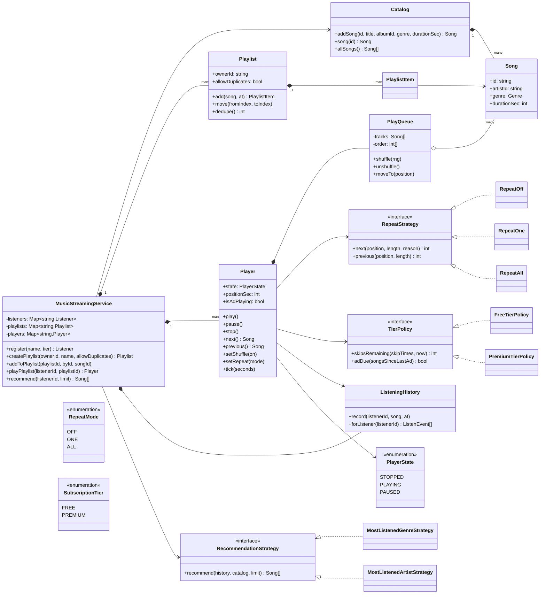
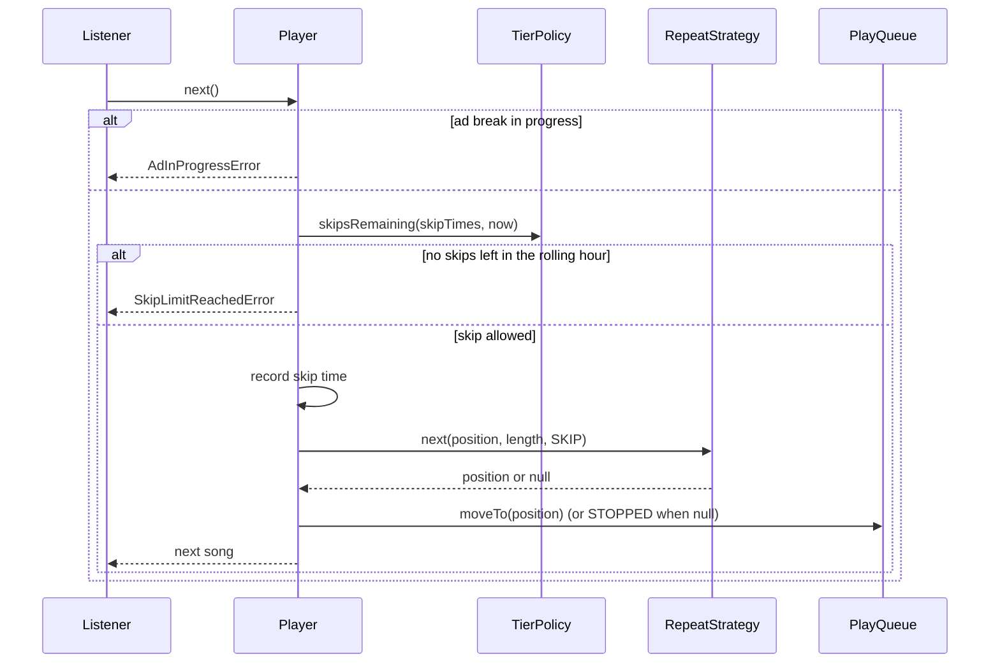
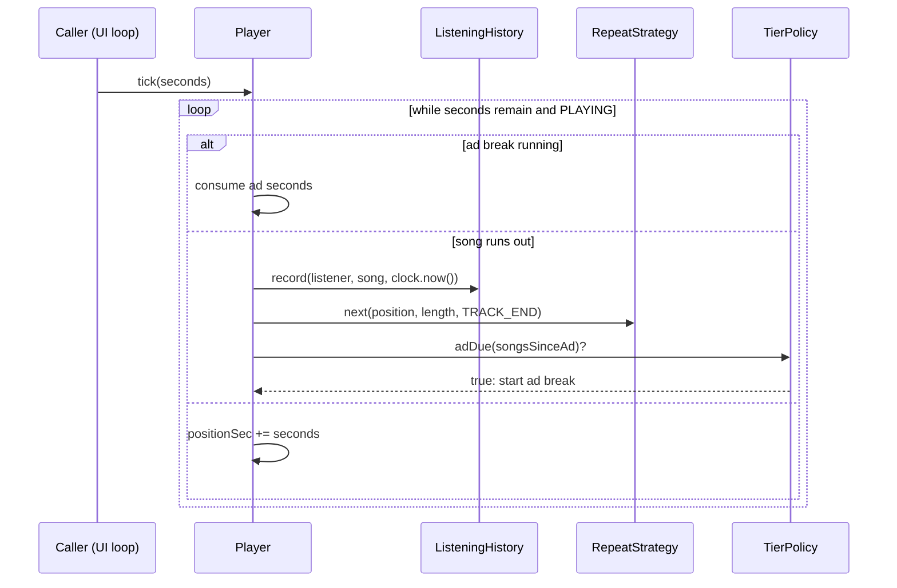

# Design a Music Streaming Service (Spotify)

| | |
|---|---|
| **Difficulty** | Medium |
| **Solution** | [`src/music-streaming/`](../src/music-streaming/) |
| **Run** | `npm run demo -- music-streaming` · `npx vitest run src/music-streaming` |
| **Patterns** | State, Strategy (repeat mode, tier, recommendation), Template Method, Facade |

## 1. Problem statement

Design the core of a music streaming app. The catalogue holds artists, albums and songs; listeners build ordered playlists and play them through a player with a queue, next/previous, shuffle and repeat. FREE listeners get a limited number of skips per hour and an ad every few songs; PREMIUM listeners get neither restriction. Completed plays feed a listening history that drives recommendations.

## 2. Clarifying questions to ask first

- Do we stream audio, or only model playback state? (State only: no codecs, no CDN.)
- What does repeat mean exactly? Does "repeat one" also block a manual skip?
- Is shuffle a new random order, or random picks with replacement? Does the current song keep playing when shuffle turns on?
- How is the FREE skip limit measured: per calendar hour or a rolling hour? Do "previous" presses count?
- How often are ads played, and can they be skipped?
- What counts as a "listen" for history and royalties: a completed play, or 30 seconds?
- Can a playlist contain the same song twice?

Assumptions used in the solution: playback state only; repeat ONE replays when the song ends but a manual skip moves on; shuffle is a Fisher-Yates permutation of the queue with the current song kept first, driven by an injected `rng`; FREE allows 6 skips in a rolling 60-minute window (previous is free), and an unskippable ad plays after every 3 completed songs; a listen is a completed play stamped by the clock; duplicates are allowed per playlist, with `dedupe()` to clean up.

## 3. Requirements

### Functional
1. The catalogue stores artists, albums and songs; each song has a genre and a positive duration in seconds and inherits its artist from its album.
2. A listener creates playlists, adds songs, removes items and moves an item to a new position. A playlist either allows or rejects duplicate songs; `dedupe()` keeps the first occurrence.
3. Only the owner edits a playlist.
4. The player is a state machine: STOPPED -> PLAYING -> PAUSED -> PLAYING, and STOPPED from either; invalid transitions throw.
5. The player has a queue with next, previous (restart if more than 3 seconds in), shuffle on/off and repeat OFF, ONE or ALL. With repeat OFF the player stops after the last song.
6. Playback time advances only through `tick(seconds)`; a song that runs out is recorded in the history with the clock's time and the next song starts.
7. FREE: at most 6 skips per rolling hour, and an unskippable ad after every N songs. PREMIUM: unlimited skips, no ads.
8. Recommendations suggest unheard songs from the listener's most-listened genre or artist, and the strategy can be swapped.

### Non-functional
- Deterministic: clock and rng are injected; no timers in the domain.
- New repeat modes, tiers or recommenders are new classes, not new branches in the player.
- Shuffle is O(n) and reversible without losing the current song.

## 4. Core entities

| Entity | Responsibility |
|---|---|
| `Catalog`, `Artist`, `Album`, `Song` | Read-mostly catalogue; songs take their artist from the album. |
| `Playlist`, `PlaylistItem` | Ordered items with their own ids (a song may repeat); move, remove, dedupe. |
| `PlayQueue` | Tracks plus a play order; shuffle permutes the order only. |
| `Player` | State machine, playback position, skip budget, ad breaks; delegates policy to strategies. |
| `RepeatStrategy` → `RepeatOff`, `RepeatOne`, `RepeatAll` | Which queue position plays next. |
| `TierPolicy` → `FreeTierPolicy`, `PremiumTierPolicy` | Skip budget and ad cadence. |
| `ListeningHistory`, `ListenEvent` | Append-only log of completed plays. |
| `RecommendationStrategy` → `MostListenedGenreStrategy`, `MostListenedArtistStrategy` | Suggestions from history. |
| `MusicStreamingService` | Facade: listeners, playlists, one player per listener, wiring the tier policy. |

## 5. Class diagram

## 6. Key flows

## 7. Design patterns used

- **State** for the player (`STOPPED`, `PLAYING`, `PAUSED`) as a transition table: pausing a stopped player is an error, not a silent no-op. A class per state (the GoF version) is the alternative when each state reacts to many events differently.
- **Strategy** three times. `RepeatStrategy` answers "which position next?", so repeat modes never appear as `if` chains in the player. `TierPolicy` keeps commercial rules (skips, ads) out of playback logic, so a STUDENT or FAMILY tier is a new class. `RecommendationStrategy` lets product swap recommenders at runtime. The alternative for tiers is a feature-flag map (`{maxSkips, adEvery}`), which is enough until tiers differ in behaviour, not just numbers.
- **Template Method** inside recommendations: `FavouriteBasedStrategy.recommend()` fixes the skeleton (find the favourite, filter unheard, sort) and subclasses supply the key (genre or artist).
- **Facade** (`MusicStreamingService`) wires listeners to the right `TierPolicy` and gives the UI one entry point.
- **Explicit time**: `tick(seconds)` instead of timers. The UI loop (or a test) drives time, so playback is deterministic and no `setTimeout` lives in the domain.

## 8. Trade-offs, extensions and follow-up questions

**"The same account presses next on two devices at once."** Skip budget is per account, so it belongs in shared storage. Store skips in `skips(listener_id, at)` and enforce the limit with one statement: `INSERT INTO skips SELECT ?, now() WHERE (SELECT count(*) FROM skips WHERE listener_id = ? AND at > now() - interval '1 hour') < 6`; zero rows inserted means the limit was reached. At scale use a Redis sorted set per listener (`ZREMRANGEBYSCORE` then `ZCARD` in a Lua script) for the rolling window. Each skip request carries an idempotency key so a retried tap does not burn two skips.

**"Two devices play at once."** Spotify allows one active device per account. Keep `playback_sessions(listener_id PRIMARY KEY, device_id, version)` and take over with `UPDATE ... SET device_id = ?, version = version + 1 WHERE listener_id = ? AND version = ?`; the old device sees a newer version and pauses.

**"Two people edit a collaborative playlist."** Positions as dense integers make every move rewrite many rows and conflict. Use fractional ranks (a string or decimal between neighbours) so a move updates one row, plus a `version` column on the playlist for optimistic checks. `dedupe()` becomes `DELETE` of all but the lowest rank per `(playlist_id, song_id)`; a no-duplicates playlist is a unique index on `(playlist_id, song_id)`.

**"Shuffle that feels random."** Pure Fisher-Yates can cluster one artist. A `SpreadShuffle` strategy interleaves by artist; it plugs in where `PlayQueue.shuffle` takes the rng.

**"Royalties need exact play counts."** History is append-only; a completed play (or 30 seconds) emits a `ListenEvent` to a log (Kafka) with an event id, and the aggregator deduplicates on that id.

**"Recommendations for a new user."** The cold-start path returns `[]` today; add a `PopularNowStrategy` and a `Composite` that falls back to it.

**Persistence sketch.** `artists`, `albums(id, artist_id, year)`, `songs(id, album_id, genre, duration_sec)`, `playlists(id, owner_id, allow_duplicates, version)`, `playlist_items(id, playlist_id, song_id, rank, added_at)` indexed by `(playlist_id, rank)`, `listeners(id, tier)`, `skips(listener_id, at)` indexed by `(listener_id, at)`, `listens(event_id PRIMARY KEY, listener_id, song_id, artist_id, genre, played_at)` partitioned by day.

## 9. What a strong interview answer sounds like

1. Scope it to playback state, playlists, tiers and recommendations (no audio pipeline) and settle the ambiguous rules: repeat ONE vs skip, rolling vs calendar hour, what counts as a listen.
2. Name the entities and invariants: playlist order is explicit, a player has one state at a time, the skip budget is per rolling hour, ads cannot be skipped.
3. Draw the player with its three strategies (repeat, tier, recommendation) behind interfaces and the queue holding a separate play order so shuffle is reversible.
4. Walk the skip flow including both failure branches (ad in progress, limit reached) and the tick flow that records history and schedules ads.
5. Finish with concurrency across devices (conditional insert for skips, versioned playback session), collaborative playlist ordering with fractional ranks, and one or two extensions such as cold-start recommendations.
