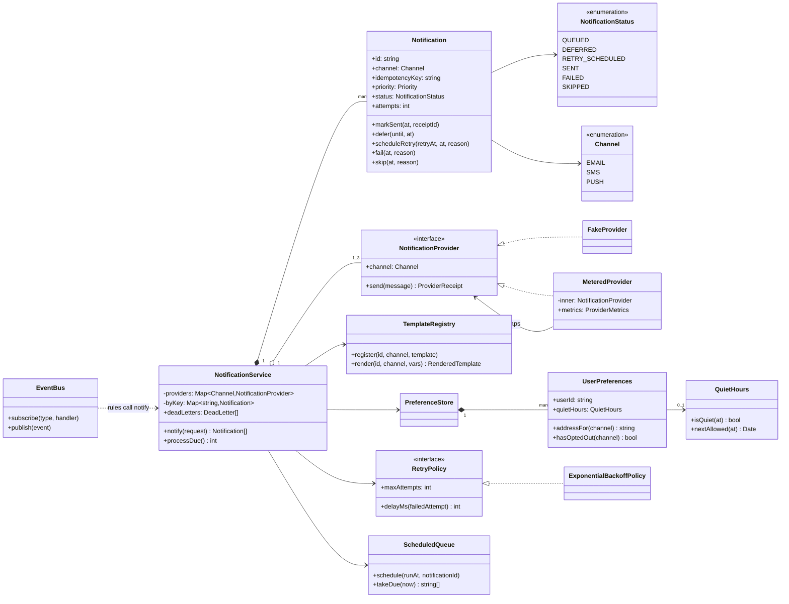
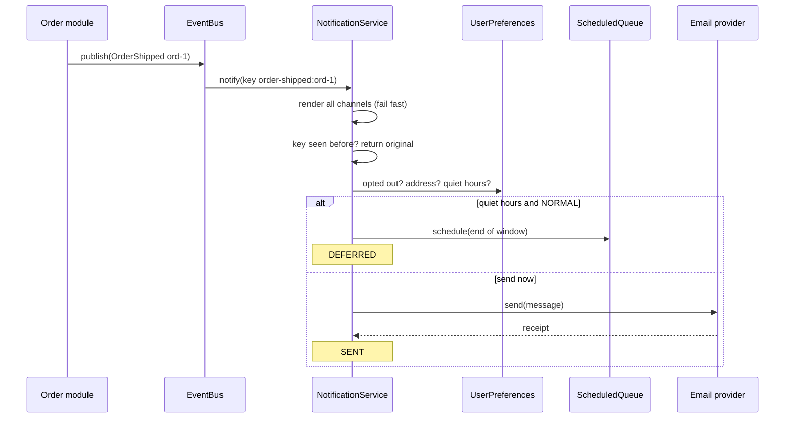
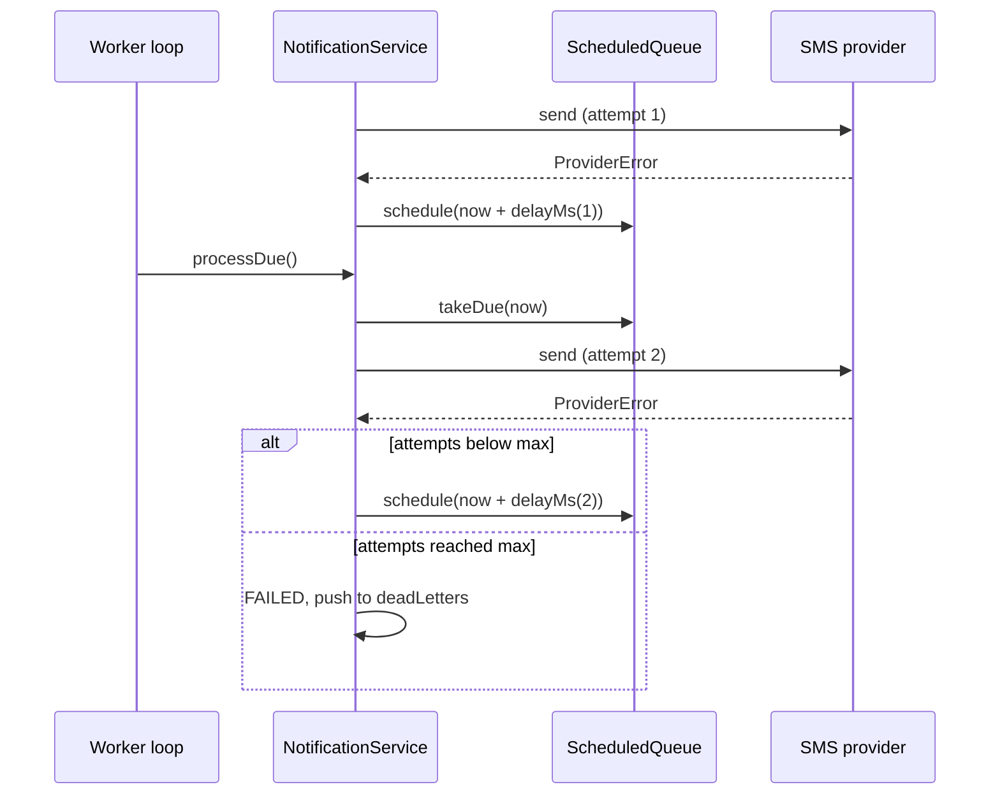

# Design a Notification Service

| | |
|---|---|
| **Difficulty** | Medium |
| **Solution** | [`src/notification-service/`](../src/notification-service/) |
| **Run** | `npm run demo -- notification-service` · `npx vitest run src/notification-service` |
| **Patterns** | Strategy (provider per channel, retry policy), Observer (domain events), Decorator (metered provider), State (notification lifecycle) |

## 1. Problem statement

Design the service that turns business events ("order shipped", "password reset requested") into messages to users over email, SMS and push. It renders templates, respects each user's channel opt-outs and quiet hours, retries failed sends with backoff, dead-letters what never succeeds, and never sends the same notification twice.

## 2. Clarifying questions to ask first

- Which channels, and do we integrate real vendors or define an interface for them?
- Who triggers notifications: other services calling an API, or domain events?
- What can users control: opt out per channel, per category, quiet hours? In which time zone?
- Are some notifications urgent enough to ignore quiet hours (one-time codes, fraud alerts)?
- What is the retry policy for a vendor failure? What happens after the last attempt?
- What guarantee do callers get: at-least-once with dedup? What is the idempotency key?
- Do we need delivery status, metrics and audit history per notification?

Assumptions used in the solution: three channels behind one `NotificationProvider` interface; templates per (template id, channel) with `{{variable}}` placeholders and strict rendering; per-channel opt-outs; quiet hours as a local window with a fixed UTC offset; `CRITICAL` priority bypasses quiet hours but not opt-outs; exponential backoff with optional jitter, then a dead-letter list; idempotency key per request, extended with the channel; a delay queue that a worker (or the test) drains with `processDue()`.

## 3. Requirements

### Functional
1. `notify(request)` creates one notification per requested channel and returns them.
2. Rendering fills every placeholder; a missing variable, unknown template, unknown user or unconfigured channel rejects the whole request before anything is sent.
3. A channel the user opted out of, or has no address for, is recorded as `SKIPPED` with the reason.
4. During the user's quiet hours a `NORMAL` notification is `DEFERRED` until the window ends; `CRITICAL` goes now.
5. A provider failure schedules a retry after the policy's delay; after `maxAttempts` the notification is `FAILED` and dead-lettered.
6. The same idempotency key and channel always returns the original notification and never sends again.
7. Domain events are mapped to notifications by subscribers on an event bus; the publisher knows nothing about notifications.
8. Providers can be decorated (metrics, logging) without changing the provider or the service.
9. Each notification keeps a status history; invalid transitions are rejected.

### Non-functional
- No duplicates for a redelivered event or a retried API call.
- One slow or failing vendor never blocks other channels.
- Deterministic: Clock, ids, the delay queue and jitter rng are injected; no timers.

## 4. Core entities

| Entity | Responsibility |
|---|---|
| `NotificationService` | Orchestrates dedup, render, preferences, quiet hours, send, retry, dead-letter. |
| `Notification` + `NotificationStatus` | One message to one user on one channel; guards its lifecycle and history. |
| `NotificationProvider` → `FakeProvider` | Vendor per channel; throws `ProviderError` on retryable failures. |
| `MeteredProvider` | Decorator adding metrics and log lines to any provider. |
| `TemplateRegistry` | Templates per (id, channel); strict rendering. |
| `UserPreferences`, `QuietHours`, `PreferenceStore` | Addresses, opt-outs, do-not-disturb window. |
| `RetryPolicy` → `ExponentialBackoffPolicy` | Attempts and delays, with injected jitter. |
| `ScheduledQueue` | Delay queue for deferred sends and retries. |
| `EventBus`, `registerNotificationRules` | Observer wiring from domain events to `notify()`. |

## 5. Class diagram

## 6. Key flows

## 7. Design patterns used

- **Strategy** for providers (one per channel, swappable vendors) and for the retry policy. Alternative: a `switch (channel)` inside the service, which needs editing for every new channel or vendor.
- **Observer** for domain events: the order and auth modules publish facts; `registerNotificationRules` is the single place that maps facts to notifications. Alternative: the order service calls `notify()` directly, which couples every module to the notification API and its failure modes. Across services the bus becomes a broker (see `problems/pub-sub-system.md`), which is also why dedup matters: brokers redeliver.
- **Decorator** for `MeteredProvider`: metrics and logs wrap any provider; a circuit breaker or rate limiter per vendor would be another decorator in the same stack. Alternative: hooks inside the service, which mixes cross-cutting concerns into orchestration.
- **State** for `Notification`: an explicit transition table, so "sent twice" or "retry after failed" is impossible regardless of how the service is called.

## 8. Trade-offs, extensions and follow-up questions

**Idempotency and concurrency.** In process, the `byKey` map makes the second call return the first notification. With several workers the guard is a unique constraint: `INSERT INTO notifications (idempotency_key, ...) VALUES (?, ...) ON CONFLICT (idempotency_key) DO NOTHING RETURNING id`; whoever inserts the row sends. Two workers picking the same due job are fenced by a conditional update: `UPDATE notifications SET status = 'SENDING', attempts = attempts + 1, version = version + 1 WHERE id = ? AND version = ? AND status IN ('DEFERRED', 'RETRY_SCHEDULED')`, proceeding only if one row changed. Vendor calls should carry the notification id as their own idempotency key where the vendor supports it, because a timeout does not mean the message was not sent.

**At-least-once at the vendor edge.** If the provider accepts the message and our process crashes before `markSent`, a retry sends it again. Vendor-side idempotency keys close most of that gap; for SMS, accept the rare duplicate and say so.

**Quiet hours.** A fixed UTC offset keeps the logic simple and testable; real users need an IANA zone and DST, which only changes `QuietHours.localMs`. Deferring to the window's end can create a 07:00 spike; spread deferred sends over a few minutes with the injected rng.

**Rendering up front.** Rendering all channels before sending any means a bad template never produces a half-sent request. The cost is rendering for channels that will be skipped, which is negligible.

**Persistence sketch.** `notifications(id PK, idempotency_key UNIQUE, user_id, channel, template_id, priority, status, attempts, next_attempt_at, version, created_at)` with an index on `(status, next_attempt_at)` for the due-jobs query; `notification_events(notification_id, status, at, note)` for history; `user_preferences(user_id PK, email, phone, device_token, quiet_start, quiet_end, tz)`, `opt_outs(user_id, channel, PK (user_id, channel))`; `templates(id, channel, version, subject, body, PK (id, channel, version))`; dead letters are rows with `status = 'FAILED'`.

**Follow-ups to expect.**
- "Channel fallback": push failed or no device token, so send SMS. A per-request fallback chain evaluated in `handleFailure`.
- "Digest instead of 20 messages": buffer low-priority notifications per user and send one summary on a schedule.
- "Per-user rate limits": a rate limiter decorator in front of `notify` (see `problems/rate-limiter.md`).
- "Vendor outage": a circuit breaker decorator stops calling a failing vendor and fails over to a secondary provider for the channel.
- "Localisation": templates keyed by (id, channel, locale) with a fallback locale.

## 9. What a strong interview answer sounds like

1. Clarify channels, triggers, user controls, urgency, retry and dedup guarantees; state the assumptions.
2. Separate the parts: providers per channel behind an interface, templates, preferences, and an orchestrating service.
3. Draw the notification state machine and walk the send flow: dedup, render, opt-out, quiet hours, send.
4. Walk the failure flow: backoff via a delay queue, max attempts, dead letter; add decorators for metrics and circuit breaking.
5. Close with idempotency keys and unique constraints, conditional updates for workers, events through a broker, and the persistence sketch.
