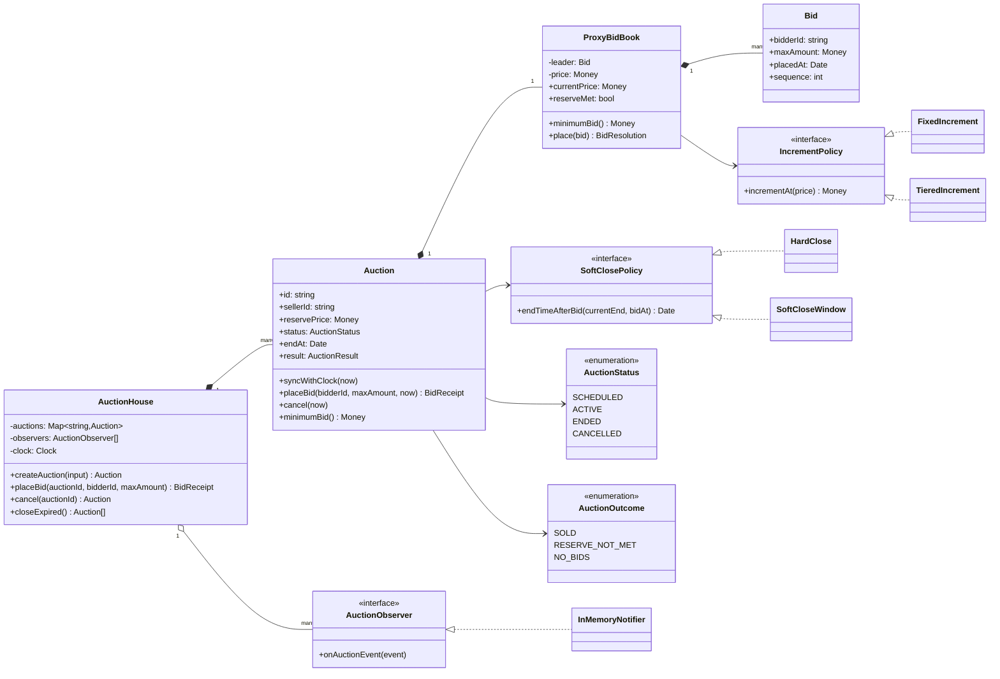
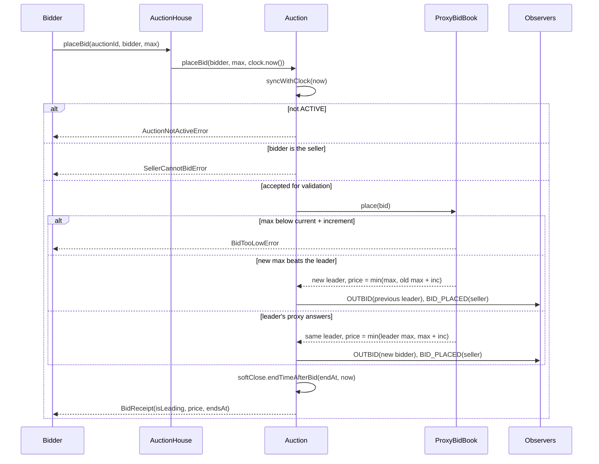
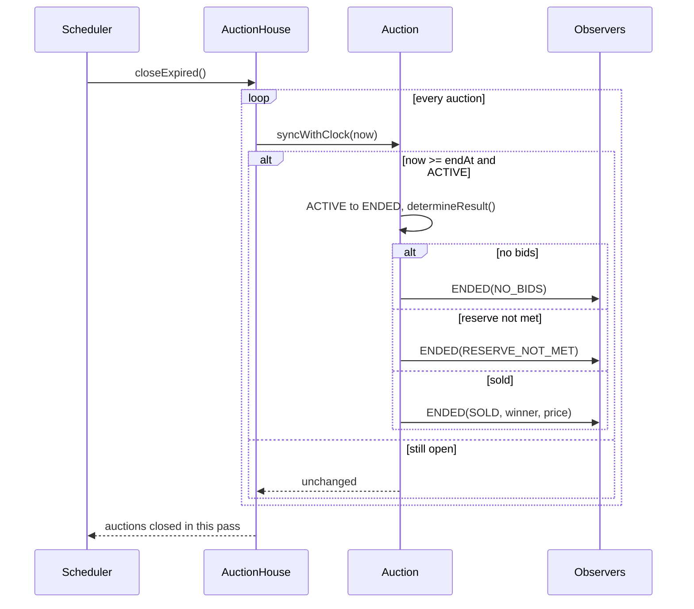

# Design an Online Auction System

| | |
|---|---|
| **Difficulty** | Medium |
| **Solution** | [`src/online-auction-system/`](../src/online-auction-system/) |
| **Run** | `npm run demo -- online-auction-system` · `npx vitest run src/online-auction-system` |
| **Patterns** | Strategy, Observer, State (validated transitions), Application Service |

## 1. Problem statement

Design the core of an online auction site such as eBay. Sellers list an item with a start time, an end time, a starting price and an optional hidden reserve. Bidders place bids, including proxy bids ("bid for me up to X"), the system enforces a minimum increment, notifies people who are outbid, and determines the winner when the auction closes.

## 2. Clarifying questions to ask first

- English (ascending) auction only, or also Dutch, sealed-bid or "buy it now"?
- Do we support proxy (automatic) bidding? Is the leader's maximum secret?
- Is there a reserve price, and is it visible to bidders?
- Is the increment fixed or tiered by price?
- What happens to bids in the last seconds: hard close (eBay) or soft close (extend the end)?
- Who can cancel an auction, and until when?
- Who must be notified: outbid bidders, the seller, the winner, watchers?
- Do we take payment, or hand off a "won" event to checkout?

Assumptions used in the solution: English auctions only; every bid is a proxy bid (a plain bid is a proxy whose maximum is the amount typed); maximums are secret; the reserve is hidden but bidders learn "reserve not met" at the end; increments are a pluggable policy (fixed or tiered); closing is a pluggable policy (hard close by default, soft close window optional); only scheduled or active auctions can be cancelled; payment is out of scope.

## 3. Requirements

### Functional
1. A seller creates an auction with title, starting price, optional reserve, start time and end time (end strictly after start).
2. An auction is SCHEDULED before its start, ACTIVE between start and end, then ENDED; it may be CANCELLED while SCHEDULED or ACTIVE.
3. A bid is accepted only while ACTIVE, never from the seller, and only if its maximum is at least the starting price (first bid) or the current price plus one increment.
4. Proxy bidding: the leader pays one increment over the runner-up's maximum, capped by the leader's own maximum. Equal maximums go to the earlier bid.
5. The leader can raise their own maximum without raising the visible price.
6. Once the leading maximum covers the reserve, the visible price jumps to the reserve.
7. On close the result is SOLD (winner and price), RESERVE_NOT_MET or NO_BIDS.
8. With soft close, a bid in the last N minutes extends the end to N minutes after that bid.
9. Outbid bidders, the seller (every new price and the result) and the winner are notified.

### Non-functional
- Correctness of the price under concurrent bids: two bids must never both "win" against the same state.
- Time-driven state without timers in the domain: status follows the injected `Clock`, and a scheduler calls `closeExpired()`.
- Policies (increments, closing rule, notification channel) change without touching `Auction`.
- Deterministic tests: `FakeClock`, `SequentialIdGenerator`, integer money.

## 4. Core entities

| Entity | Responsibility |
|---|---|
| `AuctionHouse` | Application service: creates auctions with house defaults, stamps commands with `clock.now()`, relays events, closes expired auctions. |
| `Auction` | Aggregate root for one lot: lifecycle, bid validation, soft close, result. |
| `ProxyBidBook` | Leader, visible price and bid history; the proxy and reserve arithmetic. |
| `Bid` | Value object: bidder, maximum, time, arrival sequence. |
| `AuctionStatus`, `AuctionOutcome` | Enumerations for the lifecycle and the close result. |
| `IncrementPolicy` → `FixedIncrement`, `TieredIncrement` | How much a challenger must beat the current price by. |
| `SoftClosePolicy` → `HardClose`, `SoftCloseWindow` | Whether a late bid moves the end time. |
| `AuctionObserver` → `InMemoryNotifier` | Subscribers to auction events (outbid, new price, extended, ended, cancelled). |

## 5. Class diagram

## 6. Key flows

Placing a proxy bid, including the rejection paths:

Closing driven by the clock (a scheduler calls this every minute):

## 7. Design patterns used

- **Strategy** for `IncrementPolicy` and `SoftClosePolicy`. Increment tables and anti-sniping rules are business decisions that differ per category and marketplace; the auction asks the policy instead of switching on a type. Alternative: a configuration object with a `softCloseMinutes: number | null` field, simpler but it grows a branch for every new rule (e.g. "extend at most three times").
- **Observer** for notifications. `Auction` publishes typed events; `AuctionHouse` relays them so a subscriber registers once for every lot. Email, push and websocket channels are added without touching the domain. Alternative: return events from `placeBid()` and let the caller dispatch them (the "domain events collected on the aggregate" style), which suits a transactional outbox better.
- **State (table-driven)** for the lifecycle. `ALLOWED_TRANSITIONS` plus a single `moveTo()` makes every illegal move (cancel an ended auction) throw `InvalidAuctionTransitionError`. Alternative: one class per state (`ActiveAuctionState.placeBid()`), worth it only when behaviour per state grows large.
- **Clock-driven state instead of timers.** Status is stored, but `syncWithClock(now)` runs before every command, so a bid one millisecond after the end is rejected even if the scheduler has not run yet. The scheduler only makes the ENDED event timely.
- **Separate calculation object.** `ProxyBidBook` holds the eBay arithmetic so it can be reasoned about and tested without lifecycle noise.

## 8. Trade-offs, extensions and follow-up questions

**"Two bids arrive at the same millisecond."** Each bid reads the leader and price and writes new ones, a classic read-modify-write. In-process the aggregate applies bids one at a time and the `sequence` number breaks ties. In a database, keep a `version` column on `auctions` and apply the bid with `UPDATE auctions SET leader_id = ?, current_price = ?, leader_max = ?, version = version + 1 WHERE id = ? AND version = ? AND status = 'ACTIVE' AND end_at > now()`. Zero rows updated means someone else won the race: reload and re-run the proxy calculation (the loser may still win if their maximum is higher). Hot auctions in the last minute can instead be serialised through a single-partition queue keyed by auction id, which removes contention entirely.

**"Make bids idempotent."** A retrying client sends `Idempotency-Key`; store it in `bids(auction_id, idempotency_key)` with a unique constraint and return the stored receipt on conflict.

**"Close exactly once."** `syncWithClock` is idempotent in memory; in SQL it is `UPDATE auctions SET status = 'ENDED' WHERE id = ? AND status = 'ACTIVE' AND end_at <= now()` and only the worker whose update changed one row publishes the ENDED event (via an outbox table so the event and the state change commit together).

**"Soft close vs hard close."** Hard close is predictable and favours snipers; soft close gives everyone a fair final word but the end time becomes unbounded. A follow-up policy could cap the number of extensions; it is a new `SoftClosePolicy`, not a change to `Auction`.

**"Second-chance offer / buy it now / Dutch auction."** Buy-it-now is a command that moves ACTIVE to ENDED with a fixed price while no bid exists. A Dutch auction has a falling price and no proxy book, so it would be a sibling aggregate sharing the lifecycle table, not a flag on `Auction`.

**"Millions of watchers."** The in-process observer list becomes a pub/sub topic per auction; the seller and outbid notifications stay targeted, watchers get fan-out through a websocket gateway.

**Persistence sketch.** `auctions(id, seller_id, title, starting_price, reserve_price, start_at, end_at, status, leader_id NULL, leader_max NULL, current_price, version)`, `bids(id, auction_id, bidder_id, max_amount, placed_at, sequence, idempotency_key, UNIQUE(auction_id, sequence))`, `outbox(id, payload, published_at NULL)`. Index `auctions(status, end_at)` for the closing job. The leader's maximum never leaves the server.

## 9. What a strong interview answer sounds like

1. Clarify the auction type, proxy bidding, reserve visibility and the closing rule; state the assumptions.
2. Name the invariants: price only goes up by at least one increment, the seller never bids, nobody bids outside the ACTIVE window, the leader never pays more than their maximum.
3. Draw `Auction` as the aggregate with `ProxyBidBook`, and the two strategies and the observer as interfaces.
4. Walk the bid sequence with the three proxy outcomes and the three rejections, then the clock-driven close with SOLD, RESERVE_NOT_MET and NO_BIDS.
5. Finish with concurrency (version column, conditional UPDATE, per-auction queue), exactly-once closing via outbox, and idempotent bid retries; mention time is injected so the whole thing is testable without sleeping.
