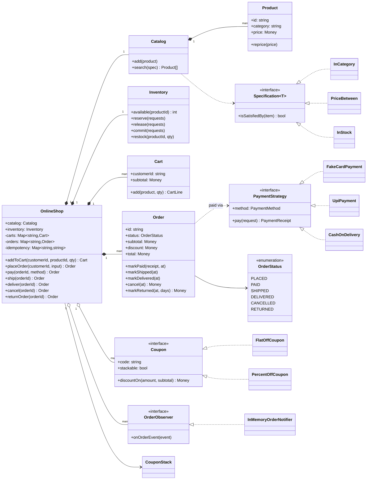
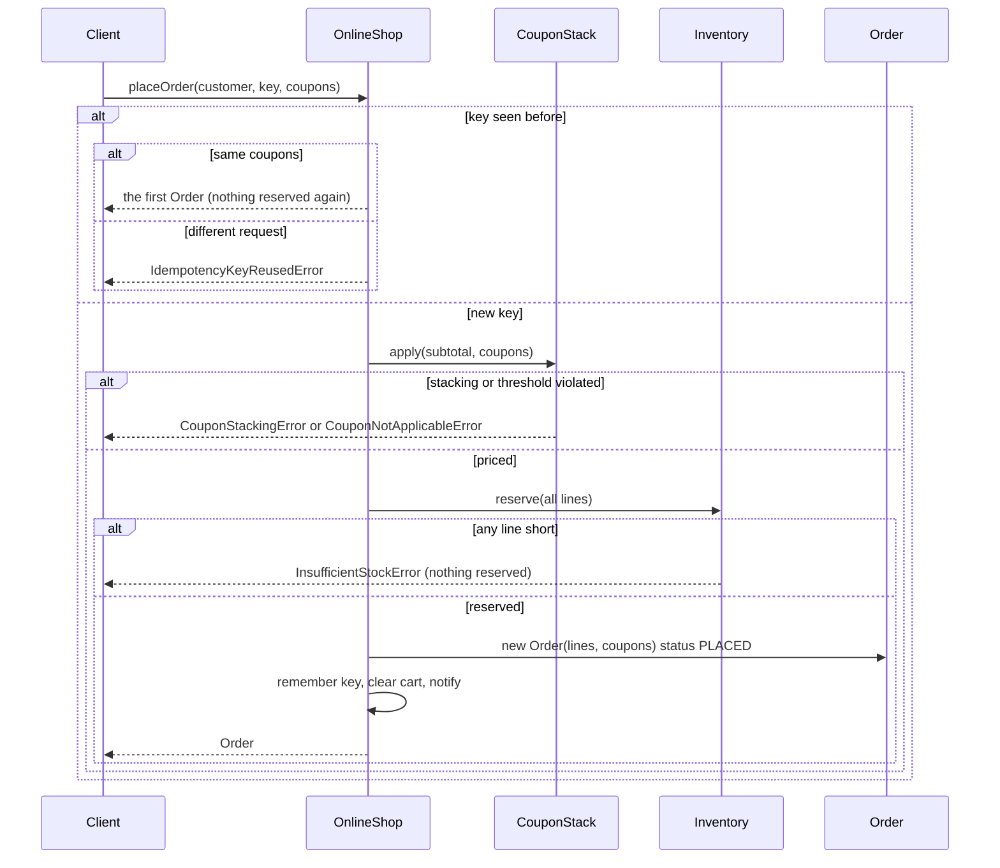
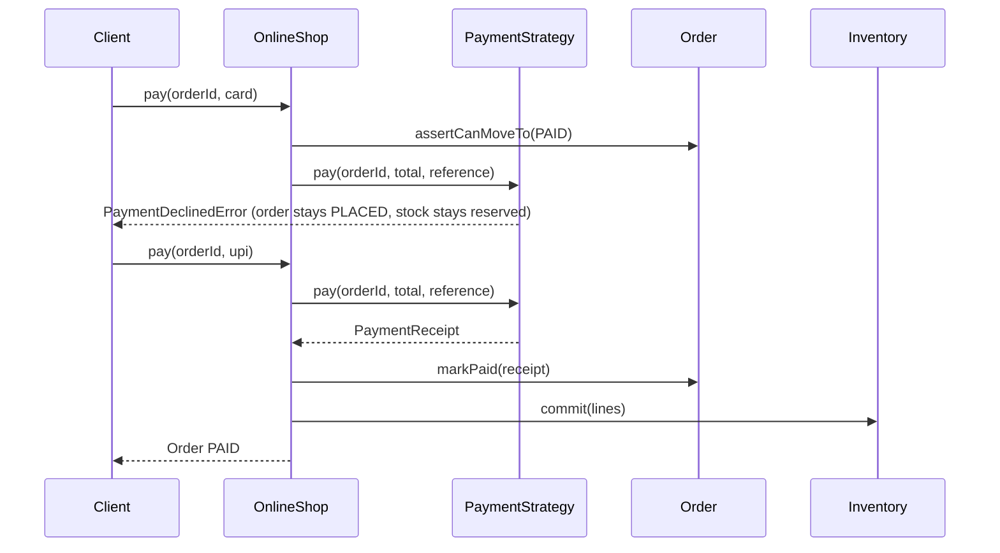

# Design an Online Shopping System

| | |
|---|---|
| **Difficulty** | Medium |
| **Solution** | [`src/online-shopping/`](../src/online-shopping/) |
| **Run** | `npm run demo -- online-shopping` · `npx vitest run src/online-shopping` |
| **Patterns** | Specification, Strategy (payment, coupons), Observer, State (validated transitions), Idempotency key |

## 1. Problem statement

Design the core of an e-commerce site such as Amazon or Flipkart. Customers search a catalog, put items in a cart, check out with coupons and a payment method, and track the order until it is delivered, cancelled or returned. The system must never sell stock it does not have, even when two customers check out the last unit at once or a client retries a request.

## 2. Clarifying questions to ask first

- When is stock taken: when added to the cart, when the order is placed, or when it is paid?
- Which payment methods: card, UPI, wallet, cash on delivery? Is COD capped?
- Can coupons be combined? In which order do they apply? Are some exclusive?
- What happens to the price in a cart if the catalog price changes?
- Can an order be cancelled after payment? After shipping? Is there a return window?
- Do clients retry checkout on timeouts (mobile networks)? Must a retry be safe?
- One warehouse or many? Partial shipments?

Assumptions used in the solution: stock is **reserved** at placement and **committed** at payment; cart lines snapshot the price when first added; card, UPI and capped COD; at most two coupons, flat amounts before percentages, exclusive coupons alone; cancellation is allowed until shipping; returns within 7 days of delivery; every `placeOrder` carries a client idempotency key; one warehouse, one shipment per order.

## 3. Requirements

### Functional
1. Search the catalog with combinable filters (category, price range, name, tag, in stock).
2. A cart merges repeated adds of the same product and keeps the price snapshot of the first add.
3. Placing an order prices the cart, applies coupons, reserves every line all-or-nothing and empties the cart.
4. Placing an order twice with the same idempotency key returns the first order and reserves nothing more; the same key with a different request is rejected.
5. Paying moves the order PLACED to PAID and commits the reserved stock; a declined payment leaves the order PLACED with stock still reserved.
6. Order states: PLACED, PAID, SHIPPED, DELIVERED, CANCELLED, RETURNED. Illegal moves throw.
7. Cancelling a PLACED order releases its reservation; cancelling a PAID order restocks and refunds what was collected.
8. Returns are accepted within the return window, restock the goods and refund.
9. Customers are notified of every status change.

### Non-functional
- No overselling: `available = onHand - reserved` never goes negative.
- Safe retries: placing and paying are idempotent from the client's point of view.
- Money in integer minor units; discount rounding is explicit and line shares add up exactly.
- New filters, coupons and payment methods are added without editing the shop service.

## 4. Core entities

| Entity | Responsibility |
|---|---|
| `Product`, `Catalog` | Sellable item with a mutable price; search by `Specification<Product>`. |
| `Specification` → `InCategory`, `PriceBetween`, `NameContains`, `HasTag`, `InStock` | Composable filters with `and` / `or` / `not`. |
| `Inventory` | `onHand` and `reserved` per product; `reserve`, `release`, `commit`, `restock`. |
| `Cart`, `CartLine` | Per-customer lines with quantity merge and price snapshot. |
| `Order`, `OrderLine` | Lifecycle with a transition table, totals, coupon shares per line, amount collected. |
| `Coupon` → `FlatOffCoupon`, `PercentOffCoupon`; `CouponStack` | Discount strategies and the stacking rules. |
| `PaymentStrategy` → `FakeCardPayment`, `UpiPayment`, `CashOnDelivery` | How an order is paid; declines throw. |
| `OrderObserver` → `InMemoryOrderNotifier` | Status-change subscribers. |
| `OnlineShop` | Application service: the only place that touches cart, inventory and order together. |

## 5. Class diagram

## 6. Key flows

Placing an order with an idempotency key:

Paying, with a declined first attempt:

## 7. Design patterns used

- **Specification** for catalog search. Each filter is an object and they compose, so "5G accessories under Rs 2,000 in stock" is `new HasTag('5g').and(new InCategory('accessories')).and(new PriceBetween(0, 200_000)).and(new InStock(inventory))`. Alternative: a `SearchCriteria` object with optional fields, simpler but closed to new filters and unable to express `or` / `not`.
- **Strategy** for payment methods and for coupons. The shop calls `pay()` or `discountOn()` and never switches on a type. Alternative for coupons: **Decorator** around a `PriceCalculator` (`new PercentOff(new FlatOff(base))`). It expresses order naturally but hides the stacking rules inside the chain; a `CouponStack` that validates count, duplicates and exclusivity in one place is easier to explain and test.
- **State (table-driven)** for the order. One `ALLOWED_TRANSITIONS` table and `assertCanMoveTo()` let the service check legality before a side effect (charging a card) and then move. Alternative: a class per state, worth it only when each state has a lot of behaviour.
- **Observer** for notifications; email, SMS and the warehouse feed subscribe without the shop knowing them.
- **Idempotency key** (an API pattern rather than a GoF one) for `placeOrder`, scoped per customer.

## 8. Trade-offs, extensions and follow-up questions

**"Two customers buy the last unit at the same time."** The guard is the reservation, not the order row. In SQL it is one conditional update per line: `UPDATE stock SET reserved = reserved + :q WHERE product_id = :p AND on_hand - reserved >= :q`, checking that one row changed; for a multi-line order run the updates in one transaction in product-id order (avoids deadlocks) and roll back if any line changes zero rows. Alternatively a `version` column with `WHERE version = :v`. At flash-sale scale, keep a per-SKU counter in Redis with an atomic `DECRBY` guarded by a Lua check, and reconcile to the database asynchronously.

**"Reservations that are never paid."** Store `reserved_until` on a `reservations(order_id, product_id, qty, expires_at)` table; a sweeper (driven by the clock, like `closeExpired` elsewhere in this repo) cancels PLACED orders past expiry and releases their stock.

**"Idempotency across processes."** `idempotency_keys(customer_id, key, request_hash, order_id, UNIQUE(customer_id, key))`. Insert the key in the same transaction as the order; a unique-violation means a concurrent retry, so read and return the stored order. Pass the payment `reference` to the gateway as its idempotency key so a retried charge is not taken twice.

**"Cart price snapshot vs current price."** Snapshotting avoids surprising the customer but lets a stale price be honoured indefinitely. Real shops re-price at checkout and show a "price changed" banner; that is a one-line change in `placeOrder` (compare `line.unitPrice` with `product.price`).

**"Partial returns / refunds per line."** `OrderLine.discountShare` already allocates the discount by largest remainder, so refunding one line refunds what the customer actually paid for it and the shares always sum to the order discount.

**"Multiple sellers or warehouses."** Split an order into shipments per fulfilment centre; inventory becomes keyed by `(warehouse, product)` and placement picks warehouses with a strategy.

**Persistence sketch.** `products(id, name, category, price)`, `stock(product_id, on_hand, reserved, version)`, `carts(customer_id, product_id, qty, unit_price_snapshot)`, `orders(id, customer_id, status, subtotal, discount, total, amount_collected, payment_method, payment_ref, version)`, `order_lines(order_id, product_id, qty, unit_price, discount_share)`, `order_status_history(order_id, status, at)`, `idempotency_keys(...)`. Status changes are `UPDATE orders SET status = :next, version = version + 1 WHERE id = :id AND status = :expected`, which enforces the transition table under concurrency.

## 9. What a strong interview answer sounds like

1. Clarify when stock is taken, which payments and coupons exist, and whether clients retry; state the assumptions.
2. Name the invariants: never oversell, never reserve twice for one request, totals in integer minor units that add up, only legal order transitions.
3. Draw the shop service with catalog, inventory, cart and order, and the Specification, Coupon, Payment and Observer interfaces.
4. Walk `placeOrder` (idempotency, pricing, all-or-nothing reservation) and `pay` (check legality first, decline keeps the reservation, success commits), then cancellation releasing or restocking.
5. Finish with the conditional `UPDATE ... WHERE on_hand - reserved >= q`, reservation expiry, the idempotency-key table and gateway references, and per-line refund allocation.
