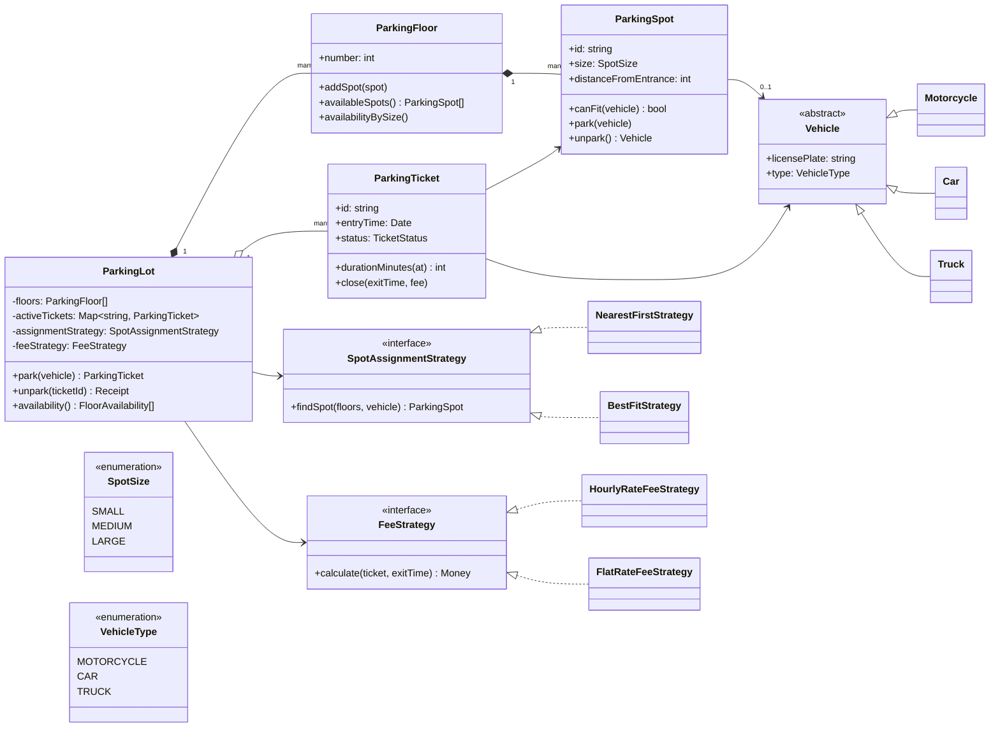
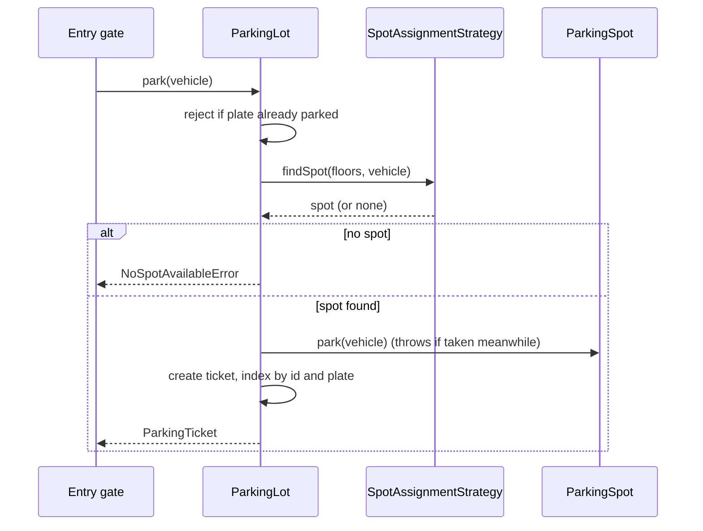
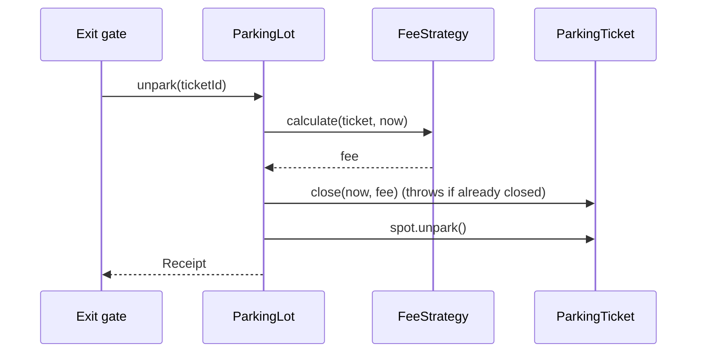

# Design a Parking Lot

| | |
|---|---|
| **Difficulty** | Easy |
| **Solution** | [`src/parking-lot/`](../src/parking-lot/) |
| **Run** | `npm run demo -- parking-lot` · `npx vitest run src/parking-lot` |
| **Patterns** | Strategy, (optional) Singleton, Factory, Observer |

## 1. Problem statement

Design the software for a multi-floor parking lot. Vehicles of different sizes arrive at entry gates, get assigned a spot, and pay a fee based on how long they stayed when they leave through an exit gate.

## 2. Clarifying questions to ask first

Ask these before drawing anything. The answers decide the model.

- Which vehicle types do we support, and can a smaller vehicle take a larger spot?
- Multiple floors? Multiple entry and exit gates operating at the same time?
- How is the fee computed: per hour, flat, per vehicle type, with a minimum charge?
- Do we process payment, or only compute the amount?
- Do we need a live display board of free spots?
- One lot or a chain of lots? (This decides whether `ParkingLot` should be a Singleton.)

Assumptions used in the solution: three vehicle types (motorcycle, car, truck), three spot sizes, a smaller vehicle may use a larger spot, hourly pricing with a one-hour minimum, no payment gateway.

## 3. Requirements

### Functional
1. The lot has multiple floors; each floor has spots of size SMALL, MEDIUM or LARGE.
2. A vehicle gets a spot that fits it (motorcycle: any; car: MEDIUM or LARGE; truck: LARGE only).
3. On entry the system issues a ticket; on exit it computes the fee and frees the spot.
4. The lot never assigns one spot to two vehicles, and never parks the same vehicle twice.
5. Spot-selection policy and pricing policy must be swappable without changing the core.
6. The system reports free spots per floor and size for display boards.

### Non-functional
- Correctness over throughput: no double booking even with several gates.
- Finding a spot should be fast (linear in the number of spots is fine; an index per size is the obvious upgrade).
- Deterministic and testable: time and id generation are injected.

## 4. Core entities

| Entity | Responsibility |
|---|---|
| `Vehicle` (abstract) → `Motorcycle`, `Car`, `Truck` | Identity (plate) and type. |
| `ParkingSpot` | Size, occupancy, compare-and-set `park()` / `unpark()`. |
| `ParkingFloor` | Owns spots, answers availability queries. |
| `ParkingTicket` | Entry time, spot, status; closed exactly once with a fee. |
| `SpotAssignmentStrategy` → `NearestFirst`, `BestFit` | Policy for choosing a spot. |
| `FeeStrategy` → `HourlyRate`, `FlatRate` | Policy for pricing a stay. |
| `ParkingLot` | Aggregate root: `park()`, `unpark()`, `availability()`. |

## 5. Class diagram

## 6. Key flows

## 7. Design patterns used

- **Strategy** for spot assignment and pricing. Both change for business reasons (events, premium floors), so they live behind interfaces.
- **Singleton** is what most reference answers use for `ParkingLot`. We keep a plain class and construct one instance at the composition root: same guarantee, no hidden global, trivially testable, and it still works for a chain of lots. Say this out loud in the interview; it shows judgement.
- **Factory** (extension): `VehicleFactory.from(plate, typeString)` when vehicles are created from gate input.
- **Observer** (extension): display boards subscribe to `spotFreed` / `spotTaken` events instead of polling `availability()`.

## 8. Trade-offs, extensions and follow-up questions

**"Two gates pick the same spot at the same time."** In-process the `ParkingSpot.park()` guard is the compare-and-set: the second caller throws and retries with a new search. Backed by a database the same idea is `UPDATE spots SET vehicle_id = ? WHERE id = ? AND vehicle_id IS NULL` and checking that exactly one row changed, or a version column (optimistic locking). Pessimistic alternatives: a lock per floor, or one queue per gate.

**"Finding a spot is slow for 10,000 spots."** Keep a free-list (or min-heap by distance) per `(floor, size)` so assignment is O(1) or O(log n). Availability counters per floor become O(1) too.

**"Add reservations / EV charging / valet / handicapped spots."** New `SpotSize` or spot attributes plus a new `SpotAssignmentStrategy`; the core does not change, which is the point of the strategies.

**"Dynamic pricing or weekend rates."** A new `FeeStrategy` (possibly composed: base rate + surcharge decorator).

**"Lost ticket."** Look up by plate (`findActiveTicket`) and charge a penalty strategy.

**Persistence sketch.** Tables `floors`, `spots(id, floor_id, size, vehicle_id NULL)`, `tickets(id, plate, spot_id, entry_at, exit_at NULL, fee NULL, status)`. Index `spots(floor_id, size, vehicle_id)` for the free-spot query, `tickets(plate) WHERE status='ACTIVE'` to enforce one active ticket per plate.

## 9. What a strong interview answer sounds like

1. Clarify the six questions above in two minutes; state assumptions.
2. List entities and the single invariant that matters (no double booking).
3. Draw the class diagram with strategies as interfaces; name the patterns and why.
4. Walk the park and unpark sequences, including the failure paths.
5. Finish with concurrency, indexing and two or three extensions. Mention that time and ids are injected for testability.
