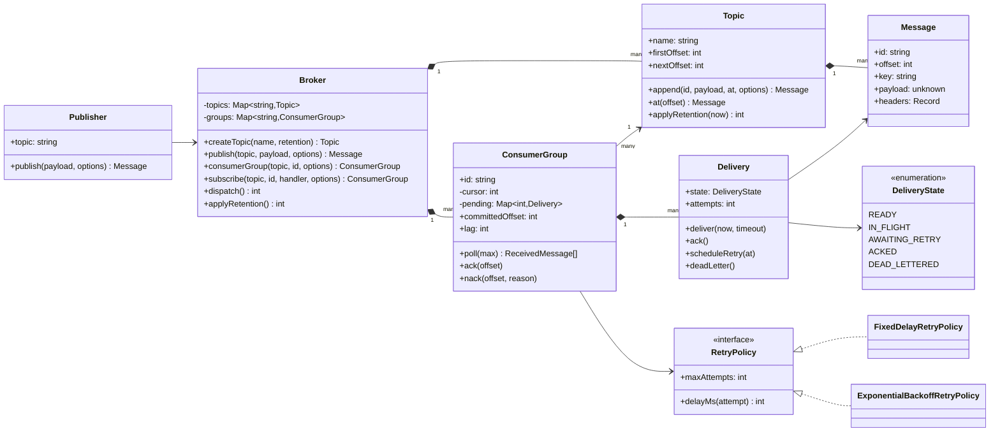
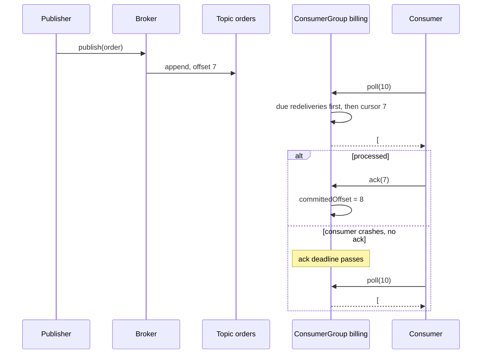
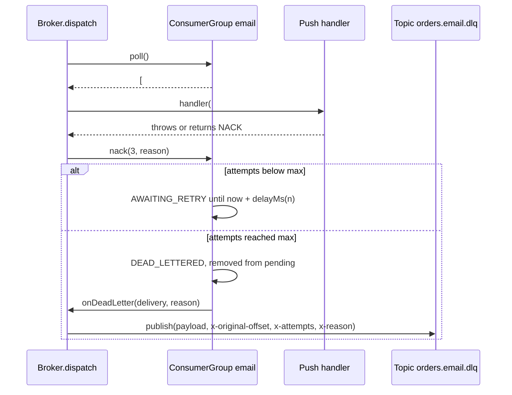

# Design a Pub-Sub System (Message Broker)

| | |
|---|---|
| **Difficulty** | Hard |
| **Solution** | [`src/pub-sub-system/`](../src/pub-sub-system/) |
| **Run** | `npm run demo -- pub-sub-system` · `npx vitest run src/pub-sub-system` |
| **Patterns** | Observer vs broker (Publish-Subscribe), State (delivery lifecycle), Strategy (retry policy) |

## 1. Problem statement

Design an in-memory message broker in the spirit of Kafka, Google Pub/Sub or SQS. Publishers append messages to named topics; subscribers receive them either pushed to a callback or pulled through consumer groups that commit offsets. Delivery is at-least-once: a message that is not acknowledged is delivered again, failed messages are retried a bounded number of times, and poison messages end up in a dead-letter topic.

## 2. Clarifying questions to ask first

- Is ordering required? Per topic, per key, or globally?
- Push (broker calls the subscriber) or pull (subscriber asks), or both?
- Should two independent services both see every message (fan-out), while several instances of one service share the work (competing consumers)?
- Delivery guarantee: at-most-once, at-least-once or effectively-once? Who deduplicates?
- How does a consumer say it failed, and how many times do we retry, with what backoff?
- What happens to a message that never succeeds?
- Retention: by count, by age, or until every group has consumed it? Can a new group replay history?

Assumptions used in the solution: one ordered log per topic (no partitions); fan-out between consumer groups, competing consumers within a group; at-least-once with explicit `ack` / `nack` and an ack timeout; a pluggable retry policy with a maximum number of attempts, after which the message goes to a per-group dead-letter topic `<topic>.<group>.dlq`; retention by count (on publish) and by age (on `applyRetention()`), independent of consumers, as in Kafka.

## 3. Requirements

### Functional
1. Create topics with an optional retention policy; publishing to an unknown topic fails.
2. Each topic is an append-only log with monotonically increasing offsets; retention trims the front without renumbering.
3. A consumer group has a cursor over one topic; every group sees every message.
4. `poll(n)` returns due redeliveries and new messages in offset order; `ack(offset)` completes one; `nack(offset)` schedules a retry after the policy's delay.
5. A message not acked within the ack timeout is redelivered with its attempt counter incremented.
6. After `maxAttempts` failed deliveries the message is moved to the group's dead-letter topic with headers saying why.
7. The committed offset is the lowest offset not yet acked or dead-lettered; it never skips an outstanding message.
8. Push subscriptions wrap a group with a callback; `dispatch()` delivers due messages, treating a thrown error or `NACK` as a failure.
9. A group can start from the earliest retained or the latest offset; `maxInFlight: 1` gives strict in-order processing.

### Non-functional
- No message is lost because a consumer crashed: until acked, it will come back.
- Deterministic: time and ids are injected; delivery happens on explicit `poll()` / `dispatch()` calls, never on timers.
- Bounded work: retries are capped; a poison message cannot loop forever.

## 4. Core entities

| Entity | Responsibility |
|---|---|
| `Broker` | Aggregate root: topics, groups, push subscriptions, `publish`, `dispatch`, dead-lettering. |
| `Topic` | Ordered log with `firstOffset` / `nextOffset` and retention. |
| `Message` | Immutable: id, topic, offset, key, payload, headers, publish time. |
| `Publisher` | A producer bound to one topic; knows the broker, not subscribers. |
| `ConsumerGroup` | Cursor plus outstanding deliveries; `poll`, `ack`, `nack`, committed offset, lag. |
| `Delivery` + `DeliveryState` | One group's attempt history for one message, with validated transitions. |
| `RetryPolicy` → `FixedDelay`, `ExponentialBackoff` | How many attempts and how long between them. |

## 5. Class diagram

## 6. Key flows

## 7. Design patterns used

- **Observer vs broker.** In the Observer pattern the subject holds direct references to its observers and calls them synchronously: no persistence, no replay, and a slow or failing observer blocks or breaks the publisher. A broker puts a durable log between them. Publishers and subscribers know only the broker and a topic name (decoupled in space), the subscriber can be offline when the message is published (decoupled in time), and delivery is retried independently per group (decoupled in failure). Push subscriptions here look like Observer from the subscriber's side, but each one is backed by a consumer group with its own cursor, which is what makes retries and replay possible. Use plain Observer for in-process UI or domain events where losing an event on crash is acceptable.
- **State** for `Delivery`: READY, IN_FLIGHT, AWAITING_RETRY, ACKED, DEAD_LETTERED with an explicit transition table. A late `ack` for a message already waiting for retry is rejected instead of silently corrupting the committed offset. Alternative: boolean flags (`acked`, `retrying`), which allow impossible combinations.
- **Strategy** for `RetryPolicy`: fixed delay for internal services, exponential backoff (with jitter in production) for flaky third parties. Alternative: a retry topic chain (`orders.retry.1m`, `orders.retry.10m`), which is how you get delayed retries out of a log that cannot hold messages back.
- **Aggregate root**: only `Broker` writes to topics, dead-letter topics included, so the "offsets only grow" invariant has one owner.

## 8. Trade-offs, extensions and follow-up questions

**Per-message acks vs a single committed offset.** Kafka consumers commit one offset per partition, which is cheap but means one stuck message blocks the commit. SQS acks each message, which allows parallelism but has no ordering. This design keeps per-message state and derives the committed offset as the low-water mark, so out-of-order acks are allowed but the persisted offset is always safe to restart from. The cost is memory per outstanding message, bounded by `maxInFlight`.

**Ordering under retries.** With `maxInFlight > 1`, a message that is being retried can be overtaken by later ones: first delivery is in order, completion is not. If order matters, use `maxInFlight: 1` (the demo of head-of-line blocking) or partition by key so only messages for the same key wait on each other.

**At-least-once means duplicates.** A consumer that processes a message and crashes before acking will see it again. Consumers must be idempotent: store the message id (or a business key) as an idempotency key with a unique constraint, `INSERT INTO processed(message_id) VALUES (?) ON CONFLICT DO NOTHING`, in the same transaction as the side effect. That is "effectively once".

**Concurrency.** Node serialises calls, so `poll` cannot hand the same message to two consumers in a group. Across processes the guard is a conditional update on the delivery row: `UPDATE deliveries SET state = 'IN_FLIGHT', attempts = attempts + 1, deadline = ? WHERE group_id = ? AND topic_offset = ? AND (state = 'AWAITING_RETRY' OR (state = 'IN_FLIGHT' AND deadline <= now()))` and checking one row changed. Offset commits use a version column, `UPDATE group_offsets SET committed = ?, version = version + 1 WHERE group_id = ? AND version = ?`, so a zombie consumer from before a rebalance cannot move the offset backwards. Publishers send an idempotency key so a retried publish does not append twice (unique `(topic, producer_id, sequence)`).

**Persistence sketch.** `topics(name PK, max_messages, max_age_ms)`, `messages(topic, offset, id UNIQUE, key, payload, headers JSON, published_at, PRIMARY KEY (topic, offset))`, `group_offsets(topic, group_id, cursor, version, PK (topic, group_id))`, `deliveries(topic, group_id, topic_offset, state, attempts, deadline, retry_at, PK (topic, group_id, topic_offset))`. Retention is `DELETE FROM messages WHERE topic = ? AND offset < ?` or, at scale, dropping segment files.

**Follow-ups to expect.**
- "Scale a topic beyond one consumer." Partitions: hash the key to N logs, assign partitions to consumers in a group, rebalance on join or leave.
- "Replay from yesterday." Seek a group's cursor to the first offset with `publishedAt >= t` (keep a time index per segment).
- "Exactly-once." Not across arbitrary side effects; idempotent consumers plus transactional offset commits get you effectively-once.
- "Backpressure on push." Cap in-flight per subscriber and stop dispatching when the cap is reached, which is `maxInFlight` here.
- "Re-drive the DLQ." A tool that republishes from `<topic>.<group>.dlq` back into the main topic after a fix, keeping the headers for audit.

## 9. What a strong interview answer sounds like

1. Clarify ordering scope, fan-out vs competing consumers, delivery guarantee, retry and retention rules; state the assumptions.
2. Model a topic as an append-only log and a consumer group as a cursor; explain why groups give fan-out and consumers within a group share the work.
3. Introduce the delivery state machine and the low-water-mark committed offset; walk the poll, ack, timeout and redelivery flow.
4. Add nack, bounded retries with a backoff strategy and the per-group dead-letter topic; walk the failure branch.
5. Contrast this with plain Observer, then cover idempotent consumers, conditional updates and version columns for offsets, and partitions for scale.
