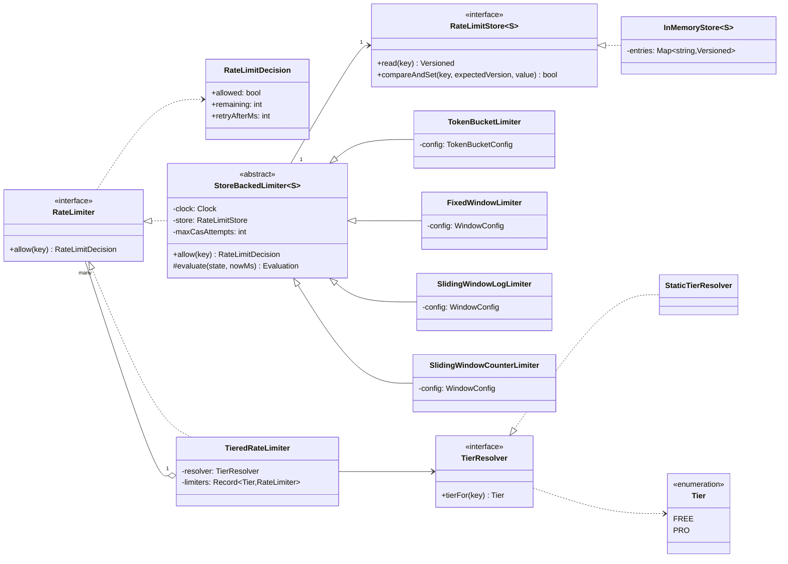
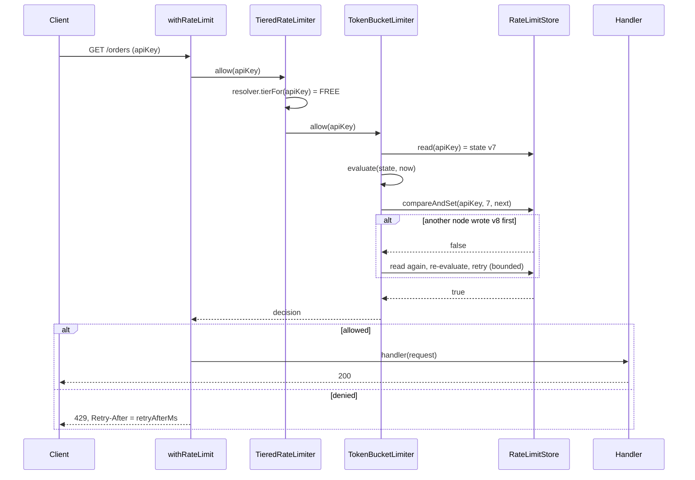

# Design a Rate Limiter

| | |
|---|---|
| **Difficulty** | Medium |
| **Solution** | [`src/rate-limiter/`](../src/rate-limiter/) |
| **Run** | `npm run demo -- rate-limiter` · `npx vitest run src/rate-limiter` |
| **Patterns** | Strategy (algorithm, tier resolver), Template Method (store-backed limiter), Decorator / middleware, Composite (tiered limiter) |

## 1. Problem statement

Design a rate limiter an API gateway calls on every request: given a key (API key, user, IP), decide whether the request may proceed and, if not, when the client may retry. Support several algorithms (token bucket, fixed window, sliding window log, sliding window counter), different limits per pricing tier, and use as middleware around a handler.

## 2. Clarifying questions to ask first

- What is the key: user, API key, IP, or a combination with the endpoint?
- Is a short burst above the average rate acceptable? How strict must the limit be at window edges?
- What does a rejected client receive: 429 with `Retry-After`, remaining quota headers?
- Are limits the same for everyone or per plan (free, pro)? Can they change at runtime?
- One process or a fleet of gateway nodes sharing the limit? Is a small overshoot acceptable?
- Fail open or fail closed if the shared store is unreachable?
- Memory budget per key, and how many active keys?

Assumptions used in the solution: per-key limits; four interchangeable algorithms behind one `RateLimiter` interface; decisions return `allowed`, `remaining` and `retryAfterMs`; tiers resolved per key with FREE as fallback; state lives behind a versioned `RateLimitStore` with compare-and-set so the same code is safe against a shared store; integer milliseconds only.

## 3. Requirements

### Functional
1. `allow(key)` returns `{ allowed, remaining?, retryAfterMs? }`; a denied decision always carries a positive `retryAfterMs`.
2. Token bucket: bursts up to `capacity`, refills `refillTokens` every `refillEveryMs`, never above capacity.
3. Fixed window: at most `limit` per aligned window; resets at the window edge.
4. Sliding window log: at most `limit` accepted requests in any trailing window; denied requests are not recorded.
5. Sliding window counter: the previous window counts in proportion to its overlap with the trailing window.
6. Keys are isolated; the empty key is rejected.
7. Tiers: a resolver maps a key to a tier, and each tier has its own limiter and configuration.
8. `withRateLimit(handler, options)` calls the handler only when allowed, otherwise returns `onLimited(...)` or throws `RateLimitExceededError`.
9. Invalid configuration (non-positive or fractional numbers) is rejected at construction.

### Non-functional
- O(1) time and memory per key for token bucket, fixed window and counter; O(limit) for the log.
- Safe under concurrent updates of the same key (compare-and-set on a version).
- Deterministic: time comes from an injected `Clock`; no timers; integer arithmetic so window edges are exact.

## 4. Core entities

| Entity | Responsibility |
|---|---|
| `RateLimiter` (interface), `RateLimitDecision` | The contract callers depend on. |
| `StoreBackedLimiter<S>` (abstract) | Read state, evaluate, compare-and-set, retry on conflict. |
| `TokenBucketLimiter`, `FixedWindowLimiter`, `SlidingWindowLogLimiter`, `SlidingWindowCounterLimiter` | Pure `evaluate(state, now)` functions per algorithm. |
| `RateLimitStore<S>` (interface), `InMemoryStore<S>` | Versioned per-key state. |
| `Tier`, `TierResolver`, `StaticTierResolver` | Which plan a key is on. |
| `TieredRateLimiter` | Routes a key to its tier's limiter. |
| `withRateLimit` | Middleware wrapper around any handler. |

## 5. Class diagram

## 6. Key flows

## 7. Design patterns used

- **Strategy** for the algorithm: the gateway holds a `RateLimiter`; which algorithm runs is configuration. The tier resolver is a second strategy (static map in tests, billing lookup in production). Alternative: one class with an `algorithm` enum and a switch, which grows a branch in every method for each new algorithm.
- **Template Method** in `StoreBackedLimiter`: the read, evaluate, compare-and-set, retry loop is written once; each algorithm only supplies a pure `evaluate(state, now)`. That is what makes every edge case testable as a pure function of state and time.
- **Composite**: `TieredRateLimiter` is itself a `RateLimiter`, so a gateway can stack limits (per-tier, then a global limiter per endpoint) without knowing it.
- **Decorator / middleware**: `withRateLimit` wraps a handler so business code never sees rate limiting. Alternative: an explicit check at the top of every handler, which is easy to forget on one endpoint.

### Choosing an algorithm

| Algorithm | Burst behaviour | State per key | Exact? | Typical use |
|---|---|---|---|---|
| Token bucket | Allows bursts up to capacity, smooth average | 2 numbers | Yes, for its model | Public APIs (AWS, Stripe) |
| Fixed window | Up to 2x the limit across a boundary | 2 numbers | No at edges | Cheap quotas, daily caps |
| Sliding window log | None | Up to `limit` timestamps | Yes | Low limits, strict fairness |
| Sliding window counter | Small, estimate-based | 3 numbers | Approximate | High-volume gateways (Cloudflare) |

## 8. Trade-offs, extensions and follow-up questions

**Integer arithmetic.** The counter algorithm's test `previous * (W - elapsed) + (current + 1) * W <= limit * W` is the weighted estimate multiplied through by `W`, and the token bucket refills in whole periods. Both avoid floating-point drift, so `retryAfterMs` is exact and the tests can pin window edges to the millisecond.

**Concurrency across gateway nodes.** Node runs one `allow` at a time, but a fleet shares state. The store's compare-and-set is the guard: read state with a version, compute, write only if the version is unchanged, retry a bounded number of times, then throw `StoreContentionError` (or fail open, as a policy decision). In SQL that is `UPDATE rate_limits SET state = ?, version = version + 1 WHERE key = ? AND version = ?` and checking one row changed; the first request for a key is an `INSERT` guarded by the primary key. In Redis the same read-compute-write runs as one Lua script (atomic on the server), and fixed window collapses to `INCR key; EXPIRE key window` with no read at all.

**Hot keys and latency.** A shared store adds a round trip to every request. Common answers: keep a local token bucket per node with `limit / nodes` capacity (no coordination, slightly unfair), or sync local counters to the central store asynchronously and accept a small overshoot.

**Retry-After and idempotency.** Clients that retry exactly at `retryAfterMs` all at once cause a thundering herd; return it, but recommend jitter. A retried request with the same idempotency key should not be charged twice: check the idempotency cache before the limiter, or refund the token when the request turns out to be a duplicate.

**Persistence sketch.** `rate_limits(key PK, algorithm, state JSON, version, expires_at)`; `expires_at = last activity + window` so a sweeper (or Redis key TTL) drops idle keys. `plans(account_id PK, tier)` feeds the resolver, cached with a short TTL. Configuration per tier lives in `tier_limits(tier, endpoint, algorithm, limit, window_ms)`.

**Follow-ups to expect.**
- "Different limits per endpoint." Key by `user:endpoint` and look up the limit per endpoint, or compose two limiters.
- "Cost-based limits" (a search costs 5, a read 1). `allow(key, cost)`: the bucket takes `cost` tokens.
- "The store is down." Fail open for availability on most APIs, fail closed for login or payment endpoints.
- "Upgrade from free to pro mid-window." The pro limiter starts the key fresh, which is generous but simple; copy usage across if it matters.
- "Distributed fairness." Sticky routing by key to one node keeps state local and makes the problem single-node again.

## 9. What a strong interview answer sounds like

1. Clarify the key, burst tolerance, response to clients, tiers and single node versus fleet; state the assumptions.
2. Define the `RateLimiter` interface and the decision shape, including `retryAfterMs`.
3. Walk the four algorithms with their trade-off table, and show the fixed window's 2x boundary burst against the sliding variants.
4. Separate pure evaluation from state: per-key state behind a versioned store with compare-and-set, tiers via a resolver, middleware for use.
5. Close with the distributed version (Redis Lua or conditional SQL update, local buckets, fail open or closed) and the follow-ups.
