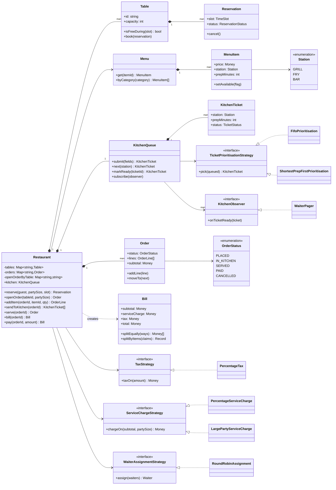
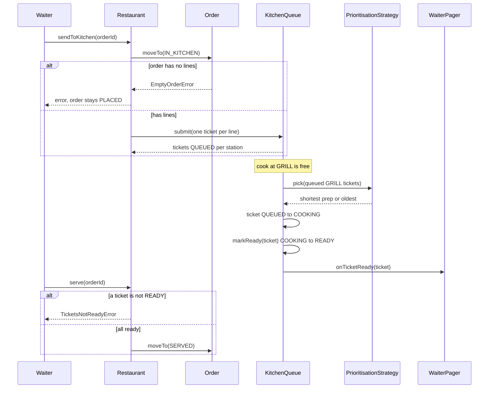
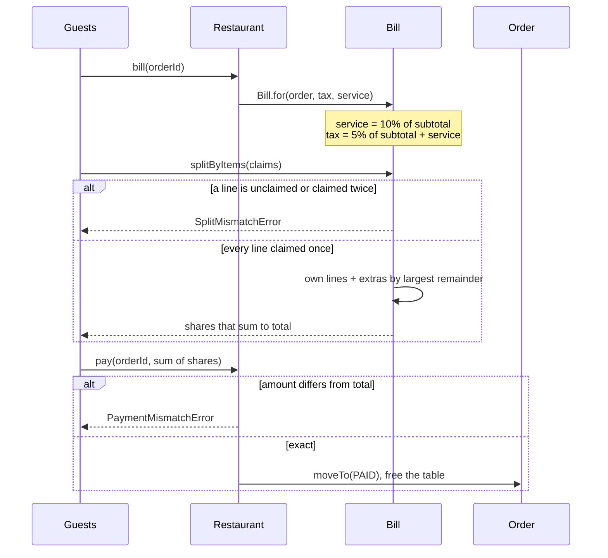

# Design a Restaurant Management System

| | |
|---|---|
| **Difficulty** | Hard |
| **Solution** | [`src/restaurant-management-system/`](../src/restaurant-management-system/) |
| **Run** | `npm run demo -- restaurant-management-system` · `npx vitest run src/restaurant-management-system` |
| **Patterns** | Strategy, Observer, State (transition table), Aggregate root |

## 1. Problem statement

Design the back-of-house software for a sit-down restaurant: guests reserve tables, waiters take orders, the kitchen cooks items at different stations, and the table pays a bill with tax and service charge that may be split between diners. The system must never double-book a table and the bill must add up to the paisa however it is split.

## 2. Clarifying questions to ask first

- Reservations: fixed-length slots or arbitrary start and end times? Does a booking ending at 20:00 clash with one starting at 20:00?
- Can the system choose the table, or does the host always pick one?
- How is the kitchen organised: one queue, or one per station (grill, fryer, bar)? Who decides the order in which tickets are cooked?
- Can items be added after the order went to the kitchen? Can an order be cancelled once cooking started?
- How are tax and service charge computed? Is tax charged on the service charge too?
- What splits are needed: equal, by item, by arbitrary amounts? Who absorbs the leftover paisa?
- How are waiters assigned to tables? Do they need to be told when food is ready?

Assumptions used in the solution: reservation slots are half-open intervals `[start, end)`; the system picks the smallest free table that fits unless the host names one; one ticket per order line, queued per station; lines are added only while the order is PLACED and an order can be cancelled only before it reaches the kitchen; service charge is a percentage of the subtotal and tax a percentage of subtotal plus service (the Indian GST treatment); splits are equal or per item with leftover paise allocated by the largest-remainder rule; waiters are assigned round robin and paged when a ticket is ready.

## 3. Requirements

### Functional
1. Tables have a capacity. A reservation books one table for a half-open slot; overlapping active reservations on the same table are rejected, back-to-back ones are allowed.
2. `reserve()` chooses the smallest free table that fits the party; cancelling a reservation frees its slot.
3. The menu groups items by category; each item has a price in paise, a station and a preparation time, and can be toggled unavailable.
4. A table has at most one open order. Orders move PLACED → IN_KITCHEN → SERVED → PAID, or PLACED → CANCELLED; any other move throws.
5. Sending an order to the kitchen creates one ticket per line on that line's station (GRILL, FRY, BAR). Tickets move QUEUED → COOKING → READY.
6. Each station picks its next ticket with a pluggable strategy: FIFO or shortest preparation first.
7. When a ticket is READY, observers are notified; the waiter's pager shows "Table T2: 2 x Masala Fries ready". An order is served only when all its tickets are ready.
8. A bill for a served order applies a service-charge strategy and a tax strategy, and can be split equally or by item; shares always add up to the total.
9. Paying the exact total closes the order and frees the table.

### Non-functional
- No floating-point money: integer paise, one explicit rounding step per percentage, explicit remainder allocation in splits.
- Policies (kitchen order, tax, service, waiter assignment) are swappable without editing `Restaurant`.
- Deterministic tests: clock and ids injected; time advances only through the clock.

## 4. Core entities

| Entity | Responsibility |
|---|---|
| `Table` | Capacity and its active reservations; `book()` rejects overlaps (the compare-and-set). |
| `Reservation`, `TimeSlot` | One booking over a half-open interval; BOOKED or CANCELLED. |
| `Menu`, `MenuItem` | Catalog by category; price, station, prep time, availability toggle. |
| `Order`, `OrderLine` | One table's order and its status machine; lines snapshot price and station at order time. |
| `KitchenTicket` | One line as the kitchen sees it; QUEUED, COOKING, READY. |
| `KitchenQueue` | Per-station queues, a prioritisation strategy, and ready notifications. |
| `TicketPrioritisationStrategy` → `Fifo`, `ShortestPrepFirst` | Which queued ticket a station cooks next. |
| `TaxStrategy`, `ServiceChargeStrategy` | Percentage tax, percentage or large-party service charge, or none. |
| `Bill` | Immutable totals for a served order; equal and per-item splits. |
| `Waiter`, `WaiterAssignmentStrategy` → `RoundRobinAssignment`, `WaiterPager` | Who takes a table; the pager observes ready tickets. |
| `Restaurant` | Aggregate root: reservations, orders, kitchen hand-off, billing and payment. |

## 5. Class diagram

## 6. Key flows

## 7. Design patterns used

- **Strategy** four times: ticket prioritisation, tax, service charge and waiter assignment. Each is house policy that changes (happy hour, a new tax rule, a large-party surcharge) and none of them should be an `if` in `Restaurant`. Alternative: a single configurable rules engine; heavier, and harder to test one policy at a time.
- **Observer** for ready tickets. The kitchen should not know whether the waiter has a pager, a smartwatch or a screen at the pass. Alternative: the waiter polls `ticketsFor(orderId)`; simpler but laggy and chatty.
- **State as a transition table** for orders, tickets and reservations. Illegal moves (cancel a served order, mark a queued ticket ready) throw `InvalidTransitionError`. Alternative: GoF State classes, worth it only if behaviour per state grew.
- **Snapshot (value object)** for `OrderLine`: price, station and prep time are copied at order time, so changing the menu price at 21:00 does not change a bill opened at 19:00.
- **Aggregate root.** `Restaurant` is the only place that moves an order while keeping the table, tickets and bill consistent. A bigger system splits it into `ReservationService`, `OrderService` and `KitchenService`; the boundaries are already the files.

## 8. Trade-offs, extensions and follow-up questions

**Half-open intervals.** `[start, end)` makes overlap a single comparison (`a.start < b.end && b.start < a.end`) and makes back-to-back bookings legal without special cases. Closed intervals force awkward "minus one minute" hacks.

**"Two hosts book the last table at once."** In-process, `Table.book()` re-checks overlap before inserting, so the second call throws. In Postgres the strongest guard is an exclusion constraint: `EXCLUDE USING gist (table_id WITH =, tstzrange(start_at, end_at, '[)') WITH &&) WHERE (status = 'BOOKED')`. Without it, lock the table row (`SELECT ... FOR UPDATE`) or bump a `version` column with `UPDATE tables SET version = version + 1 WHERE id = ? AND version = ?` before inserting.

**"Two cooks grab the same ticket."** `KitchenTicket.startCooking()` is the compare-and-set. In SQL: `UPDATE tickets SET status='COOKING', cook_id=? WHERE id=? AND status='QUEUED'` and check one row changed; or `SELECT ... FOR UPDATE SKIP LOCKED LIMIT 1` to let many cooks pull from one queue.

**"The card terminal retried the payment."** `pay()` moves SERVED → PAID once; a retry finds PAID and throws. Over HTTP give each payment an idempotency key (`unique (order_id, idempotency_key)`) so the retry returns the first result instead of an error.

**Starvation in shortest-prep-first.** A 20-minute lamb dish waits forever at a busy grill. Fix with aging: priority = prep minutes minus minutes waited (needs the clock), or a hard cap on wait time after which FIFO applies.

**Follow-ups an interviewer may ask:**
- *Add items after the first round?* Model courses or rounds: an order has several batches, each sent to the kitchen separately, and the order is SERVED when every batch is.
- *Split one dish between two diners?* Claims become `(lineId, weight)` pairs; `allocate()` already handles weights.
- *Walk-ins vs reservations?* Seating a walk-in checks `isFreeDuring(now, now + expected duration)` against upcoming bookings.
- *Inventory?* Each menu item gets a recipe; sending to the kitchen decrements stock and auto-toggles availability at zero.
- *Waiter load balancing?* A `FewestOpenTablesAssignment` strategy using the open-order index.

**Persistence sketch.**

| Table | Key columns |
|---|---|
| `tables` | `id` PK, `capacity`, `version` |
| `reservations` | `id` PK, `table_id`, `guest`, `party_size`, `start_at`, `end_at`, `status`; exclusion constraint above |
| `menu_items` | `id` PK, `category`, `price_minor`, `station`, `prep_minutes`, `available` |
| `orders` | `id` PK, `table_id`, `waiter_id`, `status`, `opened_at`; unique `(table_id) WHERE status IN ('PLACED','IN_KITCHEN','SERVED')` |
| `order_lines` | `id` PK, `order_id`, `menu_item_id`, `unit_price_minor`, `quantity` |
| `tickets` | `id` PK, `order_line_id`, `station`, `status`, `created_at`, `ready_at`; index `(station, status, created_at)` |
| `payments` | `id` PK, `order_id`, `amount_minor`, `idempotency_key` unique per order |

## 9. What a strong interview answer sounds like

1. Clarify slot semantics, kitchen layout, tax rules and split types; state the assumptions (half-open slots, per-station queues, tax on subtotal plus service).
2. Name the entities in three groups: front of house (Table, Reservation), order (Menu, Order, OrderLine), back of house (KitchenQueue, KitchenTicket), plus Bill.
3. Draw the order and ticket state machines and the class diagram with the four strategies; explain the Observer from the kitchen to the waiter.
4. Walk the kitchen flow and the billing flow, including the failure branches: empty order, serving before tickets are ready, bad split, wrong payment amount. Show the remainder allocation on a real number.
5. Close with concurrency (exclusion constraint for reservations, `SKIP LOCKED` for tickets, idempotent payment), starvation and aging in the kitchen, and one or two extensions such as rounds or shared dishes.
