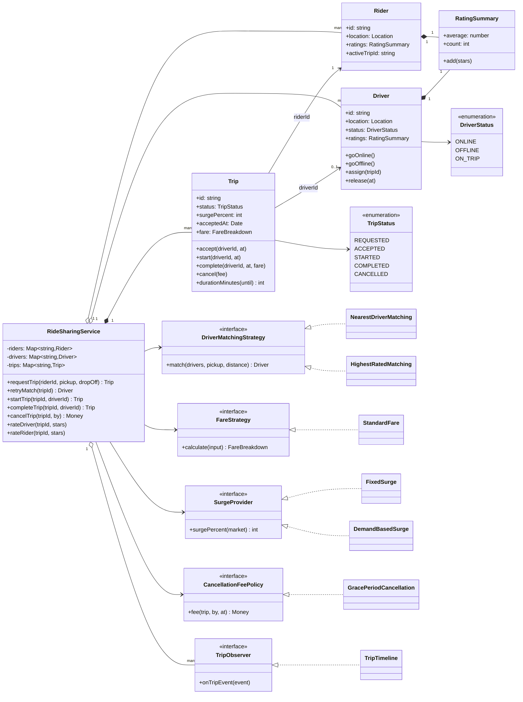
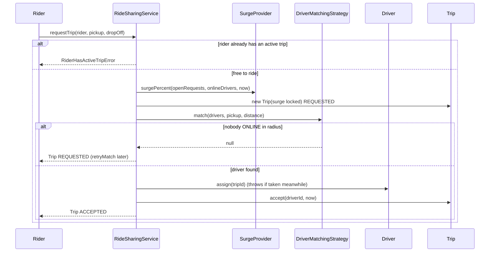
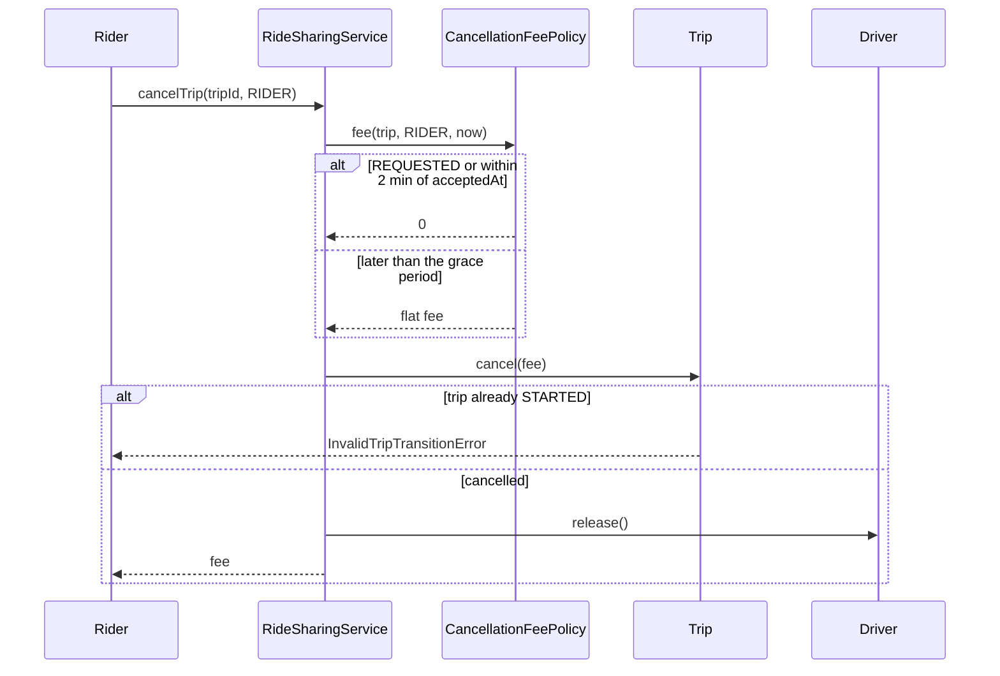

# Design a Ride-Sharing Service

| | |
|---|---|
| **Difficulty** | Hard |
| **Solution** | [`src/ride-sharing/`](../src/ride-sharing/) |
| **Run** | `npm run demo -- ride-sharing` · `npx vitest run src/ride-sharing` |
| **Patterns** | Strategy (matching, fare, surge, cancellation), Observer, State (validated transitions), compare-and-set |

## 1. Problem statement

Design the trip core of a ride-hailing app such as Uber, Ola or Lyft. A rider requests a ride from a pickup to a drop-off; the system matches an available nearby driver, the driver starts and completes the trip, the fare is computed from distance, time and surge, and both sides rate each other. Riders may cancel, and late cancellations cost a fee.

## 2. Clarifying questions to ask first

- How do we choose a driver: nearest, highest rated, fewest idle minutes? Within what radius?
- Does the driver have to accept an offer, or is the match the acceptance?
- How is the fare computed: base, per km, per minute, minimum fare? Where does surge come from, and is it locked when the rider requests?
- What are the cancellation rules for riders and for drivers? Is there a grace period?
- Can a driver go offline during a trip? Can a rider have two active trips?
- Are ratings mandatory, both ways, editable?
- Do we need pooling (shared rides) or scheduled rides?

Assumptions used in the solution: the matched driver is considered to have accepted (an offer/decline loop is a follow-up); nearest-online within a radius by default, highest-rated as a variant; distance comes from an injected function; fare = max(minimum, base + per km + per started minute) times the surge percentage quoted at request; surge comes from a pluggable provider (fixed or demand/supply); rider cancellation is free while REQUESTED and within 2 minutes of acceptance, a flat fee after; driver cancellation is free for the rider; a started trip cannot be cancelled; one active trip per rider and per driver; one rating each way, 1-5 stars, after completion.

## 3. Requirements

### Functional
1. Drivers are ONLINE, OFFLINE or ON_TRIP; an ON_TRIP driver cannot go offline or be matched again.
2. A rider with no active trip requests a trip; the surge multiplier is computed and locked on the trip.
3. The system matches an ONLINE driver with a pluggable strategy; with nobody in range the trip stays REQUESTED and matching can be retried.
4. Trip states: REQUESTED, ACCEPTED, STARTED, COMPLETED, CANCELLED. Illegal moves throw; only the assigned driver may start or complete.
5. On completion the fare is computed in minor units and the driver is ONLINE again at the drop-off.
6. Cancellation fee: free while REQUESTED, free within the grace period after acceptance (measured with the clock), a flat fee after; free when the driver cancels.
7. After completion the rider rates the driver and the driver rates the rider, once each, 1-5 stars.
8. Observers receive every trip status change.

### Non-functional
- A driver is never on two trips, even when two requests match the same driver concurrently.
- Fares and fees are integer minor units with explicit rounding (distance to nearest, surge up).
- Time is injected so fares, surge and grace periods are deterministic in tests.
- Matching, fare, surge and cancellation rules are swappable without editing the service.

## 4. Core entities

| Entity | Responsibility |
|---|---|
| `Rider` | Identity, location, rating summary, the one active trip. |
| `Driver`, `DriverStatus` | Location, vehicle, rating summary, availability with compare-and-set `assign()`. |
| `Trip`, `TripStatus` | Pickup, drop-off, locked surge, timestamps, fare, cancellation fee, who has rated. |
| `RatingSummary` | Sum and count of 1-5 stars with a prior for new users. |
| `DriverMatchingStrategy` → `NearestDriverMatching`, `HighestRatedMatching` | Choose a driver for a pickup. |
| `FareStrategy` → `StandardFare` | Price a completed trip as a `FareBreakdown`. |
| `SurgeProvider` → `FixedSurge`, `DemandBasedSurge` | Surge percentage from a market snapshot. |
| `CancellationFeePolicy` → `GracePeriodCancellation` | Fee by state, party and time since acceptance. |
| `TripObserver` → `TripTimeline` | Status-change subscribers. |
| `RideSharingService` | Application service that moves a trip and its driver together. |

## 5. Class diagram

## 6. Key flows

Requesting a trip, including the no-driver branch:

Cancelling, priced with the clock:

## 7. Design patterns used

- **Strategy** for matching, fare, surge and cancellation. Each is a business lever that differs by city and product tier (economy vs premium), so the service depends on interfaces. Alternative for matching: batch matching every few seconds that solves an assignment problem over all waiting riders and idle drivers; it lowers total pickup time at the cost of a short wait and much more explanation.
- **State (table-driven)** for the trip. `ALLOWED_TRANSITIONS` and `assertCanMoveTo()` make "cancel a started trip" or "complete before start" throw, and the service can check legality before computing a fare. Alternative: a class per state; overkill for five states with little behaviour each.
- **Observer** for the rider app, driver app and analytics following each trip.
- **Compare-and-set on the driver.** `Driver.assign()` refuses unless ONLINE, which is the guard that matters when two requests pick the same driver.
- **Value object with a locked quote.** The trip stores the surge percent at request time, so the provider can change without moving the price under a rider already in the car.

## 8. Trade-offs, extensions and follow-up questions

**"Two riders are matched to the same driver at the same moment."** In-process the second `assign()` throws and that request re-matches. In SQL: `UPDATE drivers SET status = 'ON_TRIP', trip_id = :trip WHERE id = :d AND status = 'ONLINE'`, checking one row changed. A unique partial index `trips(rider_id) WHERE status IN ('REQUESTED','ACCEPTED','STARTED')` enforces one active trip per rider even across app servers. Trip moves use `UPDATE trips SET status = :next, version = version + 1 WHERE id = :id AND status = :expected`.

**"Retries from a phone on a bad network."** `requestTrip` takes an idempotency key stored with a unique constraint `(rider_id, key)`; a retry returns the existing trip. The payment capture after completion uses the trip id as the gateway idempotency key.

**"Driver must accept or decline."** Add an OFFERED state with an expiry (`offeredAt + 15s`, evaluated with the clock); a decline or timeout excludes that driver and calls the matcher again.

**"Finding nearby drivers among a million."** Drivers stream locations every few seconds into a geo index (geohash/H3 cells in Redis, `GEOSEARCH` by radius); the matcher receives only nearby candidates. The domain code does not change because the candidate list and distance function are inputs.

**"Pooling."** A trip becomes a set of stops on a vehicle with capacity; matching scores detours, and fare splitting uses largest-remainder allocation so the shares add up to the total.

**"Surge fairness and abuse."** Surge is locked at request, capped, and shown to the rider before confirming; `DemandBasedSurge` is per pickup zone in production, keyed by the snapshot's `pickup`.

**Persistence sketch.** `riders(id, rating_sum, rating_count)`, `drivers(id, status, trip_id NULL, location, rating_sum, rating_count, version)`, `trips(id, rider_id, driver_id NULL, status, pickup, drop_off, surge_percent, requested_at, accepted_at, started_at, completed_at, fare_total, cancellation_fee, version)`, `trip_ratings(trip_id, by_party, stars, PRIMARY KEY(trip_id, by_party))` (the primary key makes "rate once" a database guarantee), `trip_events(trip_id, status, at)` as the outbox for observers.

## 9. What a strong interview answer sounds like

1. Clarify matching, acceptance, fare composition, surge locking and cancellation rules; state the assumptions.
2. Name the invariants: one driver per active trip and one active trip per driver and rider, only legal transitions by the assigned driver, money in integer minor units.
3. Draw rider, driver, trip and the four strategy interfaces plus the observer; explain why each is a strategy.
4. Walk request and match (no-driver branch, compare-and-set on the driver), then completion with the fare breakdown, then cancellation priced by the clock.
5. Finish with the conditional `UPDATE ... WHERE status = 'ONLINE'`, the partial unique index for active trips, idempotency keys, an OFFERED state for driver acceptance, and geo-indexing for scale.
