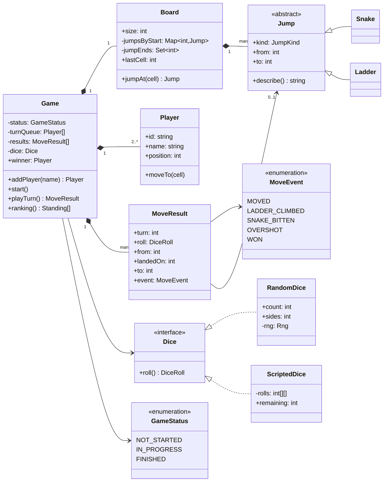
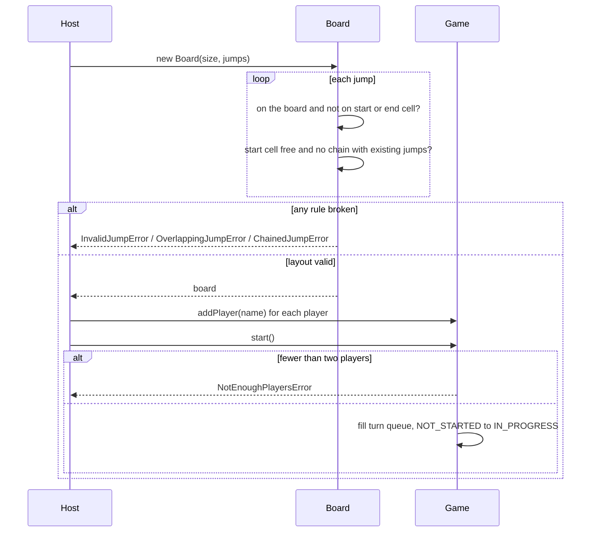
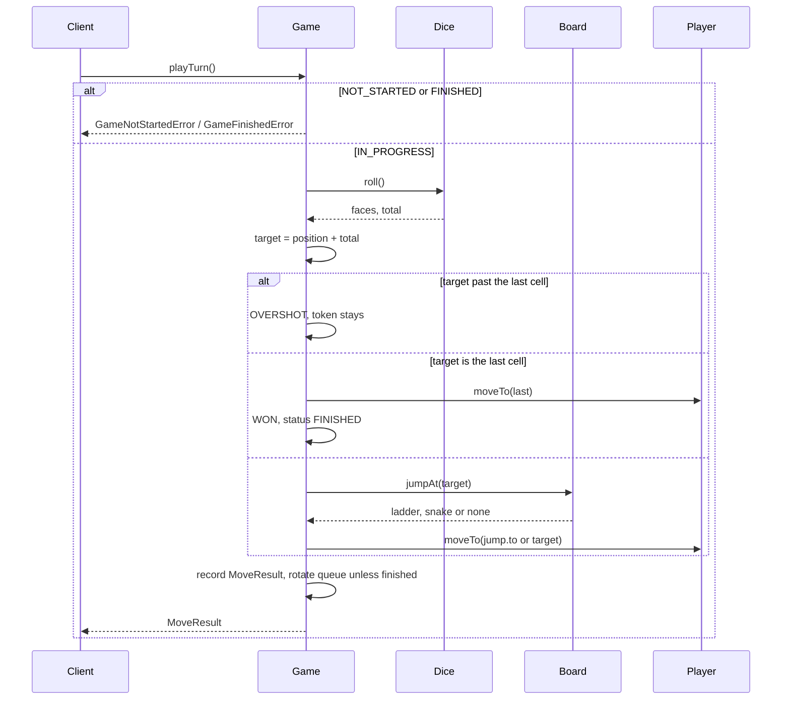

# Design Snake and Ladder

| | |
|---|---|
| **Difficulty** | Easy |
| **Solution** | [`src/snake-and-ladder/`](../src/snake-and-ladder/) |
| **Run** | `npm run demo -- snake-and-ladder` · `npx vitest run src/snake-and-ladder` |
| **Patterns** | Strategy (dice), Result object, polymorphic `Jump`, enum state machine |

## 1. Problem statement

Design the snake and ladder board game. Players take turns rolling dice and moving their token along numbered cells; a ladder lifts the token, a snake drops it, and the first player to land exactly on the last cell wins. The board layout must be validated up front and every turn must report what happened.

## 2. Clarifying questions to ask first

Ask these before drawing anything. The answers decide the model.

- Board size? Who defines the snakes and ladders, and which layouts are illegal?
- How many dice, and how many players? Where do tokens start?
- Must a player land exactly on the last cell? What happens on an overshoot: stay, or bounce back?
- Does the game end at the first winner, or continue to rank everyone?
- House rules: extra turn on a six, a six needed to enter, three sixes forfeit?
- Is it local, or online where the server must own the dice?

Assumptions used in the solution: a configurable board (default 100 cells); tokens start on cell 1; a jump may not start or end on the first or last cell, two jumps may not start on the same cell and jumps may not chain; one six-sided die by default, several dice are summed; exact landing is required and an overshoot keeps the token in place; the game ends at the first winner and ranks the others by position; no other house rules.

## 3. Requirements

### Functional
1. A board has cells 1..N and a set of snakes (head above tail) and ladders (top above bottom).
2. Board construction rejects jumps that leave the board, touch the start or end cell, share a start cell, or chain (a jump ending where another starts).
3. Players join before the game starts; at least two are needed; the line-up is locked by `start()`.
4. Players play in a fixed rotation (a turn queue). A turn rolls the dice, moves the token, then applies a ladder or snake on the landing cell.
5. A roll past the last cell is wasted; landing exactly on the last cell wins and finishes the game.
6. Each turn returns a result object (roll, from, landing cell, final cell, event: moved, ladder climbed, snake bitten, overshot, won).
7. Status follows NOT_STARTED -> IN_PROGRESS -> FINISHED; turns are refused before the start and after the finish. The game exposes the winner and a ranking.

### Non-functional
- Deterministic and testable: dice are injected (a seeded rng or a scripted sequence).
- A turn is O(1): the jump on a cell is a map lookup, not a scan.
- Invalid layouts fail fast at construction, never in the middle of a game.

## 4. Core entities

| Entity | Responsibility |
|---|---|
| `Jump` (abstract) → `Snake`, `Ladder` | From cell, to cell; each subclass enforces its own direction. |
| `Board` | Size, jumps indexed by start cell, all layout validation. |
| `Player` | Id, name and current cell. |
| `Dice` → `RandomDice`, `ScriptedDice` | Policy for producing a roll; N dice summed, rng injected. |
| `MoveResult` / `MoveEvent` | What one turn did, as data. |
| `Game` | Aggregate root: line-up, turn queue, status, `playTurn()`, winner, `ranking()`. |

## 5. Class diagram

## 6. Key flows

## 7. Design patterns used

- **Strategy** for `Dice`. `RandomDice` takes an injected rng and a dice count; `ScriptedDice` replays a fixed sequence for tests, demos and replays of a logged game. The alternative, injecting only an rng function, is enough for randomness but makes tests reverse-engineer rng values from the faces they want, and cannot express a server-side dice service.
- **Result object** (`MoveResult`). A turn returns what happened instead of `void`, so the UI, the log and the tests read one value and never re-derive the rules. The alternative is **Observer** (`onLadder`, `onSnake` callbacks); it suits several listeners (sound, analytics) and can be layered on later by publishing each `MoveResult`.
- **Polymorphic `Jump`** (`Snake`, `Ladder` extend an abstract base). The board treats both uniformly (land on `from`, go to `to`) and each subclass guarantees its direction, so an upward "snake" cannot exist. The alternative, one `Jump` class with a `kind` flag and direction checks keyed on it, is shorter but spreads the rule.
- **Queue for turn order** instead of an index modulo the player count. Rotation is "front goes to the back", and the obvious extensions (a finisher leaves, a skipped turn, an extra turn on a six) are queue operations.
- **Enum state machine**: NOT_STARTED -> IN_PROGRESS -> FINISHED, each public method guarding the state it needs.

## 8. Trade-offs, extensions and follow-up questions

**"Keep playing for second and third place."** Do not re-enqueue a player who finishes; append them to a `finishers` list and end the game when one player is left in the queue. The ranking becomes the finishing order. This is an `EndCondition` strategy if both modes must coexist.

**"House rules: bounce back on overshoot, a six to enter, extra turn on a six, three sixes forfeit."** Put a `MoveRule` strategy between the roll and the board lookup (it maps from, roll to a target) and a `TurnPolicy` that decides whether the queue rotates. The board and the queue do not change.

**"Very large boards."** Jumps are indexed by start cell, so memory is O(jumps), not O(cells), and a turn stays O(1). Validation is O(jumps) once at construction.

**"Online multiplayer: who rolls, and what if a request is retried?"** The server owns the dice; clients only ask to play. Each request carries the turn number the client saw: in a database, `UPDATE games SET turn = turn + 1 WHERE id = ? AND turn = ?` and checking one row changed rejects a double submit or a stale tab. An idempotency key per request lets a retried request return the stored `MoveResult` instead of rolling again.

**"Prove a game was fair."** Store the seed or every roll. `ScriptedDice` replays a stored game exactly, which also makes bug reports reproducible.

**Persistence sketch.** `boards(id, size)`, `jumps(board_id, from_cell, to_cell, kind)` with a unique key on `(board_id, from_cell)` (no overlaps at the database level), `games(id, board_id, status, turn, winner_id)`, `players(id, game_id, seat, name, position)`, and `turns(game_id, turn, player_id, faces, from_cell, landed_on, to_cell, event)` with primary key `(game_id, turn)`.

## 9. What a strong interview answer sounds like

1. Clarify board size, dice, overshoot and end-of-game rules in two minutes; state the assumptions.
2. Name the entities and the invariants: legal layout (checked once in `Board`), strict turn rotation, exact landing.
3. Draw the class diagram with `Dice` as an interface and snakes and ladders sharing one `Jump` abstraction.
4. Walk `playTurn` including the failure paths (not started, finished) and the overshoot, ladder, snake and win branches; show the `MoveResult` it returns.
5. Finish with extensions: play for places, house-rule strategies, server-owned dice with turn-number compare-and-set, and replay from stored rolls.
