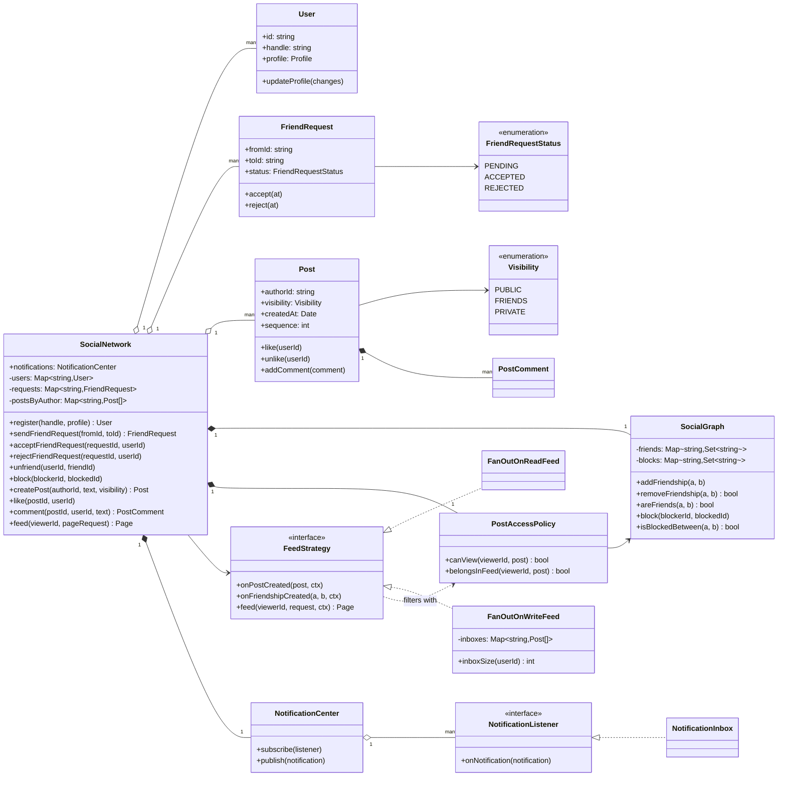
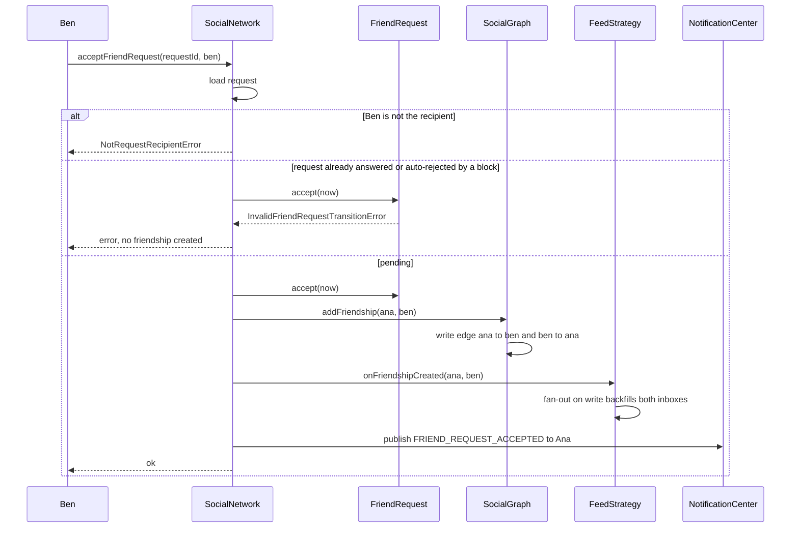
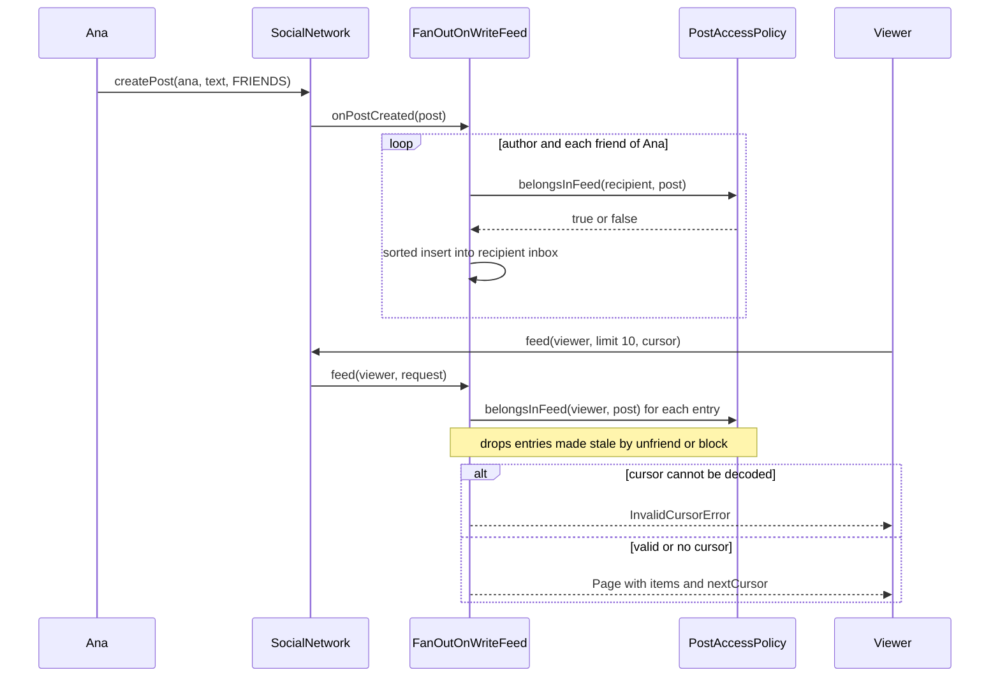

# Design a Social Network (Facebook-lite)

| | |
|---|---|
| **Difficulty** | Medium-Hard |
| **Solution** | [`src/social-network/`](../src/social-network/) |
| **Run** | `npm run demo -- social-network` · `npx vitest run src/social-network` |
| **Patterns** | Strategy (feed fan-out), Observer (notifications), State (friend requests), Policy object (visibility), keyset pagination |

## 1. Problem statement

Design the core of a social network. Users send friend requests, post with a chosen audience, like and comment, block people, and read a home feed of their friends' posts. Notifications go out for friend requests and likes, and the feed must be correct whether it is computed at read time or pushed at write time.

## 2. Clarifying questions to ask first

- Is the relationship symmetric (friends) or directed (followers)? Is there a friend cap?
- Which audiences does a post support? Can the audience change after posting?
- What exactly does blocking do: hide content both ways, stop requests, end the friendship?
- What is in the home feed: only friends' posts, or also public posts from strangers? Chronological or ranked?
- How big can a fan-out get, and how fresh must the feed be?
- Which events notify whom, and through which channels (in-app, push, e-mail)?
- How do clients page through a feed that keeps changing?

Assumptions used in the solution: symmetric friendship created only by an accepted request; visibility PUBLIC, FRIENDS or PRIVATE; blocking is decided by one user but enforced both ways, ends the friendship and rejects pending requests; the home feed is the viewer's own posts plus friends' posts they may see, newest first; notifications for request received, request accepted, post liked and post commented, never for your own actions; cursor pagination.

## 3. Requirements

### Functional
1. Users register with a unique handle and a profile they can update.
2. A user sends a friend request; the recipient accepts or rejects it once (PENDING to ACCEPTED or REJECTED). Accepting creates a friendship in both directions; unfriending removes both.
3. A user posts text with visibility PUBLIC (anyone), FRIENDS (author and friends) or PRIVATE (author only).
4. Users like a post once (and can unlike) and comment on posts they can see.
5. Blocking hides each user's posts from the other, ends their friendship and rejects pending requests; neither can send a request while the block stands.
6. The home feed lists the viewer's posts and their friends' visible posts, newest first, with cursor pagination.
7. The feed algorithm (fan-out on read or on write) is swappable and both give the same result for the same data.
8. Request-received, request-accepted, like and comment events notify the affected user through pluggable listeners.

### Non-functional
- Privacy over freshness: a post must never reach someone who may not see it, even if an inbox entry is stale.
- Feed reads are far more frequent than posts; reads should be cheap (fan-out on write) without breaking correctness.
- Stable pagination while new posts arrive: no duplicates, no gaps.
- Deterministic and testable: time and ids are injected.

## 4. Core entities

| Entity | Responsibility |
|---|---|
| `User` + `Profile` | Identity (handle) and editable profile with validation. |
| `FriendRequest` | PENDING to ACCEPTED or REJECTED exactly once; records who and when. |
| `SocialGraph` | Friendships (always written in pairs, so symmetric) and blocks. |
| `Post` + `PostComment` | Text, visibility, likes as a set (one per user), comments; a sequence for total ordering. |
| `PostAccessPolicy` | The only place that answers "may viewer V see post P", and "does P belong in V's feed". |
| `FeedStrategy` → `FanOutOnReadFeed`, `FanOutOnWriteFeed` | How the home feed is produced. |
| `Page` / cursor helpers | Keyset pagination with opaque cursors. |
| `NotificationCenter` + `NotificationListener` → `NotificationInbox` | Observer for notifications. |
| `SocialNetwork` | Application service orchestrating all of the above. |

## 5. Class diagram

## 6. Key flows

Accepting a friend request. The request is a compare-and-set; only then is the friendship written, in both directions.

Posting with fan-out on write, then reading a page. Access is checked at push time and again at read time.

## 7. Design patterns used

- **Strategy** for the feed. `FanOutOnReadFeed` does no work on write and merges friends' posts per read; `FanOutOnWriteFeed` pushes each post into recipients' inboxes so reads are a slice of one sorted list. The service only calls `onPostCreated`, `onFriendshipCreated` and `feed`. A test runs one history through both and asserts identical feeds, which is the contract. Alternative: a hybrid strategy (push for normal authors, pull for celebrities) built from the two; it slots in without touching the service.
- **Policy object** for visibility. `PostAccessPolicy` holds a rule per `Visibility` in a table and applies blocking first. Feeds, timelines, likes and comments all call it, so a privacy rule cannot be implemented twice and drift. Alternative: polymorphic visibility classes, worth it only once audiences carry data (custom lists, groups).
- **Observer** for notifications. The service publishes a `Notification`; an in-app inbox, a push sender and an e-mail digest are independent listeners. Alternative: calling a notification service directly, which couples posting and liking to delivery and its failures.
- **State machine** for `FriendRequest`, with a transition table so a rejected request cannot be accepted later. Alternative: the State pattern, unnecessary for three states.
- **Keyset (cursor) pagination.** The cursor encodes the sort key `(createdAt, sequence)` of the last item. Alternative: offsets, which repeat or skip items when posts arrive between page loads.

## 8. Trade-offs, extensions and follow-up questions

**Fan-out on write vs on read.** Write fan-out costs one inbox insert per friend per post, but a read is O(page). Read fan-out costs nothing on write and O(friends x posts) per read. Friend caps (Facebook allows 5,000) bound write fan-out for friendships; follower graphs do not, which is why production systems go hybrid: push for most authors, pull and merge at read time for authors above a follower threshold.

**Feed caching.** Inboxes live in a cache such as Redis sorted sets keyed by user, scored by a time-ordered (Snowflake) id, holding post ids only and capped at a few hundred entries. Posts are hydrated from a separate post cache. Pages beyond the cap fall back to fan-out on read. Here `sequence` stands in for the Snowflake id.

**Stale entries.** Unfriending, blocking or changing a post's audience happens after the push. This design re-checks access on every read, which is cheap per item and makes privacy independent of cache state. A background purge on `UNFRIENDED` / `BLOCKED` events keeps inboxes tidy but is an optimisation, not the guard.

**"Two people send each other a request at the same moment."** One pending request per pair: a unique index on `(LEAST(from_id, to_id), GREATEST(from_id, to_id)) WHERE status = 'PENDING'`. Answering is compare-and-set: `UPDATE friend_requests SET status = 'ACCEPTED' WHERE id = ? AND status = 'PENDING'`, and only if one row changed do we insert the friendship. That also resolves accept-versus-block races.

**Graph storage and the symmetric invariant.** Either one row per friendship with `CHECK (user_a < user_b)`, which makes symmetry structural, or two directed rows written in one transaction, which makes "friends of X" a single index range scan. At scale the graph is sharded by user id (a TAO-style cache over MySQL), and the two directed edges may live on different shards, so the pair is written through a reliable async job.

**Follow-ups:** custom audiences and groups (a new `Visibility` and one new rule in the table); ranked feeds (a ranking step over the same candidate set, or a decorator around a feed strategy); "people you may know" (count mutual friends over a two-hop traversal); notification batching ("Ben and 3 others liked your post") as a listener that aggregates; editing a post's audience (works already, because reads re-check access).

**Persistence sketch.** `users(id, handle UNIQUE, display_name, bio, city)`, `friend_requests(id, from_id, to_id, status, created_at, responded_at)`, `friendships(user_id, friend_id, since, PRIMARY KEY(user_id, friend_id))`, `blocks(blocker_id, blocked_id, PRIMARY KEY(...))`, `posts(id, author_id, text, visibility, created_at)` with an index on `(author_id, created_at DESC, id DESC)` for keyset reads, `likes(post_id, user_id, PRIMARY KEY(post_id, user_id))`, `comments(id, post_id, author_id, text, created_at)`, `notifications(id, recipient_id, type, actor_id, subject_id, created_at, read_at NULL)`; inboxes in the cache, not the database.

## 9. What a strong interview answer sounds like

1. Clarify symmetric vs directed relationships, audiences, what blocking does, what the feed contains and the expected fan-out; state the assumptions.
2. Name the invariants: friendship is symmetric, a request is answered once, one like per user, and no post ever reaches a viewer who may not see it.
3. Draw the graph, the request state machine, `PostAccessPolicy` as the single privacy gate, the `FeedStrategy` interface and the notification observer.
4. Walk accept-request and post-then-read, including the failure branches (wrong recipient, already answered, blocked, bad cursor) and why access is re-checked at read time.
5. Discuss fan-out on write vs read with numbers, the hybrid for celebrities, Redis inbox caching with capped sorted sets, keyset pagination and the SQL guards for the two races.
