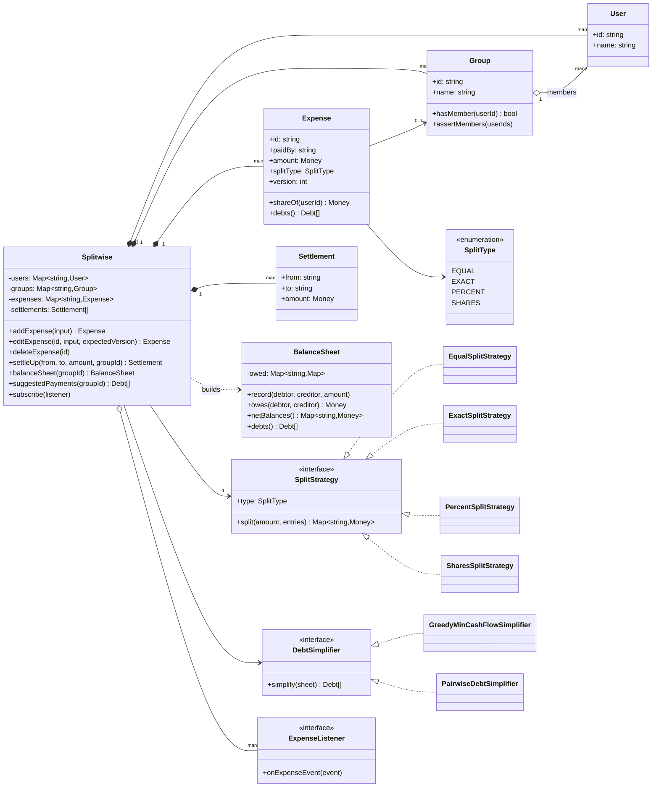
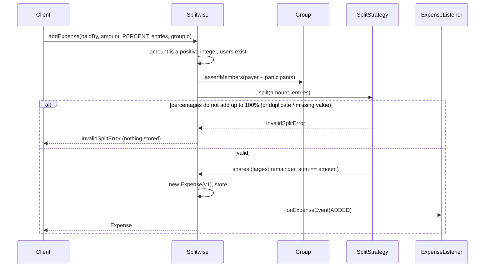
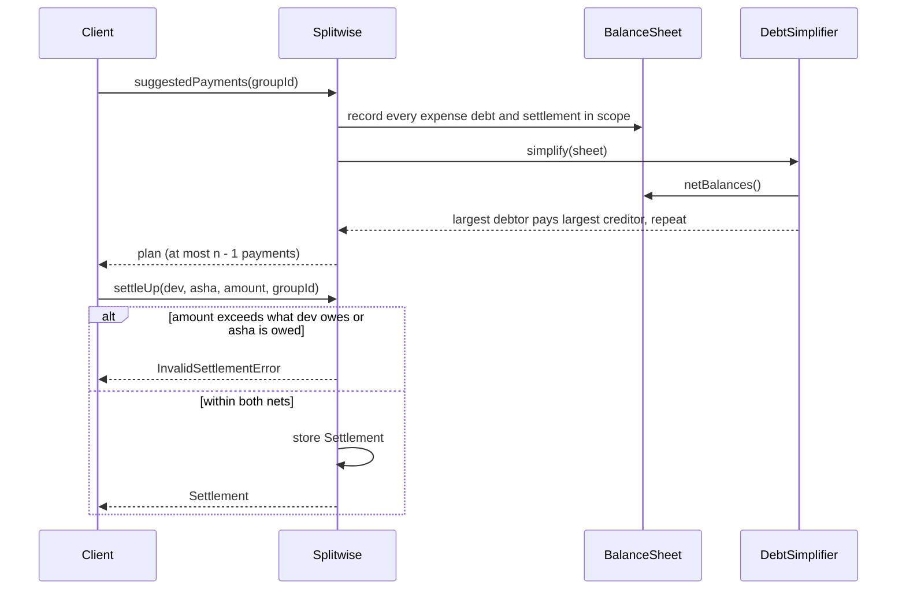

# Design Splitwise (Expense Sharing)

| | |
|---|---|
| **Difficulty** | Medium |
| **Solution** | [`src/splitwise/`](../src/splitwise/) |
| **Run** | `npm run demo -- splitwise` · `npx vitest run src/splitwise` |
| **Patterns** | Strategy (splits, debt simplification), Observer, Aggregate root, derived read model |

## 1. Problem statement

Design an expense-sharing app. People file expenses ("Asha paid Rs 12,000 for the villa, split four ways"), the system tracks who owes whom, suggests the fewest payments to settle up, and records those payments. Amounts must be exact to the paisa: every split adds up to the expense, and every balance adds up to zero.

## 2. Clarifying questions to ask first

- Which split types: equal, exact amounts, percentages, shares (weights)? Can percentages have decimals?
- When an amount does not divide evenly (Rs 1 three ways), who gets the extra paisa?
- Can one expense have several payers? Several currencies?
- Do balances live per group, overall, or both? Can an expense sit outside any group?
- Can expenses be edited or deleted after the fact, and what happens to balances already shown?
- Should the app suggest a simplified set of payments, and may a settlement go to someone you did not directly owe?
- Do we notify people when an expense is added?

Assumptions used in the solution: one payer per expense, a single currency (INR in paise), the four split types with percentages up to two decimals, leftover paise go to the earliest participants by largest remainder, expenses may be in a group or not, balances are available per group and overall, edits and deletes are allowed, simplification uses greedy min-cash-flow, and settlements are validated against net balances so people can pay along the simplified plan.

## 3. Requirements

### Functional
1. Register users; create groups of users; an expense in a group may only involve its members.
2. Add an expense with a payer, an amount and a split of type EQUAL, EXACT, PERCENT or SHARES.
3. Reject any split that does not describe the expense: shares not summing to the total, percentages not summing to 100%, duplicate participants, missing or invalid values.
4. Allocate rounding remainders deterministically: Rs 1.00 three ways is 34, 33, 33 paise.
5. Show pairwise net debts ("B owes A Rs 60") and each user's net balance, per group and overall.
6. Edit or delete an expense; balances reflect the change immediately. Edits from a stale copy are rejected.
7. Suggest a simplified payment plan that preserves every user's net balance with at most n - 1 payments.
8. Record settle-up payments; reject paying yourself, paying more than you owe, or paying someone more than they are owed.
9. Notify subscribers when an expense is added, updated or deleted.

### Non-functional
- Exactness: integer minor units everywhere; the sum of shares equals the amount, nets sum to zero.
- Determinism: the same inputs always give the same shares and the same plan (ties broken by user id).
- Extensibility: a new split type or simplification policy is a new class, not a new `switch` branch.
- Testability: clock, ids and (in tests) randomness are injected.

## 4. Core entities

| Entity | Responsibility |
|---|---|
| `User` | Identity only. What a user owes is always derived. |
| `Group` | Membership; guards that a group expense only involves members. |
| `Expense` | Immutable, versioned record: payer, amount, split type, exact shares. Refuses shares that do not sum to the amount. |
| `SplitStrategy` → `Equal`, `Exact`, `Percent`, `Shares` | Turns the user's split input into integer shares, or throws `InvalidSplitError`. |
| `allocateByWeights` | Largest-remainder allocation: exact integer parts, deterministic tie-break. |
| `Settlement` | A real payment from one user to another, optionally in a group. |
| `BalanceSheet` | Derived read model of pairwise net debts and per-user nets. |
| `DebtSimplifier` → `GreedyMinCashFlow`, `Pairwise` | Turns a balance sheet into a payment plan. |
| `ExpenseListener` | Observer of expense added / updated / deleted. |
| `Splitwise` | Aggregate root: users, groups, expenses, settlements; builds balance sheets on demand. |

## 5. Class diagram

## 6. Key flows

## 7. Design patterns used

- **Strategy** for splits. Each split type has its own validation ("sums to total", "sums to 100%", "positive weights") but the same output contract: exact integer shares. The service looks strategies up by `SplitType`, so adding "split by consumption units" is one class. Alternative: a `switch` in `addExpense`; fine for two types, a merge-conflict magnet for five.
- **Strategy** for debt simplification. Greedy min-cash-flow is the default; `PairwiseDebtSimplifier` keeps the raw debts for users who prefer to see "I owe Ravi for dinner". Alternative: an exact minimum-transactions solver (subset-sum based, exponential) behind the same interface for small groups.
- **Observer** for expense events: notifications, an activity feed or a cached balance projection subscribe without the aggregate knowing them. Alternative: an outbox table polled by a worker, which survives crashes.
- **Derived read model.** Expenses and settlements are the facts; `BalanceSheet` is recomputed from them. Edits and deletes are therefore trivially correct. Alternative: maintain balances incrementally (apply the delta of old vs new shares), which is faster but has to be exactly reversible.
- **Largest-remainder allocation** as a value function, shared by EQUAL, PERCENT and SHARES, so rounding is decided once.

## 8. Trade-offs, extensions and follow-up questions

**"Who gets the extra paisa?"** `allocateByWeights` floors every part, then hands leftover units to the largest remainders, ties to the earlier participant. It is deterministic and never loses or invents a paisa. Rotating the beneficiary (or giving it to the payer) is a one-line change if fairness over many expenses matters.

**"Why basis points for percentages?"** `33.33 + 33.33 + 33.34` in floating point is not reliably `100`. Converting to integer basis points first makes the check exact and the allocation integral.

**"Recomputing balances is O(expenses) per query."** Fine for a group of friends. At scale keep a `balances(group_id, debtor, creditor, amount)` projection updated in the same transaction as the expense row (delta of old vs new shares on edit) and treat the full recompute as a repair job.

**"Two people edit the same expense at once."** Each edit carries `expectedVersion`; a mismatch throws `StaleExpenseError`. In SQL: `UPDATE expenses SET ..., version = version + 1 WHERE id = ? AND version = ?` and check that one row changed. Shares are rewritten in the same transaction.

**"A settle-up request is retried by the mobile client."** Accept an idempotency key: `settlements(idempotency_key UNIQUE)`; a duplicate insert returns the original settlement instead of paying twice. The overpayment check and the insert must happen in one transaction (`SELECT ... FOR UPDATE` on the group's balance rows, or a serialisable transaction).

**"Is greedy optimal?"** Not always; the true minimum number of payments is NP-hard (it partitions people into zero-sum subsets). Greedy needs at most n - 1 payments and preserves every net, which is what the tests assert, including on random ledgers from a seeded generator.

**"Pay along the simplified plan."** Settlements are validated against net balances, not pairwise debts, so Dev may pay Asha even if his recorded debt is to Ravi. The pairwise view can then show a cycle whose nets cancel; `isSettled` looks at nets, and the app shows the simplified view once simplification is on.

**Persistence sketch.** `users`, `groups`, `group_members(group_id, user_id) PK(both)`, `expenses(id, group_id NULL, paid_by, amount, split_type, version, deleted_at NULL)`, `expense_shares(expense_id, user_id, amount) PK(both)` with a deferred check that shares sum to the amount, `settlements(id, group_id NULL, from_id, to_id, amount, idempotency_key UNIQUE, paid_at)`. Soft-delete expenses so the activity feed keeps history.

**Follow-ups.** Multiple payers (a `payers` map split the same way as shares); multi-currency (balances per currency, convert only at settle time); recurring expenses (a scheduler that calls `addExpense`); receipts and comments; leaving a group with a non-zero balance (forbid, or require settle-up first).

## 9. What a strong interview answer sounds like

1. Clarify split types, rounding, groups vs overall, edits and simplification; state that money is integer paise.
2. Name the invariants: shares sum to the amount, nets sum to zero, simplification preserves nets.
3. Draw expenses and settlements as facts and the balance sheet as a derived view; put split and simplification policies behind interfaces.
4. Walk add-expense with a failing percent split, then suggested payments and a rejected overpayment.
5. Close with concurrency (version column, idempotency key), the incremental balance projection, and why greedy is good enough.
