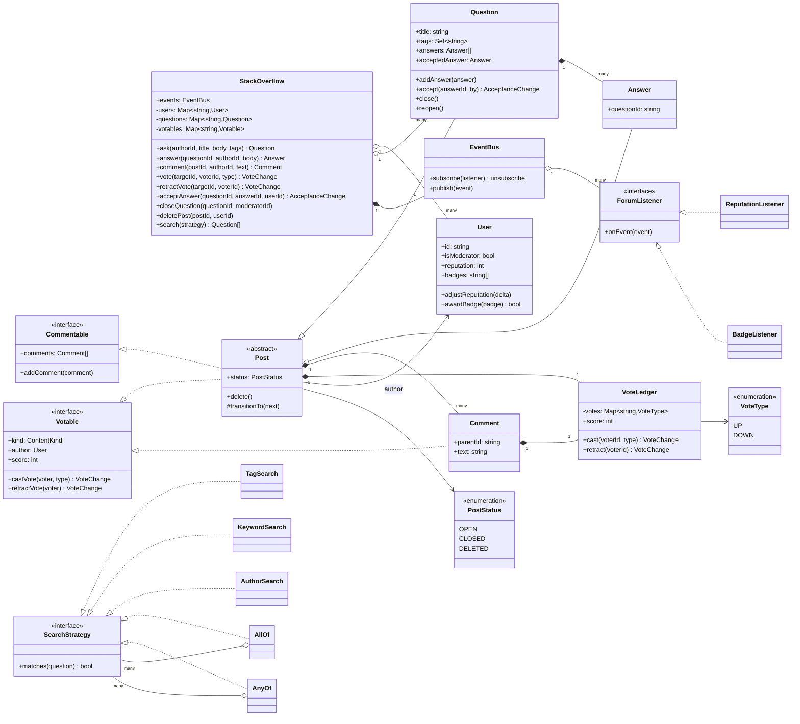
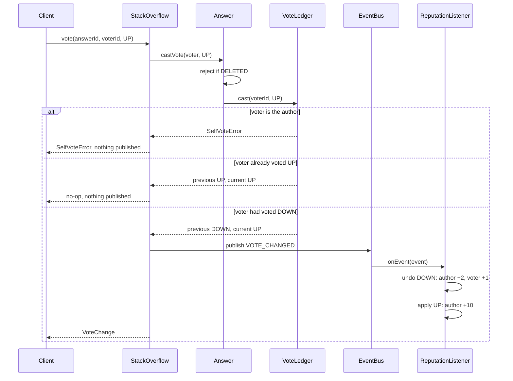
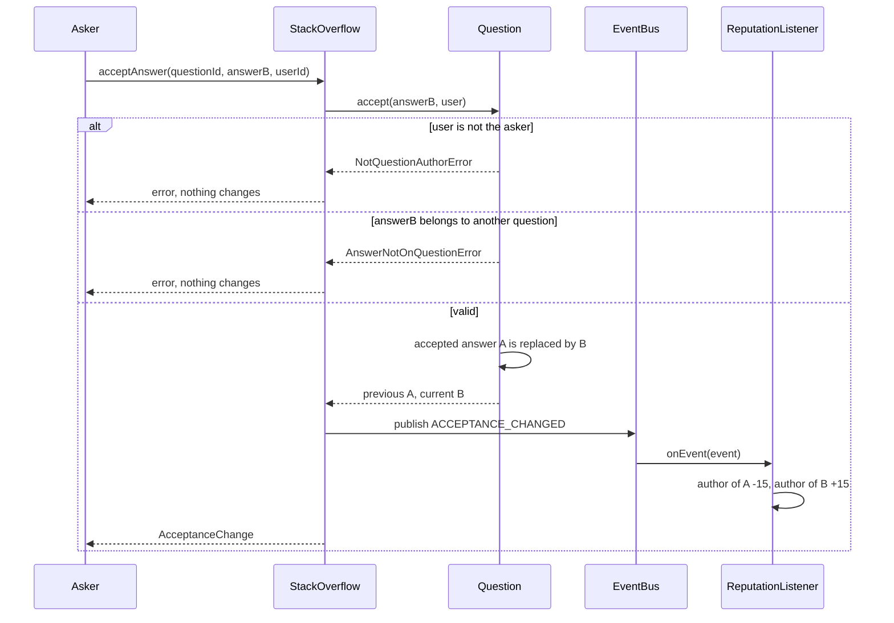

# Design Stack Overflow

| | |
|---|---|
| **Difficulty** | Medium |
| **Solution** | [`src/stack-overflow/`](../src/stack-overflow/) |
| **Run** | `npm run demo -- stack-overflow` · `npx vitest run src/stack-overflow` |
| **Patterns** | Observer (event bus), Strategy + Composite (search), State (post lifecycle), Interface segregation |

## 1. Problem statement

Design the core of a Q&A site. Users ask questions with tags, others answer and comment, everyone votes, and the asker accepts one answer. Reputation follows the votes and acceptances, and has to stay exact when people change their minds.

## 2. Clarifying questions to ask first

- What can be voted on: questions, answers, comments? Do comment votes earn reputation?
- Can a user change or retract a vote? Do we need the reputation effect to reverse exactly?
- What are the reputation rules? Does the voter pay for a downvote? Is there a floor or a daily cap?
- Who can accept an answer, how many can be accepted, and can acceptance move to another answer?
- What does "closed" mean: no new answers, or no activity at all? Who can close and delete?
- Which searches matter (tag, keyword, author) and must they combine?
- Do we need badges, notifications or bounties now, or just a design that admits them?

Assumptions used in the solution: questions, answers and comments are votable; comments take upvotes only and earn nothing. Upvote gives the author +10, downvote costs the author 2 and the voter 1, acceptance gives +15, self-acceptance gives nothing. One vote per user per post, switchable and retractable. One accepted answer, chosen by the asker. Closed questions refuse answers but still take votes and comments; deleted posts refuse everything. Moderators close and reopen; authors or moderators delete. No reputation floor or daily cap (see trade-offs).

## 3. Requirements

### Functional
1. Users register and have a reputation and a set of badges.
2. A user asks a question with a title, body and 1-5 tags; others answer it; anyone comments on questions and answers.
3. A user casts at most one vote per post; casting the same vote again changes nothing; a vote can be switched (UP to DOWN) or retracted; nobody votes on their own post.
4. The asker accepts exactly one answer and can switch or remove acceptance.
5. Reputation follows every vote, switch, retraction and acceptance change exactly.
6. Posts move through OPEN, CLOSED, DELETED with validated transitions; closed questions reject answers.
7. Questions can be searched by tag, keyword and author, and criteria combine with AND / OR.
8. New reactions to activity (badges, notifications) can be added without changing the core.

### Non-functional
- Correctness of reputation over latency: a retried or switched vote must never double count.
- Read-heavy: searches and score reads vastly outnumber votes, so scores are cheap to read.
- Deterministic and testable: time and ids are injected; listeners run synchronously in-process.

## 4. Core entities

| Entity | Responsibility |
|---|---|
| `User` | Identity, moderator flag, reputation and badges. Reputation changes only through listeners. |
| `Votable` / `Commentable` (interfaces) | What can be voted on, and what can carry comments. Segregated, because a comment is votable but not commentable. |
| `VoteLedger` | One vote per user per post, self-vote and allowed-vote rules, score derived from the votes. |
| `Post` (abstract) → `Question`, `Answer` | Lifecycle state machine, votes, comments. `Question` owns its answers and the single accepted answer. |
| `Comment` | Votable remark (upvotes only), composes its own `VoteLedger`. |
| `EventBus` + `ForumListener` | Observer: the service publishes facts, listeners react. |
| `ReputationListener`, `BadgeListener` | Reputation rules and badge rules, each in one place. |
| `SearchStrategy` → `TagSearch`, `KeywordSearch`, `AuthorSearch`, `AllOf`, `AnyOf` | Composable search criteria. |
| `StackOverflow` | Application service: looks up entities, invokes them, publishes events. |

## 5. Class diagram

## 6. Key flows

Switching a vote. The ledger reports what changed; the listener undoes the old effect and applies the new one.

Moving acceptance from one answer to another.

## 7. Design patterns used

- **Observer (event bus)** for reputation and badges. The service publishes `VOTE_CHANGED` and `ACCEPTANCE_CHANGED`; `ReputationListener` owns every number. Badges were added as a second listener without editing a single entity, which is the test of the design. Alternative: update reputation inline in `vote()`. It is simpler and synchronous, but every new rule (bounties, daily cap, badges) edits the service and the rules end up scattered.
- **"Undo then apply"** inside the listener. A switch is retract + cast, so the arithmetic is right by construction instead of a table of nine special cases (none to up, down to up, and so on).
- **Strategy + Composite** for search (a Specification in all but name). Each criterion is a predicate; `AllOf` and `AnyOf` combine them. Alternative: one `search({tag, keyword, author})` method with optional fields. Fine for three fields, but it cannot express OR and grows a parameter per feature.
- **State machine** for `PostStatus` with a transition table, so `DELETED -> OPEN` throws. Alternative: the State pattern with a class per state. With three states and two behaviours (answers allowed, votes allowed) a table is clearer.
- **Interface segregation + composition**: `Votable` and `Commentable` are separate because comments are votable but not commentable. Votes live in a `VoteLedger` that `Post` and `Comment` both compose, instead of making `Comment` inherit a post lifecycle it does not have.

## 8. Trade-offs, extensions and follow-up questions

**"Two requests from the same user vote at the same time."** The invariant is one row per `(post_id, voter_id)`. In SQL: `INSERT INTO votes ... ON CONFLICT (post_id, voter_id) DO UPDATE SET vote = EXCLUDED.vote` inside a transaction that reads the previous vote `FOR UPDATE`; the old and new values become the event. Repeating the same vote is a no-op here, so client retries are safe.

**"Reputation drifted after an outage."** Listeners are eventually consistent once they move out of process. Write the event to an outbox table in the same transaction as the vote, and make the listener idempotent by storing `reputation_changes(event_id UNIQUE, user_id, delta)`. Reputation is then a sum over that table, which can always be recomputed. This is also why the model does not clamp reputation at 1: a clamp makes a vote followed by its retraction non-reversible, so the real site recalculates from history instead.

**"Accepting an answer races with switching it."** Compare-and-set on the question: `UPDATE questions SET accepted_answer_id = ?, version = version + 1 WHERE id = ? AND version = ?`.

**"Search is a full scan."** Predicates are O(n) over questions, fine in memory. In production an inverted index (Elasticsearch/OpenSearch) is fed by `QUESTION_ASKED` and edit events; `AllOf` / `AnyOf` translate to a `bool` query with `must` / `should`. Scores are denormalised onto the question row so ranking needs no join.

**"Notify followers of a tag" (fan-out).** Another listener: on `QUESTION_ASKED`, push to followers of each tag. Popular tags have millions of followers, so fan out on read for big tags and on write for small ones.

**Follow-ups:** daily reputation cap of 200 (the listener gets a `Clock` and a per-day tally); bounties (escrow reputation on a `BOUNTY_OFFERED` event, pay on acceptance); privileges such as "downvote needs 125 reputation" (a `PrivilegePolicy` checked by the service before calling the entity); reversing reputation when a post is deleted (a listener on `POST_DELETED`); edit history (`PostRevision` entries).

**Persistence sketch.** `users(id, name, reputation, is_moderator)`, `posts(id, kind, question_id NULL, author_id, title NULL, body, status, accepted_answer_id NULL, score, created_at, version)`, `votes(post_id, voter_id, vote, PRIMARY KEY(post_id, voter_id))`, `comments(id, post_id, author_id, text, score)`, `post_tags(post_id, tag)` with an index on `tag`, `reputation_changes(event_id UNIQUE, user_id, delta, reason)`, `outbox(event_id, type, payload, published_at NULL)`.

## 9. What a strong interview answer sounds like

1. Clarify what is votable, the reputation numbers, whether votes can change, and who accepts and closes; state the assumptions.
2. Name the invariants: one vote per user per post, one accepted answer chosen by the asker, reputation always equal to the sum of the rules applied to the current votes.
3. Draw `Votable` / `Commentable`, the `Post` hierarchy with a composed `VoteLedger`, and the event bus with listeners; explain why reputation is a listener.
4. Walk the vote-switch flow ("undo then apply") and the acceptance switch, including the self-vote, non-author and closed-question failures.
5. Close with concurrency (unique constraint, versioned accept), idempotent listeners with an outbox, search indexing and two extensions (badges, bounties) that are only new listeners.
