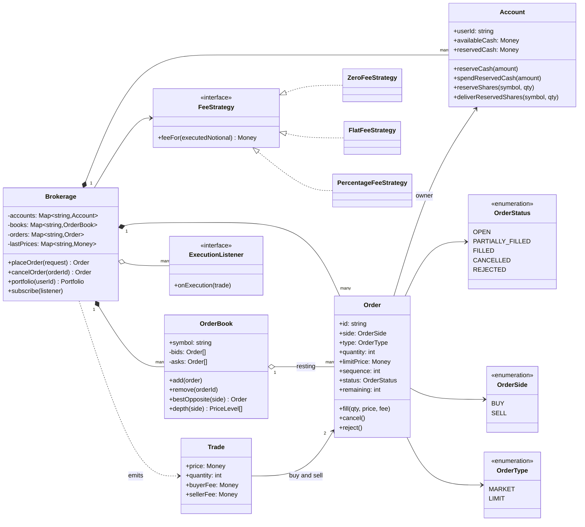
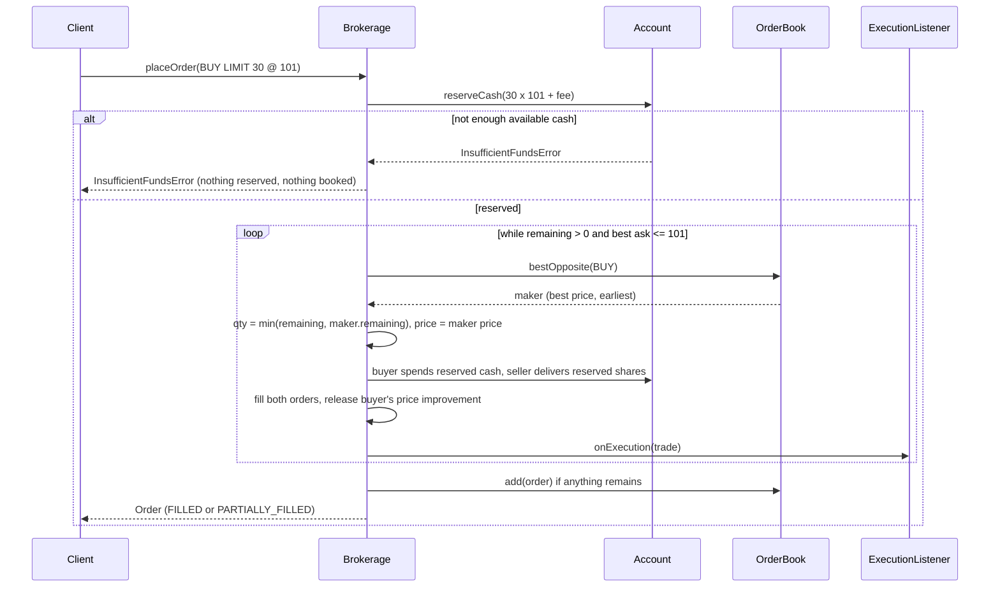
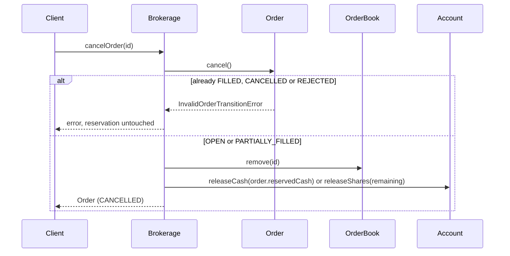

# Design a Stock Brokerage (Order Matching)

| | |
|---|---|
| **Difficulty** | Hard |
| **Solution** | [`src/stock-brokerage/`](../src/stock-brokerage/) |
| **Run** | `npm run demo -- stock-brokerage` · `npx vitest run src/stock-brokerage` |
| **Patterns** | Strategy (fees), Observer (executions), State (order lifecycle), Aggregate root |

## 1. Problem statement

Design a brokerage where users hold cash and shares and place buy and sell orders, market or limit. Orders for each symbol meet in an order book with price-time priority; trades move cash and shares between accounts and charge a brokerage fee. No user may ever commit more cash or shares than they have, even with many orders open.

## 2. Clarifying questions to ask first

- Do we run the exchange (matching) or route orders to one? (Here: we match internally.)
- Order types: market and limit only, or also stop, IOC, FOK, good-till-cancelled?
- What happens to the unfilled part of a market order when the book runs out?
- At what price does a crossing trade execute: the resting (maker) order's price or the incoming one's?
- How are fees charged: per trade, per order, percentage with a minimum? On both sides?
- Do we reserve funds when an order is placed or check at execution time?
- How is a portfolio valued: last traded price, mid price, close?

Assumptions used in the solution: internal matching, one book per symbol, market and limit orders, trades execute at the maker's price, an unfilled market remainder is cancelled (rejected if nothing filled), funds and shares are reserved at placement, fees are a function of an order's cumulative executed value charged to both sides, portfolios are valued at the last traded price, a single currency in paise and whole shares.

## 3. Requirements

### Functional
1. Users have accounts with cash and holdings per symbol; both split into available and reserved.
2. Place BUY or SELL orders, MARKET or LIMIT; quantity is a positive integer, a limit price is required for LIMIT and refused for MARKET.
3. Orders move through OPEN → PARTIALLY_FILLED → FILLED, or to CANCELLED / REJECTED; any other transition is an error.
4. Limit orders match when prices cross, otherwise rest in the book. Priority is best price, then earliest arrival.
5. Market orders sweep the opposite side level by level; a remainder is cancelled, an empty book rejects the order.
6. An incoming order can fill against several resting orders, producing one trade per fill.
7. A buy reserves its worst-case cost (quantity x limit + fee) at placement; a market buy may use all available cash and stops at what it can afford. A sell reserves its shares. Placement fails with `InsufficientFundsError` / `InsufficientHoldingsError` rather than over-committing.
8. Cancelling an order (or finishing it) releases whatever it still holds; price improvement is released as soon as a fill makes it unnecessary.
9. Brokerage fees come from a pluggable strategy; partial fills of one order add up to exactly the fee for the total.
10. Value a portfolio at the last traded price; notify subscribers of every execution.

### Non-functional
- Exactness: integer paise and whole shares; cash plus fees collected is conserved across every trade (tested).
- Fairness: deterministic price-time priority using an arrival sequence, not wall-clock time.
- Latency: best bid/ask in O(1); insertion O(n) here, O(log n) with a tree of price levels.
- Testable: clock, ids and fee policy are injected.

## 4. Core entities

| Entity | Responsibility |
|---|---|
| `Account` | Available and reserved cash and shares; refuses to reserve more than is available. |
| `Order` | Request plus lifecycle: validated transitions, filled quantity, executed value, fees paid, cash still reserved. |
| `OrderBook` | Resting limit orders for one symbol in price-time priority; `bestOpposite()`, `depth()`. |
| `Trade` | One execution: price, quantity, both orders, both fees. |
| `FeeStrategy` → `Zero`, `Flat`, `Percentage` | Fee as a function of cumulative executed value. |
| `ExecutionListener` | Observer of trades (market data, notifications). |
| `Brokerage` | Aggregate root and matching engine: reserve, match, settle each fill, release. |

## 5. Class diagram

## 6. Key flows

## 7. Design patterns used

- **Strategy** for fees. Brokerages change pricing often (flat per order, 0.1% with a minimum, zero-commission promos). The contract is `feeFor(cumulativeExecutedValue)` and must be non-decreasing; the engine charges each fill `fee(after) - fee(before)`, so partial fills telescope to exactly `fee(total)` and the fee reserved at placement always covers it. Alternative: `feeFor(trade)` per fill, which rounds on every fill and can overshoot the reservation.
- **State** (as a transition table) for the order lifecycle. `Order` refuses `FILLED → CANCELLED` and `PARTIALLY_FILLED → REJECTED` itself, so a late cancel cannot release a reservation twice. Alternative: one class per state, worthwhile once states carry behaviour (stop orders that trigger).
- **Observer** for executions: the tape, notifications and a market-data feed subscribe without the engine knowing them. Alternative: an append-only trade log consumed asynchronously.
- **Reservation (escrow)** instead of check-at-execution. Moving value from available to reserved at placement makes over-commitment impossible by construction: two open orders can never spend the same rupee.

## 8. Trade-offs, extensions and follow-up questions

**"Why trade at the maker's price?"** The resting order published that price first; the taker gets any improvement. The buyer's reservation was at its limit, so the difference is released immediately after the fill (worst case for the remainder is recomputed), not only when the order completes.

**"Why reserve all cash for a market buy?"** It has no price cap, so the worst case is unknown. Reserving all available cash for the duration of a synchronous match is safe; the engine buys only what the reservation covers, fees included, then releases the rest. A real broker would cap it with a price collar (e.g. last price + 5%) and reserve that.

**"The book is slow with 100k orders."** Replace the sorted arrays with a balanced tree (or two heaps) of price levels, each a FIFO queue, plus a `Map<orderId, node>` for O(1) cancel. Matching is then O(log levels) per fill.

**"Two orders arrive at once."** Matching for one symbol must be sequential. Exchanges run a single-threaded matcher per symbol (shard by symbol) fed by a queue; this keeps price-time priority exact. Account reservations cross symbols, so they need a guard too: `UPDATE accounts SET available = available - :amt, reserved = reserved + :amt WHERE user_id = ? AND available >= :amt` and check one row changed, or a version column on the account.

**"The client retries a placement."** Accept a client order id as an idempotency key: `orders(user_id, client_order_id) UNIQUE`; a retry returns the existing order instead of reserving twice.

**Persistence sketch.** `accounts(user_id, available_cash, reserved_cash, version)`, `holdings(user_id, symbol, available, reserved) PK(user_id, symbol)`, `orders(id, user_id, symbol, side, type, qty, limit_price NULL, filled_qty, executed_value, fees_paid, reserved_cash, status, seq)`, `trades(id, symbol, buy_order_id, sell_order_id, price, qty, buyer_fee, seller_fee, executed_at)`. Each fill is one transaction touching two orders, two accounts, two holdings rows and one trade row. Index `orders(symbol, side, status, limit_price, seq)` to rebuild books on restart.

**Follow-ups.** Stop and stop-limit orders (a trigger on last price that injects an order); IOC and FOK time-in-force (cancel the remainder or pre-check depth); self-trade prevention (skip or cancel when buyer = seller); short selling with margin; corporate actions (splits rescale quantities and prices); valuation at mid price when trades are sparse.

## 9. What a strong interview answer sounds like

1. Clarify order types, maker price, market remainder handling, fee model and reservation timing.
2. State the invariants: no over-commitment, price-time priority, cash + fees conserved, fills never exceed quantity.
3. Draw Account (available vs reserved), Order (state machine), OrderBook per symbol and the fee strategy.
4. Walk a crossing limit buy that partially fills against two makers, then a cancel that releases the rest.
5. Close with single-threaded matching per symbol, conditional updates for reservations, idempotent placement and the tree-of-levels book.
