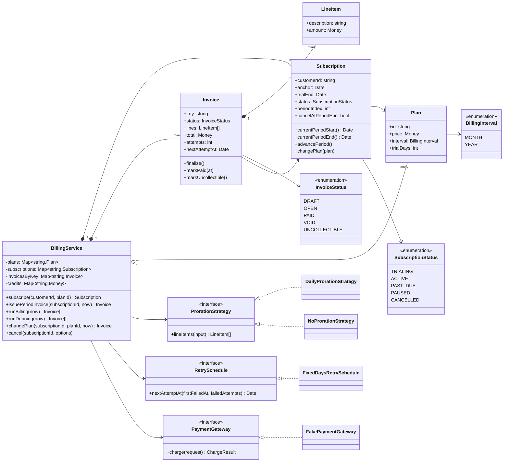
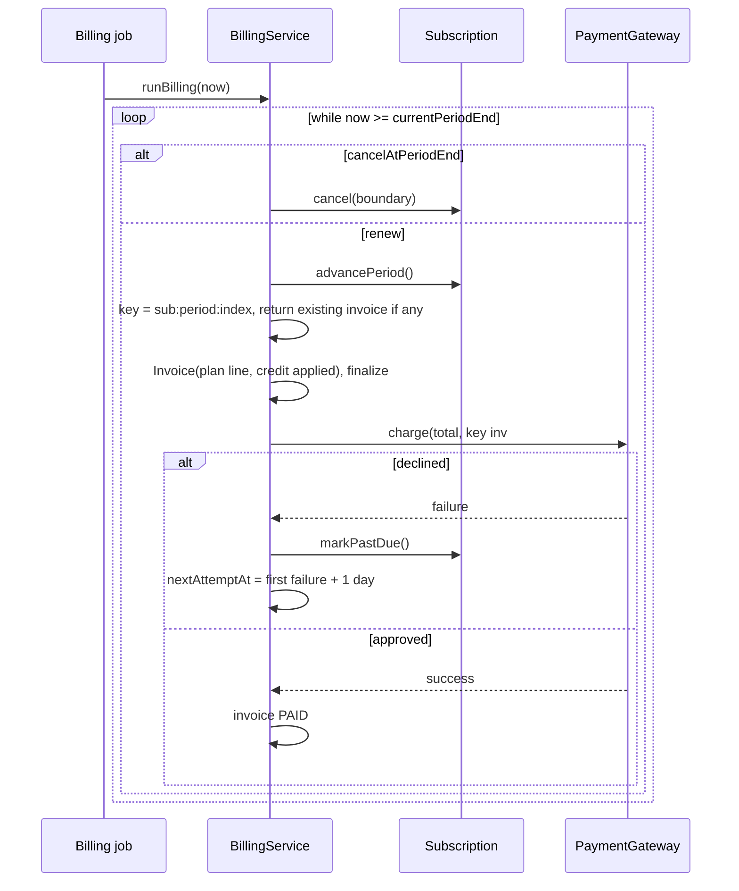
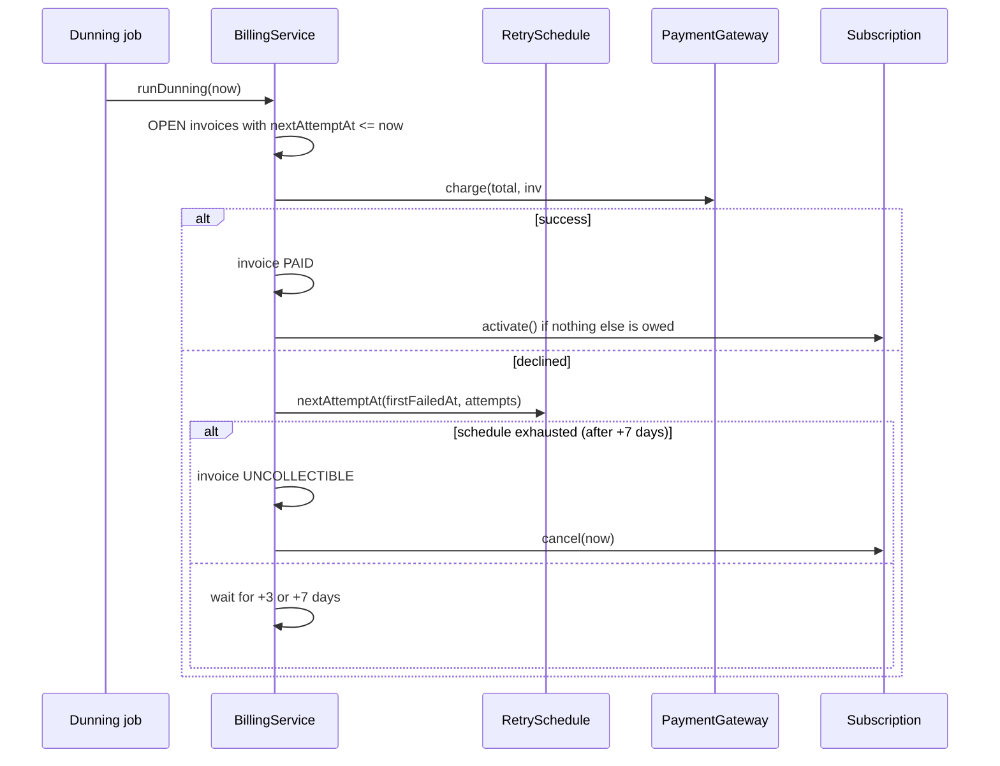

# Design a Subscription Billing System

| | |
|---|---|
| **Difficulty** | Hard |
| **Solution** | [`src/subscription-billing/`](../src/subscription-billing/) |
| **Run** | `npm run demo -- subscription-billing` · `npx vitest run src/subscription-billing` |
| **Patterns** | Strategy (proration, retry schedule), State (subscription and invoice lifecycles), Adapter (payment gateway), Idempotency key |

## 1. Problem statement

Design the billing engine behind a SaaS product. Customers subscribe to monthly or yearly plans, possibly after a free trial; the system issues one invoice per billing period, charges a payment gateway, prorates mid-period plan changes, and chases failed payments on a retry schedule until the subscription recovers or is cancelled. Dates and amounts must be exact: 31 January plus one month is 28 February, and no paisa is created or lost by proration.

## 2. Clarifying questions to ask first

- Which intervals (monthly, yearly, weekly)? Does a subscription that starts on the 31st renew on the last day of short months, and then go back to the 31st?
- Trials: free, of a fixed number of days? Is a card required at sign-up?
- Plan changes mid-period: prorate immediately, or apply from the next renewal? Can the interval change?
- Downgrades: refund to the card, or credit the account balance?
- What is the retry schedule for failed payments, and what happens when it is exhausted?
- Cancellation: immediately or at period end? Refunds?
- Who drives time: a scheduler calling us, or do we run our own timers?

Assumptions used in the solution: MONTH and YEAR intervals; billing day anchored to the original start and clamped to month end; free trials with no card check; changes within the same interval only, prorated daily by default (a no-proration strategy is the alternative); downgrade credit goes to an account balance used by the next invoice; retries at +1, +3 and +7 days from the first failure, then the invoice is uncollectible and the subscription cancelled; cancel immediately or at period end with no refunds; time is driven by explicit `runBilling(now)` and `runDunning(now)` calls; a single currency in paise.

## 3. Requirements

### Functional
1. Plans have a price in minor units, an interval (MONTH or YEAR) and optional trial days.
2. Subscriptions move through TRIALING, ACTIVE, PAST_DUE, PAUSED and CANCELLED; any other transition throws.
3. Billing periods are computed from the anchor with calendar-correct month arithmetic: 31 Jan → 28 Feb (29 in a leap year) → 31 Mar → 30 Apr.
4. A subscription without a trial is invoiced and charged at sign-up; a trialing one at trial end, which becomes its anchor.
5. Invoice generation is idempotent: exactly one invoice per subscription per period, however many times billing runs.
6. Invoices have line items and a status (DRAFT, OPEN, PAID, VOID, UNCOLLECTIBLE); finalized invoices cannot be edited.
7. A mid-period plan change is priced by a proration strategy: daily proration credits the unused days of the old plan and charges the same days at the new plan, in integer paise with the remainder allocated explicitly.
8. A failed charge makes the subscription PAST_DUE and schedules retries; success restores ACTIVE, exhaustion marks the invoice UNCOLLECTIBLE and cancels the subscription.
9. Cancel immediately or at period end; a subscription set to cancel at period end is not renewed.
10. Pausing stops invoicing while periods keep rolling on the same anchor.

### Non-functional
- Exactness: integer money, UTC dates, no drift of the billing day over many renewals.
- Idempotency end to end: invoice keys per period, gateway idempotency keys per attempt.
- Deterministic and testable: clock, ids, gateway and policies injected; no timers in the domain.

## 4. Core entities

| Entity | Responsibility |
|---|---|
| `Plan` | Price, interval, trial days. Immutable; a price change is a new plan. |
| `billing-calendar` | `addMonthsAnchored`, `periodBoundary`: month arithmetic that never drifts. |
| `Subscription` | Lifecycle state machine, anchor, period index, cancel-at-period-end flag. |
| `Invoice` + `LineItem` | Lines while DRAFT, then a fixed total; payment status and retry bookkeeping. |
| `ProrationStrategy` → `Daily`, `None` | Line items for a mid-period change. |
| `RetrySchedule` → `FixedDays` | When to retry a failed payment, or give up. |
| `PaymentGateway` → `FakePaymentGateway` | Charges with idempotency keys; the fake can be told to decline. |
| `BillingService` | Orchestrates sign-up, renewals, plan changes, collection and dunning. |

## 5. Class diagram

## 6. Key flows

## 7. Design patterns used

- **Strategy** for proration. Daily proration, second-based proration, "no proration, new price at renewal" and "charge the full difference now" are all real product choices; `changePlan` does not care which. Alternative: a `prorationMode` enum with a `switch`, which grows a branch per pricing experiment.
- **Strategy** for the retry schedule. Card networks and finance teams tune dunning constantly (+1/+3/+7, smart retries by decline code). Alternative: a fixed array in the service, which cannot vary per plan or region.
- **State** via transition tables on `Subscription` and `Invoice`. A paid invoice cannot be voided, a cancelled subscription cannot renew, so retries and late jobs cannot corrupt history. Alternative: state classes, worth it once each state has rich behaviour.
- **Adapter** for the payment gateway: the domain speaks `charge(customerId, amount, idempotencyKey)`; a Stripe or Razorpay adapter translates. The fake makes failure paths testable.
- **Idempotency key** for invoices (`sub:period:n`) and for charges (`invoice#attempt`). Billing jobs are retried and run on several workers; keys make "at least once" behave like "exactly once".

## 8. Trade-offs, extensions and follow-up questions

**"Why anchor to the original day?"** Adding a month to the previous boundary drifts: 31 Jan → 28 Feb → 28 Mar forever. `periodBoundary(anchor, interval, n)` adds `n` months to the anchor and clamps, so March returns to the 31st. The same function handles 29 Feb on yearly plans.

**"Explain the proration arithmetic."** The period's price is spread over its days: each day is worth `floor(price / days)` and the first `price mod days` days get one extra paisa. Unused value is the sum over the remaining days, so used + unused equals the price exactly. Basic Rs 100 over 31 days, changed after 10 days: 8 x 323 + 13 x 322 = 6,770 paise credited; Pro Rs 200 for the same 21 days is 21 x 645 = 13,545 charged; the customer pays 6,775. A partly used day counts as used.

**"Downgrades produce a negative invoice."** Invoices never go negative. The credit moves to the account balance (a visible line) and the next period invoice applies it. Refund-to-card is another strategy.

**"Two billing workers run at once."** The invoice key is a unique constraint: `invoices(subscription_id, period_index) UNIQUE`; the loser of `INSERT ... ON CONFLICT DO NOTHING` reads the existing row. Period advancement is a conditional update: `UPDATE subscriptions SET period_index = period_index + 1, version = version + 1 WHERE id = ? AND period_index = ? AND version = ?`. The gateway call carries `invoice_id#attempt` as its idempotency key so a crash between charge and commit does not double-charge on replay.

**"Why no timers?"** Billing is driven by a scheduler (cron, queue with delayed messages) that calls `runBilling(now)` and `runDunning(now)`. Passing `now` makes catch-up after downtime correct (the loop issues every missed period) and tests exact.

**"The gateway is asynchronous in reality."** Make `collect` record a PENDING attempt and complete it from the webhook, keyed by the same idempotency key; the state machine stays the same.

**Persistence sketch.** `plans(id, price, interval, trial_days)`, `subscriptions(id, customer_id, plan_id, anchor, trial_end NULL, status, period_index, cancel_at_period_end, version)`, `invoices(id, subscription_id, key UNIQUE, status, total, attempts, first_failed_at NULL, next_attempt_at NULL)` with an index on `(status, next_attempt_at)` for the dunning query, `invoice_lines(invoice_id, position, description, amount)`, `customer_credits(customer_id, balance)` updated with `balance = balance - :used WHERE balance >= :used`.

**Follow-ups.** Interval changes (end the current period early with a credit and re-anchor); usage-based line items (metered events summed per period); coupons and taxes (more line items, tax computed on the discounted subtotal); multi-currency (currency on plan and invoice, never mixed); grace periods before access is revoked while PAST_DUE.

## 9. What a strong interview answer sounds like

1. Clarify intervals, month-end behaviour, trials, proration policy, dunning schedule and who drives time.
2. Name the invariants: one invoice per period, no billing-day drift, used + unused = price, finalized invoices are immutable.
3. Draw Plan, Subscription and Invoice with their state machines; put proration, retry schedule and gateway behind interfaces.
4. Walk a renewal with a declined card into dunning, and a mid-period upgrade with the exact proration numbers.
5. Close with idempotency (unique invoice key, gateway keys), conditional period updates, scheduler-driven time and the async gateway.
