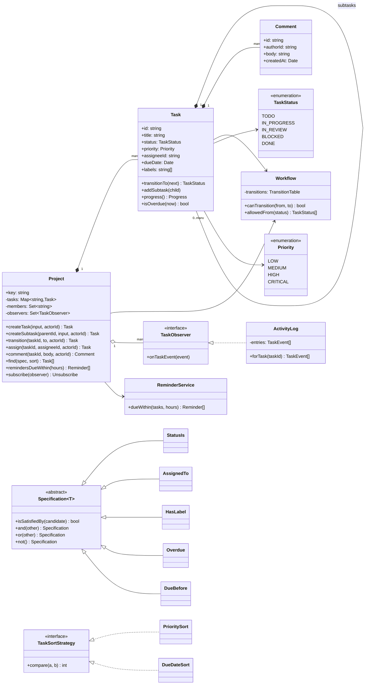
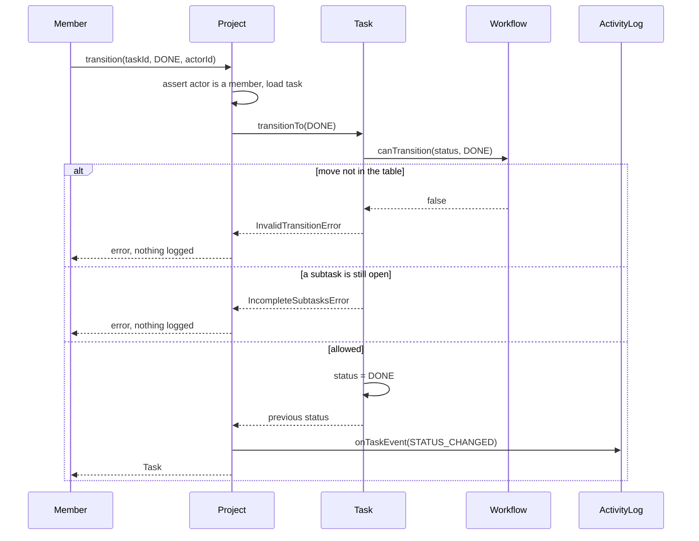
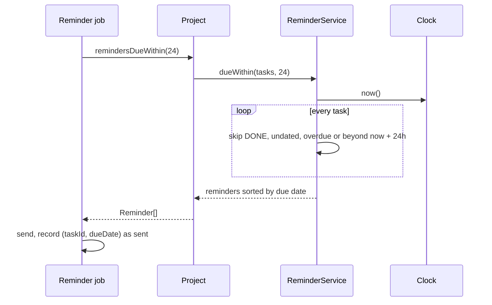

# Design a Task Management System (Jira-lite)

| | |
|---|---|
| **Difficulty** | Medium |
| **Solution** | [`src/task-management-system/`](../src/task-management-system/) |
| **Run** | `npm run demo -- task-management-system` · `npx vitest run src/task-management-system` |
| **Patterns** | State machine (table-driven State), Composite, Observer, Specification, Strategy |

## 1. Problem statement

Design the core of a Jira-like tracker. Members of a project create tasks with a priority, an assignee, labels and a due date, discuss them in comments, split them into subtasks and move them through a workflow. The board must answer "what is overdue?" and "what is due in the next day?", and every change must be auditable.

## 2. Clarifying questions to ask first

- Is the workflow fixed, or can each project define its own statuses and transitions?
- Can subtasks have subtasks? Is a parent's progress its own status or derived from the children?
- Can a parent be closed while a subtask is still open?
- Who may change a task: any project member, only the assignee, or role based?
- Is a finished task ever "overdue"? Are due dates instants or calendar days in a time zone?
- Are reminders pushed by a timer per task, or computed by a periodic job?
- Do we need a full history of who changed what and when, or only the current state?

Assumptions used in the solution: one default workflow (TODO, IN_PROGRESS, IN_REVIEW, BLOCKED, DONE, plus reopen) that a project can replace with its own transition table; subtasks nest to any depth and progress counts finished leaf tasks; a parent cannot be DONE while a subtask is open, and the subtasks of a DONE parent are frozen; any member may act (no roles); due dates are UTC instants and DONE tasks are never overdue; reminders are computed on demand.

## 3. Requirements

### Functional
1. Members create tasks with a title, priority, optional assignee, labels and due date; ids are project scoped (`PAY-1`).
2. Tasks move through a workflow defined by an explicit transition table; any move not in the table is rejected.
3. Tasks can have subtasks to any depth; a parent's progress is derived from its leaves, and a parent cannot be DONE while a subtask is open.
4. Members comment on tasks; only members may act on or be assigned to tasks.
5. Every successful change appends one activity entry (type, actor, time, detail); a failed command appends nothing.
6. Tasks can be filtered by status, assignee, label, overdue (as of the clock) and due-before, and filters combine with and/or/not.
7. Lists can be sorted by priority or by due date.
8. The system lists open tasks due within the next N hours (reminders).

### Non-functional
- Workflows, filters and sort orders change without editing the core classes.
- Derived values (progress, overdue) are computed, never stored, so they cannot go stale.
- Deterministic and testable: time and ids are injected and there are no timers.

## 4. Core entities

| Entity | Responsibility |
|---|---|
| `Project` | Aggregate root: members, the task registry, the only entry point for changes; publishes one event per change. |
| `Task` | Status, priority, assignee, labels, due date and comments; a Composite node whose `progress()` is derived from its subtasks. |
| `Workflow` + `TaskStatus` | The state machine as data: `canTransition(from, to)` reads the transition table. |
| `Comment` | Immutable value: author, body, time. |
| `TaskObserver` → `ActivityLog` | Observer interface; the append-only audit trail is one subscriber. |
| `Specification<Task>` → `StatusIs`, `AssignedTo`, `HasLabel`, `Overdue`, `DueBefore` | Composable filters. |
| `TaskSortStrategy` → `PrioritySort`, `DueDateSort` | Sort policy for board views. |
| `ReminderService` | "Due within N hours" computed from the clock on demand. |

## 5. Class diagram

## 6. Key flows

## 7. Design patterns used

- **State machine (table-driven State).** The legal moves live in one `TransitionTable`, and `Task.transitionTo()` consults it before changing anything. Workflows are the part of a tracker that every team wants to customise, so they are data: a team without code review passes a different table. The alternative is the classic State pattern (`TodoState`, `InReviewState` classes with `start()`, `approve()` methods); it shines when each state has different behaviour (entry actions, guards), but adding a status becomes a code change.
- **Composite.** A `Task` is both a leaf and a container. `progress()` recurses into subtasks and counts finished leaves, so a parent's progress is always consistent with its children. Alternative: store `doneLeaves/totalLeaves` on the parent and update it on every child change; reads become O(1) but every write must update the ancestors in the same transaction or the number drifts.
- **Observer.** `Project` publishes one `TaskEvent` per successful change; `ActivityLog` is just one `TaskObserver`. Notifications, webhooks or a search indexer are new subscribers, not edits to `Project`. Alternative: event sourcing, where the event list *is* the source of truth and the task state is a projection of it.
- **Specification.** Each filter answers one question and filters compose (`new HasLabel('backend').and(new StatusIs(DONE).not())`). `Overdue` reads the injected clock at evaluation time, so a saved filter means "overdue now". Alternative: a query object with optional fields (`{ status, assignee, label }`); simpler, but it cannot express OR and NOT without growing a mini language anyway.
- **Strategy.** `PrioritySort` and `DueDateSort` implement `TaskSortStrategy`; a board view picks one. In TypeScript a plain comparator function is an equally valid Strategy.

## 8. Trade-offs, extensions and follow-up questions

**"Two people move the same task at the same time."** In-process the transition is synchronous, so it is atomic. Once `transition()` awaits a database read, two requests can both see `IN_REVIEW`. The guard is a compare-and-set on the source status: `UPDATE tasks SET status = 'DONE', version = version + 1 WHERE id = ? AND status = 'IN_REVIEW' AND version = ?`, then check that exactly one row changed. The "parent cannot be DONE with open subtasks" rule spans rows, so close the parent inside a transaction that locks it (`SELECT ... FOR UPDATE`) or bumps a version on the parent whenever a child changes.

**"An epic has 5,000 subtasks; progress is slow."** `progress()` is O(subtree). Cache `doneLeaves/totalLeaves` per task and update the ancestors when a leaf changes status (a recursive CTE finds them), or compute progress asynchronously from the event stream.

**"Filters on a million tasks."** Translate each Specification to a SQL predicate (`toSql()` next to `isSatisfiedBy()`), with indexes on `(project_key, status)`, `(assignee_id)`, `(due_at)` and a `task_labels(label, task_id)` table.

**"Reminders must not be sent twice."** The job is idempotent if it records `reminders_sent(task_id, due_at)` with a unique key; changing the due date produces a new key and therefore a new reminder.

**"Only the assignee may send a task to review" / "custom workflow per issue type".** Add transition guards (a list of `TransitionGuard` policies checked before the table) and keep one `Workflow` per issue type.

**Persistence sketch.** `projects(key, name)`, `project_members(project_key, user_id)`, `tasks(id, project_key, parent_id NULL, title, status, priority, assignee_id NULL, due_at NULL, version)`, `task_labels(task_id, label)`, `comments(id, task_id, author_id, body, created_at)`, `activity(id, task_id, actor_id, type, detail, at)` (append-only), and `workflow_transitions(project_key, from_status, to_status)` for custom tables.

## 9. What a strong interview answer sounds like

1. Clarify the workflow, subtask and reminder questions; state the assumptions (customisable table, leaf-based progress, no roles).
2. Name the entities and the invariants that matter: only legal transitions, no DONE parent with open children, one log entry per successful change.
3. Draw the class diagram: the workflow as a table, Task as a Composite, filters as Specifications, sorting as a Strategy, the log as an Observer.
4. Walk the transition sequence including both failure branches, then the on-demand reminder query.
5. Close with concurrency (compare-and-set on the source status), caching progress for big epics, SQL translation of filters, and idempotent reminders. Mention that time and ids are injected so overdue and reminders are testable.
