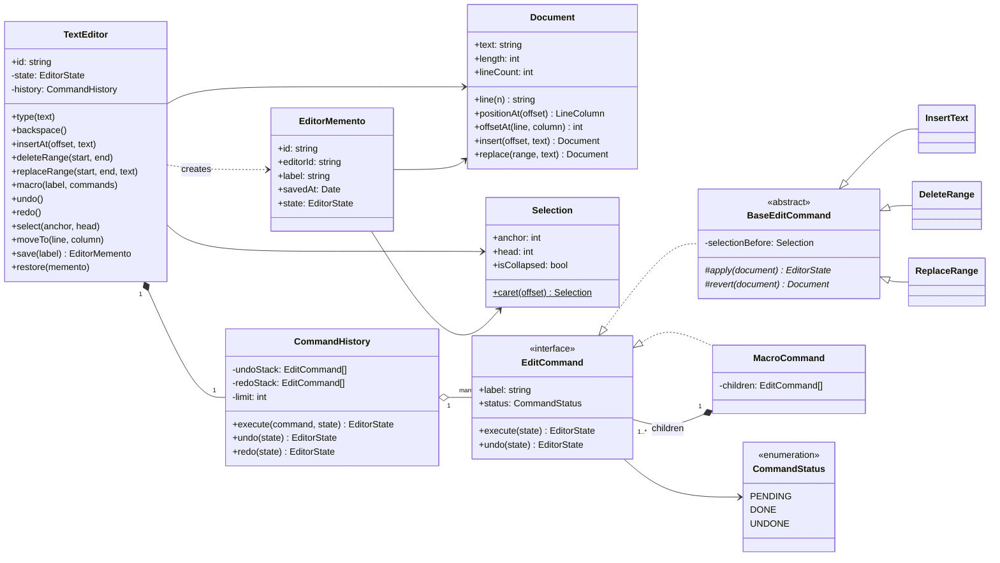
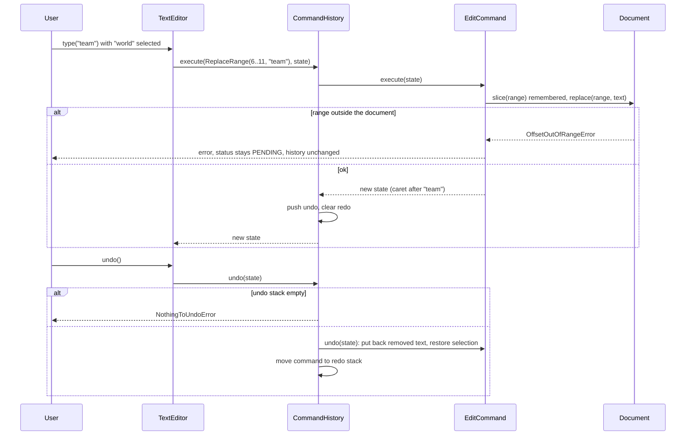
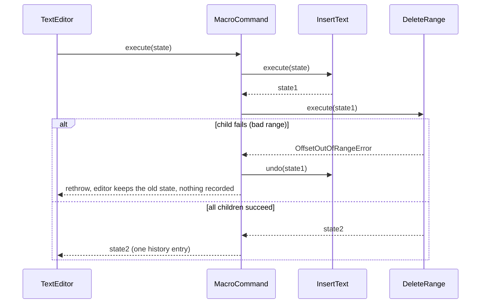

# Design a Text Editor with Undo and Redo

| | |
|---|---|
| **Difficulty** | Medium |
| **Solution** | [`src/text-editor/`](../src/text-editor/) |
| **Run** | `npm run demo -- text-editor` · `npx vitest run src/text-editor` |
| **Patterns** | Command, Composite (macros), Memento (save points), Template Method |

## 1. Problem statement

Design the core of a text editor: a document, a cursor with an optional selection, and edits (insert, delete, replace) that can be undone and redone in order. Several edits can be grouped into a macro that undoes as one step, and the user can create save points and return to them.

## 2. Clarifying questions to ask first

- Which operations are in scope: insert, delete, replace, find-and-replace, formatting?
- Is undo unlimited, or bounded by depth or memory?
- Should cursor movement and selection changes be undoable, or only text changes?
- What happens to redo after a new edit: cleared (linear history) or kept as a branch (undo tree)?
- Should consecutive keystrokes coalesce into one undo step?
- Single user, or collaborative editing with several cursors?
- Are save points "save to disk" or in-memory checkpoints? Can restoring be undone?

Assumptions used in the solution: plain text, single user, one cursor with a selection (anchor and head), linear history with a configurable depth (200 by default), redo cleared on every new edit, only text changes are undoable, no keystroke coalescing (section 8 sketches it), save points are in-memory and restoring one is itself undoable.

## 3. Requirements

### Functional
1. The document exposes its text, length, line count, the text of a line, and conversions between offsets and 1-based line/column.
2. The editor keeps a caret and a selection; typing replaces a non-empty selection, otherwise inserts at the caret; backspace deletes the selection or the previous character.
3. Edits are InsertText, DeleteRange and ReplaceRange; each can be undone and redone, restoring the text and the selection exactly.
4. Undo and redo follow stack order; a new edit clears the redo stack.
5. A macro groups several edits; it executes all-or-nothing and undoes as one step.
6. The user can save a snapshot and restore it later; restoring is an undoable edit, and the editor reports whether the text differs from the last save point.
7. Out-of-range offsets, inverted ranges, bad lines or columns, empty history and foreign snapshots fail with domain errors and leave the state unchanged.

### Non-functional
- Undo must be exact: a command records what it removed, it does not guess.
- Snapshots are cheap: documents are immutable values, so a snapshot is a reference.
- Deterministic and testable: clock and id generator are injected.
- Memory is bounded by the history limit; the oldest entries are dropped first.

## 4. Core entities

| Entity | Responsibility |
|---|---|
| `Document` | Immutable text value; line index; offset and range validation; insert, delete and replace return new documents. |
| `Selection` | Anchor and head offsets; caret when collapsed; start, end and range. |
| `EditCommand` (interface) | `execute(state)` and `undo(state)` over an `EditorState` (document + selection). |
| `BaseEditCommand` → `InsertText`, `DeleteRange`, `ReplaceRange` | Status bookkeeping and selection restore; subclasses only change text. |
| `MacroCommand` | Composite of commands, atomic execute, reverse-order undo. |
| `CommandStatus` | PENDING, DONE, UNDONE with validated transitions. |
| `CommandHistory` | Undo and redo stacks, depth limit, redo cleared on a new edit. |
| `EditorMemento` | Save point: id, label, timestamp, the editor state it captured. |
| `TextEditor` | Aggregate root: typing, cursor, selection, macros, undo, redo, save, restore. |

## 5. Class diagram

## 6. Key flows

## 7. Design patterns used

- **Command** for every edit. The history only knows `execute` and `undo`, so new edits (indent, sort lines, find-and-replace) plug in without touching it. Each command stores exactly what it needs to revert (the removed text), which keeps memory proportional to the change, not the document. Alternative: snapshot the whole document before every edit; trivial to implement and fine for small texts, but O(document) memory per keystroke.
- **Composite** for macros. `MacroCommand` implements `EditCommand`, so the history stores it as one entry and undo is atomic. It also gives transactional execute: on a failing child it undoes the applied children.
- **Memento** for save points. Because `Document` and `Selection` are immutable, a memento is just a reference plus metadata; the editor checks `editorId` so a snapshot from another buffer is refused. Restoring goes through a `ReplaceRange` command so it stays undoable instead of wiping the history.
- **Template Method** in `BaseEditCommand`: status transitions and selection restore are written once; subclasses implement `apply` and `revert`.
- **State** (light) for `CommandStatus`: PENDING -> DONE -> UNDONE -> DONE. Executing twice or undoing an unexecuted command throws, which catches history bugs early.

## 8. Trade-offs, extensions and follow-up questions

**"Typing one word creates five undo steps."** Coalesce: when a new `InsertText` starts where the previous one ended and arrives within a short interval (measured with the injected `Clock`), merge it into the top of the undo stack instead of pushing. Break the group on cursor moves, deletions or whitespace.

**"The document is 50 MB."** Replace the string with a piece table or rope; `Document` keeps the same API, and commands still store only the removed text. The line index becomes incremental (a balanced tree of line lengths) instead of a rebuild per edit.

**"Keep redo branches instead of clearing them."** An undo tree: each node is a command with children; undo moves to the parent, redo picks a child (most recent by default). The linear stack is the special case with one child.

**"Two people edit the same document."** Commands with absolute offsets break when a remote edit shifts the text. Use operational transformation (transform an incoming insert against concurrent local ones) or a CRDT (positions are stable ids, not offsets). Undo then becomes "undo my own operations", transformed against everyone else's.

**"Persist the document and its history."** On the server, a `documents(id, text, version)` row is updated with `UPDATE documents SET text = ?, version = version + 1 WHERE id = ? AND version = ?`; zero rows changed means someone else saved first and the client must rebase. An `operations(document_id, seq, kind, offset, text, removed, client_op_id)` log with a unique `(document_id, seq)` keeps ordering, and a unique `client_op_id` (idempotency key) stops a retried request from applying the same keystroke twice. Save points are rows `snapshots(id, document_id, label, version, saved_at)` pointing at a version, so restore is "replace with the text at version N" as a new operation.

**"Bound memory for undo."** The history limit drops the oldest entries; a byte budget (sum of inserted and removed text) is a better measure for large pastes.

## 9. What a strong interview answer sounds like

1. Clarify scope: which edits, linear or tree history, coalescing, collaboration, whether restore is undoable.
2. Model the document as an immutable value with a line index, and the cursor as a selection (anchor and head).
3. Make every edit a Command that records what it removed; show the two stacks and why a new edit clears redo.
4. Add Composite for macros (one undo step, all-or-nothing execute) and Memento for save points (cheap because documents are immutable).
5. Discuss scaling (piece table, coalescing) and collaboration (OT or CRDT, version column, operation log with idempotency keys).
