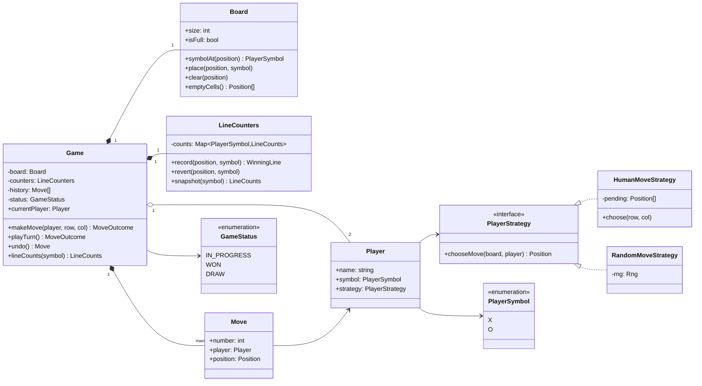
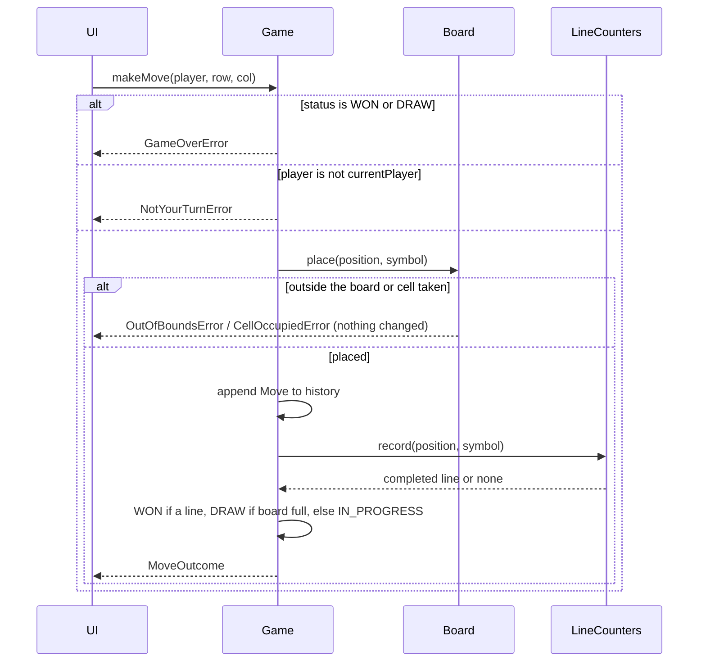
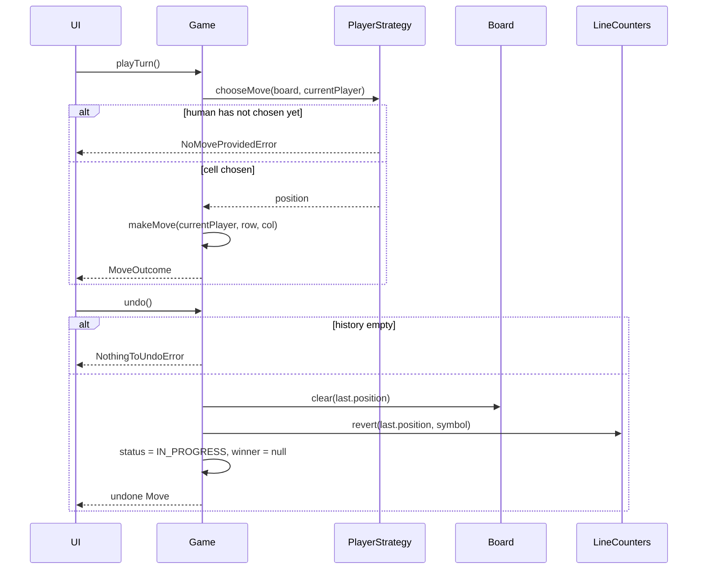

# Design Tic-Tac-Toe

| | |
|---|---|
| **Difficulty** | Easy |
| **Solution** | [`src/tic-tac-toe/`](../src/tic-tac-toe/) |
| **Run** | `npm run demo -- tic-tac-toe` · `npx vitest run src/tic-tac-toe` |
| **Patterns** | Strategy, Command-style move history (undo), enum state machine |

## 1. Problem statement

Design a tic-tac-toe game for two players on an N x N board (3 x 3 by default). Players alternate placing their symbol; the first to fill a whole row, column or diagonal wins, and a full board without a line is a draw. Moves can be taken back, and a seat can be played by a human or by a bot.

## 2. Clarifying questions to ask first

Ask these before drawing anything. The answers decide the model.

- Is the board always 3 x 3, or N x N? Does a win need a full line, or K in a row (Gomoku style)?
- Exactly two players? Who moves first?
- Do we need computer players? How smart: random, or unbeatable (minimax)?
- Is undo needed? One step or unlimited? Also after the game has ended?
- Should we declare a draw early, when no line can be completed any more, or only on a full board?
- Is this local only, or two people playing online (which brings concurrency and persistence)?

Assumptions used in the solution: N x N with N >= 3 and a win needs a full line; two players X and O, the first constructor argument moves first; unlimited undo, including taking back a winning move; a draw only on a full board; bots are a pluggable strategy (a random one with an injected rng ships today).

## 3. Requirements

### Functional
1. The board is N x N (default 3). Players alternate placing their own symbol on an empty cell.
2. A move is rejected, without changing anything, when the game is over, it is not the player's turn, the cell is outside the board or already taken.
3. After every move the game detects a win (row, column, either diagonal) or a draw (full board).
4. Status follows IN_PROGRESS -> WON or DRAW; only undo goes back to IN_PROGRESS.
5. Any number of moves can be undone, restoring board, win counters, turn and status.
6. Each player is driven by a swappable strategy: explicit human input or a bot.

### Non-functional
- Win detection is O(1) per move with O(N) memory, not an O(N^2) board rescan.
- Deterministic and testable: bots take an injected random source.
- A UI only needs `makeMove`, `playTurn`, `undo` and read-only getters.

## 4. Core entities

| Entity | Responsibility |
|---|---|
| `Player` | Name, `PlayerSymbol` (X or O) and the `PlayerStrategy` that picks its cells. |
| `Board` | N x N cells; refuses out-of-bounds and occupied cells; lists empty cells. |
| `LineCounters` | Per-symbol counters for every row, column and diagonal; reports the line a move completed; reversible. |
| `Move` / `MoveOutcome` | History record of one move / what the move caused (status, winner, line). |
| `PlayerStrategy` → `HumanMoveStrategy`, `RandomMoveStrategy` | Policy for choosing the next cell. |
| `Game` | Aggregate root: turn order, status machine, history, `makeMove()`, `playTurn()`, `undo()`. |

## 5. Class diagram

## 6. Key flows

## 7. Design patterns used

- **Strategy** for `PlayerStrategy`. Game asks the current seat for a cell and validates the answer like any other move, so a human, a random bot and a future minimax bot are interchangeable. The alternative, `HumanPlayer` / `BotPlayer` subclasses, welds identity to behaviour; with a strategy a seat can switch to a bot mid-game (a "hint" button or a timeout).
- **Command-style history** for undo. Each `Move` is enough to reverse itself: clear one cell and decrement at most four counters, O(1). The alternative is a **Memento** of the whole board per move, which costs O(N^2) memory per move and buys nothing here because every move is trivially invertible.
- **State machine as a string enum.** Three states with one rule ("only IN_PROGRESS accepts moves") do not justify the GoF State pattern's one class per state; a guarded enum keeps every transition in two methods (`makeMove`, `undo`). Reach for State classes once states start to behave very differently (paused, timed out, awaiting rematch).
- **Incremental counters** are the algorithmic core: instead of scanning the board after each move, keep 2N + 2 counters per symbol. A common alternative is one counter per line with X = +1 and O = -1 (win at +N or -N): half the memory, but it only works for exactly two players.

## 8. Trade-offs, extensions and follow-up questions

**"Win with K in a row on a 15 x 15 board (Gomoku)."** Full-line counters no longer apply. From the last move, walk the four directions (horizontal, vertical, two diagonals) and count consecutive equal symbols: O(K) per move, still no full scan. That check becomes a `WinRule` strategy next to the counters.

**"Make the bot unbeatable."** A `MinimaxStrategy` (with alpha-beta pruning) implementing `PlayerStrategy`. It explores by playing and undoing moves on a scratch game, which is exactly why cheap O(1) undo matters. For 3 x 3 the whole tree is small; for larger boards add depth limits and a heuristic.

**"Three or more players."** Counters are already per symbol, so only `PlayerSymbol`, the constructor and `currentPlayer` (`history.length % players.length`) change.

**"Declare a draw as soon as nobody can win."** A line is dead once it holds two different symbols. Track the number of live lines (start at 2N + 2) and decrement when a line dies; draw when it hits zero. Undo must revive lines, so store the transition on the `Move`.

**"Two people play online; both click at once."** Each move carries the move number the client saw. The server accepts it only if it is still the next number: in-process that is the turn check, in a database `UPDATE games SET move_count = move_count + 1 WHERE id = ? AND move_count = ?` and checking one row changed (optimistic locking). The loser of the race refreshes and sees `NotYourTurnError`.

**Persistence sketch.** `games(id, size, status, winner_symbol, move_count)`, `moves(game_id, number, symbol, row, col)` with primary key `(game_id, number)`, so two moves with the same number cannot both be stored. Loading a game replays its moves into `Board` and `LineCounters`; undo deletes the last move row and decrements `move_count` in the same transaction.

## 9. What a strong interview answer sounds like

1. Clarify board size, win rule, players, bots and undo in two minutes; state the assumptions.
2. Split responsibilities: `Board` guards cells, `Game` owns turns, status and history, `Player` delegates to a `PlayerStrategy`.
3. Explain O(1) win detection with per-line counters and why undo simply decrements them.
4. Walk `makeMove` with its failure order (game over, wrong turn, out of bounds, occupied) and show that a rejected move changes nothing.
5. Close with extensions: minimax as a new strategy, K in a row, early draws, and online play guarded by a move-number compare-and-set.
