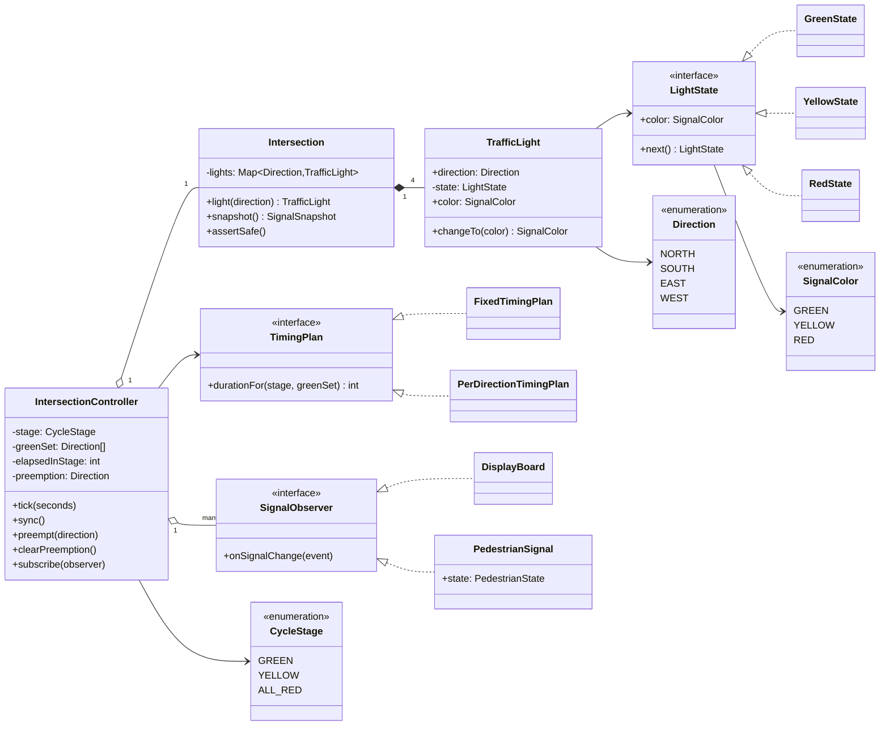
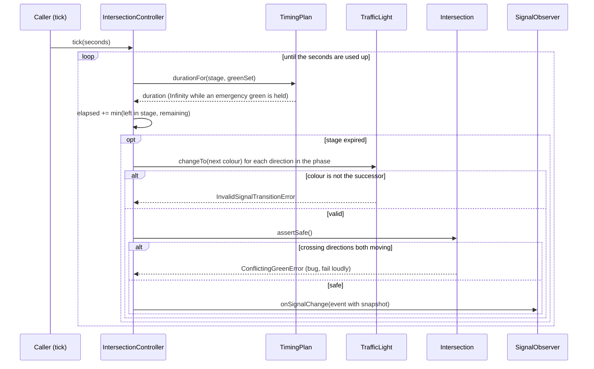
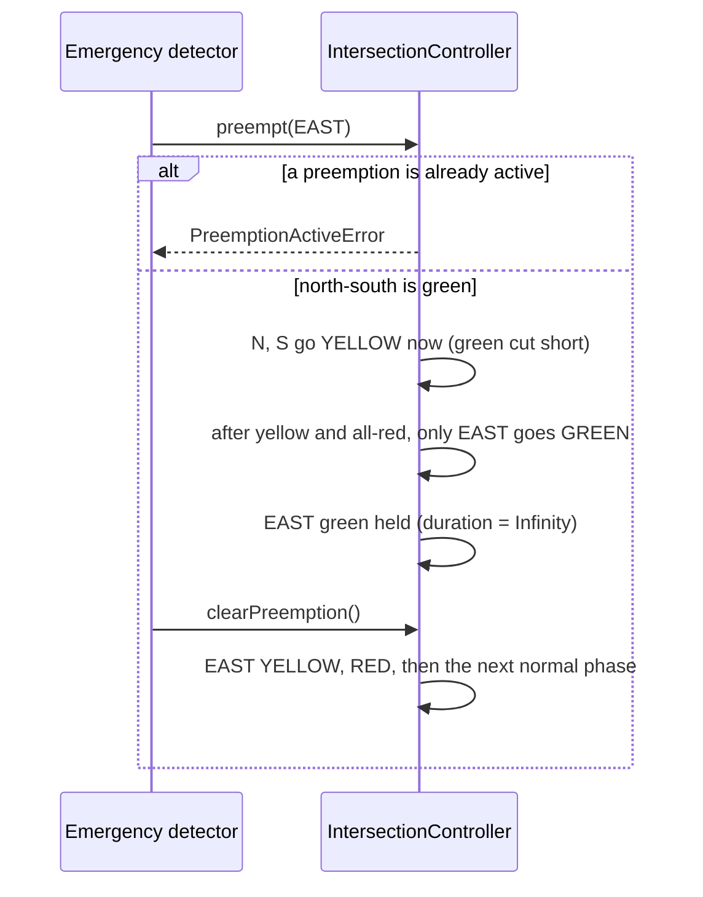

# Design a Traffic Signal Control System

| | |
|---|---|
| **Difficulty** | Medium |
| **Solution** | [`src/traffic-signal-control/`](../src/traffic-signal-control/) |
| **Run** | `npm run demo -- traffic-signal-control` · `npx vitest run src/traffic-signal-control` |
| **Patterns** | State, Strategy, Observer |

## 1. Problem statement

Design the controller for a four-way intersection. Each approach (north, south, east, west) has a signal that cycles green, yellow and red; the controller decides which approaches move, for how long, and must never let crossing traffic move at the same time. Emergency vehicles can preempt the cycle, and display boards and pedestrian signals follow every change.

## 2. Clarifying questions to ask first

- How many approaches, and which ones may move together? (Are there protected left turns?)
- Fixed timings, or per-approach timings for a busy main road? Do timings change by time of day?
- Is there an all-red clearance interval between phases?
- What exactly does emergency preemption do: cut the current green, hold a green, or both? Can two emergencies overlap?
- Who else needs to know about changes: pedestrian signals, display boards, a central traffic system?
- How is time modelled? (In an interview, say "explicit ticks" so the design is testable.)

Assumptions used in the solution: four approaches, two phases (north-south together, east-west together), stage durations from a pluggable timing plan, a configurable all-red clearance, one preemption at a time that serves only the emergency direction, and time advanced by explicit `tick(seconds)` calls or `sync()` against an injected `Clock`.

## 3. Requirements

### Functional
1. Each `TrafficLight` cycles GREEN → YELLOW → RED → GREEN; any other transition throws `InvalidSignalTransitionError`.
2. The controller runs phases in order: GREEN for the phase's directions, then YELLOW, then an ALL_RED clearance, then the next phase.
3. Durations of each stage come from a `TimingPlan` (fixed, or per direction).
4. Conflicting directions (north-south vs. east-west) are never both non-red; the check runs after every single light change.
5. `preempt(direction)` cuts a conflicting green short (yellow and clearance are still shown), then gives that direction alone a green and holds it until `clearPreemption()`.
6. Only one preemption may be active; a second request throws `PreemptionActiveError`.
7. Observers (display boards, pedestrian signals) are notified of every light change with a snapshot of all lights.

### Non-functional
- Safety over throughput: yellow is never skipped, and the invariant is checked, not assumed.
- Deterministic: no timers; one big tick behaves exactly like many small ones.
- Timing policies and observers can be added without touching the controller.

## 4. Core entities

| Entity | Responsibility |
|---|---|
| `TrafficLight` | One signal head. Holds a `LightState`; only moves to the state's successor. |
| `LightState` → `GreenState`, `YellowState`, `RedState` | State pattern: each colour knows its one legal successor. |
| `Intersection` | The four lights and the conflict rule; `assertSafe()` enforces the invariant. |
| `IntersectionController` | Cycle stages, phase order, preemption, observers; advanced by `tick()` / `sync()`. |
| `TimingPlan` → `FixedTimingPlan`, `PerDirectionTimingPlan` | Strategy for stage durations. |
| `SignalObserver` → `DisplayBoard`, `PedestrianSignal` | React to light changes. |
| `Direction`, `SignalColor`, `CycleStage` | Enumerations. |

## 5. Class diagram

## 6. Key flows

## 7. Design patterns used

- **State** for each signal head. `GreenState.next()` is yellow, and that is the only move it allows, so "green straight to red" is impossible by construction rather than by a check in the controller. Alternative: a transition table keyed by enum (what the vending machine uses); with three states and one successor each, state objects read more naturally.
- **Strategy** for timings. A main road needs longer greens; rush hour plans or sensor-actuated plans are further implementations. The controller only asks "how long is this stage for these directions?".
- **Observer** for display boards, pedestrian signals and anything else (a central traffic management feed). Each event carries a full snapshot so a pedestrian signal can decide WALK without tracking history.
- **Explicit time.** No timers in the domain. `tick(seconds)` consumes time stage by stage, so `tick(250)` equals 250 calls to `tick(1)`, which is tested. `sync()` bridges to the injected `Clock`.

## 8. Trade-offs, extensions and follow-up questions

**The safety invariant.** Phases are validated at construction (no conflicting directions in one phase), lights cannot skip yellow, and `assertSafe()` runs after every single change. A randomized-but-seeded test runs 2,000 seconds with random emergencies and checks the invariant every second. In a real controller this is the "conflict monitor": independent hardware that forces flashing red if it ever sees conflicting greens.

**Concurrency.** One controller per intersection is the single writer; that is the design, not a limitation. Emergency requests and timing-plan changes arrive as commands on its queue. If a central system pushes plans to many controllers, use a version number per plan (`UPDATE intersections SET plan_id = ?, plan_version = plan_version + 1 WHERE id = ? AND plan_version = ?`) and have controllers switch plans only at a cycle boundary. Preemption requests carry an idempotency key (the vehicle's request id) so a retried radio message does not start a second preemption.

**"Protected left turns."** Add directions such as `NORTH_LEFT` and a conflict matrix instead of the axis rule; phases become sets like `[NORTH, NORTH_LEFT]`. The controller does not change.

**"Sensor-actuated signals."** A `TimingPlan` that extends green while a loop detector reports cars, up to a maximum; the sensor is another input to the controller.

**"Coordinate a corridor of signals (green wave)."** Each controller gets an offset relative to a shared cycle start; that is configuration on top of the same tick model.

**"Power failure."** Lights power on RED (the constructor does this); the controller starts a fresh cycle. Real controllers flash red until the conflict monitor clears.

**Persistence sketch.** `intersections(id, name, plan_id, plan_version)`, `timing_plans(id, version, json)`, `signal_events(intersection_id, direction, from_color, to_color, at, preempted_for)` as an append-only log for audit, and `preemptions(id, intersection_id, direction, requested_at, cleared_at, request_key UNIQUE)`.

## 9. What a strong interview answer sounds like

1. Clarify approaches, phases, clearance interval, preemption semantics and how time is modelled; state the assumptions.
2. Name the invariant first: crossing directions never move together, and yellow is never skipped.
3. Draw the light State pattern, the controller with its stages, and the timing Strategy; explain why explicit ticks beat timers for testing.
4. Walk a normal cycle and an emergency preemption, including the rejected second preemption.
5. Close with the conflict monitor, single-writer concurrency, plan versioning and extensions such as left turns or actuated timing.
