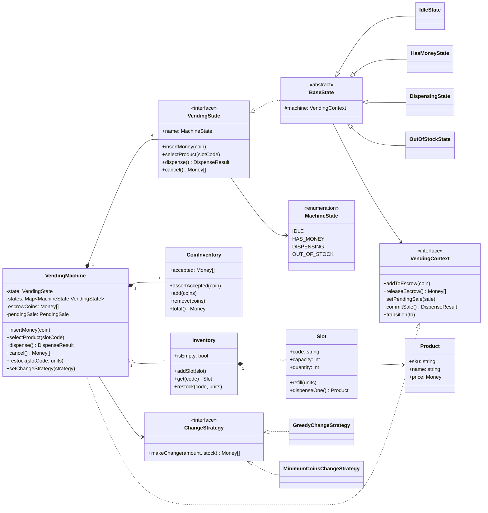
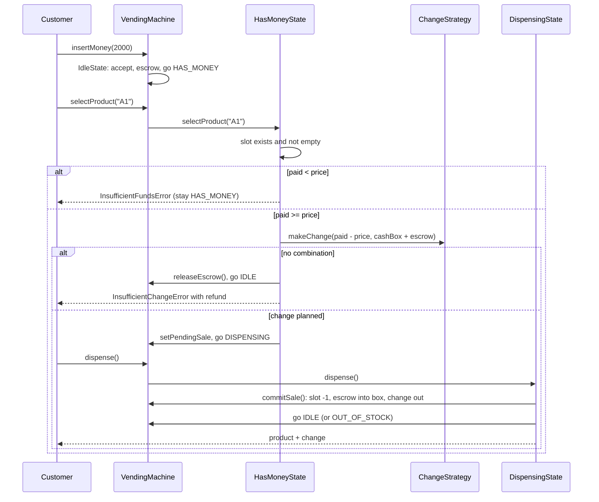

# Design a Vending Machine

| | |
|---|---|
| **Difficulty** | Medium |
| **Solution** | [`src/vending-machine/`](../src/vending-machine/) |
| **Run** | `npm run demo -- vending-machine` · `npx vitest run src/vending-machine` |
| **Patterns** | State, Strategy |

## 1. Problem statement

Design the software for a coin-and-note vending machine. A customer inserts money, picks a product by slot code, receives the product and any change, or cancels and gets their money back. The machine must never give away a product it was not paid for, and never keep money for a product it could not deliver.

## 2. Clarifying questions to ask first

- Which denominations are accepted? Coins only, or notes too?
- Does the machine have a limited coin stock for change? What happens when it cannot make change?
- Can the customer insert more money after an "insufficient funds" message, or does the machine refund?
- One product per transaction, or a basket?
- Who restocks, and can they do it while a customer is mid-transaction?
- Do we need a sales log or remote telemetry?

Assumptions used in the solution: denominations Rs 1, 2, 5, 10, 20 and 50 (stored in paise), a finite cash box, one product per transaction, inserted coins stay in escrow until the sale commits, an operator restocks only when no customer is mid-transaction, and the change policy is swappable (greedy by default).

## 3. Requirements

### Functional
1. The machine holds products in slots (A1, A2, ...) with a price, a quantity and a capacity.
2. A customer inserts accepted denominations; anything else is rejected.
3. Selecting a product checks, in order: slot exists, slot not empty, enough money inserted, change can be made.
4. If change cannot be made, the inserted coins are refunded and the machine returns to idle.
5. Dispensing hands out the product and the change, moves the inserted coins into the cash box and records a sale.
6. Cancel before dispensing refunds exactly the inserted coins.
7. When every slot is empty the machine refuses customers until restocked.
8. Every action not valid in the current state throws a domain error.

### Non-functional
- Atomicity: a failed selection changes neither stock nor cash.
- Money is integer minor units; change is an exact multiset of coins.
- The change algorithm and accepted denominations are configuration, not code.
- Deterministic tests: clock and ids injected.

## 4. Core entities

| Entity | Responsibility |
|---|---|
| `VendingMachine` | Context of the State pattern. Owns escrow, pending sale and sales log; delegates every action to the current state. |
| `VendingState` → `IdleState`, `HasMoneyState`, `DispensingState`, `OutOfStockState` | What each action means in each state. `BaseState` rejects everything by default. |
| `MachineState` + transition table | The legal transitions, checked on every state change. |
| `Inventory`, `Slot`, `Product` | Product stock. `Slot` guards its own count and capacity. |
| `CoinInventory` | The cash box: counts per accepted denomination. |
| `ChangeStrategy` → `GreedyChangeStrategy`, `MinimumCoinsChangeStrategy` | How to pay out change from a bounded coin stock. |
| `Sale`, `DispenseResult` | What was sold, paid and returned. |

## 5. Class diagram

(In the code the machine builds a private `VendingContext` object rather than implementing the interface publicly, so customers cannot call `commitSale()` directly.)

## 6. Key flows

## 7. Design patterns used

- **State.** The same four buttons mean different things depending on whether money is inserted or a sale is committed. One class per state keeps each meaning in one place, and `BaseState` makes "not allowed here" the default, so a new action is safe until a state opts in. Alternative: a `switch (status)` in every method of the machine; fine for two states, unreadable for four, and every new action touches every case.
- **Transition table** next to the states. States request a transition; the machine validates it against `ALLOWED`. This catches bugs where a state jumps somewhere illegal, and it is the table you would draw on the whiteboard.
- **Strategy** for change-making. Greedy is what most machines do and is optimal for canonical coin systems with unlimited stock; with a bounded stock it fails on cases like 600 from {500 x1, 200 x3}. `MinimumCoinsChangeStrategy` (bounded DP) finds a solution whenever one exists. Alternative: hard-code greedy and accept more refunds.
- **Narrow context interface.** States receive a `VendingContext`, not the machine, so they cannot skip the transition check or write the sales log directly.

## 8. Trade-offs, extensions and follow-up questions

**Escrow vs. cash box.** Inserted coins are kept separately until `dispense()`. Change is planned from cash box plus escrow (pay 10 + 5 + 5 for a 15 item and get one of your own 5s back), but nothing moves until the sale commits. That is what makes a failed selection atomic.

**"Two customers on a networked machine / remote purchase via app."** Real concurrency appears when the selection comes from an app while someone stands at the keypad. The guard is a compare-and-set on the machine state: `UPDATE machines SET state = 'DISPENSING', version = version + 1 WHERE id = ? AND state = 'HAS_MONEY' AND version = ?`. The loser sees zero rows changed and gets `InvalidActionError`. Stock uses `UPDATE slots SET quantity = quantity - 1 WHERE code = ? AND quantity > 0`.

**"Payment by card or UPI."** A `PaymentMethod` strategy; card payments have no change, so `HasMoneyState` becomes "Authorised" and the capture happens at dispense. Use an idempotency key per sale so a retried capture does not charge twice.

**"The motor jams after payment."** Add a `FAULT` state reachable from `DISPENSING`; `commitSale` must then refund instead of keeping the cash. In the database, record the sale with status `PENDING` before dispensing and `COMPLETED` after, so a crash leaves an auditable row.

**"Prefer giving out coins we have too many of."** A different `ChangeStrategy` that weights coins by stock level.

**Persistence sketch.** `slots(machine_id, code, sku, price, quantity, capacity)`, `cash_box(machine_id, denomination, count)`, `sales(id, machine_id, slot_code, price, paid, change_json, status, created_at)`, `machines(id, state, version)`. Unique `(machine_id, code)` on slots; the sale id doubles as the idempotency key for telemetry upload.

## 9. What a strong interview answer sounds like

1. Clarify denominations, finite change stock and what happens when change cannot be made; state the assumptions.
2. Draw the four states and the transition table before any classes; name the invariant (no product without payment, no money kept without product).
3. Show the State pattern with a default-reject base class, and the escrow vs. cash box split that makes selection atomic.
4. Walk the purchase sequence including insufficient funds, out of stock and insufficient change with refund.
5. Close with the change Strategy (greedy vs. bounded DP and the counterexample), concurrency for remote purchases, and card payments with idempotency keys.
